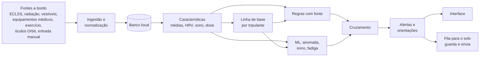

# Arquitetura do software

Texto completo: `docs/05-software-architecture.md` no repositório.

## Princípios

| # | Princípio | Por quê |
| --- | --- | --- |
| P1 | Offline-first: tudo roda dentro da estação | Marte tem minutos de atraso por trecho e dias sem contato; a ISS tem perdas de sinal |
| P2 | O astronauta é o primeiro usuário | O desafio pede autoavaliação e ação da própria tripulação |
| P3 | Cada pessoa contra a própria linha de base | O desvio pessoal aparece antes de sair da faixa populacional |
| P4 | Todo limiar tem fonte | Limiar inventado em software de saúde é defeito grave |
| P5 | Não substitui o alarme da estação nem o médico | Responsabilidade clínica e de segurança é da NASA |
| P6 | Explicável: evidência, regra e fonte em todo alerta | Confiança e auditoria |
| P7 | Privacidade por perfil | Dados médicos de astronautas são protegidos |
| P8 | Unidades canônicas com o valor original guardado | Segmentos americano e russo usam unidades diferentes |

## Fluxo

## Níveis de alerta

| Nível | Cor | Quem age |
| --- | --- | --- |
| 0 | Cinza, sem dado | Lembrete de medir |
| 1 | Verde | Ninguém |
| 2 | Amarelo | O próprio astronauta, com orientação e nova medição agendada |
| 3 | Vermelho | Crew Medical Officer e médico de voo (resumo na fila para o solo; em Marte, protocolo autônomo) |
| 4 | Vermelho piscando | Toda a tripulação, pelo procedimento de emergência da estação |

## Protótipo de 20 horas

React + Vite + TypeScript no navegador, sem servidor; IndexedDB para dados locais; ECharts para gráficos; figura humana em SVG. Dados simulados com faixas reais e cinco cenários roteirizados (C1 CO2, C2 evento solar, C3 SANS, C4 dívida de sono, C5 desidratação). Modo opcional ao vivo com feeds públicos (NOAA, telemetria pública da ISS). ML no protótipo: z-score e EWMA contra a linha de base, tendência linear; anomalia multivariada como bônus; hipnograma pré-calculado de base pública de sono.
