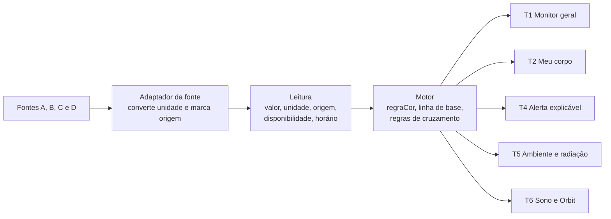

# Fontes de dados do software

Panorama de todas as fontes de dados que o Orbit Saúde pode usar: o que cada uma é, como o dado chega, o que ela ajuda a indicar sobre a saúde da tripulação e como o software a usa. Base: `docs/02` (equipamentos), `docs/12` (fontes abertas), `docs/03` e `indicadores.json` (indicadores), `docs/06` (modelo de dados) e as frentes de pesquisa 1, 2, 6, 9, 11 e 14 no repositório. Todos os ids citados (`ppco2_modulo`, `spo2` e outros) são os do `prototipo/config/indicadores.json`.

## 1. As quatro famílias

| Família | O que é | No protótipo de hoje | Na visão operacional (se a NASA adotar) |
| --- | --- | --- | --- |
| **A. A bordo** | Sistemas e equipamentos que já existem na ISS, mais o óculos Orbit e a entrada manual do astronauta | Simulados com faixas reais (perfil de simulação) e entrada manual de verdade | Integração direta com cada equipamento |
| **B. Públicas** | Dados reais e abertos da NASA e da NOAA | Usadas de verdade, gravadas para funcionar offline | Substituídas pelos dados de bordo; o clima espacial segue útil |
| **C. Terrestres e análogos** | Bases públicas de sinais de pessoas na Terra e de missões de isolamento | Para treinar e demonstrar algoritmos (sono, ECG, OCT) | Validação de algoritmos antes do voo |
| **D. Do projeto** | Arquivos gerados pela pesquisa | Base do gerador simulado e do motor de regras | Configuração revisada pela autoridade médica |

**A distinção mais importante:** na ISS, o ambiente é medido continuamente, mas o corpo não. O dado do corpo chega por **sessão** (vestível grava e transfere depois), **leitura pontual** (oxímetro, glicosímetro) ou **amostra** (sangue analisado na Terra, meses depois). O software mostra a idade de cada dado e o campo `disponibilidade` diz se ele está disponível, aguardando transferência ou pendente de laboratório.

## 2. Panorama em uma tabela

| # | Fonte | Família | Classe do dado | Ajuda a indicar | Telas | No protótipo |
| --- | --- | --- | --- | --- | --- | --- |
| A1 | Telemetria do suporte à vida (ECLSS) | A | Contínuo | CO2 alto, falta de O2, pressão, conforto térmico | T1, T4, T5 | Simulado e gravado (B1) |
| A2 | Qualidade do ar e da água | A | Amostra e campanha | Contaminantes, irritação, risco microbiológico | T5 (contexto) | Visão futura |
| A3 | Acústica | A | Campanha | Sono ruim, risco auditivo | T5, T6, T2 ouvidos | Simulado |
| A4 | Iluminação circadiana | A | Contínuo | Ritmo circadiano, pré-sono | T6 | Sensor de luz do Orbit |
| A5 | Radiação de área | A | Contínuo | Taxa de dose, passagens pela SAA, eventos solares | T1, T5 | Histórico real (B5) e simulado |
| A6 | Dosimetria pessoal | A | Contínuo e amostra | Dose acumulada contra o limite de carreira | T1, T2 corpo | Simulado |
| A7 | Vestível Bio-Monitor ou Astroskin | A | Sessão | Coração, respiração, oxigenação, estresse | T1, T2 | Simulado |
| A8 | Kit de exame físico | A | Pontual | Sinais vitais e glicose | T1, T2, T3 | Entrada manual |
| A9 | Imagem e exames de olhos | A | Campanha | Sinais de SANS | T2 olhos | Imagem terrestre opcional (C4) |
| A10 | Sangue, urina e saliva | A | Amostra | Anemia, osso, imunidade, rins | T2 sangue e rins | Simulado com "pendente" |
| A11 | Massa corporal | A | Pontual | Nutrição, perda de massa | T2 digestão | Simulado |
| A12 | Exercício | A | Sessão | Proteção de osso, músculo e coração | T2, gamificação | Simulado |
| A13 | Actigrafia | A | Sessão | Sono e atividade | T6 | Simulado |
| A14 | Cognição e comportamento | A | Pontual | Fadiga, atenção, humor | T2 cérebro, T3 | PVT real no app |
| A15 | Nutrição (ISS FIT) | A | Pontual | Calorias, proteína, líquidos | T2 digestão e rins, T3 | Entrada manual |
| A16 | Audição | A | Campanha | Perda auditiva | T2 ouvidos | Visão futura |
| A17 | Óculos Orbit | A | Contínuo durante o uso | Sono, piscadas, fadiga, luz | T6, T2 cérebro | Hipnograma de base pública (C1) |
| A18 | Entrada manual do astronauta | A | Pontual | Sintomas, dor, humor, visão, hidratação | T3, todas | Real, no próprio app |
| B1 | Telemetria pública da ISS (ISS Live) | B | Contínuo | Ambiente real da estação | T1, T5 | 3 h gravadas |
| B2 | Posição da ISS | B | Contínuo | Passagem pela SAA | T5 | Gravada |
| B3 | NOAA SWPC | B | Contínuo | Tempestade de radiação, atividade geomagnética | T1, T5 | 7 dias gravados |
| B4 | NASA DONKI | B | Evento | Explosões solares, partículas, ejeções | T5, linha do tempo | 90 dias gravados |
| B5 | OSDR RadLab | B | Histórico | Taxa de dose real por instrumento | T5 | API testada |
| B6 | OSDR EDA | B | Histórico | Ambiente real de campanhas | T5 (reserva) | Download |
| B7 | OSDR, Inspiration4 e SOMA | B | Histórico | Exames reais de pesquisa | T2 (exemplo) | API testada |
| B8 | NLSP, LSDA e LSAH | B | Por solicitação | Dados humanos agregados, Artemis II | Pitch | Só catálogo |
| B9 | data.nasa.gov e NTRS | B | Catálogo | Normas, limites e datasets | Documentação | Fonte dos limiares |
| C1 a C6 | Bases terrestres e análogos | C | Arquivo | Treino de sono, ECG, OCT | T6, T2 | Sleep-EDF escolhido |
| D1 a D3 | Arquivos do projeto | D | Arquivo | Toda a demonstração | Todas | Prontos |

## 3. A bordo (família A)

### A1. Telemetria do suporte à vida (ECLSS)
- **O que é:** sensores do sistema de controle ambiental da ISS: analisador de gases (MCA), remoção de CO2 (4B CO2 e CDRA), gerador de oxigênio (OGA), controle de temperatura e umidade (CCAA), sensores de pressão. Acompanhados continuamente pelos controladores ETHOS no controle de missão.
- **Grandezas:** pressão parcial de CO2 (mmHg), pressão parcial de O2 (kPa ou mmHg), pressão da cabine (kPa), temperatura (°C), umidade relativa (%).
- **Ajuda a indicar:** CO2 alto, que está associado a dor de cabeça e pior desempenho; falta ou excesso de oxigênio; desconforto térmico; contexto ambiental para qualquer sintoma relatado. O valor é **por módulo**: o software precisa saber onde cada tripulante está.
- **Como usamos:** indicadores `ppco2_modulo` (requisito oficial: média de 1 h até 3 mmHg, NASA-STD-3001 Vol 2 Rev F, V2 6004), `pio2_cabine` (145 a 155 mmHg), `pressao_cabine`, `temperatura_cabine`, `umidade_cabine`; regras R-CO2-01 (CO2 mais sintoma ou PVT pior) e R-AMB-01 (ambiente explica sintoma); faixa do ambiente no T1 e mapa de módulos no T5.
- **No protótipo:** perfil de simulação com CO2 por módulo a partir de dados publicados da NASA, e as 3 h gravadas da telemetria pública (B1).

### A2. Qualidade do ar e da água
- **O que é:** monitor de qualidade do ar (AQM), monitor de atmosfera (SAM), ANITA da ESA, analisador de carbono orgânico da água (TOCA), kits de microbiologia de água, ar e superfícies.
- **Grandezas:** compostos orgânicos voláteis (mg/m3), carbono orgânico total da água, contagem microbiana (UFC). Por amostra ou campanha, várias vezes analisadas depois.
- **Ajuda a indicar:** exposição a contaminantes, irritação de olhos e pele, risco de infecção.
- **Como usamos:** contexto na regra R-AMB-01 (irritação nos olhos ou na pele aponta para qualidade do ar e umidade). Não gera cor sozinho.
- **No protótipo:** visão futura.

### A3. Acústica
- **O que é:** medidor de nível sonoro e dosímetros acústicos usados pela tripulação em campanhas.
- **Grandezas:** dBA e espectro por banda de oitava; norma NC-50 para trabalho (cerca de 58 dBA) e NC-40 para sono (cerca de 49 dBA); dose de 24 h limitada a 100.
- **Ajuda a indicar:** sono ruim, cansaço, risco de perda auditiva.
- **Como usamos:** `ruido_trabalho` e `ruido_dormitorio`; contexto da regra R-SONO-01 ("o ruído pode estar contribuindo"), nunca como violação de norma a partir de uma leitura isolada.
- **No protótipo:** simulado.

### A4. Iluminação circadiana
- **O que é:** luminárias de LED da ISS (SSLA) com modos geral, pré-sono e de ajuste de fase.
- **Grandezas:** modo de luz, iluminância (lux), temperatura de cor (K).
- **Ajuda a indicar:** se a luz está ajudando ou atrapalhando o ritmo circadiano antes de dormir.
- **Como usamos:** contexto do sono na tela T6 e da paisagem sonora do óculos; o sensor de luz do Orbit (A17) mede a luz que chega ao rosto.
- **No protótipo:** só pelo sensor de luz simulado do Orbit.

### A5. Radiação de área
- **O que é:** monitores fixos de radiação (ISS-RAD, TEPC, REM, DOSIS e outros), sob responsabilidade do grupo de análise de radiação (SRAG) do Johnson Space Center.
- **Grandezas:** taxa de dose absorvida (µGy/h), taxa de dose equivalente (µSv/h), fluxo de partículas.
- **Ajuda a indicar:** a exposição do ambiente, os picos de cada passagem pela Anomalia do Atlântico Sul e a subida durante eventos solares.
- **Como usamos:** `taxa_dose_radiacao` no gráfico do T5 e na regra R-RAD-01 (evento solar); dose de área não é dose individual.
- **No protótipo:** série histórica real do RadLab (B5) e perfil simulado com os multiplicadores observados no evento solar de setembro de 2017.

### A6. Dosimetria pessoal
- **O que é:** dosímetro ativo da tripulação (CAD, com gravação contínua e downlink) e dosímetro passivo (CPD, lido em laboratório depois).
- **Grandezas:** dose acumulada (mSv de dose efetiva; limites por órgão em mGy-Eq).
- **Ajuda a indicar:** quanto da cota de radiação da carreira cada tripulante já usou (limite da NASA: menos de 600 mSv) e se um evento solar mudou esse saldo.
- **Como usamos:** `dose_acumulada` em barra relativa ao limite, no T1 e no T2 (região "corpo inteiro"); ação é da equipe de radiação, não diagnóstico.
- **No protótipo:** simulado.

### A7. Vestível Bio-Monitor ou Astroskin
- **O que é:** camiseta instrumentada com faixa de cabeça da Agência Espacial Canadense (fabricante Carré Technologies), na ISS desde dezembro de 2018. Grava sessões de até 48 h e transfere o arquivo depois.
- **Grandezas:** ECG (256 Hz) e frequência cardíaca (bpm), respiração (respirações/min, volume em mL), SpO2 (%), pressão sistólica estimada (mmHg), temperatura da pele (°C), aceleração (g).
- **Ajuda a indicar:** coração (frequência de repouso, variabilidade), respiração, oxigenação, estresse e recuperação (HRV), atividade.
- **Como usamos:** `fc_repouso`, `hrv_rmssd`, `spo2`, `frequencia_respiratoria`, `pa_sistolica` (estimada); leituras com `disponibilidade: aguardando_transferencia` até a sessão ser descarregada; HRV entra no índice de prontidão. Formato de arquivo não é público.
- **No protótipo:** simulado.

### A8. Kit de exame físico
- **O que é:** itens do kit médico da ISS: oxímetro de pulso, manguito de pressão, termômetro, glicosímetro, estetoscópio, analisador point of care (i-STAT).
- **Grandezas:** SpO2 (%), pressão arterial (mmHg), temperatura corporal (°C), glicose (mg/dL).
- **Ajuda a indicar:** sinais vitais e glicose, que são exemplos citados no próprio desafio oficial.
- **Como usamos:** `spo2`, `pa_sistolica`, `pa_diastolica`, `temperatura_corporal`, `glicose`, com referência terrestre marcada como "não é limite de voo" (SpO2 em ou abaixo de 92% chama o CMO); entrada manual com origem "exame".
- **No protótipo:** entrada manual no check-in.

### A9. Imagem e exames de olhos
- **O que é:** ultrassom (Ultrasound 2, desde 2011; Ultrasound 3 a partir de 2025 e 2026), tomografia de coerência óptica (OCT), foto de fundo de olho, tonometria. Feitos em campanhas (por exemplo FD30, FD90 e R-30), com apoio do solo.
- **Grandezas:** espessura da retina e do disco óptico (µm), pressão intraocular (mmHg), escala de Frisén, imagens.
- **Ajuda a indicar:** sinais da síndrome neuro-ocular do voo espacial (SANS).
- **Como usamos:** resultados de exame na região "olhos" do T2, comparados com o exame anterior da mesma pessoa e sem cor automática (a NASA não publica limiar único); a triagem diária vem da entrada manual (A18).
- **No protótipo:** imagem de OCT de base terrestre opcional (C4).

### A10. Sangue, urina e saliva
- **O que é:** coletas centrifugadas, congeladas a menos 80 °C e analisadas na Terra; poucos testes point of care a bordo.
- **Grandezas:** hemoglobina (g/dL), hemograma, marcadores ósseos, cálcio urinário, reativação viral na saliva.
- **Ajuda a indicar:** anemia do voo espacial, perda óssea, imunidade, risco de cálculo renal.
- **Como usamos:** `hemoglobina` e outros com `disponibilidade: pendente_laboratorio`; o T2 mostra "amostra coletada, análise na Terra" até o laudo chegar.
- **No protótipo:** simulado com o estado pendente.

### A11. Massa corporal
- **O que é:** aparelho que mede massa sem gravidade por aceleração (SLAMMD) e o equivalente russo.
- **Grandezas:** massa (kg).
- **Ajuda a indicar:** nutrição insuficiente e perda de massa ao longo da missão.
- **Como usamos:** `massa_corporal` com tendência (perda em kg por dia, `docs/04`, A5) contra a linha de base.
- **No protótipo:** simulado com tendência de 180 dias.

### A12. Exercício
- **O que é:** aparelho de resistência (ARED), bicicleta (CEVIS) e esteira (T2), cerca de 2 h por dia.
- **Grandezas:** carga (kg ou lb), repetições, potência (W), tempo (min), frequência cardíaca.
- **Ajuda a indicar:** se a proteção de osso, músculo e coração está sendo cumprida.
- **Como usamos:** `tempo_exercicio` e `carga_ared` nas regiões ossos e músculos do T2; metas cooperativas da gamificação.
- **No protótipo:** simulado.

### A13. Actigrafia
- **O que é:** relógio de pulso com acelerômetro e sensor de luz (Actiwatch), usado em campanhas de duas semanas.
- **Grandezas:** movimento por época, luz (lux), horários estimados de sono.
- **Ajuda a indicar:** tempo e regularidade do sono, atividade.
- **Como usamos:** alternativa ao óculos para `sono_tst` e `sono_eficiencia` (`SessaoSono` com fonte "actigrafia"); não mede estágios do sono.
- **No protótipo:** simulado.

### A14. Cognição e comportamento
- **O que é:** teste de reação de 3 minutos (Reaction Self Test, paradigma PVT-B), bateria Cognition, WinSCAT, questionários; conferências médicas e psicológicas privadas.
- **Grandezas:** tempo de reação (ms), lapsos (respostas a partir de 355 ms), escalas de humor e fadiga.
- **Ajuda a indicar:** fadiga, falta de sono, atenção, efeito de CO2, humor.
- **Como usamos:** `pvt_tempo_reacao` e `pvt_lapsos` contra a linha de base (variação percentual, `docs/04`, A6 e A10); entram nas regras R-CO2-01 e R-SONO-01 e no índice de prontidão. Conversas privadas nunca entram no software.
- **No protótipo:** o PVT de 3 minutos roda de verdade no app.

### A15. Nutrição e hidratação (ISS FIT)
- **O que é:** aplicativo de registro de alimentação no iPad da tripulação.
- **Grandezas:** calorias (kcal), proteína (g), líquidos (mL).
- **Ajuda a indicar:** ingestão insuficiente, hidratação abaixo do plano, risco de cálculo renal (junto com a perda óssea).
- **Como usamos:** `agua_ingerida` e `cor_urina` na regra R-HID-01 e na região rins; missão do dia da gamificação.
- **No protótipo:** entrada manual (+250 mL por toque e foto da urina).

### A16. Audição
- **O que é:** avaliação auditiva em órbita (OOHA), a cada 3 meses.
- **Grandezas:** limiar auditivo (dB HL) por frequência.
- **Ajuda a indicar:** perda auditiva somada ao ruído da estação.
- **Como usamos:** região ouvidos do T2, comparando com o exame anterior.
- **No protótipo:** visão futura.

### A17. Óculos Orbit (proposto)
- **O que é:** o óculos do projeto, com EEG frontal, EOG horizontal e vertical, sensor de movimento, sensor de luz e áudio por condução óssea.
- **Grandezas:** sinais a 250 Hz (97,2 MB por noite de 9 h com 4 canais), estágios do sono a cada 30 s, piscadas por minuto, índice de fadiga, luz (lux).
- **Ajuda a indicar:** qualidade e estágios do sono, sonolência e fadiga, exposição à luz antes de dormir. **Não detecta SANS.**
- **Como usamos:** `SessaoSono` com hipnograma, eficiência e dívida de sono no T6; `condicaoEstudo` para o piloto cruzado; paisagem sonora registrada por noite.
- **No protótipo:** hipnograma pré-calculado de uma base pública de sono (C1).

### A18. Entrada manual do astronauta
- **O que é:** check-in diário de 2 minutos e testes rápidos no próprio app: sono, energia, humor (1 a 5), sintomas, dor (0 a 10), água, foto da urina, grade de Amsler, acuidade de perto, PVT.
- **Grandezas:** escalas autorrelatadas, mL, escala de cor da urina de 8 pontos, distorção na grade, tempo de reação.
- **Ajuda a indicar:** fadiga, humor, dor, sintomas do voo (dor de cabeça, visão embaçada, congestão), primeiros sinais visuais compatíveis com SANS, hidratação. É a fonte que transforma o astronauta em participante ativo, como pede o desafio.
- **Como usamos:** cada resposta vira uma `Leitura` com origem "manual"; dispara R-SANS-01 (dois testes de visão piores em até 14 dias), alimenta R-CO2-01, R-SONO-01, R-HID-01 e o índice de prontidão; gamificação por sequência de check-ins.
- **No protótipo:** real, na tela T3.

## 4. Públicas (família B)

### B1. Telemetria pública da ISS (ISS Live)
- **O que é:** parcela da telemetria da estação publicada pela NASA e retransmitida pelo servidor `push.lightstreamer.com` (adapter `ISSLIVE`).
- **Dados:** pressões parciais de O2, N2 e CO2 do laboratório e do Node 3, pressão da cabine, temperatura do ar, estado e produção do gerador de O2, tanques de água e urina. As pressões vêm em torr ou mmHg (confirmado pela gravação de 15/11; ppCO2 do laboratório com mediana de 2,44 mmHg). Não traz umidade, ruído nem sinais vitais.
- **Ajuda a indicar:** o ambiente real da estação naquele momento.
- **Como usamos:** modo "ao vivo" opcional do T1 e do T5, atrás de seletor; sem internet, o app reproduz a gravação com origem "historica". Temperaturas e tanques não geram cor (unidade não confirmada).
- **No protótipo:** 3 h gravadas em `prototipo/dados/amostras-reais/`, com scripts de coleta. Licença de redistribuição não encontrada.

### B2. Posição da ISS
- **O que é:** serviço aberto Where the ISS at.
- **Dados:** latitude, longitude, altitude, velocidade.
- **Ajuda a indicar:** quando a estação cruza a Anomalia do Atlântico Sul, o que explica os picos de taxa de dose.
- **Como usamos:** marcação das passagens no gráfico de dose do T5. Posição não é dose.
- **No protótipo:** gravada junto com o B1 (duas passagens pela SAA).

### B3. NOAA SWPC
- **O que é:** centro de previsão de clima espacial da NOAA, fonte preferida para alerta.
- **Dados:** fluxo integral de prótons do satélite GOES (pfu, por energia), índice Kp, alertas e escalas oficiais. Escala S de tempestade de radiação: S1 a partir de 10 pfu, S2 de 100, S3 de 1.000.
- **Ajuda a indicar:** tempestade de radiação em andamento e atividade geomagnética.
- **Como usamos:** `fluxo_protons_goes` e `kp`; dispara a regra R-RAD-01 (cenário C2 com 150 pfu, escala S2). Descreve o espaço fora da estação: não converter em dose.
- **No protótipo:** 7 dias gravados; modo ao vivo opcional.

### B4. NASA DONKI
- **O que é:** banco de eventos de clima espacial do centro de modelagem da NASA (CCMC), no endereço `ccmc.gsfc.nasa.gov/DONKI-API` (a rota antiga em api.nasa.gov responde 404).
- **Dados:** explosões solares (FLR), eventos de partículas (SEP), ejeções de massa coronal (CME), tempestades geomagnéticas (GST), com horários e classe.
- **Ajuda a indicar:** contexto do que está acontecendo no Sol e o que pode chegar.
- **Como usamos:** `EventoClimaEspacial` na linha do tempo do T5; um SEP ajuda a disparar R-RAD-01. A própria NASA classifica como dado de pesquisa; para alerta, prioriza a NOAA.
- **No protótipo:** 90 dias gravados (55 FLR, 11 SEP, 323 CME, 3 GST).

### B5. OSDR RadLab
- **O que é:** portal de dados de radiação do repositório aberto da NASA.
- **Dados:** taxa de dose absorvida (µGy/h), taxa de dose equivalente (µSv/h), fluxo, posição orbital, por instrumento e módulo; cadência de 20 s a 5 min conforme o instrumento.
- **Ajuda a indicar:** como é a radiação real dentro da ISS, inclusive picos da SAA.
- **Como usamos:** série histórica real de `taxa_dose_radiacao` no T5. Dose de área, não individual.
- **No protótipo:** API testada (DosTel, abril de 2022).

### B6. OSDR EDA
- **O que é:** aplicação de dados ambientais de experimentos da ISS.
- **Dados:** temperatura (°C), umidade (%), CO2 (ppm) e doses de campanhas selecionadas.
- **Ajuda a indicar:** ambiente real de uma missão passada.
- **Como usamos:** arquivo de reserva do painel de ambiente; CO2 em ppm precisa ser convertido para mmHg com a pressão da cabine (`docs/04`, A1).
- **No protótipo:** download quando necessário.

### B7. OSDR, Inspiration4 e SOMA
- **O que é:** dados de pesquisa com astronautas no repositório aberto (por exemplo o conjunto OSD-575 da missão Inspiration4) e o atlas SOMA.
- **Dados:** painel metabólico, citocinas, painel cardiovascular, hemograma, antes e depois do voo.
- **Ajuda a indicar:** como os exames de sangue mudam com o voo em casos reais.
- **Como usamos:** exemplo de como mostrar um resultado de exame com unidade e janela relativa ao voo, marcado como pesquisa. Nunca como faixa normal nem como feed.
- **No protótipo:** API testada.

### B8. NLSP, LSDA e LSAH
- **O que é:** portal de ciências da vida da NASA, arquivo de dados do Johnson Space Center e vigilância da saúde dos astronautas.
- **Dados:** estudos de voo e de análogos; dados individuais só por solicitação formal, com consentimento e comitê de ética. Os resultados anonimizados do Artemis II poderão ser pedidos ao LSDA.
- **Ajuda a indicar:** valores agregados de astronautas reais para validar o software.
- **Como usamos:** argumento do pitch ("estes são os dados que a NASA poderia fornecer") e pedido futuro de estatísticas agregadas.
- **No protótipo:** só catálogo.

### B9. data.nasa.gov e NTRS
- **O que é:** catálogo de datasets da NASA e servidor de relatórios técnicos.
- **Dados:** normas, manuais, limites e conjuntos como o TEPC da ISS a cada 10 s.
- **Ajuda a indicar:** de onde vem cada limiar e cada número citado.
- **Como usamos:** fonte das referências em `docs/03` e `docs/15`.
- **No protótipo:** documentação.

## 5. Terrestres e análogos (família C)

| # | Base | O que tem | Ajuda a indicar | Como usamos | Licença e cuidado |
| --- | --- | --- | --- | --- | --- |
| C1 | Sleep-EDF Expanded (PhysioNet) | EEG, EOG e hipnogramas de 197 noites, 100 Hz | Estágios do sono | **Escolhida:** hipnograma pré-calculado do óculos na T6 | Aberta, atribuição obrigatória (ODC-By) |
| C2 | Sleep Heart Health Study (PhysioNet) | EEG, EOG, ECG, saturação, frequência cardíaca | Sono e oxigenação noturna | Exemplo de SpO2 e EOG | Aberta (ODC-By); coorte com apneia acima de 40 anos |
| C3 | MIT-BIH Arrhythmia (PhysioNet) | ECG, 48 registros de 30 min, 360 Hz | Traçado cardíaco | Traçado de ECG opcional no T2 | Aberta (ODC-By); arritmias selecionadas de propósito |
| C4 | OLIVES e REFUGE | OCT e fundo de olho | Aparência de exames de olhos | Imagem de OCT para o cenário C3 | OLIVES CC BY 4.0; REFUGE com licença a verificar; são doenças terrestres, não SANS |
| C5 | Mars-500 (ESA HREDA) | Séries cardiovasculares, atividade, desempenho e humor da simulação de isolamento (2009 a 2012) | Tendências longas em confinamento | Testar a leitura de séries longas | CC BY-NC (uso não comercial) |
| C6 | HERA, SIRIUS, Antártida | Sono, humor, cognição em isolamento | Comportamento em missões análogas | Inspiração para cenários | Por solicitação; CHAPEA sem liberação pública |

Não usar: MIMIC-IV (exige credenciamento e acordo de uso) e MASS (exige aprovação ética).

## 6. Do projeto (família D)

| # | Arquivo | O que tem | Como usamos |
| --- | --- | --- | --- |
| D1 | `prototipo/config/perfis-simulacao.rascunho.json` | 35 indicadores com valor típico, variação, ruído, ritmo diário e tendência em 180 dias; 7 tripulantes fictícios; roteiro de missão; cenários C1 a C5 com gatilhos | Base do gerador simulado (Dev B) |
| D2 | `prototipo/config/indicadores.json` | 35 indicadores e 6 regras de cruzamento, cada um com classe, regra de cor numérica, exemplos de teste, explicação, orientação e fonte | Motor de regras e testes (Dev C) |
| D3 | `prototipo/dados/amostras-reais/` | Gravações reais de 15/11/2026: telemetria da ISS, posição, NOAA e DONKI, mais scripts | Modo de demonstração offline e modo ao vivo |

## 7. Como uma fonte vira informação na tela

Cada adaptador só entrega `Leitura`; quem decide a cor é o motor, com a regra e a fonte guardadas em `indicadores.json`. Toda leitura mostra a origem (simulada, ao vivo, histórica, manual, automática ou exame) e a idade.

## 8. Que fonte responde a cada pergunta de saúde

| Região ou risco | Fontes principais | Regras e cenários |
| --- | --- | --- |
| Cérebro e mente (sono, fadiga, humor, cognição) | A14, A17, A18, A13, A3 | R-SONO-01, C4 |
| Olhos (SANS) | A18 (Amsler e acuidade), A9 (OCT e fundo de olho) | R-SANS-01, C3 |
| Coração e vasos | A7, A8 | Referência terrestre e linha de base |
| Pulmões e ambiente respiratório | A1, A7, A8, B1 | R-CO2-01, R-AMB-01, C1 |
| Sangue, imunidade e glicose | A8, A10, B7 | Pendente de laboratório |
| Rins e hidratação | A15, A18, A10 | R-HID-01, C5 |
| Ossos e músculos | A11, A12, A10 | Tendência e linha de base |
| Ouvidos | A3, A16 | Contexto de R-SONO-01 |
| Corpo inteiro (radiação) | A5, A6, B3, B4, B5, B2 | R-RAD-01, C2 |
