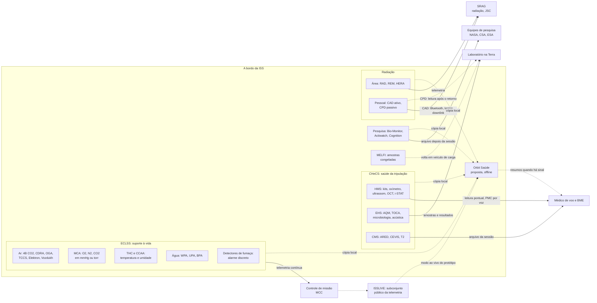

# 02. Equipamentos e dados

> Para quem: desenvolvedores (principalmente o Dev B, dados e entrada) e a IA de desenvolvimento. Não é preciso saber nada de medicina nem de estação espacial.
> Pergunta que responde: que equipamentos reais da ISS geram dados úteis para o Orbit Saúde, o que cada um faz, como entrega o dado e em qual unidade.
> Fontes: frente 1, [`../pesquisa/bruto/01-eclss-ambiente-radiacao.md`](../pesquisa/bruto/01-eclss-ambiente-radiacao.md) (ambiente e radiação), e frente 2, [`../pesquisa/bruto/02-equipamentos-medicos-tripulacao.md`](../pesquisa/bruto/02-equipamentos-medicos-tripulacao.md) (corpo). Os arquivos brutos guardam todas as citações; aqui fica o link oficial principal de cada fato.
> Limiares (verde, amarelo, vermelho) **não** estão aqui: estão em [`03-indicadores-e-limiares.md`](03-indicadores-e-limiares.md). Nomes de campos e unidades canônicas: [`06-modelo-de-dados.md`](06-modelo-de-dados.md). Conversões: [`04-cruzamento-de-dados.md`](04-cruzamento-de-dados.md), A1.

---

## 1. Como ler este catálogo

### 1.1 As colunas das tabelas

**Equipamento**: nome oficial em inglês e sigla expandida (entre parênteses, o segmento quando não é o americano). **O que faz**: uma frase didática. **Grandezas e unidade**: o que o equipamento mede, na unidade em que **a fonte** diz que o dado sai, que pode não ser a canônica do `docs/06`. **Frequência ou cadência**: começa pela **classe do dado** (seção 1.2) e depois traz a cadência publicada. **Como o dado sai**: tela local, telemetria, arquivo transferido depois, amostra que volta à Terra ou conversa por voz. **Status**: desde quando, quem fez e a última evidência pública de uso. **Fonte principal**: link oficial copiado do arquivo bruto.

### 1.2 As quatro classes de dado (a distinção mais importante deste documento)

A frente 2 mostrou que quase todo dado do corpo é episódico, e a frente 1 separa o dado ambiental em telemetria de sistema, amostra analisada a bordo, dosimetria passiva analisada no solo e dados científicos do OSDR. Para o software isso vira quatro classes, que casam com o campo `disponibilidade` da `Leitura` (ver a nota de disponibilidade em [`06-modelo-de-dados.md`](06-modelo-de-dados.md), seção 2.5).

| Classe | O que significa | Exemplos | Como vira `Leitura` |
| --- | --- | --- | --- |
| **Contínuo** | O equipamento mede sozinho, o tempo todo, e o valor sai como telemetria ou fica gravado com horário. | MCA, CCAA, RAD, CAD | `disponivel` logo após a medida. Mostrar a idade do dado. |
| **Sessão** | Alguém veste ou liga o aparelho, grava por horas ou dias, encerra e só depois transfere o arquivo. | Bio-Monitor (até 48 h), Actiwatch (2 semanas), Holter | `aguardando_transferencia` até o arquivo chegar; `instanteDisponivelUtc` fica horas depois de `instanteUtc`. |
| **Pontual** | Uma pessoa faz uma leitura única e vê o resultado na hora. | Oxímetro do kit, SLAMMD, TOCA, i-STAT, tira de urina | `origem: "manual"` ou `"exame"`, disponível na hora. |
| **Amostra** | Material coletado, guardado (às vezes congelado) e analisado depois, muitas vezes na Terra. | Sangue, saliva, CPD, Area PADLES, placas do MAS | `pendente_laboratorio` até o laudo, que pode chegar meses depois. |

### 1.3 USOS, ROS e módulos

A ISS tem dois segmentos com suporte à vida próprio: o **USOS** (US Orbital Segment, o segmento americano, onde ficam por exemplo o US Lab Destiny, o Node 3 Tranquility e o Airlock Quest) e o **ROS** (Russian Orbital Segment, com o Service Module Zvezda). Eles compartilham a atmosfera quando as passagens estão abertas, mas os sistemas e procedimentos não são intercambiáveis ([NASA ISS Familiarization](https://ntrs.nasa.gov/api/citations/20250005232/downloads/International%20Space%20Station%20Familiarization.pdf)). Por isso o `Modulo` do `docs/06` tem o campo `segmento`. Outros módulos citados nas fontes: Columbus (ESA), Kibo/JEM (JAXA) e Cupola.

### 1.4 Regras de leitura

- **Nada aqui é feed público ao vivo**, salvo o subconjunto ISSLIVE da seção 6 e os conjuntos históricos (EDA, RadLab) citados lá. Dados médicos individuais de astronautas não são públicos.
- **Status** é a última evidência pública primária encontrada, não garantia de operação em 15/11/2026.
- **NÃO ENCONTRADO** significa que a pesquisa não achou fonte pública primária suficiente, não que o dado inexista dentro da NASA.
- Códigos como **5A, 1R, 1A/R, 7A** são marcos de primeiro voo da montagem da estação, não datas de ativação ([NASA ISS Familiarization](https://ntrs.nasa.gov/api/citations/20250005232/downloads/International%20Space%20Station%20Familiarization.pdf)).
- Valores de referência citados aqui são contexto. Quem define cor no software é o `docs/03`.

---

## 2. Visão geral: sistemas e para onde vai o dado

Leitura do diagrama: linhas cheias são caminhos documentados nas fontes; linhas tracejadas com "cópia local" são a **proposta** do Orbit Saúde (um gateway interno aprovado alimentaria o computador de bordo, como a frente 1 recomenda para operação offline). Pela frente 2, os sensores de radiação também fazem parte do EHS; aparecem separados só para facilitar a leitura ([NASA ISS Familiarization, seção 14](https://ntrs.nasa.gov/api/citations/20250005232/downloads/International%20Space%20Station%20Familiarization.pdf)).

---

## 3. Parte A. Ambiente (frente 1)

### 3.1 Atmosfera, pressão e remoção de CO2

Estes equipamentos **produzem ou limpam** o ar. Quase nenhum é sensor de saúde: o dado que interessa ao corpo é a pressão parcial medida no módulo (seção 3.2), não o estado ligado ou desligado da máquina.

| Equipamento | O que faz | Grandezas e unidade | Frequência ou cadência | Como o dado sai | Status | Fonte principal |
| --- | --- | --- | --- | --- | --- | --- |
| Pressure Control Assembly (PCA), parte do Atmosphere Control and Supply (ACS) | Controla a pressão da cabine e adiciona O2 e N2. | Pressão total em psia ou torr (escala do item público a confirmar). Nominal cerca de 14,7 psia; requisito genérico NASA 14,0 a 14,9 psia. | **Contínuo**. Taxa pública NÃO ENCONTRADO. | Telemetria USOS para o MCC; item USLAB000058 no mapa comunitário. | Primeiro voo 5A; ativo como função do ACS, sem inventário público por unidade. | [CCT-REQ-1130](https://ntrs.nasa.gov/api/citations/20170001943/downloads/20170001943.pdf?__source=newsletter%7Cspacenewsletter) |
| Oxygen Generation Assembly (OGA) | Quebra água por eletrólise: o O2 vai para a cabine, o H2 é ventilado ou vai para o Sabatier. | Produção de O2 em lb/dia: capacidade 20,4 lb/dia (9,25 kg/dia) a 100%, comandável de 22% a 100%; média acumulada de 5,78 lb/dia até jun. 2024. Estado em código enumerado. | **Contínuo** (estado e taxa). | Telemetria; NODE3000010 (estado) e NODE3000011 (lb/dia) no mapa comunitário. | Lançado em jul. 2006, ativado em jul. 2007 no US Lab, no Node 3 de 2010 a 2022, de volta ao US Lab em set. 2022. NASA MSFC e UTAS. | [ICES 2024, OGA](https://ntrs.nasa.gov/api/citations/20240007995/downloads/ICES2024141%20ISS%20ECLS%20Presentaton%20RevA.pdf) |
| Elektron-VM (ROS) | Eletrólise de água que fornece O2 ao segmento russo, no Zvezda. | Unidades, faixa e alarmes: NÃO ENCONTRADO. | NÃO ENCONTRADO. | NÃO ENCONTRADO em fonte pública. | Primeiro voo 1R (hardware do Zvezda em 2000). Status 2025/2026: NÃO ENCONTRADO. | [NASA ISS Familiarization](https://ntrs.nasa.gov/api/citations/20250005232/downloads/International%20Space%20Station%20Familiarization.pdf) |
| Four Bed CO2 Scrubber (4B CO2, também 4BMS) e Carbon Dioxide Removal Assembly (CDRA) | Retiram o CO2 do ar com leitos de zeólita. | Não é sensor. A entrada alvo de 2 torr para quatro tripulantes equivalentes é parâmetro de engenharia, não limite de exposição. | **Contínuo** (ciclos de adsorção e regeneração). | Estado do equipamento. O estado do 4BMS não aparece no feed público. | 4B CO2: lançado em ago. 2021, ativado em out. 2021, NASA MSFC; o ICES 2026 o descreve como remoção primária. CDRA: primeira entrega 5A; operação atual e simultânea NÃO ENCONTRADO. | [NTRS, projeto 4B CO2](https://ntrs.nasa.gov/citations/20205003542); [ICES 2026](https://ntrs.nasa.gov/citations/20260007665) |
| Vozdukh (ROS) | Remove CO2 no segmento russo, com LiOH (hidróxido de lítio) como reserva. | Capacidade, alarmes e telemetria: NÃO ENCONTRADO. | Ciclos históricos de 10, 20 ou 30 min. | CO2 ventilado para o espaço. | Primeiro voo 1R. Status 2025/2026: NÃO ENCONTRADO. | [NTRS, ventilação ROS](https://ntrs.nasa.gov/api/citations/20180006142/downloads/20180006142.pdf) |
| Sabatier (Carbon Dioxide Reduction Assembly) | Junta o H2 da eletrólise com o CO2 retirado e forma água (volta à WPA) e metano (ventilado). | Não é sensor. | Não se aplica. | Não se aplica. | Operou a partir de nov. 2010; fora de serviço desde out. 2017 segundo fonte de 2024; retorno NÃO ENCONTRADO. | [ICES 2024, água](https://ntrs.nasa.gov/api/citations/20240005472/downloads/ICES%202024-317%20Status%20of%20ISS%20Water_Final.pdf) |
| Trace Contaminant Control Subassembly (TCCS) | Remove gases liberados por materiais e pessoas: carvão ativado, oxidador catalítico aquecido e leito de LiOH. | Não mede concentração (quem mede são AQM, SAM e amostras). | **Contínuo**; leitos trocados periodicamente. | Sem telemetria pública. | Primeira entrega 5A, ativado em fev. 2001. Operação por unidade em 2026: NÃO ENCONTRADO. | [NTRS, TCCS](https://ntrs.nasa.gov/citations/20030065986) |
| Solid Fuel Oxygen Generator (SFOG/TGK, ROS) e Nitrogen/Oxygen Recharge System (NORS) | SFOG: cartucho químico que libera O2 em contingência. NORS: tanques que recarregam gás no Airlock Quest. | NORS: 7.000 psia, pressão da garrafa e não da cabine. | Sob demanda. | Telemetria de veículo, não de saúde. Estoque e inventário: NÃO ENCONTRADO. | SFOG: primeiro voo 1A/R. O acidente de vela de oxigênio de 1997 foi na Mir, não na ISS. | [NTRS, NORS](https://ntrs.nasa.gov/archive/nasa/casi.ntrs.nasa.gov/20140001491.pdf); [NTRS, geradores químicos](https://ntrs.nasa.gov/api/citations/20090006787/downloads/20090006787.pdf) |

**Como funciona por dentro**
- **4B CO2 e CDRA.** O ar passa por peneiras moleculares de zeólita que prendem o CO2 (adsorção). Quando um leito satura, ele é aquecido e trocado por outro; o calor solta o CO2 para exaustão e o leito volta a servir (regeneração). Por isso a máquina trabalha em ciclos ([NASA ECLSS](https://www.nasa.gov/reference/environmental-control-and-life-support-systems-eclss/)).
- **OGA e Sabatier.** A corrente elétrica separa a água em O2 e H2. O Sabatier usaria esse H2 com o CO2 da cabine para refazer água, recuperando no máximo teórico cerca de 50 a 54% do oxigênio preso no CO2, porque o H2 sai no metano ventilado ([NTRS, Sabatier](https://ntrs.nasa.gov/citations/20160009739)). Gerar O2 (OGA) é diferente de recuperar O2 do CO2 (Sabatier).
- **Pressão parcial.** Cada gás da mistura responde por uma parte da pressão total. 3 mmHg de CO2 equivalem a cerca de 0,4% em volume só perto de 1 atmosfera; a conversão muda com a pressão total ([OCHMO-TB-004](https://www.nasa.gov/wp-content/uploads/2023/12/ochmo-tb-004-carbon-dioxide.pdf)).

### 3.2 Monitoramento do ar (composição e contaminantes)

| Equipamento | O que faz | Grandezas e unidade | Frequência ou cadência | Como o dado sai | Status | Fonte principal |
| --- | --- | --- | --- | --- | --- | --- |
| Major Constituent Analyzer (MCA) | Espectrômetro de massa que acompanha os gases principais do ar em pontos do USOS. | Pressão parcial de N2, O2, H2, CO2, CH4 e vapor de água, em mmHg ou torr. | **Contínuo**. A NASA publica médias de 24 h por módulo. | Telemetria ao solo; itens USLAB000053 a 55 e NODE3000001 a 3 no mapa comunitário. | Primeira entrega 5A; aparece nas medidas de atmosfera atuais. | [NTRS, MCA](https://ntrs.nasa.gov/citations/20060023360); [NTRS, calibração](https://ntrs.nasa.gov/api/citations/20100024404/downloads/20100024404.pdf) |
| Air Quality Monitor (AQM) | Mede compostos orgânicos voláteis (VOCs) por cromatografia gasosa com espectrometria de mobilidade diferencial (GC-DMS). | Concentração por composto, em ppm ou ppb. | **Pontual**: 2 vezes por semana com 22 alvos (relatório de 2015); página NASA do período 2025 cita dois AQMs e 23 VOCs alvo. Mais vezes em contingência. | Resultado do instrumento enviado ao solo. | Na ISS desde mar. 2013, validado em jan. 2014. Sionex, Wyle e NASA JSC. Versão ativa em 2026: NÃO ENCONTRADO. | [NTRS, AQM](https://ntrs.nasa.gov/api/citations/20150018596/downloads/20150018596.pdf); [NASA Toxicology](https://www.nasa.gov/directorates/esdmd/hhp/toxicology-and-environmental-chemistry/) |
| Spacecraft Atmosphere Monitor (SAM, também SCRAM-2) | Demonstração do JPL de cromatógrafo e espectrômetro de massa (GC/MS) miniaturizado. | N2, O2, Ar, CO2, CH4 (TDU1); VOCs (TDU2). Pressão parcial, ppm ou ppb. | **Contínuo** em campanha: TDU1 a cada 1 s de ago. 2019 a jul. 2021; TDU2 por 10 semanas em 2024. | Resultados enviados ao solo. | NASA JPL. Operação em 2026: NÃO ENCONTRADO. Não cadastrar como sensor clínico ativo. | [PAPER, SAM](https://www.sciencedirect.com/science/article/pii/S1387380622000525); [NASA, out. 2024](https://www.nasa.gov/centers-and-facilities/johnson/station-science-top-news-oct-25-2024/) |
| ANITA e ANITA-2 (ESA) | Espectrômetro de infravermelho por transformada de Fourier (FTIR) para contaminantes. | 32 contaminantes, em ppm baixo ou ppb alto. Não mede O2, N2 nem H2. | **Contínuo** em ciclo de 6 min (ANITA); frequência atual do ANITA-2: NÃO ENCONTRADO. | Coleta local ou bolsa de amostra remota. | ANITA em 2007; ANITA-2 em 2021, uso no Columbus em 2022 e 2023. Status 2026: NÃO ENCONTRADO. | [ESA, ANITA](https://www.esa.int/sv/articles/anita-air-quality-monitoring-for-the-international-space-station); [ESA, ANITA-2](https://www.esa.int/media/the-analyzing-interferometer-for-ambient-air-2-anita-2) |
| Carbon Dioxide Monitor (CDM) | Monitor portátil de CO2, calibrado pela porta de amostra do MCA. | Unidade e princípio do sensor: NÃO ENCONTRADO. | **Pontual**. | Leitura local. | Documentado em 2016. Diferente do MCA e do monitor vestível. | [NASA Daily Summary 2016](https://www.nasa.gov/blogs/stationreport/2016/06/01/iss-daily-summary-report-06-01-16/) |
| Personal CO2 Monitor | Sensor vestível de demonstração para medir o CO2 perto da pessoa e estudar bolsões. | Unidade e frequência nominal: NÃO ENCONTRADO. | **Sessão**: em 2016, quatro monitores por várias horas. | Dados baixados por iPad; NASA cita capacidade de downlink. | Pesquisa (2016 e retomada em 2024), sem uso diário por tripulante nem alerta clínico. | [NASA, vestíveis 2024](https://www.nasa.gov/missions/station/iss-research/wearable-tech-for-space-station-research/) |

Contexto de CO2 (os limiares do software ficam no `docs/03`): a regra operacional pública da ISS é média de 24 h até 3 mmHg, aprovada em 2016; a NASA-STD-3001 Vol. 2 Rev. F pede média de 1 h até 3 mmHg (requisito V2 6004, que é o que o software usa); o OCHMO-TB-004 associa média de 7 dias abaixo de 2,5 mmHg a risco de cefaleia menor que 1%. São três janelas diferentes (1 h, 24 h, 7 dias), cada uma com sua finalidade; leituras de julho a novembro de 2025 ficaram tipicamente entre 1,7 e 2,1 mmHg; valores de 5,3 mmHg e picos de 7,6 a 10 mmHg são requisitos antigos ([OCHMO-TB-004](https://www.nasa.gov/wp-content/uploads/2023/12/ochmo-tb-004-carbon-dioxide.pdf); [NASA-STD-3001 Vol. 2 Rev. E](https://ntrs.nasa.gov/api/citations/20250004555/downloads/NASA-STD-3001%20Vol%202%20Rev%20E%20FINAL_05022025.pdf)).

**Como funciona por dentro**
- **MCA.** Um espectrômetro de massa separa as moléculas da amostra de ar pela massa e mede quanto existe de cada uma (definição do método; a frente 1 não detalha o interior do MCA). Cada gás vira uma pressão parcial em mmHg ou torr. Ele mede no ponto de amostragem, não junto ao rosto do tripulante ([NASA-STD-3001 Vol. 2 Rev. F](https://www.nasa.gov/wp-content/uploads/2025/05/nasa-std-3001-vol-2.pdf)).
- **AQM.** A cromatografia separa os compostos da amostra; o DMS identifica cada um pela mobilidade dos seus íons ([NTRS, AQM](https://ntrs.nasa.gov/citations/20170002579)). Cada composto tem seu próprio limite SMAC (Spacecraft Maximum Allowable Concentration), que depende da duração; não existe um "SMAC geral".
- **ANITA.** Cada gás absorve luz infravermelha de um jeito próprio; por isso o FTIR identifica contaminantes, mas não enxerga O2, N2 e H2, que não têm absorção apropriada ([ESA, ANITA](https://www.esa.int/sv/articles/anita-air-quality-monitoring-for-the-international-space-station)).

### 3.3 Temperatura, umidade e ventilação

| Equipamento | O que faz | Grandezas e unidade | Frequência ou cadência | Como o dado sai | Status | Fonte principal |
| --- | --- | --- | --- | --- | --- | --- |
| Common Cabin Air Assembly (CCAA), parte do Temperature and Humidity Control (THC) | Puxa o ar das cabines e racks, tira o calor num trocador e condensa a umidade. O THC inclui ainda filtros CHIPS (Charcoal HEPA Integrated Particle Scrubbers). | Temperatura do ar em °C; umidade relativa (UR) em %; vazão de projeto 200 a 400 ft³/min (5,7 a 11,3 m³/min). | **Contínuo**. Taxa pública NÃO ENCONTRADO. | Telemetria. USLAB000059 é a temperatura na entrada da CCAA (°C, mapa comunitário). UR não tem item público. | Primeiro voo 5A; documentado no status ICES 2024. | [ICES 2024, THC](https://ntrs.nasa.gov/api/citations/20240007333/downloads/ICES_085_Presentation_Final.pdf) |
| Intermodule Ventilation (IMV) e ventiladores | Movem o ar entre os módulos e até os equipamentos de revitalização. | Vazão de projeto 120 a 150 ft³/min (3,4 a 4,2 m³/min). | **Contínuo**. | Controles internos; alguns estados no feed, como NODE3000018 (condicionador de ar). | Em uso. | [ICES 2024, THC](https://ntrs.nasa.gov/api/citations/20240007333/downloads/ICES_085_Presentation_Final.pdf) |
| Sensores de temperatura de fluido | Medem a água dos circuitos de resfriamento de aviônicos e do ar. | °C (temperatura do fluido, **não** do ar da cabine). | **Contínuo**. | Feed público: USLAB000060 e 61, NODE3000012 e 13. | Itens do mapa comunitário. | [ISS-Mimic](https://iss-mimic.github.io/Mimic/) |

**Como funciona por dentro**
- **Por que a ventilação importa.** Em microgravidade o ar quente não sobe, então não existe convecção natural útil: sem ventilador, CO2 e calor formam bolsões. A NASA-STD-3001 exige circulação suficiente para evitar esses bolsões ([NASA-STD-3001 Vol. 2 Rev. F](https://www.nasa.gov/wp-content/uploads/2025/05/nasa-std-3001-vol-2.pdf)).
- **Temperatura e umidade andam juntas.** O limite de saúde é um envelope combinado, de cerca de 18 °C com 75% de UR até 27 °C com 25% de UR; a faixa histórica de 17 a 28 °C, com ponto de orvalho de 4,4 a 15,6 °C, vem de documento antigo e não substitui o limite atual ([NASA-STD-3001 Vol. 2, seção 6.2.3](https://www.nasa.gov/reference/6-0-natural-and-induced-environments-vol-2/); [ISS Tech Demo Mini Book](https://www.nasa.gov/wp-content/uploads/2023/08/np-2022-06-009-jsc-iss-tech-demo-mini-book-proof-3.pdf)).

### 3.4 Água

| Equipamento | O que faz | Grandezas e unidade | Frequência ou cadência | Como o dado sai | Status | Fonte principal |
| --- | --- | --- | --- | --- | --- | --- |
| Urine Processor Assembly (UPA) | Pré-trata a urina e a destila em baixa pressão numa montagem rotativa. | Recuperação típica de cerca de 85% da água da urina (desempenho de processo, não dado fisiológico). Estado enumerado; tanque em % (unidade não confirmada). | **Contínuo** (estado). | Telemetria; NODE3000004 (estado) e NODE3000005 (tanque). | Water Recovery System em operação desde nov. 2008; Distillation Assembly nova em set. 2020. NASA MSFC. | [NTRS, UPA e WPA](https://ntrs.nasa.gov/api/citations/20230002933/downloads/Alternative%20Treatment%20and%20Resource%20Recovery%20of%20Crew%20Urine%20and%20Gray%20Water%20Using%20a%20Hybrid%20Membrane%20Technology.pdf?attachment=true) |
| Brine Processor Assembly (BPA) | Tira água da salmoura que sobra do UPA, por evaporação com ar. | Leva a recuperação do fluxo de urina para acima de 90%. Cadência de sensor: NÃO ENCONTRADO. | **Contínuo** (processo). | Sem item público identificado. | Contrato NASA e Paragon em 2016; na ISS desde mar. 2021; marco de 98% em 2023. | [NASA, marco de 98%](https://www.nasa.gov/missions/station/iss-research/nasa-achieves-water-recovery-milestone-on-international-space-station/) |
| Water Processor Assembly (WPA) | Trata condensado, destilado de urina e água residual com leitos de filtragem e reator catalítico. | Condutividade (para decidir se reprocessa); estado e etapa enumerados; tanques em % (unidade marcada como desconhecida no mapa). | **Contínuo** (estado). | Telemetria; NODE3000006 a 9. | Desde nov. 2008. Hamilton Sundstrand com NASA MSFC. | [ICES 2026, ECLSS](https://ntrs.nasa.gov/api/citations/20260003280/downloads/ISS%20ECLSS%20Testbed%202026_final_A.pdf?attachment=true) |
| Potable Water Dispenser (PWD, xPWD) | Distribui água para beber e preparar comida, quente ou ambiente. | Dose em incrementos de 25 mL; água quente média de cerca de 82 °C (65 a 93 °C). | **Pontual** (cada dispensa). | Saída do dispensador; registro por tripulante não é citado na fonte. | Em serviço desde 2008; status de cada unidade não verificado. | [NASA-STD-3001 Vol. 2, água](https://www.nasa.gov/reference/6-0-natural-and-induced-environments-vol-2/) |
| Total Organic Carbon Analyzer (TOCA) | Analisa uma amostra de água: carbono total, inorgânico e orgânico, pH e condutividade. | Carbono orgânico total (TOC) em mg/L; pH sem unidade; condutividade em µS/cm. Limite histórico de TOC: 3 mg/L (confirmar tabela vigente). | **Pontual**, até 30 min por análise; semanal no início do incremento e mensal depois (manual de familiarização). | Tripulante lê o display; resultado pode ir por laptop MEC. Amostras de arquivo voltam à Terra. | Configuração confirmada em 2025; cadência em nov. 2026: NÃO ENCONTRADO. | [NASA ISS Familiarization](https://ntrs.nasa.gov/api/citations/20250005232/downloads/International%20Space%20Station%20Familiarization.pdf); [NTRS, limites de água](https://ntrs.nasa.gov/api/citations/20170001718/downloads/20170001718.pdf) |
| Iodo residual (biocida do circuito americano) | Mantém a água protegida contra microrganismos. | Referências de 2017: 0,2 mg/L na água potável, faixa biocida de 1 a 4 mg/L. Prata (0,05 a 0,4 mg/L) é histórica e não deve ser tratada como biocida atual do USOS. | **Amostra**. | Telemetria de iodo ou prata: NÃO ENCONTRADO. | Valores exigem confirmação na lista JSC-63414 vigente. | [NTRS, monitoramento de água](https://ntrs.nasa.gov/api/citations/20170001718/downloads/20170001718.pdf) |

**Como funciona por dentro**
- **O ciclo da água.** UPA destila a urina, BPA recupera a água da salmoura (o vapor vai para a cabine, a CCAA condensa e a WPA processa) e a WPA trata tudo. Os 98% são capacidade demonstrada do ciclo combinado em 2023, não leitura instantânea nem garantia em todo ciclo ([NASA, marco de 98%](https://www.nasa.gov/missions/station/iss-research/nasa-achieves-water-recovery-milestone-on-international-space-station/)).
- **TOCA.** Dá um número agregado de matéria orgânica, mas não identifica qual composto é; os limites por composto (SWEGs, Spacecraft Water Exposure Guidelines) dependem de concentração e duração ([NASA Toxicology](https://www.nasa.gov/directorates/esdmd/hhp/toxicology-and-environmental-chemistry/)).

### 3.5 Microbiologia (água, ar e superfícies)

| Equipamento | O que faz | Grandezas e unidade | Frequência ou cadência | Como o dado sai | Status | Fonte principal |
| --- | --- | --- | --- | --- | --- | --- |
| Water Microbiology Kit (WMK): Microbial Capture Device (MCD) e Coliform Detection Bag (CDB) | Filtra a água, captura microrganismos e cultiva; o CDB testa coliformes. | Heterotróficos em CFU/mL (colony forming units; especificação histórica até 50 CFU/mL); coliformes totais em CFU/100 mL (critério histórico: 0). | **Amostra**: trimestral (paper de 2022); coliformes lidos após cerca de 2 dias de incubação. | Tripulação lê o kit e relata ao solo; amostra pode voltar à Terra. | Sem resultado em tempo real. | [NTRS, limites de água](https://ntrs.nasa.gov/api/citations/20170001718/downloads/20170001718.pdf); [NTRS, monitoramento WRS](https://ntrs.nasa.gov/citations/20220016272) |
| Microbial Air Sampler (MAS) | Aspira 60 L de ar em 3 min sobre meio de cultura para bactéria ou fungo. | Densidade de colônias por placa (não é CFU/mL). | **Amostra**: a cada 3 meses; leitura após 5 dias em temperatura ambiente. | Tripulação estima e comunica; placas voltam ao JSC para identificação. | Em uso no programa de monitoramento. | [NTRS, MAS](https://ntrs.nasa.gov/api/citations/20220016274/downloads/NASA%20Slides%20for%20the%202nd%2021st%20Century_TIM_DLR%20%281%29_FINAL.pdf?attachment=true) |
| Surface Sampler Kit (SSK) | Swab de superfícies para cultura de bactérias e fungos. | Resultado de cultura; unidade quantitativa e limite atuais: NÃO ENCONTRADO. | **Amostra**: dois locais por módulo habitável por trimestre. | Fotos e registro da tripulação; análise após o retorno. | Em uso. | [NASA ISS Familiarization](https://ntrs.nasa.gov/api/citations/20250005232/downloads/International%20Space%20Station%20Familiarization.pdf) |
| Microbial Tracking e sequenciamento | Campanhas científicas que identificam espécies e genes. | Depende do protocolo. | **Amostra** por campanha. | Dados de pesquisa no OSDR. | Pesquisa, não alarme operacional. | [NTRS, Microbial Tracking](https://ntrs.nasa.gov/citations/20210023918) |

**Como funciona por dentro:** microbiologia depende de cultura, e o microrganismo precisa crescer para ser contado. Por isso o resultado só existe dias depois da coleta e não pode ser classificado antes da incubação. O software guarda local, método, data de coleta, incubação e validade ([NTRS, MAS](https://ntrs.nasa.gov/api/citations/20220016274/downloads/NASA%20Slides%20for%20the%202nd%2021st%20Century_TIM_DLR%20%281%29_FINAL.pdf?attachment=true)).

### 3.6 Acústica

| Equipamento | O que faz | Grandezas e unidade | Frequência ou cadência | Como o dado sai | Status | Fonte principal |
| --- | --- | --- | --- | --- | --- | --- |
| ISS Acoustic Monitor (Svantek SV102A+, classe 1), medição por módulo | Mede o nível de pressão sonora por banda de frequência. | Nível global em dBA; curva NC (Noise Criteria) por bandas, adimensional. | **Pontual** ou campanha. Rotina atual: NÃO ENCONTRADO. | Leitura local e registro por procedimento. Sem feed público. | Em uso; resultados publicados até o Increment 70. | [ICES 2024, acústica](https://ntrs.nasa.gov/api/citations/20240006442/downloads/ICES-2024-354%20ISS%20Acoustics.pdf?attachment=true) |
| O mesmo SV102A+ como dosímetro pessoal | Vestido pelo tripulante, integra o ruído recebido no tempo. | Dose e nível médio ponderado no tempo (TWA) em dBA. | **Sessão**. | Leitura local; telemetria de dose pessoal: NÃO ENCONTRADO. | Em uso. | [ICES 2024, acústica](https://ntrs.nasa.gov/api/citations/20240006442/downloads/ICES-2024-354%20ISS%20Acoustics.pdf?attachment=true) |

**Como funciona por dentro:** a norma usa NC-50 para áreas de trabalho, NC-40 para áreas de sono e dose diária até 100, equivalente a 75 dBA de TWA em 8 h ([NASA-STD-3001 Vol. 2 Rev. F](https://www.nasa.gov/wp-content/uploads/2025/05/nasa-std-3001-vol-2.pdf)). O ruído varia muito por local: Node 3 com 55,9 dBA (NC 50,5), Cupola com 49,2 dBA (NC 44,2) e um alojamento (Crew Quarters) com 43,8 dBA (NC 36,6), em datas específicas ([ICES 2024, acústica](https://ntrs.nasa.gov/api/citations/20240006442/downloads/ICES-2024-354%20ISS%20Acoustics.pdf?attachment=true)).

### 3.7 Iluminação

| Equipamento | O que faz | Grandezas e unidade | Frequência ou cadência | Como o dado sai | Status | Fonte principal |
| --- | --- | --- | --- | --- | --- | --- |
| Solid State Lighting Assemblies (SSLA) | Luminárias de LED com espectros para rotina, pré-sono e alerta. A luz azul influencia melatonina e sono, mas a luminária não é sensor de saúde. | Temperatura de cor em K; intensidade de comando em candela. Lux depende da posição e não é publicado por local. | Modo escolhido pela tripulação conforme a rotina. Telemetria de lux: NÃO ENCONTRADO. | Comando da luminária. | Primeiros módulos lançados em 8 jul. 2016, instalados nos alojamentos em 5 out. 2016, mais instalações em 2017 e 2019. Protótipo do KSC, revisão do JSC. | [NTRS, guia SSLA](https://ntrs.nasa.gov/api/citations/20200011570/downloads/20200011570.pdf); [NLSP, SSLA](https://nlsp.nasa.gov/search/data/details/8612dea9-d3e2-59e8-af67-184437f8e64b?dataType=EXPERIMENTS) |

| Modo SSLA | Cor | Intensidade de comando | Uso |
| --- | --- | --- | --- |
| General purpose | 4500 K | 112 a 320 cd, padrão 210 | Rotina diurna |
| Pre-sleep | 2700 K | 45 a 130 cd, padrão 90 | Cerca de duas horas antes do sono |
| Alertness/phase-shift | 6500 K | mínimo 147, padrão e máximo 420 cd | Aumentar alerta ou deslocar o relógio biológico, orientado pelo flight surgeon |

Candela e lux não são intercambiáveis sem geometria, distância e orientação ([NTRS, guia SSLA](https://ntrs.nasa.gov/api/citations/20200011570/downloads/20200011570.pdf)). Os modos são referência útil para o óculos Orbit e para o modo noturno da interface.

### 3.8 Fogo e fumaça

| Equipamento | O que faz | Grandezas e unidade | Frequência ou cadência | Como o dado sai | Status | Fonte principal |
| --- | --- | --- | --- | --- | --- | --- |
| Smoke detectors, parte do Fire Detection and Suppression (FDS) | Detecção fotoelétrica de fumaça; poeira e aerossóis podem gerar alarme falso. | Alarme discreto (sim ou não), não ppm. Limiar quantitativo: NÃO ENCONTRADO. | **Contínuo**. | Alarme local e comunicação com o MCC. | Primeiro voo 1A/R; inspeções periódicas em relatórios recentes. ROS tem arquitetura própria. | [OCHMO-TB-008, fogo](https://www.nasa.gov/wp-content/uploads/2023/12/ochmo-tb-008-fire-protection.pdf) |
| Compound Specific Analyzer for Combustion Products (CSA-CP) | Portátil com sensores eletroquímicos, usado depois de suspeita de combustão. | CO, HCl e HCN em ppm, mais O2. Faixa de projeto: CO 5 a 1000 ppm, HCl e HCN 2 a 50 ppm, resolução de 1 ppm. | **Pontual**, sob demanda. | Leitura local, relatada por voz. | Versão em uso em 2026: NÃO ENCONTRADO. Não substitui o detector. | [NTRS, CSA-CP](https://ntrs.nasa.gov/archive/nasa/casi.ntrs.nasa.gov/20170002222.pdf) |
| Portable Breathing Apparatus (PBA) | Cilindro de O2 com máscara para fogo, despressurização ou contaminação. Não é sensor. | USOS: 15 min de O2 a 18 L/min, fluxo máximo de 90 L/min. | Emergência. | Não gera dado. | Primeiro voo 1A/R. | [NASA ISS Familiarization](https://ntrs.nasa.gov/api/citations/20250005232/downloads/International%20Space%20Station%20Familiarization.pdf) |

**Como funciona por dentro:** no alarme, o procedimento desliga ventiladores, fecha as válvulas de IMV, a tripulação põe máscaras, corta energia das cargas afetadas e usa extintor (CO2 no USOS, água no ROS); o MCC coordena ([OCHMO-TB-008](https://www.nasa.gov/wp-content/uploads/2023/12/ochmo-tb-008-fire-protection.pdf)). O Orbit Saúde só mostra e aponta o procedimento; nunca substitui o alarme ([`../AGENTS.md`](../AGENTS.md), regra 6).

### 3.9 Radiação de área

Antes da tabela, as grandezas, que não podem ser misturadas ([NTRS, doses efetivas](https://ntrs.nasa.gov/citations/20080026203); [RadLab API](https://visualization.osdr.nasa.gov/radlab/gui/data-api/)):

| Grandeza | Unidade | Cuidado |
| --- | --- | --- |
| Dose absorvida | Gy (mGy, µGy); taxa em µGy/h | Energia depositada por massa; sozinha não diz o dano biológico. |
| Dose equivalente | Sv (mSv, µSv); limites de curto prazo em Gy-eq | Ponderada pelo tipo de radiação. A dose de um detector de área não é a dose pessoal. |
| Dose efetiva | Sv | Estimada por modelo para o corpo todo; nenhum dosímetro a lê diretamente. |
| LET (Linear Energy Transfer) | keV/µm | Informa a qualidade da radiação; não é dose. |
| Fluxo | partículas por cm² por sr por s | Depende do instrumento e da partícula. |

| Equipamento | O que faz | Grandezas e unidade | Frequência ou cadência | Como o dado sai | Status | Fonte principal |
| --- | --- | --- | --- | --- | --- | --- |
| ISS Radiation Assessment Detector (ISS-RAD, hoje RAD) | Detector ativo com Charged Particle Detector (CPD) e Fast Neutron Detector (FND); referência de tendência e para estimar dose extra em caminhada espacial (EVA). | Taxa de dose. Unidade e resolução na telemetria aberta: NÃO ENCONTRADO. | **Contínuo**; pode gerar alarme local de taxa de dose. | Telemetria para o SRAG; alguns conjuntos processados no RadLab/OSDR. | Checkout no LAB103 em fev. 2016; no LAB106 desde mai. 2020, confirmado em 2025. Fabricado pelo SwRI, operado pelo SRAG. | [NTRS, ISS-RAD 2025](https://ntrs.nasa.gov/api/citations/20250008430/downloads/ISS-RAD_SC25_WRMISS-2025-V2.pdf) |
| Tissue Equivalent Proportional Counter (TEPC) | Câmara de gás com parede equivalente a tecido que estima a energia depositada num microvolume de tecido. | µGy/h, µSv/h, espectro de LET. | **Contínuo**; conjunto público com agregados de 10 s; reposicionado semanalmente pela tripulação. | Telemetria pelo barramento CHeCS/1553B. | Histórico, com limitações de estabilidade; substituído por RAD e Timepix. Presença atual: NÃO ENCONTRADO. | [Data.gov, TEPC 10 s](https://catalog.data.gov/dataset/iss-tissue-equivalent-proportional-counter-tepc-dose-analyzer-10-s-data) |
| Radiation Environment Monitor (REM, REM-2) | Detector Timepix (tecnologia do CERN) instalado em módulos como o US Lab. | Dose absorvida, LET e espectro por partícula, conforme calibração. | **Contínuo**; cadência pública varia por detector. | Laptop por USB e downlink. | Desde 2012; NASA SRAG com a University of Houston. Ativo segundo o SRAG. | [NASA JSC, Timepix](https://three.jsc.nasa.gov/articles/CurrentActiveDetectors.pdf); [SRAG](https://srag.jsc.nasa.gov/SpaceRadiation/How/How.cfm) |
| Hybrid Electronic Radiation Assessor (HERA) | Sensor Timepix feito para o caution and warning da Orion e testado na ISS. | Taxa de dose. O valor de 50 µGy/min da análise NESC é referência de teste, não limiar universal de abrigo. | **Contínuo**. | Telemetria. | Unidade reserva na ISS desde abr. 2021 (NASA RadWorks/JSC). Não prova alerta para a tripulação da ISS. | [NASA TechPort, HERA](https://techport.nasa.gov/projects/10581); [NESC](https://ntrs.nasa.gov/api/citations/20220002905/downloads/NESC-RP-20-01589_NASA-TM-20220002905final.pdf) |
| Radiation Area Monitor (RAM) | Dosímetro passivo de área, sem energia, que acumula dose no ponto onde fica. | Dose integrada; unidade depende do modelo. | **Amostra**: integra durante o ciclo de voo. | Volta à Terra para leitura. | RAM no Kibo em mar. 2016; seis RAM no módulo BEAM, monitoramento encerrado em dez. 2017. | [NTRS, sensores BEAM](https://ntrs.nasa.gov/api/citations/20180006494/downloads/20180006494.pdf) |
| Area PADLES (JAXA) | Passive Dosimeter for Life Science Experiments in Space: TLD (Thermoluminescent Dosimeter) mais plástico de traço CR-39, no Kibo. | mGy, LET em keV/µm, mSv. | **Amostra**: instalação padrão de 3 meses (mínimo 1 semana, máximo 1 ano). | Leitura e análise pós-voo na Terra. | Campanhas geram mapas de diferença espacial no Kibo. | [JAXA, PADLES](https://iss.jaxa.jp/en/kiboexp/pm/padles/) |
| DOSIS-3D e DOSTEL (ESA e DLR) | 11 pontos passivos no Columbus mais telescópios de silício ativos (DOSTEL). | Dose absorvida e equivalente, LET. | Ativo: mediana de 5 min no RadLab. Passivo: **Amostra**. | Ativo: série temporal publicada no RadLab; passivo volta à Terra. | Atividade de anos; operação em 2026: NÃO ENCONTRADO. | [ESA, DOSIS-3D](https://sdg.esa.int/activity/dosis-3d-4039) |
| Light Ions Detector for ALTEA (LIDAL) | Acrescenta cintiladores e tempo de voo ao ALTEA para íons leves, no Columbus. | Objetivo declarado: coeficientes de risco em tempo real; dados DORELI com resolução de 300 s no RadLab. | **Contínuo** em campanha. | Dados DORELI no RadLab; o item LIDAL ainda é esboço de metadados. | Reinstalado no EXPRESS Rack 3 em set. 2021; atividade em 2026 não comprovada. | [NASA Daily Summary 2021](https://www.nasa.gov/blogs/stationreport/2021/09/10/iss-daily-summary-report-9-10-2021/) |
| Matroshka e Matryoshka-R | Manequim de tecido equivalente cheio de dosímetros, para estudar a dose dentro do corpo. | mGy e mSv por posição ou órgão; numa campanha, cerca de 1 mGy/dia na superfície e 0,2 a 0,3 mGy/dia nos órgãos. | **Amostra**, por campanha. | Análise em solo. | Chegou em 2004; pesquisa histórica, sem status ativo em 2026. | [NASA, Matroshka-1](https://www.nasa.gov/wp-content/uploads/2022/03/iss_technical_publication_030116.pdf) |

**Como funciona por dentro**
- **Timepix (REM e HERA).** Uma matriz pixelada de silício coleta a carga de ionização deixada por cada partícula e mostra o traço dela, o que permite distinguir partículas e energia depositada ([SRAG](https://srag.jsc.nasa.gov/SpaceRadiation/How/How.cfm)).
- **Passivos (RAM, PADLES, CPD).** Não têm bateria nem tela. O TLD registra a dose absorvida e o CR-39 registra o espectro de LET e as partículas pesadas; a leitura é feita em laboratório depois do retorno à Terra ([JAXA, PADLES](https://iss.jaxa.jp/en/kiboexp/pm/padles/)).
- **De onde vem a radiação.** Raios cósmicos galácticos (GCR, fundo contínuo), eventos de partículas solares (SPE, episódicos), cinturões de Van Allen e a Anomalia do Atlântico Sul (SAA, trecho da órbita com dose maior e previsível pela posição). O SRAG (Space Radiation Analysis Group), no JSC, junta detectores e modelos e apoia o controle de voo e o flight surgeon ([SRAG](https://srag.jsc.nasa.gov/SpaceRadiation/How/How.cfm)).

### 3.10 Dosimetria pessoal

| Equipamento | O que faz | Grandezas e unidade | Frequência ou cadência | Como o dado sai | Status | Fonte principal |
| --- | --- | --- | --- | --- | --- | --- |
| Crew Active Dosimeter (CAD) | Dosímetro vestível pequeno com display de papel eletrônico e Bluetooth. | Dose absorvida acumulada e taxa recente (Gy, mGy), com marca de horário. Não calcula dose efetiva. | **Contínuo**, com descarga diária. | Tripulante lê no display; Bluetooth para laptops de bordo e downlink diário ao SRAG. Não vai direto ao prontuário. | Certificado em 2020, usado desde a Crew-1. Mirion Dosimetry Services, a partir da tecnologia Instadose. | [SRAG, CAD](https://srag.jsc.nasa.gov/SpaceRadiation/How/How.cfm); [NTRS, operação CAD 2023](https://ntrs.nasa.gov/api/citations/20230009510/downloads/Barzilla_ICES2023_RGaza_compressed.pdf) |
| Crew Passive Dosimeter (CPD) | Pacote passivo individual com TLD, OSLD (Optically Stimulated Luminescence Dosimeter) e PNTD (Plastic Nuclear Track Detector), usado o tempo todo e na EVA. | Dose integrada, resultado de laboratório. | **Amostra**. | Leitura em laboratório após o retorno; sem alarme durante a missão. | Uso contínuo exigido para os tripulantes indicados; composição varia por voo. | [NTRS, CPD](https://ntrs.nasa.gov/api/citations/20090021477/downloads/20090021477.pdf) |
| Dosímetros pessoais russos | Dosimetria passiva própria do ROS. | Marca, modelo e unidade: NÃO ENCONTRADO. | NÃO ENCONTRADO. | Avaliação pelo programa médico russo em solo. | Não atribuir ao CAD do USOS. | [NASA Space Radiation](https://www.nasa.gov/directorates/esdmd/hhp/space-radiation/) |

**Como funciona por dentro**
- **CAD.** Usa Direct Ion Storage (DIS): a radiação ionizante altera a carga guardada num transistor e a calibração traduz essa mudança em dose ([SRAG, CAD](https://srag.jsc.nasa.gov/SpaceRadiation/How/How.cfm)).
- **Contexto de limites (valores do software no `docs/03`).** Carreira: menos de 600 mSv de dose efetiva. Curto prazo por órgão em Gy-eq: em 30 dias, medula 0,25, cristalino 1,0 e pele 1,5 ([OCHMO-STD-100.1A](https://ntrs.nasa.gov/api/citations/20240006194/downloads/OCHMO%20STD%20100%201A%2005142024.pdf?attachment=true)). Dose típica de seis meses: as fontes divergem, com 80 a 160 mSv numa proposta NIAC e 50 a 100 mSv numa síntese técnica posterior; nenhuma é valor universal ([NIAC](https://ntrs.nasa.gov/api/citations/20250002403/downloads/NIAC_2022_PhI_DOnghia_CREWHat.pdf); [NTRS, síntese](https://ntrs.nasa.gov/api/citations/20240008451/downloads/PASM_070124_to%20pubpress_Final.pdf)).
- **Evento solar.** NOAA e centros de previsão avisam o SRAG, que coordena com o controle de voo e o flight surgeon; se necessário a tripulação se abriga em Crew Quarters, áreas do US Lab ou parte de trás do Service Module. A decisão é operacional e médica, não de aplicativo ([SRAG](https://srag.jsc.nasa.gov/SpaceRadiation/How/How.cfm)).

---

## 4. Parte B. Corpo (frente 2)

### 4.1 Arquitetura do cuidado médico: CHeCS e CMO

O **Crew Health Care System (CHeCS)** é o conjunto de hardware, suprimentos e software de saúde da tripulação. O **Crew Medical Officer (CMO)** é um tripulante designado como cuidador médico, que **não precisa ser médico** e segue o **Flight Surgeon** (médico de voo) em Houston, apoiado pelo **Biomedical Engineer (BME)** ([NASA-STD-3001 Vol. 1 Rev. C](https://www.nasa.gov/wp-content/uploads/2023/11/nasa-std-3001-vol-1-rev-c-with-signature.pdf)). O treinamento de CMO aparece como cerca de 25 h pré-voo numa fonte e 7 a 13 h em outra, recortes diferentes que não devem ser somados ([NTRS, treino CMO](https://ntrs.nasa.gov/api/citations/20240001015/downloads/Med%20Ops%20Crew%20Training%20%20Ground%20Support%20Training.pdf); [NTRS, EIMO](https://ntrs.nasa.gov/api/citations/20240000152/downloads/EIMO_TIM_TRAINING_MeetingSummary_FINAL.pdf)).

| Equipamento | O que faz | Grandezas e unidade | Frequência ou cadência | Como o dado sai | Status | Fonte principal |
| --- | --- | --- | --- | --- | --- | --- |
| Health Maintenance System (HMS) | Prevenção, diagnóstico e tratamento: kits, medicamentos, sinais vitais, ECG, ultrassom, exames em voo. | Depende do instrumento. | **Pontual**. | Não é sensor contínuo; não consolida os exames. | Em uso. | [NASA ISS Familiarization, 14.3.2](https://ntrs.nasa.gov/api/citations/20250005232/downloads/International%20Space%20Station%20Familiarization.pdf) |
| Environmental Health System (EHS) | Qualidade química e microbiológica de ar, água e superfícies (Parte A). | Ver seções 3.2 a 3.5. | Ver Parte A. | Dado de contexto, não sinal da pessoa. | Em uso. | [NASA ISS Familiarization, 14.3.2](https://ntrs.nasa.gov/api/citations/20250005232/downloads/International%20Space%20Station%20Familiarization.pdf) |
| Countermeasures System (CMS) | Exercício e monitoramento durante as contramedidas: ARED, esteira, cicloergômetro, monitores de FC e de pressão/ECG. | Ver seção 4.7. | **Sessão** diária. | Arquivos de exercício. | Em uso. | [NASA ISS Familiarization, 14.4](https://ntrs.nasa.gov/api/citations/20250005232/downloads/International%20Space%20Station%20Familiarization.pdf) |
| Kits de resposta: ALSP (Advanced Life Support Pack), AMP (Ambulatory Medical Pack), RSP (Respiratory Support Pack), AED (Automated External Defibrillator), CMRS (Crew Medical Restraint System) | Emergência, atendimento ambulatorial, suporte respiratório, desfibrilação e contenção do corpo para exame. | O AED pode registrar ritmo e evento; exportação do AED da ISS: NÃO ENCONTRADO. | Uso clínico; treino com RSP e AED relatado em fev. 2026. | Registro clínico do CMO. | Inventário completo em 2026: NÃO ENCONTRADO. | [NTRS, hardware CHeCS](https://ntrs.nasa.gov/api/citations/20100022009/downloads/20100022009.pdf?attachment=true); [NASA, 5 fev. 2026](https://www.nasa.gov/blogs/spacestation/2026/02/05/dragon-preps-artificial-intelligence-and-medical-gear-fill-crews-day/) |

Odontologia e pele: há exame odontológico pré-voo e material de primeiros socorros, mas não foi encontrado sensor odontológico contínuo nem radiografia odontológica de rotina a bordo; a pele é observada em exame e fotografada em pesquisas ([NTRS, hardware CHeCS](https://ntrs.nasa.gov/api/citations/20100022009/downloads/20100022009.pdf?attachment=true)).

### 4.2 Sinais vitais e vestíveis

| Equipamento | O que faz | Grandezas e unidade | Frequência ou cadência | Como o dado sai | Status | Fonte principal |
| --- | --- | --- | --- | --- | --- | --- |
| Kit do CMO: ISS Medical Kit e Physical Diagnostic Pack | Estetoscópio, termômetro, manguito de pressão, oxímetro de pulso, glicosímetro, tabela de acuidade visual. | FC em bpm, pressão em mmHg, temperatura em °C, SpO2 em %, glicose em mg/dL ou mmol/L. | **Pontual**. | CMO registra e compartilha pelo fluxo médico e na PMC. | Categorias confirmadas por imagem pública; marca, modelo e calibração: NÃO ENCONTRADO. | [NTRS, kit da Expedição 55](https://ntrs.nasa.gov/api/citations/20210020209/downloads/Aunon-Chancellor_Medical%20Challenges.pdf) |
| Bio-Monitor (CSA) | Camiseta e faixa de cabeça instrumentadas, módulo eletrônico e tablet. Vestível de pesquisa. | ECG (mV), FC (bpm), pressão sistólica estimada (mmHg), FR (respirações/min), volume corrente (mL), ventilação (L/min), SpO2 (%), temperatura da pele (°C), aceleração (g), cadência (rpm). | **Sessão** de até 48 h. Taxas de projeto (CSA, 2018): ECG 256 Hz, respiração pelo menos 128 Hz, SpO2 e aceleração pelo menos 64 Hz, temperatura e parâmetros 1 Hz. | Tablet mostra durante a sessão; no fim, bateria vai para a base e os dados descem pelas comunicações da ISS. Formato de arquivo: NÃO ENCONTRADO. | Carré Technologies para a CSA. Chegou em dez. 2018, comissionado em 2019 (Expedição 58). Usado em Vascular Aging, Space Health e Vascular Calcium. | [CSA, Bio-Monitor](https://www.asc-csa.gc.ca/eng/sciences/bio-monitor.asp); [CSA, especificação 2018](https://www.asc-csa.gc.ca/eng/funding-programs/funding-opportunities/ao/2018-lsrs.asp) |
| Astroskin | Vestimenta da mesma família (Carré Technologies), avaliada pela NASA. **Não assumir que é o Bio-Monitor.** | ECG de duas derivações, FC, respiração torácica e abdominal, FR, SpO2, pressão sistólica estimada (mmHg), temperatura da pele, aceleração triaxial. | **Sessão** de até 24 h. Estudo: ECG 256 Hz, respiração 128 Hz, pressão sistólica 1 Hz. | App por Bluetooth Low Energy; software no laptop importa a gravação; estudo exportou CSV. | Avaliado pela NASA Ames e pela CSA em campanhas terrestres e análogas. Não comprovado como hardware de voo. | [NTRS, Astroskin](https://ntrs.nasa.gov/api/citations/20205009977/downloads/NASA_TM_20205009977.pdf) |
| Tempus PRO | Monitor multiparâmetro com ECG, pressão, oximetria, temperatura, câmera e laringoscópio. | ECG, bpm, mmHg, %, °C. | Pontual, em teste. | Tela local; exportação: NÃO ENCONTRADO. | Remote Diagnostic Technologies (Philips). Testado no análogo HESTIA em 2023; **candidato** para exploração, não operacional na ISS. | [NASA Glenn](https://www.nasa.gov/glenn/glenn-expertise-space-exploration/human-health-performance/exploration-medical-technologies/multifunctional-integrated-medical-devices/) |
| Holter e ESA Cardiolab | Grava o ECG por horas para estudar ritmo e variabilidade da frequência cardíaca (HRV). | ECG em mV, FC em bpm, intervalos R-R e HRV em ms. | **Sessão**, frequentemente 24 h em estudos. | Arquivo descarregado e analisado no solo. | Depende do experimento. | [ESA, Cardiolab](https://www.esa.int/Science_Exploration/Human_and_Robotic_Exploration/Research/Cardiolab) |
| Pressão arterial: manguito e Finometer/Portapres | Manguito mede por oscilometria; Finometer/Portapres estima batimento a batimento por manguito de dedo. | Sistólica, diastólica e média em mmHg; pulso em bpm. | Manguito: **Pontual**. Finometer: **Sessão** de pesquisa. | Leitura clínica registrada ou arquivo de estudo. | Modelos a bordo em 2026: NÃO ENCONTRADO. | [NASA, Human Adaptation](https://www.nasa.gov/wp-content/uploads/2023/03/human-adaptation-2020-final.pdf) |
| Thermolab e Double Sensor (ESA e Dräger) | Sensores de temperatura da pele para ritmo circadiano; temperatura central só é estimada. | °C. | **Sessão** de estudo. | Arquivo analisado com diário de sono. | Usado em estudos de ritmo circadiano. | [ESA, Circadian Rhythms](https://www.esa.int/Science_Exploration/Human_and_Robotic_Exploration/Research/Circadian_Rhythms) |
| Actiwatch Spectrum | Relógio com acelerômetro e sensor de luz: estima atividade, repouso e luz. Não mede estágios do sono. | Contagens por época; luz em lux ou canal espectral. | **Sessão**: campanhas de duas semanas. | Armazena localmente; arquivo sincronizado para análise no solo. | Usado em pesquisas de sono da NASA. | [NTRS, protocolo de sono](https://ntrs.nasa.gov/api/citations/20200001281/downloads/20200001281.pdf) |

**Bio-Monitor e Astroskin lado a lado** (a frente 2 recomenda identificadores distintos até confirmar a versão de hardware):

| Item | Bio-Monitor (CSA, voo) | Astroskin (avaliação NASA) |
| --- | --- | --- |
| Gravação | Até 48 h contínuas | Até 24 h, quatro pilhas AA alcalinas |
| Interface | Tablet dedicado | App por Bluetooth Low Energy e software de laptop |
| Arquivo | NÃO ENCONTRADO; não presumir CSV nem API | CSV, lido em DADiSP no estudo |
| Saída para o solo | Base e comunicações da ISS, sem latência publicada | Descarregamento para computador |
| Faixas de engenharia | SpO2 30 a 100% (resolução 1%), FR 2 a 90/min, volume corrente 200 a 7000 mL, ventilação 1 a 90 L/min, cadência 0 a 240 rpm, pele 10 a 50 °C, aceleração até ±16 g, pressão estimada ±5 mmHg ou 4% | Não publicadas no mesmo formato |

As faixas de engenharia são limites do instrumento, não faixas clínicas normais ([CSA, especificação 2018](https://www.asc-csa.gc.ca/eng/funding-programs/funding-opportunities/ao/2018-lsrs.asp)).

### 4.3 Oximetria de pulso

**Como funciona por dentro.** O oxímetro estima a porcentagem da hemoglobina do sangue arterial que está ligada ao oxigênio (SpO2) e a frequência de pulso. Um diodo emite luz **vermelha, por volta de 660 nm**, e **infravermelha, por volta de 940 nm**. A hemoglobina com oxigênio e a sem oxigênio absorvem essas duas cores de forma diferente. O fotodetector mede, em cada cor, a parte da absorção que pulsa com o coração (AC) e a parte de fundo (DC). O algoritmo calcula a "razão das razões", R = (AC660/DC660) ÷ (AC940/DC940), e converte R em SpO2 por uma curva de calibração obtida em pessoas, comparando com co-oximetria do sangue arterial. O oxímetro **não** mede CO2, ventilação nem pressão da cabine ([PAPER, Anesthesiology](https://pubs.asahq.org/anesthesiology/article-pdf/70/1/98/317265/0000542-198901000-00019.pdf); [FDA](https://www.fda.gov/medical-devices/products-and-medical-procedures/pulse-oximeters)).

| Equipamento | O que faz | Grandezas e unidade | Frequência ou cadência | Como o dado sai | Status | Fonte principal |
| --- | --- | --- | --- | --- | --- | --- |
| Oxímetro de pulso do kit de exame | Leitura durante avaliação de sintomas ou emergência, por decisão do CMO. | SpO2 em %, pulso em bpm. | **Pontual**. Taxa: NÃO ENCONTRADO. | Display local. | No kit; modelo e fabricante atuais: NÃO ENCONTRADO. | [NTRS, kit médico](https://ntrs.nasa.gov/api/citations/20210020209/downloads/Aunon-Chancellor_Medical%20Challenges.pdf) |
| Canal de SpO2 do Bio-Monitor | Sensor óptico na faixa de cabeça (a especificação também lista testa, orelha, dedo ou dedo do pé). | %SpO2, bpm. | **Sessão**, pelo menos 64 Hz. | Arquivo da sessão. | Desde dez. 2018. | [CSA, especificação 2018](https://www.asc-csa.gc.ca/eng/funding-programs/funding-opportunities/ao/2018-lsrs.asp) |
| Portable Oxygen Monitor (POM) | Usado na pré-respiração antes da EVA. **Mede o oxigênio do ambiente, não a SpO2 da pessoa.** | O2 ambiental. | Na operação de prebreathe. | Leitura local. | Atual; não há base para dizer que oximetria de pulso seja obrigatória em toda pré-respiração. | [NTRS, prebreathe 2026](https://ntrs.nasa.gov/api/citations/20260003925/downloads/20260003925.pdf) |

Limitações: baixa perfusão, frio, movimento, pigmentação da pele, esmalte, luz ambiente, anemia e dis-hemoglobinas afetam a leitura; valor discrepante deve ser repetido ([FDA, acurácia](https://www.fda.gov/media/176236/download)). A referência terrestre de 95 a 100% em repouso não é limiar de voo ([MedlinePlus](https://www.medlineplus.gov/lab-tests/pulse-oximetry/)).

### 4.4 Imagem, visão e SANS

**SANS** (Spaceflight Associated Neuro-ocular Syndrome) reúne alterações de olho e crânio ligadas ao voo: edema do disco óptico, achatamento do globo, pregas na retina e mudança de grau. A avaliação combina vários exames ao longo do tempo; nenhum aparelho sozinho diagnostica ([SANS Technical Brief](https://www.nasa.gov/wp-content/uploads/2024/02/ochmo-mtb-001-sans.pdf)).

| Equipamento | O que faz | Grandezas e unidade | Frequência ou cadência | Como o dado sai | Status | Fonte principal |
| --- | --- | --- | --- | --- | --- | --- |
| Ultrasound 2 (U2) | GE Vivid q adaptado pela NASA: imagem de órgãos, vasos, músculos e olho por eco de pulsos acústicos. | Imagem; distâncias em mm; Doppler em cm/s em estudos. | **Pontual**, por exame. | Especialista do JSC orienta por áudio e vídeo em tempo real; arquivos descem por downlink. | Chegou no STS-135 (8 jul. 2011); usado em pesquisa cardiovascular em 2025. | [NASA Ames, U2](https://www.nasa.gov/ames/space-biosciences/ultrasound-2-sts-135/) |
| Ultrasound 3 (U3) | Sucessor do U2. | Parâmetros e formato: NÃO ENCONTRADO. | **Pontual**. | NÃO ENCONTRADO. | Entregue pelo Cygnus XL em 18 set. 2025; checkout em fev. 2026; vai substituir o U2. Rotina ainda não comprovada. | [NASA, 5 fev. 2026](https://www.nasa.gov/blogs/spacestation/2026/02/05/dragon-preps-artificial-intelligence-and-medical-gear-fill-crews-day/) |
| Optical Coherence Tomography (OCT): Heidelberg Spectralis | Luz de baixa coerência reconstrói cortes da retina e da cabeça do nervo óptico. | Imagens e espessuras em µm. | **Pontual**, em janelas SANS. | Arquivos descem para revisão de especialistas. | Plataformas OCT1 e OCT2 em estudos de voo. | [SANS Technical Brief](https://www.nasa.gov/wp-content/uploads/2024/02/ochmo-mtb-001-sans.pdf) |
| Câmera de fundo de olho | Fotografia colorida da retina, disco óptico e vasos. | Imagem, sem unidade. | **Pontual**, pareada com OCT. | Arquivo revisado em solo. | Modelo atual: NÃO ENCONTRADO. | [SANS Technical Brief](https://www.nasa.gov/wp-content/uploads/2024/02/ochmo-mtb-001-sans.pdf) |
| Tonometria: Tono-Pen Avia (voo) e iCare Pro (pré-voo) | Estima a pressão dentro do olho tocando a córnea. Não mede pressão intracraniana. | Pressão intraocular em mmHg (média de medidas repetidas). | **Pontual**. | Leitura anotada e enviada à equipe ocular. | Depende da agência e do protocolo. | [SANS Technical Brief](https://www.nasa.gov/wp-content/uploads/2024/02/ochmo-mtb-001-sans.pdf) |
| Acuidade visual e grade de Amsler | Tabela mede a menor letra lida; a grade de Amsler revela distorção ou falhas no centro da visão. | Acuidade em notação da tabela ou fração; Amsler categórico ou desenho. | **Pontual**, por campanha; pode ser feito pelo próprio tripulante. | Registro manual. | Rotina SANS. Base para o teste rápido do protótipo (cenário C3). | [SANS Technical Brief](https://www.nasa.gov/wp-content/uploads/2024/02/ochmo-mtb-001-sans.pdf) |
| Ultrassom da bainha do nervo óptico (ONSD) | Mede o diâmetro da bainha do nervo óptico, marcador indireto estudado em relação à pressão intracraniana. | mm. | **Pontual**. | Imagem interpretada por profissional. | Sem limiar NASA validado para software. | [NTRS, ONSD](https://ntrs.nasa.gov/api/citations/20220012315/downloads/220808%20AGBRESA_SM_Acta_Astronautica%20-%20Accepted.pdf?attachment=true) |

### 4.5 Sangue, urina e saliva: o que se analisa a bordo e o que vai para a Terra

**Por que quase tudo vai para a Terra.** Em microgravidade o líquido não cai: tensão superficial, capilaridade e bolhas mudam o manuseio, e a coleta exige contenção, controle de risco biológico e cadeia de identificação. A capacidade de diagnóstico a bordo é limitada (i-STAT e tiras de urina), e o laboratório na Terra é o padrão para a maioria dos biomarcadores de pesquisa. Por isso a amostra é centrifugada na **Refrigerated Centrifuge**, guardada no **MELFI** (Minus Eighty-Degree Laboratory Freezer for ISS, nominalmente até menos 80 °C) e volta em veículo de carga ([NASA, Human Adaptation](https://www.nasa.gov/wp-content/uploads/2023/03/human-adaptation-2020-final.pdf); [NASA Glenn, In-Situ Lab Analysis](https://www.nasa.gov/glenn/glenn-expertise-space-exploration/human-health-performance/exploration-medical-technologies/in-situ-lab-analysis/)).

| Equipamento | O que faz | Grandezas e unidade | Frequência ou cadência | Como o dado sai | Status | Fonte principal |
| --- | --- | --- | --- | --- | --- | --- |
| Coleta de sangue venoso | Hemograma, química, hormônios, imunologia, marcadores ósseos, virologia. | Depende do ensaio e do laboratório. | **Amostra**, em janelas de estudo. | Centrifugada, congelada e analisada **na Terra**. | Primeira coleta na ISS em out. 2006 (Expedição 14). | [NASA, Human Adaptation](https://www.nasa.gov/wp-content/uploads/2023/03/human-adaptation-2020-final.pdf) |
| i-STAT | Analisador portátil de sangue com cartucho descartável (eletrólitos, glicose, gases, marcadores conforme cartucho). | Unidade do cartucho. | **Pontual**, resultado em minutos. | Analisado **a bordo**. | Relatório NASA cita i-STAT no kit para troponina e química básica; cartuchos embarcados em 2026: NÃO ENCONTRADO. | [NASA, padrão VTE](https://ntrs.nasa.gov/api/citations/20250001074/downloads/NASA%20SP-20250001074%20REV1.pdf?attachment=true) |
| Tiras reagentes de urina | Estimam pH, densidade, glicose, sangue, proteína, cetonas, nitrito e leucócitos pela cor. | Qualitativo ou semiquantitativo, conforme a tira. | **Pontual**. | Lidas **a bordo** e registradas. | Recurso point-of-care; não é coleta obrigatória diária. | [PAPER, Clin Chem](https://academic.oup.com/clinchem/article/69/5/442/7113323) |
| Urine Collection Device (UCD) | Saco com válvula para coletar urina e tirar alíquotas; alguns estudos usam cloreto de lítio como traçador de volume. | Volume em mL; química no laboratório. | **Amostra**, em protocolos como Biochemical Profile. | Alíquotas congeladas, analisadas **na Terra**. | Pesquisa. | [NLSP, Biochemical Profile](https://nlsp.nasa.gov/search/data/details/2a30c3f0-93d8-5060-b546-ba229f740cc3?dataType=EXPERIMENTS) |
| Saliva | Cortisol, imunoglobulinas, DNA viral (EBV, VZV, CMV: vírus Epstein-Barr, varicela-zóster e citomegalovírus). | Concentração ou cópias por volume, conforme o ensaio. | **Amostra**. | Analisada **na Terra**. | Estudos de reativação viral da NASA. | [NTRS, reativação viral](https://ntrs.nasa.gov/citations/20100040666) |
| HemoCue WBC DIFF | Lê sangue em microcuvete: hemoglobina ou leucócitos com diferencial. | Hb em g/dL; leucócitos em células/µL ou ×10⁹/L. | **Pontual**, minutos. | A bordo. | **Demonstração** 2020 a 2021, não rotina. | [NTRS, HemoCue](https://ntrs.nasa.gov/citations/20240004905) |
| rHEALTH ONE | Citômetro de fluxo miniaturizado (DNA Medicine Institute). | Arquivo de eventos com cerca de 10 µL de amostra. | **Pontual**, minutos. | A bordo. | **Demonstração** em mai. 2022. | [NTRS, rHEALTH](https://ntrs.nasa.gov/citations/20230001079) |
| Microflow e Bio-Analyzer (CSA) | Citometria e análises biológicas miniaturizadas de pesquisa. | Interface, formato e unidade: NÃO ENCONTRADO. | Demonstração. | NÃO ENCONTRADO. | Não apresentar como analisador clínico corrente. | [CSA, Bio-Monitor e tecnologias](https://www.asc-csa.gc.ca/eng/sciences/bio-monitor.asp) |

Unidades usuais dos marcadores ([PAPER, Clin Chem](https://academic.oup.com/clinchem/article/69/5/442/7113323); [NASA, Bone Loss Brief](https://www.nasa.gov/wp-content/uploads/2023/12/ochmo-tb-030-bone-loss.pdf?emrc=6ad2badc07f7c)):

| Grupo | Unidades | Observação |
| --- | --- | --- |
| Hemograma | Hemoglobina g/dL; hematócrito %; células por volume | Quase sempre laudo após o retorno. |
| Química | Glicose mg/dL ou mmol/L; cálcio mg/dL ou mmol/L; eletrólitos mmol/L; creatinina mg/dL ou µmol/L | Converter só com metadado de analito e amostra. |
| Vitamina D e osso | 25-hidroxivitamina D ng/mL ou nmol/L (alvo NASA de 35 a 90 ng/mL); NTx, BSAP, osteocalcina; cálcio urinário mg/24 h | Laboratorial, coleta definida por estudo. |
| Cortisol | Depende da matriz (saliva, sangue, urina) e do método | Sem horário e matriz, não é comparável. |

### 4.6 Massa corporal, composição, músculo e osso

| Equipamento | O que faz | Grandezas e unidade | Frequência ou cadência | Como o dado sai | Status | Fonte principal |
| --- | --- | --- | --- | --- | --- | --- |
| Space Linear Acceleration Mass Measurement Device (SLAMMD) | "Pesa" sem gravidade usando força conhecida e aceleração medida. | Massa em lb ou kg; precisão de 0,5 lb entre 90 e 240 lb. | **Pontual**: primeira semana e cerca de mensal. | Leitura local registrada para saúde e contramedidas. | Instalação da ISS (desde 2008 segundo a tabela mestra da frente 2). | [NASA, ISS Facilities](https://www.nasa.gov/wp-content/uploads/2023/11/roi-iss-facilities-june2023.pdf?emrc=698425c585f1b) |
| Russian Mass Measurement Device (MMD), às vezes chamado BMMD (ROS) | Oscilador massa e mola: a massa sai do período da oscilação. | kg. | **Pontual**, inicial e cerca de mensal. | Leitura local. | Comparação antiga mostra diferença sistemática em relação ao SLAMMD. Modelo atual: NÃO ENCONTRADO. | [OCHMO-STD-100.1A](https://ntrs.nasa.gov/api/citations/20240006194/downloads/OCHMO%20STD%20100%201A%2005142024.pdf) |
| Bioimpedância (NutrISS e outros) | Corrente elétrica fraca estima água corporal, massa magra e gorda. | kg e % de gordura. | **Pontual**, pesquisa. | Registro de sessão. | Pesquisa. | [NASA, NutrISS](https://www.nasa.gov/blogs/stationreport/2022/03/14/iss-daily-summary-report-3-14-2022/) |
| Dual-energy X-ray absorptiometry (DXA) | Densidade mineral óssea, em equipamento **na Terra**. | g/cm²; escores Z e T. | Pré e pós-voo. | Laudo em Terra. | Motivo da ausência em órbita: NÃO ENCONTRADO. | [NASA, Bone and Mineral](https://www.nasa.gov/directorates/esdmd/hhp/bone-and-mineral-evaluation-and-analysis/) |
| Dinamômetro de preensão manual | Mede a força máxima do aperto da mão. | N ou kgf. | **Pontual**, por estudo. | Leitura registrada. | Pesquisa. | [NASA, publicação técnica ISS](https://www.nasa.gov/wp-content/uploads/2022/03/iss_technical_publication_030116.pdf) |
| MyotonPRO (ESA) | Dá um toque mecânico na pele sobre o músculo e mede a vibração de resposta. | Frequência em Hz, rigidez em N/m, decremento logarítmico. | **Pontual**, por estudo. | Gravado no aparelho e passado ao laptop do European Physiology Module. | Usado em estudo da ISS até 2022. | [NASA, Myoton 2022](https://www.nasa.gov/blogs/spacestation/2022/08/29/crew-studies-muscles-skin-healing-during-spacewalk-preps/) |

**Como se pesa sem gravidade.** Balança comum mede o peso, que é a força da gravidade, e em órbita tudo flutua. O SLAMMD prende o tripulante a um braço movido por molas conhecidas: a força (F) é conhecida, a aceleração (a) é medida, e a massa sai de F = m × a, ou seja m = F ÷ a. O MMD russo faz o tripulante oscilar preso a molas e estima a massa a partir do período ou da frequência dessa oscilação ([NASA, ISS Facilities](https://www.nasa.gov/wp-content/uploads/2023/11/roi-iss-facilities-june2023.pdf?emrc=698425c585f1b); [NTRS, estudo histórico](https://ntrs.nasa.gov/api/citations/19720021322/downloads/19720021322.pdf?attachment=true)).

### 4.7 Exercício (contramedidas)

A agenda reserva cerca de duas horas por dia para exercício, incluindo preparação, troca de equipamento e higiene; não são duas horas de exercício contínuo. A prescrição é do ASCR (Astronaut Strength, Conditioning and Rehabilitation) ([NASA, ASCR](https://www.nasa.gov/directorates/esdmd/hhp/astronaut-strength-conditioning-and-rehabilitation/)).

| Equipamento | O que faz | Grandezas e unidade | Frequência ou cadência | Como o dado sai | Status | Fonte principal |
| --- | --- | --- | --- | --- | --- | --- |
| Advanced Resistive Exercise Device (ARED) | Musculação com cilindros de vácuo e volantes. | Carga em lb ou kg (até 600 lb na barra, 150 lb nos cabos); repetições, séries, tempo. | **Sessão** diária, dezenas de minutos. | Logs descarregados e avaliados pelo ASCR no sistema OnePortal. | Instalado em 2008, substituiu o iRED. | [NASA, Exercise Countermeasures](https://www.nasa.gov/reference/jsc-exercise-countermeasures/) |
| Cycle Ergometer with Vibration Isolation and Stabilization (CEVIS) | Bicicleta ergométrica com isolamento de vibração. | Potência em W, cadência em rpm, tempo em min, FC em bpm. | **Sessão**, típica de cerca de 27 min. Taxa em Hz: NÃO ENCONTRADO. | Canais de acompanhamento de exercício. | Na ISS desde 2001, modernizado em 2023. | [NASA, Astronaut Exercise](https://www.nasa.gov/missions/station/iss-research/astronaut-exercise/) |
| T2 (COLBERT), esteira | Corrida e caminhada com arnês que puxa o corpo contra a esteira. | Velocidade em mph ou km/h; FC em bpm; carga do arnês em lbf ou N. | **Sessão**. | Avaliado pelo ASCR; exportação varia. | Desde 2009, substituiu a TVIS. | [NASA, Astronaut Exercise](https://www.nasa.gov/missions/station/iss-research/astronaut-exercise/) |
| BD-2 (esteira) e VELO (cicloergômetro), ROS | Equipamentos russos, distintos do conjunto USOS. | Carga, velocidade, duração e FC podem ser anotadas. | **Sessão**. | Log automático, formato e cadência: NÃO ENCONTRADO. | Versão em 2026: NÃO ENCONTRADO. | [NASA, BD-2](https://gipoc.grc.nasa.gov/pims/pimsdocs/public/ISS%20Handbook/hb_vib_crew_BD-2_Treadmill_Exercise_2022-11-01.pdf) |

### 4.8 Função pulmonar e cardiovascular

| Equipamento | O que faz | Grandezas e unidade | Frequência ou cadência | Como o dado sai | Status | Fonte principal |
| --- | --- | --- | --- | --- | --- | --- |
| Pulmonary Function System (PFS) e Portable PFS (PPFS) | Analisa gases inspirados e expirados, ventilação e consumo de oxigênio em repouso ou exercício. | VO2 em L/min ou mL/kg/min, VCO2 e ventilação em L/min, FC em bpm, carga em W. | **Pontual** (teste supervisionado). | Arquivo de teste metabólico; arquivo bruto operacional: NÃO ENCONTRADO. | Hardware de pesquisa em órbita. | [NLSP, PFS](https://nlsp.nasa.gov/search/data/details/IDP-LSDA_HARDWARE-0000000000000496?dataType=HARDWARE) |
| Test for Aerobic Functional Capacity (uso corrente: Periodic Fitness Evaluation, PFE) | Teste de capacidade aeróbica, em voo muitas vezes submáximo. | VO2peak em mL/kg/min ou L/min; W; bpm. | **Pontual**: FD14, FD75, FD165, R-14 (e FD255, ver seção 5); R+5 e R+30 depois do pouso. | Relatório para exercício e medicina. | Protocolo NASA. | [OCHMO-STD-100.1A](https://ntrs.nasa.gov/api/citations/20240006194/downloads/OCHMO%20STD%20100%201A%2005142024.pdf) |
| Avaliação cardiovascular (Vascular Aging, Vascular Echo) | Pressão, ECG, ultrassom vascular e cardíaco, às vezes Holter ou vestíveis. | bpm, mmHg, mV, imagens. | **Sessão** ou pontual, por estudo. | Arquivos de pesquisa. | Experimentos, não bateria de rotina igual para todos. | [NASA, saúde cardiovascular](https://www.nasa.gov/missions/station/iss-research/science-in-space-august-11-2023-cardiovascular-health/) |

### 4.9 Audição

| Equipamento | O que faz | Grandezas e unidade | Frequência ou cadência | Como o dado sai | Status | Fonte principal |
| --- | --- | --- | --- | --- | --- | --- |
| On-Orbit Hearing Assessment (OOHA), sistema KUDUwave | Audiometria de tons puros: o tripulante ouve tons de frequência conhecida e indica se ouviu; o software monta o audiograma. | Limiar em dB HL (decibéis Hearing Level) por frequência em Hz, em cada ouvido. | **Pontual**, cerca de 20 min: até FD21, depois a cada 3 meses, e em R+3. Documentos antigos podem mostrar outra cadência. | Arquivo transferido ao ambiente médico e à audiologia. | Operacional em procedimentos CHeCS. | [NLSP, guia OOHA](https://nlsp.nasa.gov/explore/api/v1/getfiles3?alias=lsda&id=IDP-LSDA_DOCUMENT-0000000000003663&type=lsda_document) |

### 4.10 Cognição e saúde comportamental

| Equipamento | O que faz | Grandezas e unidade | Frequência ou cadência | Como o dado sai | Status | Fonte principal |
| --- | --- | --- | --- | --- | --- | --- |
| WinSCAT (Spaceflight Cognitive Assessment Tool for Windows) | Bateria de tarefas breves: memória, atenção, velocidade e raciocínio. | Desempenho por tarefa (ms, acurácia). | **Pontual**: cinco subtestes, 11 a 15 min; mensal em missões longas (documento de 2008). | Comparação longitudinal; não é diagnóstico psiquiátrico. | NASA JSC. | [NTRS, WinSCAT](https://ntrs.nasa.gov/api/citations/20080009715/downloads/20080009715.pdf) |
| Cognition | Dez tarefas computadorizadas em menos de 20 min, com versões alternadas. | Tempo de reação em ms, acurácia, memória. | **Pontual**: mensal ou por campanha (Standard Measures). | Escores para a equipe de pesquisa. | Mathias Basner e equipe, University of Pennsylvania. | [NTRS, Standard Measures](https://ntrs.nasa.gov/api/citations/20205007191/downloads/TP-20205007191.pdf?attachment=true) |
| Reaction Self Test (PVT, teste de vigilância psicomotora) | Responder a estímulos visuais imprevisíveis. | Latência em ms, lapsos, variabilidade. | **Pontual**, cerca de 3 min, por protocolo; não é rotina diária universal. | Software calcula e envia ao estudo. | Pesquisa NASA. Base do teste de reação do protótipo. | [NTRS, Reaction Self Test](https://ntrs.nasa.gov/api/citations/20090029851/downloads/20090029851.pdf) |
| Questionários e diários (Journals) | Autorrelato de humor, estresse, sono, carga de trabalho e coesão. | Escore, resposta categórica ou texto livre. | **Pontual**: diário, semanal ou mensal conforme o estudo. | App ou diário; conteúdo protegido. | NASA BHP (Behavioral Health and Performance) e HRP. | [NASA, Behavioral Health](https://www.nasa.gov/directorates/esdmd/hhp/behavioral-health/) |
| Private Psychological Conference (PPC) | Conversa privada com profissional de saúde comportamental. | Não gera número. | A cada 14 dias, ajustável. | Registro clínico confidencial; nunca em painel coletivo. | Rotina. | [NASA, JSC Behavioral Health](https://www.nasa.gov/reference/jsc-behavioral-health/) |
| Private Medical Conference (PMC) | Conversa privada com o flight surgeon: sintomas, sono, humor, medicações. | Não gera número. | Diária nos primeiros cinco dias após a atracação, depois semanal (cerca de 15 min); extras antes e depois de EVA. | Voz; não é fluxo para o painel. | Rotina. | [NASA, consoles de saúde](https://www.nasa.gov/podcasts/houston-we-have-a-podcast/mission-control-crew-health-consoles/) |

O software pode registrar **que** uma PMC, PPC ou diário aconteceu, nunca o conteúdo para outros tripulantes ([NASA, JSC Behavioral Health](https://www.nasa.gov/reference/jsc-behavioral-health/)).

### 4.11 Nutrição e hidratação

| Equipamento | O que faz | Grandezas e unidade | Frequência ou cadência | Como o dado sai | Status | Fonte principal |
| --- | --- | --- | --- | --- | --- | --- |
| ISS Food Intake Tracker (ISS FIT), app de iPad | Registra alimentos e bebidas consumidos e estima nutrientes. | Energia em kcal, proteína em g, sódio em mg, fluidos em mL ou L. | **Pontual** (registro manual diário). | Enviado semanalmente a nutricionistas e flight surgeons; esquema de exportação: NÃO ENCONTRADO. | Implementado em 2016. | [NASA, Nutritional Biochemistry](https://www.nasa.gov/directorates/esdmd/hhp/nutritional-biochemistry/) |
| Questionário de dieta | Questionário padrão de alimentação. | Respostas do questionário. | **Pontual**, semanal. | Equipe de nutrição. | Rotina OCHMO. | [OCHMO-STD-100.1A Rev A](https://www.nasa.gov/wp-content/uploads/2024/09/ochmo-std-100-1a-rev-a-signed.pdf) |
| Hidratação (sem equipamento dedicado) | Inferida de ingestão registrada, massa, sintomas e urina em protocolos. | mL ingeridos; densidade específica e volume urinário. | Registro diário mais amostras pontuais. | Combinação de registros. Sensor contínuo de hidratação: NÃO ENCONTRADO. | Não há dispositivo identificado. | [NTRS, Standard Measures](https://ntrs.nasa.gov/citations/20230014025) |

Ligação com a Parte A: o dispensador de água (PWD) libera em incrementos de 25 mL, mas a fonte não cita registro automático por tripulante; no protótipo, a ingestão continua vindo do check-in de hidratação ([NASA-STD-3001 Vol. 2, água](https://www.nasa.gov/reference/6-0-natural-and-induced-environments-vol-2/)).

---

## 5. Calendário médico típico de uma missão de 180 dias

Base: Tabela 8 da OCHMO-STD-100.1A Rev A, que é **exemplo** e não agenda garantida; o plano real é individual. FD = Flight Day (dia de voo); L = lançamento; R = retorno (R-30 é 30 dias antes do retorno, R+3 é 3 dias depois do pouso); ACI = As Clinically Indicated, quando clinicamente indicado ([OCHMO-STD-100.1A Rev A](https://www.nasa.gov/wp-content/uploads/2024/09/ochmo-std-100-1a-rev-a-signed.pdf)).

| Janela | O que acontece | Classe do dado |
| --- | --- | --- |
| L-180 a L-90 | Linha de base clínica, condicionamento e amostras; actigrafia em blocos de 2 semanas; visão, audição, saúde bucal e sono conforme o caso | Pontual, sessão, amostra |
| L-90 a L-30 | Avaliação funcional, teste aeróbico pré-voo, olhos e audição | Pontual |
| L-14 a L-1 | Exame físico e exames pré-lançamento | Pontual |
| FD1 a FD7 | PMC diária nos primeiros cinco dias após a atracação, depois semanal | Conversa privada |
| Primeira semana, depois mensal | Massa corporal (SLAMMD ou MMD russo); avaliação nutricional mensal | Pontual |
| FD14 | Teste de capacidade aeróbica; avaliação de saúde pelo CMO na janela L+14/21 | Pontual |
| FD15, FD30, FD60, FD120, FD180 e R-14 | Sangue e urina do protocolo de **pesquisa** Biochemical Profile, não obrigação de todos ([NLSP](https://nlsp.nasa.gov/search/data/details/2a30c3f0-93d8-5060-b546-ba229f740cc3?dataType=EXPERIMENTS)) | Amostra |
| Até FD21 | Audiometria OOHA; depois a cada 3 meses | Pontual |
| FD30 | Standard Measures em voo (cognição, imunologia, bioquímica); exames de olho SANS | Pontual, amostra |
| L+30, L+90, L+180, L+270 e R-30 | Exames oculares especializados segundo a OCHMO, com procedimentos adicionais ACI; o briefing SANS mostra exemplo com FD30, FD90 e R-30 | Pontual (imagem) |
| A cada 14 dias | PPC | Conversa privada |
| Diário e semanal | ISS FIT diário; questionário de dieta semanal; força e condicionamento acompanhados no mínimo a cada 30 dias | Pontual |
| FD75 e FD165 | Teste de capacidade aeróbica | Pontual |
| FD255 | Teste aeróbico listado na tabela, mas **depois do fim** de uma missão de 180 dias: inconsistência interna do exemplo publicado. Confirmar no plano individual e não interpolar para FD44 ou FD60 | Ressalva |
| R-30 | Repetição de olhos e de Standard Measures selecionadas | Pontual |
| R-14 | Teste aeróbico; sangue e urina em protocolos bioquímicos | Pontual, amostra |
| R+0 a R+30 | Avaliação pós-pouso; postural em R+0 e diária até estabilizar; audição em R+3; teste aeróbico em R+5 e R+30; DXA pós-voo | Pontual |

Observação deste documento: L+270, na linha dos exames oculares, também fica depois de 180 dias. A frente 2 só sinalizou o FD255; tratar L+270 com a mesma ressalva. Standard Measures, de modo geral, coleta em L-180 e L-90, em FD30 e por volta de R-30 ([NTRS, Standard Measures](https://ntrs.nasa.gov/citations/20230014025)).

---

## 6. Telemetria pública ISSLIVE

A NASA publica um subconjunto da telemetria da ISS (originalmente descrito como reduzido, de um total de mais de 100 mil itens) pelo serviço ISS Live: servidor Lightstreamer `push.lightstreamer.com`, adapter set `ISSLIVE`; o cliente assina cada item e recebe o campo `Value` ([Lightstreamer](https://lightstreamer.com/customer-story/how-nasa-is-using-lightstreamer/)). **Não foi encontrado dicionário oficial da NASA** com identificador, unidade, calibração e cadência: os nomes abaixo vêm de mapas comunitários ([ISS-Mimic](https://iss-mimic.github.io/Mimic/); [Node-RED ISS Data Streamer](https://github.com/joepavitt/node-red-iss-data-streamer)). É demonstração pública, não interface operacional garantida.

> **Unidade em verificação.** A frente 1 registra **torr** para as pressões parciais, segundo o mapa comunitário ISS-Mimic. A frente 6 ([`../pesquisa/bruto/06-dados-abertos-software-fluxo.md`](../pesquisa/bruto/06-dados-abertos-software-fluxo.md)) cita **psia** para ppO2, ppN2 e ppCO2, segundo o dicionário do cliente de exemplo do Lightstreamer ([PUIList.xml](https://github.com/Lightstreamer/Lightstreamer-example-ISSLive-client-javascript/blob/master/src/assets/PUIList.xml)), e diz que algumas temperaturas aparecem em CNT (contagens), não em °C. **Resolvido pela frente 11** com 2 horas de amostras reais: as pressões não estão em psia; são torr ou mmHg (mesma escala na prática), e o ppCO2 do laboratório teve mediana de 2,44 mmHg. Temperaturas (°C ou CNT) e tanques seguem sem unidade confirmada: o adaptador guarda o valor cru e não gera cor a partir deles. Ver [`12-fontes-de-dados-abertas.md`](12-fontes-de-dados-abertas.md), seção 2.7.1.

| ID | Descrição no mapa | Unidade segundo a frente 1 | Módulo | Ressalva |
| --- | --- | --- | --- | --- |
| USLAB000053 | ppO2 | torr | US Lab | Validar escala antes de converter ou alertar; para comparar com o alvo de normoxia, converter em PIO2 com a pressão total (USLAB000058), ver `docs/04`, A1 |
| USLAB000054 | ppN2 | torr | US Lab | Não mede CO2 nem contaminantes |
| USLAB000055 | ppCO2 | torr | US Lab | Comparar com a regra de 3 mmHg só depois de validar unidade, calibração e janela de média |
| USLAB000056 e 57 | Água de coolant de baixa e média temperatura | ? | US Lab | Circuito de refrigeração, não água potável |
| USLAB000058 | Pressão da cabine | torr | US Lab | Escala transmitida precisa de confirmação |
| USLAB000059 | Temperatura da cabine (entrada da CCAA) | °C | US Lab | Ponto do sensor, não o módulo todo |
| USLAB000060 e 61 | Temperatura de fluido (aviônicos, ar) | °C | US Lab | Fluido, não ar da cabine |
| NODE3000001 a 3 | ppO2, ppN2, ppCO2 | torr | Node 3 | Mesmas ressalvas do US Lab |
| NODE3000004 | Estado da UPA | Código enumerado (STOP, SHUTDOWN, NORMAL, STANDBY...) | Node 3 | Estado, não taxa |
| NODE3000005 | Tanque da UPA | % (não confirmado) | Node 3 | Não é consumo nem qualidade |
| NODE3000006 e 7 | Estado e etapa da WPA | Código enumerado (VENT, HEATUP, PURGE, FLOW...) | Node 3 | Não indica pureza da água |
| NODE3000008 e 9 | Tanques de água residual e limpa | % sugerido, unidade desconhecida | Node 3 | Não converter para volume |
| NODE3000010 | Estado da OGA | Código enumerado (PROCESS, STANDBY...) | Node 3 | Não prova ppO2 adequada |
| NODE3000011 | Produção de O2 | lb/dia | Node 3 | A OGA voltou ao US Lab em 2022: o ID pode ser histórico ou espelho |
| NODE3000012 e 13 | Temperatura de fluido (aviônicos, ar) | °C | Node 3 | Não é ar da cabine |
| NODE3000017 e 19 | Água de coolant | ? | Node 3 | Guardar cru até validar |
| NODE3000018 | Condicionador de ar | Código (OFF, ON, TEST...) | Node 3 | Contexto térmico apenas |

Não há item público identificado para UR da cabine, dose do CAD, ruído em dBA, lux, microbiologia, contaminantes por composto, estado do 4BMS ou temperatura corporal. Para dados históricos existem o EDA (Environmental Data Application: temperatura, CO2, UR e dose por missão, com unidade variando por conjunto) e a RadLab API (µGy/h, µSv/h, fluxo; cadência de 20 s a 24 h conforme o conjunto) ([EDA](https://visualization.osdr.nasa.gov/eda/); [RadLab API](https://visualization.osdr.nasa.gov/radlab/gui/data-api/)). Detalhes de acesso em [`12-fontes-de-dados-abertas.md`](12-fontes-de-dados-abertas.md).

---

## 7. O que isso significa para o software

1. **Saber o módulo de cada tripulante e de cada sensor.** Sensor fixo mede o ponto dele; não existe exposição pessoal a partir de uma média espacial. Cruzar ambiente com corpo só por horário e local (`Tripulante.moduloAtual`, `Leitura.moduloId`).
2. **O ambiente é contínuo, o corpo é episódico.** O motor recebe séries densas do ambiente e pontos esparsos do corpo. Não interpolar o corpo entre medidas nem tratar "sem leitura hoje" como problema.
3. **Mostrar a idade e o estado do dado.** Todo valor aparece com horário da medida e estado (`disponivel`, `aguardando_transferencia`, `pendente_laboratorio`). Valor antigo nunca aparece como condição atual; passado o `validadeHoras`, vira cinza.
4. **Nunca prometer alerta em tempo real para dado de sessão ou de amostra.** Bio-Monitor, Holter, Actiwatch e laboratório chegam horas ou meses depois. A tela diz "gravado, aguardando transferência" ou "amostra coletada, análise na Terra".
5. **Manter a unidade original.** Guardar `valorOriginal` e `unidadeOriginal`; converter só com metadado. Não misturar torr, mmHg e psia sem saber o que o sinal é; ppCO2 só vira porcentagem com a pressão total; Gy não é Sv.
6. **Separar estado de equipamento de grandeza.** OGA em PROCESS não prova ppO2 adequada; WPA funcionando não prova água potável; scrubber ligado não é CO2 baixo.
7. **Dizer a janela de média e o contexto.** CO2 tem regra de 1 h (norma) e de 24 h (regra operacional); a tela informa qual está avaliando. Temperatura só é avaliada junto com a UR.
8. **Gravar equipamento, versão e segmento em cada `Dispositivo`.** Bio-Monitor e Astroskin são dispositivos distintos; logs russos e do USOS não têm formato comum demonstrado; demonstrações (HemoCue, rHEALTH, SAM) não são rotina clínica.
9. **Proteger o que é privado.** PMC, PPC e diários nunca aparecem no Monitor geral; no máximo o registro de que aconteceram (`docs/05`, seção 7).
10. **Referência terrestre não é limiar de voo e alarme da estação não se substitui.** Cor com limiar fixo só com fonte no `docs/03`; fogo, despressurização e atmosfera tóxica continuam com o alarme da ISS.

---

## 8. Lacunas conhecidas

| Lacuna | O que não foi encontrado em fonte pública | Frente |
| --- | --- | --- |
| Dicionário da telemetria pública | Catálogo NASA de itens ISSLIVE com unidade, calibração, cadência e alarmes | 1 |
| Inventário de sensores | Sensores ativos de UR, contaminantes, temperatura e pressão por módulo, inclusive no ROS | 1 |
| Status em nov. 2026 | Elektron-VM, Vozdukh, SFOG/TGK, CDRA legado, Sabatier, AQM, ANITA-2, SAM, TEPC, LIDAL, RAM e dosímetros russos | 1 |
| Alarmes de voo | Tabela atual para O2, pressão, fogo, contaminantes, UR, temperatura, ruído e tanques | 1 |
| Limites de água e ar | Edição vigente da JSC-63414 (SWEG) e SMAC por composto; TOC, iodo, prata e CFU citados são históricos | 1 |
| Séries pessoais | dBA, lux, microbiologia, dose do CAD por tripulante, temperatura corporal | 1 |
| Inventário clínico | Modelo, calibração e exportação do oxímetro, manguito, termômetro, glicosímetro e AED | 2 |
| Bio-Monitor | Formato de arquivo, nomes de canal, firmware, bateria em horas e endpoint de downlink; relação com o Astroskin | 2 |
| Ultrasound 3 | Configuração e uso de rotina depois do checkout de fev. 2026 | 2 |
| Laboratório a bordo | Cartuchos i-STAT embarcados, ensaios validados, versões de tiras e HemoCue | 2 |
| Equipamentos russos | Modelo e status do MMD/BMMD, VELO e BD-2; formato dos logs | 2 |
| PFS e VO2 | Configuração atual, taxa de amostragem e agenda real por expedição | 2 |
| Faixas de decisão | Limiares operacionais validados em microgravidade para cada canal do corpo | 2 |
| DXA e hidratação | Motivo oficial da ausência de DXA em órbita; qualquer sensor contínuo de hidratação | 2 |
