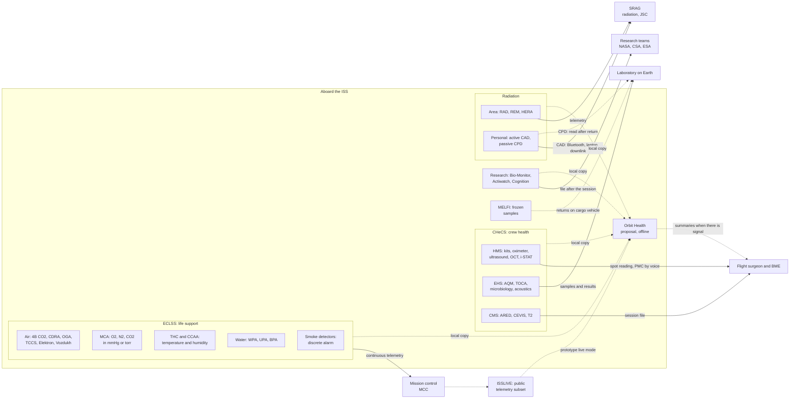

# 02. Equipment and data

> For whom: developers (mainly Dev B, data and input) and the development AI. No knowledge of medicine or space stations is needed.
> Question it answers: which real ISS equipment generates data useful for Orbit Health, what each one does, how it delivers the data and in which unit.
> Sources: front 1, [`../pesquisa/bruto/01-eclss-ambiente-radiacao.md`](../pesquisa/bruto/01-eclss-ambiente-radiacao.md) (environment and radiation), and front 2, [`../pesquisa/bruto/02-equipamentos-medicos-tripulacao.md`](../pesquisa/bruto/02-equipamentos-medicos-tripulacao.md) (body). The raw files keep all the citations; here only the main official link for each fact is kept.
> Thresholds (green, yellow, red) are **not** here: they are in [`03-indicators-and-thresholds.md`](03-indicators-and-thresholds.md). Canonical field names and units: [`06-data-model.md`](06-data-model.md). Conversions: [`04-data-cross-referencing.md`](04-data-cross-referencing.md), A1.

---

## 1. How to read this catalog

### 1.1 The table columns

**Equipment**: official name in English and expanded acronym (in parentheses, the segment when it is not the American one). **What it does**: one didactic sentence. **Quantities and unit**: what the equipment measures, in the unit in which **the source** says the data comes out, which may not be the canonical one from `docs/06`. **Frequency or cadence**: starts with the **data class** (section 1.2) and then gives the published cadence. **How the data comes out**: local screen, telemetry, file transferred later, sample that returns to Earth or voice conversation. **Status**: since when, who built it and the latest public evidence of use. **Main source**: official link copied from the raw file.

### 1.2 The four data classes (the most important distinction in this document)

Front 2 showed that almost all body data is episodic, and front 1 separates environmental data into system telemetry, samples analyzed on board, passive dosimetry analyzed on the ground and scientific data from the OSDR. For the software this becomes four classes, which match the `disponibilidade` (availability) field of `Leitura` (Reading) (see the availability note in [`06-data-model.md`](06-data-model.md), section 2.5).

| Class | What it means | Examples | How it becomes `Leitura` |
| --- | --- | --- | --- |
| **Continuous** | The equipment measures by itself, all the time, and the value comes out as telemetry or stays recorded with a timestamp. | MCA, CCAA, RAD, CAD | `disponivel` right after the measurement. Show the age of the data. |
| **Session** | Someone wears or turns on the device, it records for hours or days, is finished and only then the file is transferred. | Bio-Monitor (up to 48 h), Actiwatch (2 weeks), Holter | `aguardando_transferencia` until the file arrives; `instanteDisponivelUtc` is hours after `instanteUtc`. |
| **Spot** | A person takes a single reading and sees the result immediately. | Kit pulse oximeter, SLAMMD, TOCA, i-STAT, urine strip | `origem: "manual"` or `"exame"`, available immediately. |
| **Sample** | Material collected, stored (sometimes frozen) and analyzed later, often on Earth. | Blood, saliva, CPD, Area PADLES, MAS plates | `pendente_laboratorio` until the report, which may arrive months later. |

### 1.3 USOS, ROS and modules

The ISS has two segments with their own life support: the **USOS** (US Orbital Segment, the American segment, where for example the US Lab Destiny, Node 3 Tranquility and the Quest Airlock are located) and the **ROS** (Russian Orbital Segment, with the Zvezda Service Module). They share the atmosphere when the passages are open, but the systems and procedures are not interchangeable ([NASA ISS Familiarization](https://ntrs.nasa.gov/api/citations/20250005232/downloads/International%20Space%20Station%20Familiarization.pdf)). That is why the `Modulo` (Module) of `docs/06` has the `segmento` field. Other modules cited in the sources: Columbus (ESA), Kibo/JEM (JAXA) and Cupola.

### 1.4 Reading rules

- **Nothing here is a public live feed**, except the ISSLIVE subset in section 6 and the historical datasets (EDA, RadLab) cited there. Individual medical data of astronauts is not public.
- **Status** is the latest primary public evidence found, not a guarantee of operation on 11/15/2026.
- **NOT FOUND** means the research did not find sufficient primary public source, not that the data does not exist inside NASA.
- Codes such as **5A, 1R, 1A/R, 7A** are first-flight milestones of the station assembly, not activation dates ([NASA ISS Familiarization](https://ntrs.nasa.gov/api/citations/20250005232/downloads/International%20Space%20Station%20Familiarization.pdf)).
- Reference values cited here are context. What defines color in the software is `docs/03`.

---

## 2. Overview: systems and where the data goes

Reading the diagram: solid lines are paths documented in the sources; dashed lines with "local copy" are the Orbit Health **proposal** (an approved internal gateway would feed the onboard computer, as front 1 recommends for offline operation). According to front 2, radiation sensors are also part of the EHS; they appear separately only to make reading easier ([NASA ISS Familiarization, section 14](https://ntrs.nasa.gov/api/citations/20250005232/downloads/International%20Space%20Station%20Familiarization.pdf)).

---

## 3. Part A. Environment (front 1)

### 3.1 Atmosphere, pressure and CO2 removal

This equipment **produces or cleans** the air. Almost none of it is a health sensor: the data that matters to the body is the partial pressure measured in the module (section 3.2), not the on or off state of the machine.

| Equipment | What it does | Quantities and unit | Frequency or cadence | How the data comes out | Status | Main source |
| --- | --- | --- | --- | --- | --- | --- |
| Pressure Control Assembly (PCA), part of the Atmosphere Control and Supply (ACS) | Controls cabin pressure and adds O2 and N2. | Total pressure in psia or torr (scale of the public item to be confirmed). Nominal about 14.7 psia; generic NASA requirement 14.0 to 14.9 psia. | **Continuous**. Public rate NOT FOUND. | USOS telemetry to the MCC; item USLAB000058 in the community map. | First flight 5A; active as an ACS function, with no public per-unit inventory. | [CCT-REQ-1130](https://ntrs.nasa.gov/api/citations/20170001943/downloads/20170001943.pdf?__source=newsletter%7Cspacenewsletter) |
| Oxygen Generation Assembly (OGA) | Splits water by electrolysis: O2 goes to the cabin, H2 is vented or goes to the Sabatier. | O2 production in lb/day: capacity 20.4 lb/day (9.25 kg/day) at 100%, commandable from 22% to 100%; cumulative average of 5.78 lb/day through Jun. 2024. State as an enumerated code. | **Continuous** (state and rate). | Telemetry; NODE3000010 (state) and NODE3000011 (lb/day) in the community map. | Launched in Jul. 2006, activated in Jul. 2007 in the US Lab, in Node 3 from 2010 to 2022, back in the US Lab in Sep. 2022. NASA MSFC and UTAS. | [ICES 2024, OGA](https://ntrs.nasa.gov/api/citations/20240007995/downloads/ICES2024141%20ISS%20ECLS%20Presentaton%20RevA.pdf) |
| Elektron-VM (ROS) | Water electrolysis that supplies O2 to the Russian segment, in the Zvezda. | Units, range and alarms: NOT FOUND. | NOT FOUND. | NOT FOUND in a public source. | First flight 1R (Zvezda hardware in 2000). Status 2025/2026: NOT FOUND. | [NASA ISS Familiarization](https://ntrs.nasa.gov/api/citations/20250005232/downloads/International%20Space%20Station%20Familiarization.pdf) |
| Four Bed CO2 Scrubber (4B CO2, also 4BMS) and Carbon Dioxide Removal Assembly (CDRA) | Remove CO2 from the air with zeolite beds. | Not a sensor. The target inlet of 2 torr for four equivalent crew members is an engineering parameter, not an exposure limit. | **Continuous** (adsorption and regeneration cycles). | Equipment state. The 4BMS state does not appear in the public feed. | 4B CO2: launched in Aug. 2021, activated in Oct. 2021, NASA MSFC; ICES 2026 describes it as primary removal. CDRA: first delivery 5A; current and simultaneous operation NOT FOUND. | [NTRS, 4B CO2 project](https://ntrs.nasa.gov/citations/20205003542); [ICES 2026](https://ntrs.nasa.gov/citations/20260007665) |
| Vozdukh (ROS) | Removes CO2 in the Russian segment, with LiOH (lithium hydroxide) as backup. | Capacity, alarms and telemetry: NOT FOUND. | Historical cycles of 10, 20 or 30 min. | CO2 vented to space. | First flight 1R. Status 2025/2026: NOT FOUND. | [NTRS, ROS venting](https://ntrs.nasa.gov/api/citations/20180006142/downloads/20180006142.pdf) |
| Sabatier (Carbon Dioxide Reduction Assembly) | Combines the H2 from electrolysis with the removed CO2 and forms water (back to the WPA) and methane (vented). | Not a sensor. | Not applicable. | Not applicable. | Operated from Nov. 2010; out of service since Oct. 2017 according to a 2024 source; return NOT FOUND. | [ICES 2024, water](https://ntrs.nasa.gov/api/citations/20240005472/downloads/ICES%202024-317%20Status%20of%20ISS%20Water_Final.pdf) |
| Trace Contaminant Control Subassembly (TCCS) | Removes gases released by materials and people: activated charcoal, heated catalytic oxidizer and LiOH bed. | Does not measure concentration (AQM, SAM and samples do that). | **Continuous**; beds replaced periodically. | No public telemetry. | First delivery 5A, activated in Feb. 2001. Per-unit operation in 2026: NOT FOUND. | [NTRS, TCCS](https://ntrs.nasa.gov/citations/20030065986) |
| Solid Fuel Oxygen Generator (SFOG/TGK, ROS) and Nitrogen/Oxygen Recharge System (NORS) | SFOG: chemical cartridge that releases O2 in a contingency. NORS: tanks that recharge gas in the Quest Airlock. | NORS: 7,000 psia, bottle pressure and not cabin pressure. | On demand. | Vehicle telemetry, not health. Stock and inventory: NOT FOUND. | SFOG: first flight 1A/R. The 1997 oxygen candle accident was on Mir, not on the ISS. | [NTRS, NORS](https://ntrs.nasa.gov/archive/nasa/casi.ntrs.nasa.gov/20140001491.pdf); [NTRS, chemical generators](https://ntrs.nasa.gov/api/citations/20090006787/downloads/20090006787.pdf) |

**How it works inside**
- **4B CO2 and CDRA.** The air passes through zeolite molecular sieves that trap the CO2 (adsorption). When a bed saturates, it is heated and swapped for another; the heat releases the CO2 for exhaust and the bed becomes usable again (regeneration). That is why the machine works in cycles ([NASA ECLSS](https://www.nasa.gov/reference/environmental-control-and-life-support-systems-eclss/)).
- **OGA and Sabatier.** Electric current splits water into O2 and H2. The Sabatier would use that H2 with the cabin CO2 to remake water, recovering at most a theoretical 50 to 54% of the oxygen trapped in the CO2, because the H2 leaves in the vented methane ([NTRS, Sabatier](https://ntrs.nasa.gov/citations/20160009739)). Generating O2 (OGA) is different from recovering O2 from CO2 (Sabatier).
- **Partial pressure.** Each gas in the mixture accounts for a part of the total pressure. 3 mmHg of CO2 equals about 0.4% by volume only near 1 atmosphere; the conversion changes with total pressure ([OCHMO-TB-004](https://www.nasa.gov/wp-content/uploads/2023/12/ochmo-tb-004-carbon-dioxide.pdf)).

### 3.2 Air monitoring (composition and contaminants)

| Equipment | What it does | Quantities and unit | Frequency or cadence | How the data comes out | Status | Main source |
| --- | --- | --- | --- | --- | --- | --- |
| Major Constituent Analyzer (MCA) | Mass spectrometer that tracks the main gases of the air at points in the USOS. | Partial pressure of N2, O2, H2, CO2, CH4 and water vapor, in mmHg or torr. | **Continuous**. NASA publishes 24 h averages per module. | Telemetry to the ground; items USLAB000053 to 55 and NODE3000001 to 3 in the community map. | First delivery 5A; appears in current atmosphere measurements. | [NTRS, MCA](https://ntrs.nasa.gov/citations/20060023360); [NTRS, calibration](https://ntrs.nasa.gov/api/citations/20100024404/downloads/20100024404.pdf) |
| Air Quality Monitor (AQM) | Measures volatile organic compounds (VOCs) by gas chromatography with differential mobility spectrometry (GC-DMS). | Concentration per compound, in ppm or ppb. | **Spot**: twice a week with 22 targets (2015 report); a NASA page for the 2025 period cites two AQMs and 23 target VOCs. More often in a contingency. | Instrument result sent to the ground. | On the ISS since Mar. 2013, validated in Jan. 2014. Sionex, Wyle and NASA JSC. Active version in 2026: NOT FOUND. | [NTRS, AQM](https://ntrs.nasa.gov/api/citations/20150018596/downloads/20150018596.pdf); [NASA Toxicology](https://www.nasa.gov/directorates/esdmd/hhp/toxicology-and-environmental-chemistry/) |
| Spacecraft Atmosphere Monitor (SAM, also SCRAM-2) | JPL demonstration of a miniaturized gas chromatograph and mass spectrometer (GC/MS). | N2, O2, Ar, CO2, CH4 (TDU1); VOCs (TDU2). Partial pressure, ppm or ppb. | **Continuous** in a campaign: TDU1 every 1 s from Aug. 2019 to Jul. 2021; TDU2 for 10 weeks in 2024. | Results sent to the ground. | NASA JPL. Operation in 2026: NOT FOUND. Do not register as an active clinical sensor. | [PAPER, SAM](https://www.sciencedirect.com/science/article/pii/S1387380622000525); [NASA, Oct. 2024](https://www.nasa.gov/centers-and-facilities/johnson/station-science-top-news-oct-25-2024/) |
| ANITA and ANITA-2 (ESA) | Fourier transform infrared (FTIR) spectrometer for contaminants. | 32 contaminants, at low ppm or high ppb. Does not measure O2, N2 or H2. | **Continuous** in a 6 min cycle (ANITA); current ANITA-2 frequency: NOT FOUND. | Local collection or remote sample bag. | ANITA in 2007; ANITA-2 in 2021, used in Columbus in 2022 and 2023. Status 2026: NOT FOUND. | [ESA, ANITA](https://www.esa.int/sv/articles/anita-air-quality-monitoring-for-the-international-space-station); [ESA, ANITA-2](https://www.esa.int/media/the-analyzing-interferometer-for-ambient-air-2-anita-2) |
| Carbon Dioxide Monitor (CDM) | Portable CO2 monitor, calibrated through the MCA sample port. | Unit and sensor principle: NOT FOUND. | **Spot**. | Local reading. | Documented in 2016. Different from the MCA and from the wearable monitor. | [NASA Daily Summary 2016](https://www.nasa.gov/blogs/stationreport/2016/06/01/iss-daily-summary-report-06-01-16/) |
| Personal CO2 Monitor | Wearable demonstration sensor to measure CO2 near the person and study pockets. | Unit and nominal frequency: NOT FOUND. | **Session**: in 2016, four monitors for several hours. | Data downloaded via iPad; NASA cites downlink capability. | Research (2016 and resumed in 2024), with no daily use per crew member nor clinical alert. | [NASA, wearables 2024](https://www.nasa.gov/missions/station/iss-research/wearable-tech-for-space-station-research/) |

CO2 context (the software thresholds are in `docs/03`): the public operational ISS rule is a 24 h average up to 3 mmHg, approved in 2016; NASA-STD-3001 Vol. 2 Rev. F asks for a 1 h average up to 3 mmHg (requirement V2 6004, which is what the software uses); OCHMO-TB-004 associates a 7 day average below 2.5 mmHg with a headache risk below 1%. These are three different windows (1 h, 24 h, 7 days), each with its own purpose; readings from July to November 2025 were typically between 1.7 and 2.1 mmHg; values of 5.3 mmHg and peaks of 7.6 to 10 mmHg are old requirements ([OCHMO-TB-004](https://www.nasa.gov/wp-content/uploads/2023/12/ochmo-tb-004-carbon-dioxide.pdf); [NASA-STD-3001 Vol. 2 Rev. E](https://ntrs.nasa.gov/api/citations/20250004555/downloads/NASA-STD-3001%20Vol%202%20Rev%20E%20FINAL_05022025.pdf)).

**How it works inside**
- **MCA.** A mass spectrometer separates the molecules of the air sample by mass and measures how much of each exists (definition of the method; front 1 does not detail the inside of the MCA). Each gas becomes a partial pressure in mmHg or torr. It measures at the sampling point, not next to the crew member's face ([NASA-STD-3001 Vol. 2 Rev. F](https://www.nasa.gov/wp-content/uploads/2025/05/nasa-std-3001-vol-2.pdf)).
- **AQM.** Chromatography separates the compounds in the sample; the DMS identifies each one by the mobility of its ions ([NTRS, AQM](https://ntrs.nasa.gov/citations/20170002579)). Each compound has its own SMAC (Spacecraft Maximum Allowable Concentration) limit, which depends on duration; there is no "general SMAC".
- **ANITA.** Each gas absorbs infrared light in its own way; that is why the FTIR identifies contaminants but cannot see O2, N2 and H2, which have no suitable absorption ([ESA, ANITA](https://www.esa.int/sv/articles/anita-air-quality-monitoring-for-the-international-space-station)).

### 3.3 Temperature, humidity and ventilation

| Equipment | What it does | Quantities and unit | Frequency or cadence | How the data comes out | Status | Main source |
| --- | --- | --- | --- | --- | --- | --- |
| Common Cabin Air Assembly (CCAA), part of the Temperature and Humidity Control (THC) | Draws air from the cabins and racks, removes heat in an exchanger and condenses moisture. The THC also includes CHIPS filters (Charcoal HEPA Integrated Particle Scrubbers). | Air temperature in °C; relative humidity (RH) in %; design flow 200 to 400 ft³/min (5.7 to 11.3 m³/min). | **Continuous**. Public rate NOT FOUND. | Telemetry. USLAB000059 is the CCAA inlet temperature (°C, community map). RH has no public item. | First flight 5A; documented in the ICES 2024 status. | [ICES 2024, THC](https://ntrs.nasa.gov/api/citations/20240007333/downloads/ICES_085_Presentation_Final.pdf) |
| Intermodule Ventilation (IMV) and fans | Move air between modules and to the revitalization equipment. | Design flow 120 to 150 ft³/min (3.4 to 4.2 m³/min). | **Continuous**. | Internal controls; some states in the feed, such as NODE3000018 (air conditioner). | In use. | [ICES 2024, THC](https://ntrs.nasa.gov/api/citations/20240007333/downloads/ICES_085_Presentation_Final.pdf) |
| Fluid temperature sensors | Measure the water of the avionics and air cooling loops. | °C (fluid temperature, **not** cabin air). | **Continuous**. | Public feed: USLAB000060 and 61, NODE3000012 and 13. | Community map items. | [ISS-Mimic](https://iss-mimic.github.io/Mimic/) |

**How it works inside**
- **Why ventilation matters.** In microgravity warm air does not rise, so there is no useful natural convection: without a fan, CO2 and heat form pockets. NASA-STD-3001 requires enough circulation to avoid those pockets ([NASA-STD-3001 Vol. 2 Rev. F](https://www.nasa.gov/wp-content/uploads/2025/05/nasa-std-3001-vol-2.pdf)).
- **Temperature and humidity go together.** The health limit is a combined envelope, from about 18 °C with 75% RH to 27 °C with 25% RH; the historical range of 17 to 28 °C, with a dew point of 4.4 to 15.6 °C, comes from an old document and does not replace the current limit ([NASA-STD-3001 Vol. 2, section 6.2.3](https://www.nasa.gov/reference/6-0-natural-and-induced-environments-vol-2/); [ISS Tech Demo Mini Book](https://www.nasa.gov/wp-content/uploads/2023/08/np-2022-06-009-jsc-iss-tech-demo-mini-book-proof-3.pdf)).

### 3.4 Water

| Equipment | What it does | Quantities and unit | Frequency or cadence | How the data comes out | Status | Main source |
| --- | --- | --- | --- | --- | --- | --- |
| Urine Processor Assembly (UPA) | Pre-treats urine and distills it at low pressure in a rotating assembly. | Typical recovery of about 85% of the water in urine (process performance, not physiological data). Enumerated state; tank in % (unit not confirmed). | **Continuous** (state). | Telemetry; NODE3000004 (state) and NODE3000005 (tank). | Water Recovery System in operation since Nov. 2008; new Distillation Assembly in Sep. 2020. NASA MSFC. | [NTRS, UPA and WPA](https://ntrs.nasa.gov/api/citations/20230002933/downloads/Alternative%20Treatment%20and%20Resource%20Recovery%20of%20Crew%20Urine%20and%20Gray%20Water%20Using%20a%20Hybrid%20Membrane%20Technology.pdf?attachment=true) |
| Brine Processor Assembly (BPA) | Removes water from the brine left over by the UPA, by evaporation with air. | Raises urine stream recovery to above 90%. Sensor cadence: NOT FOUND. | **Continuous** (process). | No public item identified. | NASA and Paragon contract in 2016; on the ISS since Mar. 2021; 98% milestone in 2023. | [NASA, 98% milestone](https://www.nasa.gov/missions/station/iss-research/nasa-achieves-water-recovery-milestone-on-international-space-station/) |
| Water Processor Assembly (WPA) | Treats condensate, urine distillate and wastewater with filtration beds and a catalytic reactor. | Conductivity (to decide whether to reprocess); enumerated state and stage; tanks in % (unit marked as unknown in the map). | **Continuous** (state). | Telemetry; NODE3000006 to 9. | Since Nov. 2008. Hamilton Sundstrand with NASA MSFC. | [ICES 2026, ECLSS](https://ntrs.nasa.gov/api/citations/20260003280/downloads/ISS%20ECLSS%20Testbed%202026_final_A.pdf?attachment=true) |
| Potable Water Dispenser (PWD, xPWD) | Dispenses water for drinking and food preparation, hot or ambient. | Dose in 25 mL increments; average hot water of about 82 °C (65 to 93 °C). | **Spot** (each dispense). | Dispenser output; per-crew-member logging is not cited in the source. | In service since 2008; status of each unit not verified. | [NASA-STD-3001 Vol. 2, water](https://www.nasa.gov/reference/6-0-natural-and-induced-environments-vol-2/) |
| Total Organic Carbon Analyzer (TOCA) | Analyzes a water sample: total, inorganic and organic carbon, pH and conductivity. | Total organic carbon (TOC) in mg/L; pH unitless; conductivity in µS/cm. Historical TOC limit: 3 mg/L (confirm current table). | **Spot**, up to 30 min per analysis; weekly at the start of the increment and monthly afterward (familiarization manual). | Crew member reads the display; result may go through the MEC laptop. Archive samples return to Earth. | Configuration confirmed in 2025; cadence in Nov. 2026: NOT FOUND. | [NASA ISS Familiarization](https://ntrs.nasa.gov/api/citations/20250005232/downloads/International%20Space%20Station%20Familiarization.pdf); [NTRS, water limits](https://ntrs.nasa.gov/api/citations/20170001718/downloads/20170001718.pdf) |
| Residual iodine (biocide of the American loop) | Keeps the water protected against microorganisms. | 2017 references: 0.2 mg/L in potable water, biocidal range of 1 to 4 mg/L. Silver (0.05 to 0.4 mg/L) is historical and must not be treated as the current USOS biocide. | **Sample**. | Iodine or silver telemetry: NOT FOUND. | Values require confirmation in the current JSC-63414 list. | [NTRS, water monitoring](https://ntrs.nasa.gov/api/citations/20170001718/downloads/20170001718.pdf) |

**How it works inside**
- **The water cycle.** The UPA distills the urine, the BPA recovers water from the brine (the vapor goes to the cabin, the CCAA condenses it and the WPA processes it) and the WPA treats everything. The 98% is demonstrated capacity of the combined cycle in 2023, not an instantaneous reading nor a guarantee in every cycle ([NASA, 98% milestone](https://www.nasa.gov/missions/station/iss-research/nasa-achieves-water-recovery-milestone-on-international-space-station/)).
- **TOCA.** Gives an aggregate number for organic matter, but does not identify which compound it is; the limits per compound (SWEGs, Spacecraft Water Exposure Guidelines) depend on concentration and duration ([NASA Toxicology](https://www.nasa.gov/directorates/esdmd/hhp/toxicology-and-environmental-chemistry/)).

### 3.5 Microbiology (water, air and surfaces)

| Equipment | What it does | Quantities and unit | Frequency or cadence | How the data comes out | Status | Main source |
| --- | --- | --- | --- | --- | --- | --- |
| Water Microbiology Kit (WMK): Microbial Capture Device (MCD) and Coliform Detection Bag (CDB) | Filters the water, captures microorganisms and cultures them; the CDB tests for coliforms. | Heterotrophs in CFU/mL (colony forming units; historical specification up to 50 CFU/mL); total coliforms in CFU/100 mL (historical criterion: 0). | **Sample**: quarterly (2022 paper); coliforms read after about 2 days of incubation. | Crew reads the kit and reports to the ground; sample may return to Earth. | No real-time result. | [NTRS, water limits](https://ntrs.nasa.gov/api/citations/20170001718/downloads/20170001718.pdf); [NTRS, WRS monitoring](https://ntrs.nasa.gov/citations/20220016272) |
| Microbial Air Sampler (MAS) | Draws 60 L of air in 3 min onto culture medium for bacteria or fungi. | Colony density per plate (not CFU/mL). | **Sample**: every 3 months; read after 5 days at room temperature. | Crew estimates and reports; plates return to the JSC for identification. | In use in the monitoring program. | [NTRS, MAS](https://ntrs.nasa.gov/api/citations/20220016274/downloads/NASA%20Slides%20for%20the%202nd%2021st%20Century_TIM_DLR%20%281%29_FINAL.pdf?attachment=true) |
| Surface Sampler Kit (SSK) | Surface swab for culture of bacteria and fungi. | Culture result; current quantitative unit and limit: NOT FOUND. | **Sample**: two locations per habitable module per quarter. | Photos and crew record; analysis after return. | In use. | [NASA ISS Familiarization](https://ntrs.nasa.gov/api/citations/20250005232/downloads/International%20Space%20Station%20Familiarization.pdf) |
| Microbial Tracking and sequencing | Scientific campaigns that identify species and genes. | Depends on the protocol. | **Sample** per campaign. | Research data in the OSDR. | Research, not an operational alarm. | [NTRS, Microbial Tracking](https://ntrs.nasa.gov/citations/20210023918) |

**How it works inside:** microbiology depends on culture, and the microorganism needs to grow to be counted. That is why the result only exists days after collection and cannot be classified before incubation. The software stores location, method, collection date, incubation and validity ([NTRS, MAS](https://ntrs.nasa.gov/api/citations/20220016274/downloads/NASA%20Slides%20for%20the%202nd%2021st%20Century_TIM_DLR%20%281%29_FINAL.pdf?attachment=true)).

### 3.6 Acoustics

| Equipment | What it does | Quantities and unit | Frequency or cadence | How the data comes out | Status | Main source |
| --- | --- | --- | --- | --- | --- | --- |
| ISS Acoustic Monitor (Svantek SV102A+, class 1), per-module measurement | Measures sound pressure level per frequency band. | Overall level in dBA; NC (Noise Criteria) curve by bands, dimensionless. | **Spot** or campaign. Current routine: NOT FOUND. | Local reading and record by procedure. No public feed. | In use; results published through Increment 70. | [ICES 2024, acoustics](https://ntrs.nasa.gov/api/citations/20240006442/downloads/ICES-2024-354%20ISS%20Acoustics.pdf?attachment=true) |
| The same SV102A+ as a personal dosimeter | Worn by the crew member, integrates the received noise over time. | Dose and time-weighted average (TWA) level in dBA. | **Session**. | Local reading; personal dose telemetry: NOT FOUND. | In use. | [ICES 2024, acoustics](https://ntrs.nasa.gov/api/citations/20240006442/downloads/ICES-2024-354%20ISS%20Acoustics.pdf?attachment=true) |

**How it works inside:** the standard uses NC-50 for work areas, NC-40 for sleep areas and a daily dose up to 100, equivalent to 75 dBA of TWA over 8 h ([NASA-STD-3001 Vol. 2 Rev. F](https://www.nasa.gov/wp-content/uploads/2025/05/nasa-std-3001-vol-2.pdf)). Noise varies a lot by location: Node 3 with 55.9 dBA (NC 50.5), Cupola with 49.2 dBA (NC 44.2) and a crew quarters with 43.8 dBA (NC 36.6), on specific dates ([ICES 2024, acoustics](https://ntrs.nasa.gov/api/citations/20240006442/downloads/ICES-2024-354%20ISS%20Acoustics.pdf?attachment=true)).

### 3.7 Lighting

| Equipment | What it does | Quantities and unit | Frequency or cadence | How the data comes out | Status | Main source |
| --- | --- | --- | --- | --- | --- | --- |
| Solid State Lighting Assemblies (SSLA) | LED luminaires with spectra for routine, pre-sleep and alertness. Blue light influences melatonin and sleep, but the luminaire is not a health sensor. | Color temperature in K; command intensity in candela. Lux depends on position and is not published per location. | Mode chosen by the crew according to routine. Lux telemetry: NOT FOUND. | Luminaire command. | First modules launched on Jul. 8, 2016, installed in the crew quarters on Oct. 5, 2016, more installations in 2017 and 2019. KSC prototype, JSC review. | [NTRS, SSLA guide](https://ntrs.nasa.gov/api/citations/20200011570/downloads/20200011570.pdf); [NLSP, SSLA](https://nlsp.nasa.gov/search/data/details/8612dea9-d3e2-59e8-af67-184437f8e64b?dataType=EXPERIMENTS) |

| SSLA mode | Color | Command intensity | Use |
| --- | --- | --- | --- |
| General purpose | 4500 K | 112 to 320 cd, default 210 | Daytime routine |
| Pre-sleep | 2700 K | 45 to 130 cd, default 90 | About two hours before sleep |
| Alertness/phase-shift | 6500 K | minimum 147, default and maximum 420 cd | Increase alertness or shift the biological clock, guided by the flight surgeon |

Candela and lux are not interchangeable without geometry, distance and orientation ([NTRS, SSLA guide](https://ntrs.nasa.gov/api/citations/20200011570/downloads/20200011570.pdf)). The modes are a useful reference for the Orbit glasses and for the interface night mode.

### 3.8 Fire and smoke

| Equipment | What it does | Quantities and unit | Frequency or cadence | How the data comes out | Status | Main source |
| --- | --- | --- | --- | --- | --- | --- |
| Smoke detectors, part of the Fire Detection and Suppression (FDS) | Photoelectric smoke detection; dust and aerosols can cause a false alarm. | Discrete alarm (yes or no), not ppm. Quantitative threshold: NOT FOUND. | **Continuous**. | Local alarm and communication with the MCC. | First flight 1A/R; periodic inspections in recent reports. ROS has its own architecture. | [OCHMO-TB-008, fire](https://www.nasa.gov/wp-content/uploads/2023/12/ochmo-tb-008-fire-protection.pdf) |
| Compound Specific Analyzer for Combustion Products (CSA-CP) | Portable with electrochemical sensors, used after suspected combustion. | CO, HCl and HCN in ppm, plus O2. Design range: CO 5 to 1000 ppm, HCl and HCN 2 to 50 ppm, resolution of 1 ppm. | **Spot**, on demand. | Local reading, reported by voice. | Version in use in 2026: NOT FOUND. Does not replace the detector. | [NTRS, CSA-CP](https://ntrs.nasa.gov/archive/nasa/casi.ntrs.nasa.gov/20170002222.pdf) |
| Portable Breathing Apparatus (PBA) | O2 cylinder with a mask for fire, depressurization or contamination. Not a sensor. | USOS: 15 min of O2 at 18 L/min, maximum flow of 90 L/min. | Emergency. | Generates no data. | First flight 1A/R. | [NASA ISS Familiarization](https://ntrs.nasa.gov/api/citations/20250005232/downloads/International%20Space%20Station%20Familiarization.pdf) |

**How it works inside:** on alarm, the procedure turns off fans, closes the IMV valves, the crew puts on masks, cuts power to the affected loads and uses an extinguisher (CO2 in the USOS, water in the ROS); the MCC coordinates ([OCHMO-TB-008](https://www.nasa.gov/wp-content/uploads/2023/12/ochmo-tb-008-fire-protection.pdf)). Orbit Health only shows and points to the procedure; it never replaces the alarm ([`../AGENTS.md`](../AGENTS.md), rule 6).

### 3.9 Area radiation

Before the table, the quantities, which cannot be mixed ([NTRS, effective doses](https://ntrs.nasa.gov/citations/20080026203); [RadLab API](https://visualization.osdr.nasa.gov/radlab/gui/data-api/)):

| Quantity | Unit | Caution |
| --- | --- | --- |
| Absorbed dose | Gy (mGy, µGy); rate in µGy/h | Energy deposited per mass; on its own it does not tell the biological damage. |
| Equivalent dose | Sv (mSv, µSv); short-term limits in Gy-eq | Weighted by radiation type. The dose from an area detector is not the personal dose. |
| Effective dose | Sv | Estimated by a model for the whole body; no dosimeter reads it directly. |
| LET (Linear Energy Transfer) | keV/µm | Tells the quality of the radiation; it is not a dose. |
| Flux | particles per cm² per sr per s | Depends on the instrument and the particle. |

| Equipment | What it does | Quantities and unit | Frequency or cadence | How the data comes out | Status | Main source |
| --- | --- | --- | --- | --- | --- | --- |
| ISS Radiation Assessment Detector (ISS-RAD, now RAD) | Active detector with Charged Particle Detector (CPD) and Fast Neutron Detector (FND); reference for trend and for estimating extra dose in a spacewalk (EVA). | Dose rate. Unit and resolution in open telemetry: NOT FOUND. | **Continuous**; may generate a local dose rate alarm. | Telemetry to the SRAG; some processed datasets in RadLab/OSDR. | Checkout in LAB103 in Feb. 2016; in LAB106 since May 2020, confirmed in 2025. Built by SwRI, operated by the SRAG. | [NTRS, ISS-RAD 2025](https://ntrs.nasa.gov/api/citations/20250008430/downloads/ISS-RAD_SC25_WRMISS-2025-V2.pdf) |
| Tissue Equivalent Proportional Counter (TEPC) | Gas chamber with a tissue-equivalent wall that estimates the energy deposited in a microvolume of tissue. | µGy/h, µSv/h, LET spectrum. | **Continuous**; public dataset with 10 s aggregates; repositioned weekly by the crew. | Telemetry over the CHeCS/1553B bus. | Historical, with stability limitations; replaced by RAD and Timepix. Current presence: NOT FOUND. | [Data.gov, TEPC 10 s](https://catalog.data.gov/dataset/iss-tissue-equivalent-proportional-counter-tepc-dose-analyzer-10-s-data) |
| Radiation Environment Monitor (REM, REM-2) | Timepix detector (CERN technology) installed in modules such as the US Lab. | Absorbed dose, LET and spectrum per particle, depending on calibration. | **Continuous**; public cadence varies by detector. | Laptop via USB and downlink. | Since 2012; NASA SRAG with the University of Houston. Active according to the SRAG. | [NASA JSC, Timepix](https://three.jsc.nasa.gov/articles/CurrentActiveDetectors.pdf); [SRAG](https://srag.jsc.nasa.gov/SpaceRadiation/How/How.cfm) |
| Hybrid Electronic Radiation Assessor (HERA) | Timepix sensor made for the Orion caution and warning and tested on the ISS. | Dose rate. The 50 µGy/min value from the NESC analysis is a test reference, not a universal shelter threshold. | **Continuous**. | Telemetry. | Spare unit on the ISS since Apr. 2021 (NASA RadWorks/JSC). Does not prove an alert for the ISS crew. | [NASA TechPort, HERA](https://techport.nasa.gov/projects/10581); [NESC](https://ntrs.nasa.gov/api/citations/20220002905/downloads/NESC-RP-20-01589_NASA-TM-20220002905final.pdf) |
| Radiation Area Monitor (RAM) | Passive area dosimeter, with no power, that accumulates dose at the point where it sits. | Integrated dose; unit depends on the model. | **Sample**: integrates over the flight cycle. | Returns to Earth for reading. | RAM in Kibo in Mar. 2016; six RAMs in the BEAM module, monitoring ended in Dec. 2017. | [NTRS, BEAM sensors](https://ntrs.nasa.gov/api/citations/20180006494/downloads/20180006494.pdf) |
| Area PADLES (JAXA) | Passive Dosimeter for Life Science Experiments in Space: TLD (Thermoluminescent Dosimeter) plus CR-39 track plastic, in Kibo. | mGy, LET in keV/µm, mSv. | **Sample**: standard installation of 3 months (minimum 1 week, maximum 1 year). | Post-flight reading and analysis on Earth. | Campaigns generate spatial difference maps in Kibo. | [JAXA, PADLES](https://iss.jaxa.jp/en/kiboexp/pm/padles/) |
| DOSIS-3D and DOSTEL (ESA and DLR) | 11 passive points in Columbus plus active silicon telescopes (DOSTEL). | Absorbed and equivalent dose, LET. | Active: median of 5 min in RadLab. Passive: **Sample**. | Active: time series published in RadLab; passive returns to Earth. | Activity of years; operation in 2026: NOT FOUND. | [ESA, DOSIS-3D](https://sdg.esa.int/activity/dosis-3d-4039) |
| Light Ions Detector for ALTEA (LIDAL) | Adds scintillators and time of flight to ALTEA for light ions, in Columbus. | Stated goal: real-time risk coefficients; DORELI data with 300 s resolution in RadLab. | **Continuous** in a campaign. | DORELI data in RadLab; the LIDAL item is still a metadata stub. | Reinstalled in EXPRESS Rack 3 in Sep. 2021; activity in 2026 not proven. | [NASA Daily Summary 2021](https://www.nasa.gov/blogs/stationreport/2021/09/10/iss-daily-summary-report-9-10-2021/) |
| Matroshka and Matryoshka-R | Tissue-equivalent mannequin full of dosimeters, to study the dose inside the body. | mGy and mSv per position or organ; in one campaign, about 1 mGy/day at the surface and 0.2 to 0.3 mGy/day in the organs. | **Sample**, per campaign. | Ground analysis. | Arrived in 2004; historical research, no active status in 2026. | [NASA, Matroshka-1](https://www.nasa.gov/wp-content/uploads/2022/03/iss_technical_publication_030116.pdf) |

**How it works inside**
- **Timepix (REM and HERA).** A pixelated silicon matrix collects the ionization charge left by each particle and shows its track, which makes it possible to distinguish particles and deposited energy ([SRAG](https://srag.jsc.nasa.gov/SpaceRadiation/How/How.cfm)).
- **Passive (RAM, PADLES, CPD).** They have no battery or screen. The TLD records the absorbed dose and the CR-39 records the LET spectrum and heavy particles; reading is done in a laboratory after the return to Earth ([JAXA, PADLES](https://iss.jaxa.jp/en/kiboexp/pm/padles/)).
- **Where radiation comes from.** Galactic cosmic rays (GCR, continuous background), solar particle events (SPE, episodic), Van Allen belts and the South Atlantic Anomaly (SAA, a stretch of the orbit with a higher dose, predictable from position). The SRAG (Space Radiation Analysis Group), at the JSC, brings together detectors and models and supports flight control and the flight surgeon ([SRAG](https://srag.jsc.nasa.gov/SpaceRadiation/How/How.cfm)).

### 3.10 Personal dosimetry

| Equipment | What it does | Quantities and unit | Frequency or cadence | How the data comes out | Status | Main source |
| --- | --- | --- | --- | --- | --- | --- |
| Crew Active Dosimeter (CAD) | Small wearable dosimeter with an e-paper display and Bluetooth. | Accumulated absorbed dose and recent rate (Gy, mGy), with a timestamp. Does not calculate effective dose. | **Continuous**, with daily download. | Crew member reads the display; Bluetooth to onboard laptops and daily downlink to the SRAG. Does not go directly to the medical record. | Certified in 2020, used since Crew-1. Mirion Dosimetry Services, from Instadose technology. | [SRAG, CAD](https://srag.jsc.nasa.gov/SpaceRadiation/How/How.cfm); [NTRS, CAD operation 2023](https://ntrs.nasa.gov/api/citations/20230009510/downloads/Barzilla_ICES2023_RGaza_compressed.pdf) |
| Crew Passive Dosimeter (CPD) | Individual passive package with TLD, OSLD (Optically Stimulated Luminescence Dosimeter) and PNTD (Plastic Nuclear Track Detector), worn all the time and during EVA. | Integrated dose, laboratory result. | **Sample**. | Laboratory reading after return; no alarm during the mission. | Continuous use required for designated crew members; composition varies per flight. | [NTRS, CPD](https://ntrs.nasa.gov/api/citations/20090021477/downloads/20090021477.pdf) |
| Russian personal dosimeters | The ROS's own passive dosimetry. | Brand, model and unit: NOT FOUND. | NOT FOUND. | Assessment by the Russian medical program on the ground. | Do not attribute to the USOS CAD. | [NASA Space Radiation](https://www.nasa.gov/directorates/esdmd/hhp/space-radiation/) |

**How it works inside**
- **CAD.** Uses Direct Ion Storage (DIS): ionizing radiation changes the charge stored in a transistor and calibration translates that change into dose ([SRAG, CAD](https://srag.jsc.nasa.gov/SpaceRadiation/How/How.cfm)).
- **Limits context (software values in `docs/03`).** Career: less than 600 mSv of effective dose. Short term per organ in Gy-eq: in 30 days, bone marrow 0.25, lens 1.0 and skin 1.5 ([OCHMO-STD-100.1A](https://ntrs.nasa.gov/api/citations/20240006194/downloads/OCHMO%20STD%20100%201A%2005142024.pdf?attachment=true)). Typical six-month dose: the sources diverge, with 80 to 160 mSv in a NIAC proposal and 50 to 100 mSv in a later technical synthesis; neither is a universal value ([NIAC](https://ntrs.nasa.gov/api/citations/20250002403/downloads/NIAC_2022_PhI_DOnghia_CREWHat.pdf); [NTRS, synthesis](https://ntrs.nasa.gov/api/citations/20240008451/downloads/PASM_070124_to%20pubpress_Final.pdf)).
- **Solar event.** NOAA and forecast centers warn the SRAG, which coordinates with flight control and the flight surgeon; if necessary the crew shelters in crew quarters, areas of the US Lab or the aft part of the Service Module. The decision is operational and medical, not an app decision ([SRAG](https://srag.jsc.nasa.gov/SpaceRadiation/How/How.cfm)).

---

## 4. Part B. Body (front 2)

### 4.1 Architecture of medical care: CHeCS and CMO

The **Crew Health Care System (CHeCS)** is the set of crew health hardware, supplies and software. The **Crew Medical Officer (CMO)** is a crew member designated as medical caregiver, who **does not need to be a physician** and follows the **Flight Surgeon** in Houston, supported by the **Biomedical Engineer (BME)** ([NASA-STD-3001 Vol. 1 Rev. C](https://www.nasa.gov/wp-content/uploads/2023/11/nasa-std-3001-vol-1-rev-c-with-signature.pdf)). CMO training appears as about 25 h pre-flight in one source and 7 to 13 h in another, different cuts that must not be added together ([NTRS, CMO training](https://ntrs.nasa.gov/api/citations/20240001015/downloads/Med%20Ops%20Crew%20Training%20%20Ground%20Support%20Training.pdf); [NTRS, EIMO](https://ntrs.nasa.gov/api/citations/20240000152/downloads/EIMO_TIM_TRAINING_MeetingSummary_FINAL.pdf)).

| Equipment | What it does | Quantities and unit | Frequency or cadence | How the data comes out | Status | Main source |
| --- | --- | --- | --- | --- | --- | --- |
| Health Maintenance System (HMS) | Prevention, diagnosis and treatment: kits, medications, vital signs, ECG, ultrasound, in-flight exams. | Depends on the instrument. | **Spot**. | Not a continuous sensor; does not consolidate the exams. | In use. | [NASA ISS Familiarization, 14.3.2](https://ntrs.nasa.gov/api/citations/20250005232/downloads/International%20Space%20Station%20Familiarization.pdf) |
| Environmental Health System (EHS) | Chemical and microbiological quality of air, water and surfaces (Part A). | See sections 3.2 to 3.5. | See Part A. | Context data, not a signal from the person. | In use. | [NASA ISS Familiarization, 14.3.2](https://ntrs.nasa.gov/api/citations/20250005232/downloads/International%20Space%20Station%20Familiarization.pdf) |
| Countermeasures System (CMS) | Exercise and monitoring during countermeasures: ARED, treadmill, cycle ergometer, HR monitors and blood pressure/ECG. | See section 4.7. | Daily **session**. | Exercise files. | In use. | [NASA ISS Familiarization, 14.4](https://ntrs.nasa.gov/api/citations/20250005232/downloads/International%20Space%20Station%20Familiarization.pdf) |
| Response kits: ALSP (Advanced Life Support Pack), AMP (Ambulatory Medical Pack), RSP (Respiratory Support Pack), AED (Automated External Defibrillator), CMRS (Crew Medical Restraint System) | Emergency, ambulatory care, respiratory support, defibrillation and body restraint for examination. | The AED may record rhythm and event; ISS AED export: NOT FOUND. | Clinical use; training with RSP and AED reported in Feb. 2026. | CMO clinical record. | Full inventory in 2026: NOT FOUND. | [NTRS, CHeCS hardware](https://ntrs.nasa.gov/api/citations/20100022009/downloads/20100022009.pdf?attachment=true); [NASA, Feb. 5, 2026](https://www.nasa.gov/blogs/spacestation/2026/02/05/dragon-preps-artificial-intelligence-and-medical-gear-fill-crews-day/) |

Dentistry and skin: there is a pre-flight dental exam and first aid material, but no continuous dental sensor or routine dental radiography on board was found; skin is observed in examination and photographed in research ([NTRS, CHeCS hardware](https://ntrs.nasa.gov/api/citations/20100022009/downloads/20100022009.pdf?attachment=true)).

### 4.2 Vital signs and wearables

| Equipment | What it does | Quantities and unit | Frequency or cadence | How the data comes out | Status | Main source |
| --- | --- | --- | --- | --- | --- | --- |
| CMO kit: ISS Medical Kit and Physical Diagnostic Pack | Stethoscope, thermometer, blood pressure cuff, pulse oximeter, glucometer, visual acuity chart. | HR in bpm, pressure in mmHg, temperature in °C, SpO2 in %, glucose in mg/dL or mmol/L. | **Spot**. | CMO records and shares through the medical flow and in the PMC. | Categories confirmed by public image; brand, model and calibration: NOT FOUND. | [NTRS, Expedition 55 kit](https://ntrs.nasa.gov/api/citations/20210020209/downloads/Aunon-Chancellor_Medical%20Challenges.pdf) |
| Bio-Monitor (CSA) | Instrumented shirt and headband, electronics module and tablet. Research wearable. | ECG (mV), HR (bpm), estimated systolic pressure (mmHg), RR (breaths/min), tidal volume (mL), ventilation (L/min), SpO2 (%), skin temperature (°C), acceleration (g), cadence (rpm). | **Session** of up to 48 h. Design rates (CSA, 2018): ECG 256 Hz, respiration at least 128 Hz, SpO2 and acceleration at least 64 Hz, temperature and parameters 1 Hz. | Tablet displays during the session; at the end, the battery goes to the base and the data comes down through ISS communications. File format: NOT FOUND. | Carré Technologies for the CSA. Arrived in Dec. 2018, commissioned in 2019 (Expedition 58). Used in Vascular Aging, Space Health and Vascular Calcium. | [CSA, Bio-Monitor](https://www.asc-csa.gc.ca/eng/sciences/bio-monitor.asp); [CSA, 2018 specification](https://www.asc-csa.gc.ca/eng/funding-programs/funding-opportunities/ao/2018-lsrs.asp) |
| Astroskin | Garment of the same family (Carré Technologies), evaluated by NASA. **Do not assume it is the Bio-Monitor.** | Two-lead ECG, HR, thoracic and abdominal respiration, RR, SpO2, estimated systolic pressure (mmHg), skin temperature, triaxial acceleration. | **Session** of up to 24 h. Study: ECG 256 Hz, respiration 128 Hz, systolic pressure 1 Hz. | App over Bluetooth Low Energy; laptop software imports the recording; study exported CSV. | Evaluated by NASA Ames and the CSA in terrestrial and analog campaigns. Not proven as flight hardware. | [NTRS, Astroskin](https://ntrs.nasa.gov/api/citations/20205009977/downloads/NASA_TM_20205009977.pdf) |
| Tempus PRO | Multiparameter monitor with ECG, pressure, oximetry, temperature, camera and laryngoscope. | ECG, bpm, mmHg, %, °C. | Spot, in testing. | Local screen; export: NOT FOUND. | Remote Diagnostic Technologies (Philips). Tested in the HESTIA analog in 2023; **candidate** for exploration, not operational on the ISS. | [NASA Glenn](https://www.nasa.gov/glenn/glenn-expertise-space-exploration/human-health-performance/exploration-medical-technologies/multifunctional-integrated-medical-devices/) |
| Holter and ESA Cardiolab | Records the ECG for hours to study rhythm and heart rate variability (HRV). | ECG in mV, HR in bpm, R-R intervals and HRV in ms. | **Session**, often 24 h in studies. | File downloaded and analyzed on the ground. | Depends on the experiment. | [ESA, Cardiolab](https://www.esa.int/Science_Exploration/Human_and_Robotic_Exploration/Research/Cardiolab) |
| Blood pressure: cuff and Finometer/Portapres | Cuff measures by oscillometry; Finometer/Portapres estimates beat to beat with a finger cuff. | Systolic, diastolic and mean in mmHg; pulse in bpm. | Cuff: **Spot**. Finometer: research **Session**. | Recorded clinical reading or study file. | Models on board in 2026: NOT FOUND. | [NASA, Human Adaptation](https://www.nasa.gov/wp-content/uploads/2023/03/human-adaptation-2020-final.pdf) |
| Thermolab and Double Sensor (ESA and Dräger) | Skin temperature sensors for circadian rhythm; core temperature is only estimated. | °C. | Study **Session**. | File analyzed with a sleep diary. | Used in circadian rhythm studies. | [ESA, Circadian Rhythms](https://www.esa.int/Science_Exploration/Human_and_Robotic_Exploration/Research/Circadian_Rhythms) |
| Actiwatch Spectrum | Watch with accelerometer and light sensor: estimates activity, rest and light. Does not measure sleep stages. | Counts per epoch; light in lux or spectral channel. | **Session**: two-week campaigns. | Stores locally; file synchronized for ground analysis. | Used in NASA sleep research. | [NTRS, sleep protocol](https://ntrs.nasa.gov/api/citations/20200001281/downloads/20200001281.pdf) |

**Bio-Monitor and Astroskin side by side** (front 2 recommends distinct identifiers until the hardware version is confirmed):

| Item | Bio-Monitor (CSA, flight) | Astroskin (NASA evaluation) |
| --- | --- | --- |
| Recording | Up to 48 h continuous | Up to 24 h, four alkaline AA batteries |
| Interface | Dedicated tablet | App over Bluetooth Low Energy and laptop software |
| File | NOT FOUND; do not presume CSV or API | CSV, read in DADiSP in the study |
| Output to the ground | Base and ISS communications, no published latency | Download to a computer |
| Engineering ranges | SpO2 30 to 100% (resolution 1%), RR 2 to 90/min, tidal volume 200 to 7000 mL, ventilation 1 to 90 L/min, cadence 0 to 240 rpm, skin 10 to 50 °C, acceleration up to ±16 g, estimated pressure ±5 mmHg or 4% | Not published in the same format |

The engineering ranges are instrument limits, not normal clinical ranges ([CSA, 2018 specification](https://www.asc-csa.gc.ca/eng/funding-programs/funding-opportunities/ao/2018-lsrs.asp)).

### 4.3 Pulse oximetry

**How it works inside.** The oximeter estimates the percentage of arterial blood hemoglobin bound to oxygen (SpO2) and the pulse rate. A diode emits **red light, around 660 nm**, and **infrared light, around 940 nm**. Oxygenated and deoxygenated hemoglobin absorb these two colors differently. The photodetector measures, in each color, the part of the absorption that pulses with the heart (AC) and the background part (DC). The algorithm calculates the "ratio of ratios", R = (AC660/DC660) ÷ (AC940/DC940), and converts R into SpO2 by a calibration curve obtained in people, comparing with arterial blood co-oximetry. The oximeter does **not** measure CO2, ventilation or cabin pressure ([PAPER, Anesthesiology](https://pubs.asahq.org/anesthesiology/article-pdf/70/1/98/317265/0000542-198901000-00019.pdf); [FDA](https://www.fda.gov/medical-devices/products-and-medical-procedures/pulse-oximeters)).

| Equipment | What it does | Quantities and unit | Frequency or cadence | How the data comes out | Status | Main source |
| --- | --- | --- | --- | --- | --- | --- |
| Exam kit pulse oximeter | Reading during symptom assessment or emergency, at the CMO's decision. | SpO2 in %, pulse in bpm. | **Spot**. Rate: NOT FOUND. | Local display. | In the kit; current model and manufacturer: NOT FOUND. | [NTRS, medical kit](https://ntrs.nasa.gov/api/citations/20210020209/downloads/Aunon-Chancellor_Medical%20Challenges.pdf) |
| Bio-Monitor SpO2 channel | Optical sensor on the headband (the specification also lists forehead, ear, finger or toe). | %SpO2, bpm. | **Session**, at least 64 Hz. | Session file. | Since Dec. 2018. | [CSA, 2018 specification](https://www.asc-csa.gc.ca/eng/funding-programs/funding-opportunities/ao/2018-lsrs.asp) |
| Portable Oxygen Monitor (POM) | Used in pre-breathing before EVA. **Measures ambient oxygen, not the person's SpO2.** | Ambient O2. | In the prebreathe operation. | Local reading. | Current; there is no basis to say pulse oximetry is mandatory in every pre-breathe. | [NTRS, prebreathe 2026](https://ntrs.nasa.gov/api/citations/20260003925/downloads/20260003925.pdf) |

Limitations: low perfusion, cold, motion, skin pigmentation, nail polish, ambient light, anemia and dyshemoglobins affect the reading; a discrepant value should be repeated ([FDA, accuracy](https://www.fda.gov/media/176236/download)). The terrestrial reference of 95 to 100% at rest is not a flight threshold ([MedlinePlus](https://www.medlineplus.gov/lab-tests/pulse-oximetry/)).

### 4.4 Imaging, vision and SANS

**SANS** (Spaceflight Associated Neuro-ocular Syndrome) groups eye and skull changes linked to flight: optic disc edema, globe flattening, retinal folds and change in refractive error. The assessment combines several exams over time; no single device diagnoses ([SANS Technical Brief](https://www.nasa.gov/wp-content/uploads/2024/02/ochmo-mtb-001-sans.pdf)).

| Equipment | What it does | Quantities and unit | Frequency or cadence | How the data comes out | Status | Main source |
| --- | --- | --- | --- | --- | --- | --- |
| Ultrasound 2 (U2) | GE Vivid q adapted by NASA: imaging of organs, vessels, muscles and eye by acoustic pulse echo. | Image; distances in mm; Doppler in cm/s in studies. | **Spot**, per exam. | JSC specialist guides by real-time audio and video; files come down by downlink. | Arrived on STS-135 (Jul. 8, 2011); used in cardiovascular research in 2025. | [NASA Ames, U2](https://www.nasa.gov/ames/space-biosciences/ultrasound-2-sts-135/) |
| Ultrasound 3 (U3) | Successor to the U2. | Parameters and format: NOT FOUND. | **Spot**. | NOT FOUND. | Delivered by Cygnus XL on Sep. 18, 2025; checkout in Feb. 2026; will replace the U2. Routine not yet proven. | [NASA, Feb. 5, 2026](https://www.nasa.gov/blogs/spacestation/2026/02/05/dragon-preps-artificial-intelligence-and-medical-gear-fill-crews-day/) |
| Optical Coherence Tomography (OCT): Heidelberg Spectralis | Low-coherence light reconstructs slices of the retina and the optic nerve head. | Images and thicknesses in µm. | **Spot**, in SANS windows. | Files come down for specialist review. | OCT1 and OCT2 platforms in flight studies. | [SANS Technical Brief](https://www.nasa.gov/wp-content/uploads/2024/02/ochmo-mtb-001-sans.pdf) |
| Fundus camera | Color photography of the retina, optic disc and vessels. | Image, no unit. | **Spot**, paired with OCT. | File reviewed on the ground. | Current model: NOT FOUND. | [SANS Technical Brief](https://www.nasa.gov/wp-content/uploads/2024/02/ochmo-mtb-001-sans.pdf) |
| Tonometry: Tono-Pen Avia (flight) and iCare Pro (pre-flight) | Estimates the pressure inside the eye by touching the cornea. Does not measure intracranial pressure. | Intraocular pressure in mmHg (average of repeated measurements). | **Spot**. | Reading noted and sent to the eye team. | Depends on the agency and protocol. | [SANS Technical Brief](https://www.nasa.gov/wp-content/uploads/2024/02/ochmo-mtb-001-sans.pdf) |
| Visual acuity and Amsler grid | The chart measures the smallest letter read; the Amsler grid reveals distortion or gaps in the center of vision. | Acuity in chart notation or fraction; Amsler categorical or drawing. | **Spot**, per campaign; may be done by the crew member. | Manual record. | SANS routine. Basis for the prototype quick test (scenario C3). | [SANS Technical Brief](https://www.nasa.gov/wp-content/uploads/2024/02/ochmo-mtb-001-sans.pdf) |
| Optic nerve sheath diameter (ONSD) ultrasound | Measures the diameter of the optic nerve sheath, an indirect marker studied in relation to intracranial pressure. | mm. | **Spot**. | Image interpreted by a professional. | No validated NASA threshold for software. | [NTRS, ONSD](https://ntrs.nasa.gov/api/citations/20220012315/downloads/220808%20AGBRESA_SM_Acta_Astronautica%20-%20Accepted.pdf?attachment=true) |

### 4.5 Blood, urine and saliva: what is analyzed on board and what goes to Earth

**Why almost everything goes to Earth.** In microgravity liquid does not fall: surface tension, capillarity and bubbles change handling, and collection requires containment, biohazard control and a chain of identification. On-board diagnostic capability is limited (i-STAT and urine strips), and the laboratory on Earth is the standard for most research biomarkers. That is why the sample is centrifuged in the **Refrigerated Centrifuge**, stored in the **MELFI** (Minus Eighty-Degree Laboratory Freezer for ISS, nominally down to minus 80 °C) and returns on a cargo vehicle ([NASA, Human Adaptation](https://www.nasa.gov/wp-content/uploads/2023/03/human-adaptation-2020-final.pdf); [NASA Glenn, In-Situ Lab Analysis](https://www.nasa.gov/glenn/glenn-expertise-space-exploration/human-health-performance/exploration-medical-technologies/in-situ-lab-analysis/)).

| Equipment | What it does | Quantities and unit | Frequency or cadence | How the data comes out | Status | Main source |
| --- | --- | --- | --- | --- | --- | --- |
| Venous blood collection | Blood count, chemistry, hormones, immunology, bone markers, virology. | Depends on the assay and the laboratory. | **Sample**, in study windows. | Centrifuged, frozen and analyzed **on Earth**. | First collection on the ISS in Oct. 2006 (Expedition 14). | [NASA, Human Adaptation](https://www.nasa.gov/wp-content/uploads/2023/03/human-adaptation-2020-final.pdf) |
| i-STAT | Portable blood analyzer with a disposable cartridge (electrolytes, glucose, gases, markers depending on the cartridge). | Cartridge unit. | **Spot**, result in minutes. | Analyzed **on board**. | NASA report cites i-STAT in the kit for troponin and basic chemistry; cartridges on board in 2026: NOT FOUND. | [NASA, VTE standard](https://ntrs.nasa.gov/api/citations/20250001074/downloads/NASA%20SP-20250001074%20REV1.pdf?attachment=true) |
| Urine reagent strips | Estimate pH, density, glucose, blood, protein, ketones, nitrite and leukocytes by color. | Qualitative or semiquantitative, depending on the strip. | **Spot**. | Read **on board** and recorded. | Point-of-care resource; not a mandatory daily collection. | [PAPER, Clin Chem](https://academic.oup.com/clinchem/article/69/5/442/7113323) |
| Urine Collection Device (UCD) | Bag with a valve to collect urine and take aliquots; some studies use lithium chloride as a volume tracer. | Volume in mL; chemistry in the laboratory. | **Sample**, in protocols such as Biochemical Profile. | Frozen aliquots, analyzed **on Earth**. | Research. | [NLSP, Biochemical Profile](https://nlsp.nasa.gov/search/data/details/2a30c3f0-93d8-5060-b546-ba229f740cc3?dataType=EXPERIMENTS) |
| Saliva | Cortisol, immunoglobulins, viral DNA (EBV, VZV, CMV: Epstein-Barr virus, varicella-zoster and cytomegalovirus). | Concentration or copies per volume, depending on the assay. | **Sample**. | Analyzed **on Earth**. | NASA viral reactivation studies. | [NTRS, viral reactivation](https://ntrs.nasa.gov/citations/20100040666) |
| HemoCue WBC DIFF | Reads blood in a microcuvette: hemoglobin or leukocytes with differential. | Hb in g/dL; leukocytes in cells/µL or ×10⁹/L. | **Spot**, minutes. | On board. | 2020 to 2021 **demonstration**, not routine. | [NTRS, HemoCue](https://ntrs.nasa.gov/citations/20240004905) |
| rHEALTH ONE | Miniaturized flow cytometer (DNA Medicine Institute). | Event file with about 10 µL of sample. | **Spot**, minutes. | On board. | **Demonstration** in May 2022. | [NTRS, rHEALTH](https://ntrs.nasa.gov/citations/20230001079) |
| Microflow and Bio-Analyzer (CSA) | Miniaturized research cytometry and biological analyses. | Interface, format and unit: NOT FOUND. | Demonstration. | NOT FOUND. | Do not present as a current clinical analyzer. | [CSA, Bio-Monitor and technologies](https://www.asc-csa.gc.ca/eng/sciences/bio-monitor.asp) |

Usual units of the markers ([PAPER, Clin Chem](https://academic.oup.com/clinchem/article/69/5/442/7113323); [NASA, Bone Loss Brief](https://www.nasa.gov/wp-content/uploads/2023/12/ochmo-tb-030-bone-loss.pdf?emrc=6ad2badc07f7c)):

| Group | Units | Note |
| --- | --- | --- |
| Blood count | Hemoglobin g/dL; hematocrit %; cells per volume | Almost always a report after return. |
| Chemistry | Glucose mg/dL or mmol/L; calcium mg/dL or mmol/L; electrolytes mmol/L; creatinine mg/dL or µmol/L | Convert only with analyte and sample metadata. |
| Vitamin D and bone | 25-hydroxyvitamin D ng/mL or nmol/L (NASA target of 35 to 90 ng/mL); NTx, BSAP, osteocalcin; urinary calcium mg/24 h | Laboratory, collection defined by study. |
| Cortisol | Depends on the matrix (saliva, blood, urine) and the method | Without time and matrix, it is not comparable. |

### 4.6 Body mass, composition, muscle and bone

| Equipment | What it does | Quantities and unit | Frequency or cadence | How the data comes out | Status | Main source |
| --- | --- | --- | --- | --- | --- | --- |
| Space Linear Acceleration Mass Measurement Device (SLAMMD) | "Weighs" without gravity using a known force and measured acceleration. | Mass in lb or kg; precision of 0.5 lb between 90 and 240 lb. | **Spot**: first week and about monthly. | Local reading recorded for health and countermeasures. | ISS installation (since 2008 according to the front 2 master table). | [NASA, ISS Facilities](https://www.nasa.gov/wp-content/uploads/2023/11/roi-iss-facilities-june2023.pdf?emrc=698425c585f1b) |
| Russian Mass Measurement Device (MMD), sometimes called BMMD (ROS) | Mass and spring oscillator: the mass comes from the oscillation period. | kg. | **Spot**, initial and about monthly. | Local reading. | Old comparison shows a systematic difference relative to the SLAMMD. Current model: NOT FOUND. | [OCHMO-STD-100.1A](https://ntrs.nasa.gov/api/citations/20240006194/downloads/OCHMO%20STD%20100%201A%2005142024.pdf) |
| Bioimpedance (NutrISS and others) | A weak electric current estimates body water, lean mass and fat mass. | kg and % fat. | **Spot**, research. | Session record. | Research. | [NASA, NutrISS](https://www.nasa.gov/blogs/stationreport/2022/03/14/iss-daily-summary-report-3-14-2022/) |
| Dual-energy X-ray absorptiometry (DXA) | Bone mineral density, in equipment **on Earth**. | g/cm²; Z and T scores. | Pre and post flight. | Report on Earth. | Reason for absence in orbit: NOT FOUND. | [NASA, Bone and Mineral](https://www.nasa.gov/directorates/esdmd/hhp/bone-and-mineral-evaluation-and-analysis/) |
| Handgrip dynamometer | Measures the maximum strength of the hand grip. | N or kgf. | **Spot**, per study. | Recorded reading. | Research. | [NASA, ISS technical publication](https://www.nasa.gov/wp-content/uploads/2022/03/iss_technical_publication_030116.pdf) |
| MyotonPRO (ESA) | Gives a mechanical tap on the skin over the muscle and measures the response vibration. | Frequency in Hz, stiffness in N/m, logarithmic decrement. | **Spot**, per study. | Recorded on the device and passed to the European Physiology Module laptop. | Used in an ISS study through 2022. | [NASA, Myoton 2022](https://www.nasa.gov/blogs/spacestation/2022/08/29/crew-studies-muscles-skin-healing-during-spacewalk-preps/) |

**How to weigh without gravity.** An ordinary scale measures weight, which is the force of gravity, and in orbit everything floats. The SLAMMD attaches the crew member to an arm moved by known springs: the force (F) is known, the acceleration (a) is measured, and the mass comes from F = m × a, that is, m = F ÷ a. The Russian MMD makes the crew member oscillate attached to springs and estimates the mass from the period or frequency of that oscillation ([NASA, ISS Facilities](https://www.nasa.gov/wp-content/uploads/2023/11/roi-iss-facilities-june2023.pdf?emrc=698425c585f1b); [NTRS, historical study](https://ntrs.nasa.gov/api/citations/19720021322/downloads/19720021322.pdf?attachment=true)).

### 4.7 Exercise (countermeasures)

The schedule reserves about two hours a day for exercise, including preparation, equipment changes and hygiene; it is not two hours of continuous exercise. The prescription comes from the ASCR (Astronaut Strength, Conditioning and Rehabilitation) ([NASA, ASCR](https://www.nasa.gov/directorates/esdmd/hhp/astronaut-strength-conditioning-and-rehabilitation/)).

| Equipment | What it does | Quantities and unit | Frequency or cadence | How the data comes out | Status | Main source |
| --- | --- | --- | --- | --- | --- | --- |
| Advanced Resistive Exercise Device (ARED) | Weight training with vacuum cylinders and flywheels. | Load in lb or kg (up to 600 lb on the bar, 150 lb on the cables); repetitions, sets, time. | Daily **session**, tens of minutes. | Logs downloaded and evaluated by the ASCR in the OnePortal system. | Installed in 2008, replaced the iRED. | [NASA, Exercise Countermeasures](https://www.nasa.gov/reference/jsc-exercise-countermeasures/) |
| Cycle Ergometer with Vibration Isolation and Stabilization (CEVIS) | Ergometer bicycle with vibration isolation. | Power in W, cadence in rpm, time in min, HR in bpm. | **Session**, typically about 27 min. Rate in Hz: NOT FOUND. | Exercise tracking channels. | On the ISS since 2001, upgraded in 2023. | [NASA, Astronaut Exercise](https://www.nasa.gov/missions/station/iss-research/astronaut-exercise/) |
| T2 (COLBERT), treadmill | Running and walking with a harness that pulls the body against the treadmill. | Speed in mph or km/h; HR in bpm; harness load in lbf or N. | **Session**. | Evaluated by the ASCR; export varies. | Since 2009, replaced the TVIS. | [NASA, Astronaut Exercise](https://www.nasa.gov/missions/station/iss-research/astronaut-exercise/) |
| BD-2 (treadmill) and VELO (cycle ergometer), ROS | Russian equipment, distinct from the USOS set. | Load, speed, duration and HR may be noted. | **Session**. | Automatic log, format and cadence: NOT FOUND. | Version in 2026: NOT FOUND. | [NASA, BD-2](https://gipoc.grc.nasa.gov/pims/pimsdocs/public/ISS%20Handbook/hb_vib_crew_BD-2_Treadmill_Exercise_2022-11-01.pdf) |

### 4.8 Pulmonary and cardiovascular function

| Equipment | What it does | Quantities and unit | Frequency or cadence | How the data comes out | Status | Main source |
| --- | --- | --- | --- | --- | --- | --- |
| Pulmonary Function System (PFS) and Portable PFS (PPFS) | Analyzes inspired and expired gases, ventilation and oxygen consumption at rest or in exercise. | VO2 in L/min or mL/kg/min, VCO2 and ventilation in L/min, HR in bpm, load in W. | **Spot** (supervised test). | Metabolic test file; operational raw file: NOT FOUND. | Research hardware in orbit. | [NLSP, PFS](https://nlsp.nasa.gov/search/data/details/IDP-LSDA_HARDWARE-0000000000000496?dataType=HARDWARE) |
| Test for Aerobic Functional Capacity (current use: Periodic Fitness Evaluation, PFE) | Aerobic capacity test, in flight often submaximal. | VO2peak in mL/kg/min or L/min; W; bpm. | **Spot**: FD14, FD75, FD165, R-14 (and FD255, see section 5); R+5 and R+30 after landing. | Report for exercise and medicine. | NASA protocol. | [OCHMO-STD-100.1A](https://ntrs.nasa.gov/api/citations/20240006194/downloads/OCHMO%20STD%20100%201A%2005142024.pdf) |
| Cardiovascular assessment (Vascular Aging, Vascular Echo) | Pressure, ECG, vascular and cardiac ultrasound, sometimes Holter or wearables. | bpm, mmHg, mV, images. | **Session** or spot, per study. | Research files. | Experiments, not a routine battery equal for everyone. | [NASA, cardiovascular health](https://www.nasa.gov/missions/station/iss-research/science-in-space-august-11-2023-cardiovascular-health/) |

### 4.9 Hearing

| Equipment | What it does | Quantities and unit | Frequency or cadence | How the data comes out | Status | Main source |
| --- | --- | --- | --- | --- | --- | --- |
| On-Orbit Hearing Assessment (OOHA), KUDUwave system | Pure-tone audiometry: the crew member hears tones of known frequency and indicates whether they heard them; the software builds the audiogram. | Threshold in dB HL (decibels Hearing Level) per frequency in Hz, in each ear. | **Spot**, about 20 min: until FD21, then every 3 months, and at R+3. Old documents may show another cadence. | File transferred to the medical environment and audiology. | Operational in CHeCS procedures. | [NLSP, OOHA guide](https://nlsp.nasa.gov/explore/api/v1/getfiles3?alias=lsda&id=IDP-LSDA_DOCUMENT-0000000000003663&type=lsda_document) |

### 4.10 Cognition and behavioral health

| Equipment | What it does | Quantities and unit | Frequency or cadence | How the data comes out | Status | Main source |
| --- | --- | --- | --- | --- | --- | --- |
| WinSCAT (Spaceflight Cognitive Assessment Tool for Windows) | Battery of brief tasks: memory, attention, speed and reasoning. | Performance per task (ms, accuracy). | **Spot**: five subtests, 11 to 15 min; monthly on long missions (2008 document). | Longitudinal comparison; not a psychiatric diagnosis. | NASA JSC. | [NTRS, WinSCAT](https://ntrs.nasa.gov/api/citations/20080009715/downloads/20080009715.pdf) |
| Cognition | Ten computerized tasks in under 20 min, with alternate versions. | Reaction time in ms, accuracy, memory. | **Spot**: monthly or per campaign (Standard Measures). | Scores for the research team. | Mathias Basner and team, University of Pennsylvania. | [NTRS, Standard Measures](https://ntrs.nasa.gov/api/citations/20205007191/downloads/TP-20205007191.pdf?attachment=true) |
| Reaction Self Test (PVT, psychomotor vigilance test) | Responding to unpredictable visual stimuli. | Latency in ms, lapses, variability. | **Spot**, about 3 min, per protocol; not a universal daily routine. | Software calculates and sends to the study. | NASA research. Basis for the prototype reaction test. | [NTRS, Reaction Self Test](https://ntrs.nasa.gov/api/citations/20090029851/downloads/20090029851.pdf) |
| Questionnaires and diaries (Journals) | Self-report of mood, stress, sleep, workload and cohesion. | Score, categorical answer or free text. | **Spot**: daily, weekly or monthly depending on the study. | App or diary; protected content. | NASA BHP (Behavioral Health and Performance) and HRP. | [NASA, Behavioral Health](https://www.nasa.gov/directorates/esdmd/hhp/behavioral-health/) |
| Private Psychological Conference (PPC) | Private conversation with a behavioral health professional. | Generates no number. | Every 14 days, adjustable. | Confidential clinical record; never on a collective panel. | Routine. | [NASA, JSC Behavioral Health](https://www.nasa.gov/reference/jsc-behavioral-health/) |
| Private Medical Conference (PMC) | Private conversation with the flight surgeon: symptoms, sleep, mood, medications. | Generates no number. | Daily in the first five days after docking, then weekly (about 15 min); extras before and after EVA. | Voice; not a flow for the panel. | Routine. | [NASA, health consoles](https://www.nasa.gov/podcasts/houston-we-have-a-podcast/mission-control-crew-health-consoles/) |

The software may record **that** a PMC, PPC or diary happened, never the content for other crew members ([NASA, JSC Behavioral Health](https://www.nasa.gov/reference/jsc-behavioral-health/)).

### 4.11 Nutrition and hydration

| Equipment | What it does | Quantities and unit | Frequency or cadence | How the data comes out | Status | Main source |
| --- | --- | --- | --- | --- | --- | --- |
| ISS Food Intake Tracker (ISS FIT), iPad app | Records foods and drinks consumed and estimates nutrients. | Energy in kcal, protein in g, sodium in mg, fluids in mL or L. | **Spot** (daily manual record). | Sent weekly to nutritionists and flight surgeons; export schema: NOT FOUND. | Implemented in 2016. | [NASA, Nutritional Biochemistry](https://www.nasa.gov/directorates/esdmd/hhp/nutritional-biochemistry/) |
| Diet questionnaire | Standard food questionnaire. | Questionnaire answers. | **Spot**, weekly. | Nutrition team. | OCHMO routine. | [OCHMO-STD-100.1A Rev A](https://www.nasa.gov/wp-content/uploads/2024/09/ochmo-std-100-1a-rev-a-signed.pdf) |
| Hydration (no dedicated equipment) | Inferred from recorded intake, mass, symptoms and urine in protocols. | mL ingested; specific gravity and urine volume. | Daily record plus spot samples. | Combination of records. Continuous hydration sensor: NOT FOUND. | No device identified. | [NTRS, Standard Measures](https://ntrs.nasa.gov/citations/20230014025) |

Link with Part A: the water dispenser (PWD) releases in 25 mL increments, but the source does not cite automatic per-crew-member logging; in the prototype, intake continues to come from the hydration check-in ([NASA-STD-3001 Vol. 2, water](https://www.nasa.gov/reference/6-0-natural-and-induced-environments-vol-2/)).

---

## 5. Typical medical calendar of a 180-day mission

Basis: Table 8 of OCHMO-STD-100.1A Rev A, which is an **example** and not a guaranteed schedule; the real plan is individual. FD = Flight Day; L = launch; R = return (R-30 is 30 days before return, R+3 is 3 days after landing); ACI = As Clinically Indicated ([OCHMO-STD-100.1A Rev A](https://www.nasa.gov/wp-content/uploads/2024/09/ochmo-std-100-1a-rev-a-signed.pdf)).

| Window | What happens | Data class |
| --- | --- | --- |
| L-180 to L-90 | Clinical baseline, conditioning and samples; actigraphy in 2-week blocks; vision, hearing, oral health and sleep as the case requires | Spot, session, sample |
| L-90 to L-30 | Functional assessment, pre-flight aerobic test, eyes and hearing | Spot |
| L-14 to L-1 | Physical exam and pre-launch exams | Spot |
| FD1 to FD7 | Daily PMC in the first five days after docking, then weekly | Private conversation |
| First week, then monthly | Body mass (SLAMMD or Russian MMD); monthly nutritional assessment | Spot |
| FD14 | Aerobic capacity test; health assessment by the CMO in the L+14/21 window | Spot |
| FD15, FD30, FD60, FD120, FD180 and R-14 | Blood and urine of the Biochemical Profile **research** protocol, not an obligation for everyone ([NLSP](https://nlsp.nasa.gov/search/data/details/2a30c3f0-93d8-5060-b546-ba229f740cc3?dataType=EXPERIMENTS)) | Sample |
| Until FD21 | OOHA audiometry; then every 3 months | Spot |
| FD30 | Standard Measures in flight (cognition, immunology, biochemistry); SANS eye exams | Spot, sample |
| L+30, L+90, L+180, L+270 and R-30 | Specialized eye exams according to OCHMO, with additional ACI procedures; the SANS briefing shows an example with FD30, FD90 and R-30 | Spot (imaging) |
| Every 14 days | PPC | Private conversation |
| Daily and weekly | Daily ISS FIT; weekly diet questionnaire; strength and conditioning tracked at least every 30 days | Spot |
| FD75 and FD165 | Aerobic capacity test | Spot |
| FD255 | Aerobic test listed in the table, but **after the end** of a 180-day mission: internal inconsistency of the published example. Confirm in the individual plan and do not interpolate to FD44 or FD60 | Caveat |
| R-30 | Repeat of eyes and selected Standard Measures | Spot |
| R-14 | Aerobic test; blood and urine in biochemical protocols | Spot, sample |
| R+0 to R+30 | Post-landing assessment; postural at R+0 and daily until stable; hearing at R+3; aerobic test at R+5 and R+30; post-flight DXA | Spot |

Note from this document: L+270, in the eye exams row, is also after 180 days. Front 2 only flagged FD255; treat L+270 with the same caveat. Standard Measures, in general, collects at L-180 and L-90, at FD30 and around R-30 ([NTRS, Standard Measures](https://ntrs.nasa.gov/citations/20230014025)).

---

## 6. ISSLIVE public telemetry

NASA publishes a subset of ISS telemetry (originally described as reduced, out of a total of more than 100 thousand items) through the ISS Live service: Lightstreamer server `push.lightstreamer.com`, adapter set `ISSLIVE`; the client subscribes to each item and receives the `Value` field ([Lightstreamer](https://lightstreamer.com/customer-story/how-nasa-is-using-lightstreamer/)). **No official NASA dictionary was found** with identifier, unit, calibration and cadence: the names below come from community maps ([ISS-Mimic](https://iss-mimic.github.io/Mimic/); [Node-RED ISS Data Streamer](https://github.com/joepavitt/node-red-iss-data-streamer)). It is a public demonstration, not a guaranteed operational interface.

> **Unit under verification.** Front 1 records **torr** for partial pressures, according to the ISS-Mimic community map. Front 6 ([`../pesquisa/bruto/06-dados-abertos-software-fluxo.md`](../pesquisa/bruto/06-dados-abertos-software-fluxo.md)) cites **psia** for ppO2, ppN2 and ppCO2, according to the dictionary of the Lightstreamer example client ([PUIList.xml](https://github.com/Lightstreamer/Lightstreamer-example-ISSLive-client-javascript/blob/master/src/assets/PUIList.xml)), and says some temperatures appear in CNT (counts), not in °C. **Resolved by front 11** with 2 hours of real samples: the pressures are not in psia; they are torr or mmHg (same scale in practice), and the laboratory ppCO2 had a median of 2.44 mmHg. Temperatures (°C or CNT) and tanks remain without a confirmed unit: the adapter stores the raw value and does not generate color from them. See [`12-open-data-sources.md`](12-open-data-sources.md), section 2.7.1.

| ID | Description in the map | Unit according to front 1 | Module | Caveat |
| --- | --- | --- | --- | --- |
| USLAB000053 | ppO2 | torr | US Lab | Validate the scale before converting or alerting; to compare with the normoxia target, convert to PIO2 with the total pressure (USLAB000058), see `docs/04`, A1 |
| USLAB000054 | ppN2 | torr | US Lab | Does not measure CO2 or contaminants |
| USLAB000055 | ppCO2 | torr | US Lab | Compare with the 3 mmHg rule only after validating unit, calibration and averaging window |
| USLAB000056 and 57 | Low and medium temperature coolant water | ? | US Lab | Cooling loop, not potable water |
| USLAB000058 | Cabin pressure | torr | US Lab | Transmitted scale needs confirmation |
| USLAB000059 | Cabin temperature (CCAA inlet) | °C | US Lab | Sensor point, not the whole module |
| USLAB000060 and 61 | Fluid temperature (avionics, air) | °C | US Lab | Fluid, not cabin air |
| NODE3000001 to 3 | ppO2, ppN2, ppCO2 | torr | Node 3 | Same caveats as the US Lab |
| NODE3000004 | UPA state | Enumerated code (STOP, SHUTDOWN, NORMAL, STANDBY...) | Node 3 | State, not rate |
| NODE3000005 | UPA tank | % (not confirmed) | Node 3 | Not consumption or quality |
| NODE3000006 and 7 | WPA state and stage | Enumerated code (VENT, HEATUP, PURGE, FLOW...) | Node 3 | Does not indicate water purity |
| NODE3000008 and 9 | Wastewater and clean water tanks | % suggested, unit unknown | Node 3 | Do not convert to volume |
| NODE3000010 | OGA state | Enumerated code (PROCESS, STANDBY...) | Node 3 | Does not prove adequate ppO2 |
| NODE3000011 | O2 production | lb/day | Node 3 | The OGA returned to the US Lab in 2022: the ID may be historical or a mirror |
| NODE3000012 and 13 | Fluid temperature (avionics, air) | °C | Node 3 | Not cabin air |
| NODE3000017 and 19 | Coolant water | ? | Node 3 | Store raw until validated |
| NODE3000018 | Air conditioner | Code (OFF, ON, TEST...) | Node 3 | Thermal context only |

There is no public item identified for cabin RH, CAD dose, noise in dBA, lux, microbiology, contaminants per compound, 4BMS state or body temperature. For historical data there are the EDA (Environmental Data Application: temperature, CO2, RH and dose per mission, with unit varying by dataset) and the RadLab API (µGy/h, µSv/h, flux; cadence from 20 s to 24 h depending on the dataset) ([EDA](https://visualization.osdr.nasa.gov/eda/); [RadLab API](https://visualization.osdr.nasa.gov/radlab/gui/data-api/)). Access details in [`12-open-data-sources.md`](12-open-data-sources.md).

---

## 7. What this means for the software

1. **Know the module of each crew member and each sensor.** A fixed sensor measures its own point; there is no personal exposure from a spatial average. Cross environment with body only by time and place (`Tripulante.moduloAtual`, `Leitura.moduloId`).
2. **The environment is continuous, the body is episodic.** The engine receives dense series from the environment and sparse points from the body. Do not interpolate the body between measurements nor treat "no reading today" as a problem.
3. **Show the age and state of the data.** Every value appears with the measurement time and state (`disponivel`, `aguardando_transferencia`, `pendente_laboratorio`). An old value never appears as a current condition; after `validadeHoras`, it turns gray.
4. **Never promise a real-time alert for session or sample data.** Bio-Monitor, Holter, Actiwatch and laboratory results arrive hours or months later. The screen says "recorded, awaiting transfer" or "sample collected, analysis on Earth".
5. **Keep the original unit.** Store `valorOriginal` and `unidadeOriginal`; convert only with metadata. Do not mix torr, mmHg and psia without knowing what the signal is; ppCO2 only becomes a percentage with the total pressure; Gy is not Sv.
6. **Separate equipment state from quantity.** OGA in PROCESS does not prove adequate ppO2; a working WPA does not prove potable water; a scrubber turned on does not mean low CO2.
7. **State the averaging window and the context.** CO2 has a 1 h rule (standard) and a 24 h rule (operational rule); the screen says which one is being evaluated. Temperature is only evaluated together with RH.
8. **Record equipment, version and segment in each `Dispositivo` (Device).** Bio-Monitor and Astroskin are distinct devices; Russian and USOS logs have no demonstrated common format; demonstrations (HemoCue, rHEALTH, SAM) are not clinical routine.
9. **Protect what is private.** PMC, PPC and diaries never appear in the general Monitor; at most the record that they happened (`docs/05`, section 7).
10. **A terrestrial reference is not a flight threshold and the station alarm is not replaced.** Color with a fixed threshold only with a source in `docs/03`; fire, depressurization and toxic atmosphere remain with the ISS alarm.

---

## 8. Known gaps

| Gap | What was not found in a public source | Front |
| --- | --- | --- |
| Public telemetry dictionary | NASA catalog of ISSLIVE items with unit, calibration, cadence and alarms | 1 |
| Sensor inventory | Active RH, contaminant, temperature and pressure sensors per module, including in the ROS | 1 |
| Status in Nov. 2026 | Elektron-VM, Vozdukh, SFOG/TGK, legacy CDRA, Sabatier, AQM, ANITA-2, SAM, TEPC, LIDAL, RAM and Russian dosimeters | 1 |
| Flight alarms | Current table for O2, pressure, fire, contaminants, RH, temperature, noise and tanks | 1 |
| Water and air limits | Current edition of JSC-63414 (SWEG) and SMAC per compound; TOC, iodine, silver and CFU cited are historical | 1 |
| Personal series | dBA, lux, microbiology, CAD dose per crew member, body temperature | 1 |
| Clinical inventory | Model, calibration and export of the oximeter, cuff, thermometer, glucometer and AED | 2 |
| Bio-Monitor | File format, channel names, firmware, battery in hours and downlink endpoint; relationship with the Astroskin | 2 |
| Ultrasound 3 | Configuration and routine use after the Feb. 2026 checkout | 2 |
| Onboard laboratory | i-STAT cartridges on board, validated assays, strip and HemoCue versions | 2 |
| Russian equipment | Model and status of the MMD/BMMD, VELO and BD-2; log format | 2 |
| PFS and VO2 | Current configuration, sampling rate and real schedule per expedition | 2 |
| Decision ranges | Operational thresholds validated in microgravity for each body channel | 2 |
| DXA and hydration | Official reason for the absence of DXA in orbit; any continuous hydration sensor | 2 |
