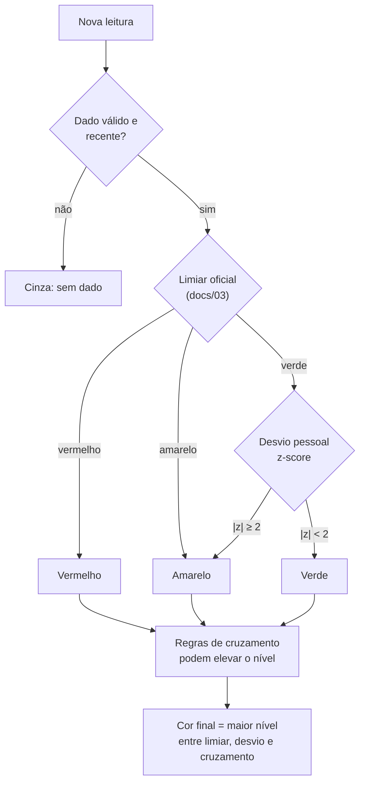

# 04. Cálculos e cruzamento de dados

> Para quem: Dev C (motor e ML) e qualquer pessoa que queira entender de onde sai uma cor na tela.
> Como usar: cada fórmula tem um **exemplo resolvido**. Os números dos exemplos são o gabarito dos testes unitários (ver [`../AGENTS.md`](../AGENTS.md), seção 5).
> Os limiares (onde termina o verde e começa o amarelo) **não** estão aqui: estão em [`03-indicadores-e-limiares.md`](03-indicadores-e-limiares.md), com fonte. Aqui está a matemática.

---

## Parte A. Do dado bruto ao indicador

### A1. Conversão de unidades

Todo dado entra convertido para a unidade canônica de [`06-modelo-de-dados.md`](06-modelo-de-dados.md). As conversões mais usadas:

| De | Para | Fórmula | Exemplo |
| --- | --- | --- | --- |
| kPa | mmHg | mmHg = kPa × 7,50062 | 0,40 kPa × 7,50062 = 3,00 mmHg |
| psia | kPa | kPa = psia × 6,89476 | 14,7 psia × 6,89476 = 101,35 kPa |
| mmHg | kPa | kPa = mmHg × 0,133322 | 3,0 mmHg × 0,133322 = 0,40 kPa |
| Pressão parcial em mmHg | Fração (%) da atmosfera | % = (pp ÷ pressão total) × 100 | 3,0 mmHg ÷ 760 mmHg × 100 = 0,39 % |
| Fração (%) | ppm | ppm = % × 10.000 | 0,39 % = 3.900 ppm |
| °F | °C | °C = (°F menos 32) × 5 ÷ 9 | 72 °F → (72 menos 32) × 5 ÷ 9 = 22,2 °C |
| lb | kg | kg = lb × 0,453592 | 150 lb × 0,453592 = 68,0 kg |
| mGy | mSv | Depende do tipo de radiação (fator de qualidade). Nunca converter "um para um" sem o fator informado pelo instrumento. | Ver A7 |
| glicose mg/dL | mmol/L | mmol/L = mg/dL ÷ 18,016 | 90 mg/dL ÷ 18,016 = 5,0 mmol/L |

Por que a pressão parcial importa mais que a porcentagem: o corpo responde à **pressão parcial** do gás. Uma mesma porcentagem de CO2 vale mais pressão parcial numa cabine a 101 kPa do que numa cabine de pressão reduzida. Por isso a ISS e as normas da NASA falam de CO2 em **mmHg**.

### A2. Média, desvio padrão e linha de base pessoal

A linha de base é "o normal desta pessoa". Calcula-se com as leituras de um período de referência (pré-voo, ou as primeiras semanas de voo quando o pré-voo não existe no protótipo).

- Média: μ = (x₁ + x₂ + … + xₙ) ÷ n
- Desvio padrão amostral: σ = raiz( Σ (xᵢ menos μ)² ÷ (n menos 1) )

**Exemplo resolvido.** Frequência cardíaca de repouso do Tripulante A em 7 manhãs: 56, 58, 57, 60, 55, 59, 57 bpm.

| Passo | Conta | Resultado |
| --- | --- | --- |
| Soma | 56 + 58 + 57 + 60 + 55 + 59 + 57 | 402 |
| Média | 402 ÷ 7 | μ = 57,43 bpm |
| Desvios ao quadrado | (−1,43)² + (0,57)² + (−0,43)² + (2,57)² + (−2,43)² + (1,57)² + (−0,43)² | 2,04 + 0,33 + 0,18 + 6,61 + 5,90 + 2,47 + 0,18 = 17,71 |
| Variância | 17,71 ÷ (7 menos 1) | 2,95 |
| Desvio padrão | raiz(2,95) | σ = 1,72 bpm |

Regras práticas:
- Mínimo de 7 leituras para ter linha de base; antes disso, o indicador usa só a faixa de referência populacional e a tela mostra "linha de base em formação".
- Não atualize a linha de base com dias em amarelo ou vermelho (senão o "anormal" vira o novo normal).

### A3. z-score: quanto o valor de hoje foge do normal da pessoa

z = (x menos μ) ÷ σ

**Exemplo.** Hoje a FC de repouso do Tripulante A foi 63 bpm. z = (63 menos 57,43) ÷ 1,72 = **3,24**.

Interpretação: o valor está 3,24 desvios padrão acima do normal dele. Com 57 a 58 bpm de média, 63 bpm ainda está dentro da faixa populacional de repouso, mas é incomum **para ele**. É assim que o software vê uma mudança antes de ela virar problema.

Regra padrão do protótipo para desvio pessoal (só quando o indicador não tem limiar oficial mais restritivo):

| |z| | Estado por desvio pessoal |
| --- | --- |
| menor que 2 | sem alerta |
| de 2 a 3 | amarelo ("diferente do seu normal") |
| maior que 3 em 2 medições seguidas | amarelo persistente; sugere conversar com o CMO |

O z-score sozinho **nunca** gera vermelho. Vermelho vem de limiar com fonte (`docs/03`) ou de regra de cruzamento.

Atenção ao sentido: para alguns indicadores só um lado importa (SpO2 baixa é ruim, alta não). O `config/indicadores.json` tem o campo `direcao` (`acima`, `abaixo`, `ambos`).

### A4. EWMA: média móvel exponencial para sinais ruidosos

Sensores oscilam. A EWMA suaviza dando mais peso ao valor recente:

Sₜ = λ × xₜ + (1 menos λ) × Sₜ₋₁, com λ entre 0 e 1 (padrão 0,3).

**Exemplo.** CO2 de um módulo, uma leitura a cada 10 minutos, em mmHg: 2,8; 3,0; 3,6; 3,9; 4,1. Com λ = 0,3 e S₀ = 2,8:

| t | xₜ | Conta | Sₜ |
| --- | --- | --- | --- |
| 0 | 2,8 | início | 2,80 |
| 1 | 3,0 | 0,3 × 3,0 + 0,7 × 2,80 | 2,86 |
| 2 | 3,6 | 0,3 × 3,6 + 0,7 × 2,86 | 3,08 |
| 3 | 3,9 | 0,3 × 3,9 + 0,7 × 3,08 | 3,33 |
| 4 | 4,1 | 0,3 × 4,1 + 0,7 × 3,33 | 3,56 |

Use o valor suavizado para decidir a cor de grandezas ambientais (evita piscar amarelo e verde a cada leitura) e use o bruto para mostrar no gráfico.

### A5. Tendência e projeção ("se continuar assim...")

Regressão linear simples sobre os últimos N dias (x = dia, y = valor):

- inclinação b = Σ((xᵢ menos x̄)(yᵢ menos ȳ)) ÷ Σ((xᵢ menos x̄)²)
- intercepto a = ȳ menos b × x̄
- dias até cruzar o limite L: (L menos (a + b × hoje)) ÷ b, se b aponta para o limite

**Exemplo.** Massa corporal (kg) nos dias 1 a 5 de uma semana: 70,0; 69,8; 69,7; 69,5; 69,3.

| Passo | Conta | Resultado |
| --- | --- | --- |
| x̄, ȳ | (1+2+3+4+5) ÷ 5; (70,0+69,8+69,7+69,5+69,3) ÷ 5 | 3; 69,66 |
| Σ(x menos x̄)(y menos ȳ) | (−2)(0,34) + (−1)(0,14) + 0(0,04) + 1(−0,16) + 2(−0,36) | −0,68 −0,14 + 0 −0,16 −0,72 = −1,70 |
| Σ(x menos x̄)² | 4 + 1 + 0 + 1 + 4 | 10 |
| b | −1,70 ÷ 10 | −0,17 kg por dia |

Leitura para a tela: "perdendo cerca de 0,17 kg por dia nesta semana". A regra de quanto de perda é aceitável vem de `docs/03` (nutrição).

### A6. Variação percentual em relação à base

Δ% = (atual menos base) ÷ base × 100

**Exemplo.** Tempo médio de reação no PVT: base 260 ms, hoje 307 ms. Δ% = (307 menos 260) ÷ 260 × 100 = **+18,1 %** (mais lento).

### A7. Dose de radiação acumulada e orçamento

- Dose acumulada da missão: soma das doses diárias. D = Σ dᵢ
- Percentual do limite: D ÷ limite × 100
- Dias restantes no ritmo atual: (limite menos D_carreira) ÷ taxa média diária

**Exemplo didático** (os números reais de taxa diária e do limite vêm de `docs/03`; aqui são só para treinar a conta). Taxa média de 0,5 mSv por dia durante 180 dias: D = 0,5 × 180 = 90 mSv. Se o limite de carreira considerado fosse 600 mSv, a missão consumiria 90 ÷ 600 × 100 = **15 %** dele.

Sobre unidades: o instrumento mede **dose absorvida** em gray (Gy, energia por massa). O risco biológico é a **dose equivalente** em sievert (Sv), que multiplica a dose absorvida por um fator de qualidade que depende do tipo de partícula. Os instrumentos da ISS informam os dois quando conseguem medir a mistura de partículas; o software mostra o que o instrumento entregar, sem converter por conta própria.

### A8. Sono

Com a lista de épocas de 30 segundos (do EEG do óculos ou da actigrafia):

| Indicador | Fórmula | Exemplo |
| --- | --- | --- |
| Tempo na cama (TIB) | fim menos início | 22:00 a 06:30 = 510 min |
| Tempo total de sono (TST) | nº de épocas de sono × 0,5 min | 744 épocas × 0,5 = 372 min (6 h 12) |
| Eficiência do sono | TST ÷ TIB × 100 | 372 ÷ 510 × 100 = 72,9 % |
| Latência do sono | início do sono menos início na cama | 22:00 a 22:24 = 24 min |
| WASO (acordado após dormir) | épocas acordado entre o primeiro e o último sono × 0,5 | 60 épocas = 30 min |
| Dívida de sono | Σ (sono programado menos TST) nos últimos dias | 3 noites com 8,5 h programadas e 6,2 h dormidas: 3 × 2,3 = 6,9 h |

### A9. Variabilidade da frequência cardíaca (HRV), RMSSD

Do ECG (Astroskin ou Bio-Monitor) saem os intervalos entre batimentos (intervalos RR) em milissegundos. RMSSD mede a variação de um batimento para o seguinte; queda sustentada em relação à base costuma acompanhar estresse, fadiga ou doença.

RMSSD = raiz( média de (RRᵢ₊₁ menos RRᵢ)² )

**Exemplo.** RR: 1000, 980, 1010, 990, 1005 ms. Diferenças: −20, +30, −20, +15. Quadrados: 400, 900, 400, 225. Média: 1925 ÷ 4 = 481,25. RMSSD = raiz(481,25) = **21,9 ms**.

Use sempre contra a linha de base pessoal (A3); a faixa entre pessoas é muito larga.

### A10. Teste de reação PVT (Psychomotor Vigilance Test)

O tripulante toca na tela assim que um estímulo aparece, em intervalos aleatórios. O protótipo usa o **PVT-B de 3 minutos**, o paradigma do Reaction Self Test da ISS, com intervalo entre estímulos sorteado de 1 a 4 s. A versão padrão de pesquisa tem 10 minutos e intervalo de 2 a 10 s. Especificação completa, temporização no navegador (`performance.now`, taxa de atualização da tela) e fontes em [`../pesquisa/bruto/08-autoavaliacoes-implementaveis.md`](../pesquisa/bruto/08-autoavaliacoes-implementaveis.md), seção 2.

| Métrica | Como calcular |
| --- | --- |
| Tempo médio de reação | média dos tempos válidos (ignore toques antes do estímulo, que são "falsos inícios") |
| Lapsos | no PVT-B, respostas com tempo ≥ 355 ms (corte usado na literatura do teste breve); guarde também a contagem ≥ 500 ms para comparar com o PVT padrão. Nenhum dos dois é limiar clínico: o motor compara com a linha de base pessoal |
| Velocidade média | média de 1 ÷ tempo de reação (em 1/s); é menos sensível a um único valor muito alto |
| Falsos inícios | toques sem estímulo |

### A11. Hidratação e cor da urina por foto

Entrada manual: mL ingeridos (botões de +250 mL) e foto da urina comparada a uma escala de cor. O app guarda o nível da escala escolhido pelo tripulante (o protótipo não precisa de visão computacional; a foto vira registro para o médico).

- Ingestão diária: Σ mL do dia.
- Ingestão por massa: mL ÷ kg.
- Meta e faixas de atenção vêm de `docs/03`.

### A12. Índice de prontidão (o anel de 0 a 100 do painel)

Combinação simples e explicável. Cada componente vira uma nota de 0 a 100 e o índice é a média ponderada. Pesos iniciais (a equipe pode ajustar, desde que documente):

| Componente | Peso | Nota 100 quando | Nota 0 quando |
| --- | --- | --- | --- |
| Sono (TST da última noite em relação ao programado) | 0,30 | TST ≥ programado | TST ≤ metade do programado |
| Fadiga autorrelatada | 0,20 | menor valor da escala | maior valor da escala |
| PVT (Δ% do tempo de reação) | 0,20 | Δ% ≤ 0 | Δ% ≥ +30 % |
| HRV (z-score do RMSSD) | 0,15 | z ≥ 0 | z ≤ −3 |
| Humor autorrelatado | 0,15 | melhor valor | pior valor |

Entre os extremos, a nota é linear. Se um componente não tem dado, ele sai e os pesos dos outros são renormalizados (o anel mostra "parcial").

**Exemplo.** Sono 6,2 h de 8,5 h programadas: (6,2 menos 4,25) ÷ (8,5 menos 4,25) × 100 = 45,9. Fadiga 4 numa escala de 1 a 7: (7 menos 4) ÷ (7 menos 1) × 100 = 50. PVT +18 %: (30 menos 18) ÷ 30 × 100 = 40. HRV z = −1: (−1 menos (−3)) ÷ 3 × 100 = 66,7. Humor 4 numa escala de 1 a 5: (4 menos 1) ÷ (5 menos 1) × 100 = 75.

Prontidão = 0,30 × 45,9 + 0,20 × 50 + 0,20 × 40 + 0,15 × 66,7 + 0,15 × 75 = 13,77 + 10 + 8 + 10,0 + 11,25 = **53,0**.

> O índice de prontidão é uma criação deste projeto para resumir a tela. Ele não é uma métrica oficial da NASA e a apresentação deve dizer isso.

---

## Parte B. Regras de cruzamento

Uma regra de cruzamento junta sinais de fontes diferentes para formar uma **hipótese explicável**. Formato de cada regra:

| Campo | Significado |
| --- | --- |
| `id` | Identificador estável, usado em teste e no alerta |
| Condições | Lista de condições sobre indicadores, todas avaliadas numa janela de tempo |
| Janela | Período em que as condições precisam coincidir |
| Nível | Nível do alerta resultante (2 amarelo ou 3 vermelho) |
| Hipótese | O texto "possível ..." que aparece na tela |
| Orientações | Passos do "o que fazer" e o gatilho para subir de nível |
| Fonte | Base científica da relação entre os sinais |

As regras abaixo estão descritas em nível de lógica. Os números de limiar citados como "limite de atenção" e "limite crítico" são os de `docs/03`.

### R-CO2-01. Possível efeito de CO2 elevado (cenário C1)

- **Condições:** EWMA do ppCO2 do módulo onde o tripulante está acima do limite de atenção **e** pelo menos um entre: dor de cabeça relatada, Δ% do PVT acima de +10 %, dificuldade de concentração relatada.
- **Janela:** 3 horas.
- **Nível:** 2 (amarelo). Sobe para 3 se a dor de cabeça for ≥ 7 de 10 ou vier com tontura, ou se o ppCO2 passar do limite crítico.
- **Hipótese:** "Possível efeito de CO2 elevado no módulo X."
- **Orientações:** trabalhar num módulo com CO2 mais baixo; conferir ventilação do posto de trabalho; hidratar; refazer o PVT em 2 h. O controle ambiental em solo é notificado na fila.
- **Fonte:** relação entre CO2 da cabine e sintomas, em `docs/03`, linha CO2.

### R-RAD-01. Evento de partículas solares (cenário C2)

- **Condições:** fluxo de prótons do GOES acima do limiar de tempestade de radiação (escala S da NOAA, ver `docs/12`) **ou** alerta de SEP (evento de partículas energéticas solares) na DONKI.
- **Janela:** enquanto durar o evento.
- **Nível:** 2 para toda a tripulação no início; 3 se a taxa de dose medida a bordo subir acima do patamar definido em `docs/03`.
- **Hipótese:** "Evento solar em andamento: dose de radiação pode subir."
- **Orientações:** seguir o procedimento da estação e as instruções do controle de missão (a decisão de abrigo é do solo); acompanhar a taxa de dose; registrar a dose do evento.
- **Fonte:** procedimento operacional de radiação descrito em `docs/02` e `docs/03`.

### R-SANS-01. Possíveis sinais visuais compatíveis com SANS (cenário C3)

- **Condições:** piora na acuidade de perto em relação à base **ou** distorção relatada na grade de Amsler, em **2 testes seguidos**, com ou sem sintoma de visão embaçada.
- **Janela:** 14 dias, inclusiva (dois testes com até 14 dias de intervalo contam; no cenário C3 eles caem nos dias 90 e 104).
- **Nível:** 2. Sobe para 3 se vier com dor de cabeça persistente, visão dupla ou perda súbita de visão (sinais que pedem avaliação imediata).
- **Hipótese:** "Mudança na visão: vale antecipar o exame de olhos com o médico de voo."
- **Orientações:** repetir os testes no mesmo horário e com a mesma luz; confirmar o uso dos óculos de grau do voo; resumo para o médico de voo sugerindo OCT e fundo de olho.
- **Fonte:** SANS e exames a bordo em `docs/03`.

### R-SONO-01. Dívida de sono antes de atividade crítica (cenário C4)

- **Condições:** dívida de sono (A8) acima do limite de atenção nos últimos 3 dias **e** atividade crítica no plano dos próximos 2 dias (EVA, chegada de veículo, operação de braço robótico).
- **Nível:** 2.
- **Hipótese:** "Sono abaixo do programado antes de uma atividade crítica."
- **Orientações:** priorizar sono nas próximas noites; reduzir ruído e luz na cabine de dormir; ajustar a paisagem sonora do óculos para o pré-sono mais cedo; informar o CMO.
- **Cruzamento ambiental:** se o ruído medido na cabine de dormir estiver acima do limite de `docs/03`, a hipótese acrescenta "ruído na cabine de dormir pode estar contribuindo".
- **Fonte:** sono e desempenho em `docs/03`.

### R-HID-01. Hidratação baixa e risco renal (cenário C5)

- **Condições:** registro de ingestão de água abaixo do parâmetro de demonstração (menos de 1.200 mL em 24 h, ver `docs/03`, seção 5) por 2 dias **e** cor da urina 6 ou mais na escala de 8 pontos.
- **Agravante:** fase da missão com perda óssea esperada (cálcio liberado do osso aumenta o risco de cálculo renal).
- **Nível:** 2.
- **Hipótese:** "Ingestão registrada abaixo do plano: vale conferir a hidratação."
- **Orientações:** comparar com a meta individual aprovada no plano de voo (o software não prescreve volume de água); lembretes; missão da gamificação ligada à hidratação.
- **Fonte:** nutrição e cálculo renal em `docs/03`.

### R-AMB-01. Ambiente explica o sintoma (regra genérica)

Para qualquer sintoma relatado no check-in, o motor procura grandezas ambientais fora do verde **no módulo onde o tripulante passou mais tempo nas últimas 6 horas** e lista como "fatores ambientais possíveis" no alerta. Tabela de associação sintoma → grandeza ambiental:

| Sintoma relatado | Grandezas ambientais a verificar |
| --- | --- |
| Dor de cabeça | CO2, temperatura |
| Dificuldade de concentração | CO2, ruído, sono da última noite |
| Sono ruim | Ruído e luz na cabine de dormir, temperatura |
| Irritação nos olhos ou na pele | Umidade, qualidade do ar (contaminantes) |
| Náusea | Movimento recente (primeiros dias de voo), qualidade do ar |

---

## Parte C. Como o motor decide a cor final

Regra de ouro: **a cor final é o maior nível** entre (1) o limiar oficial, (2) o desvio pessoal e (3) as regras de cruzamento. Uma região do corpo assume a cor do pior indicador dela.
