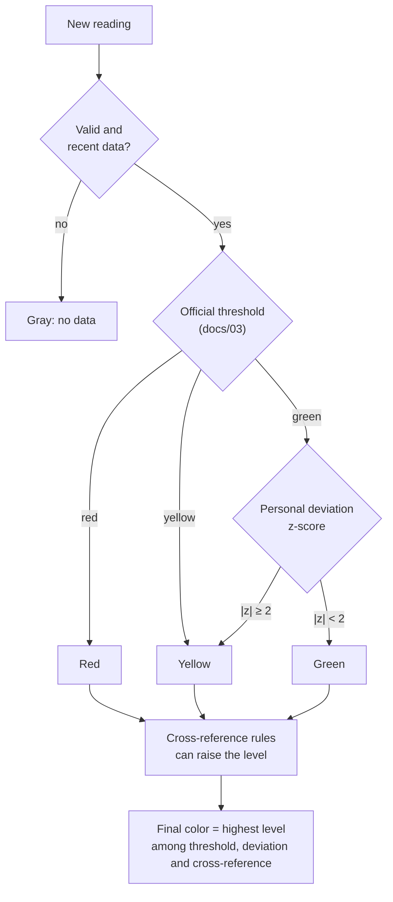

# 04. Calculations and data cross-referencing

> For: Dev C (engine and ML) and anyone who wants to understand where a color on the screen comes from.
> How to use: each formula has a **worked example**. The numbers in the examples are the reference for the unit tests (see [`../AGENTS.md`](../AGENTS.md), section 5).
> The thresholds (where green ends and yellow begins) are **not** here: they are in [`03-indicators-and-thresholds.md`](03-indicators-and-thresholds.md), with sources. Here is the math.

---

## Part A. From raw data to indicator

### A1. Unit conversion

All data enters converted to the canonical unit of [`06-data-model.md`](06-data-model.md). The most used conversions:

| From | To | Formula | Example |
| --- | --- | --- | --- |
| kPa | mmHg | mmHg = kPa × 7.50062 | 0.40 kPa × 7.50062 = 3.00 mmHg |
| psia | kPa | kPa = psia × 6.89476 | 14.7 psia × 6.89476 = 101.35 kPa |
| mmHg | kPa | kPa = mmHg × 0.133322 | 3.0 mmHg × 0.133322 = 0.40 kPa |
| Partial pressure in mmHg | Fraction (%) of the atmosphere | % = (pp ÷ total pressure) × 100 | 3.0 mmHg ÷ 760 mmHg × 100 = 0.39 % |
| Fraction (%) | ppm | ppm = % × 10,000 | 0.39 % = 3,900 ppm |
| °F | °C | °C = (°F minus 32) × 5 ÷ 9 | 72 °F → (72 minus 32) × 5 ÷ 9 = 22.2 °C |
| lb | kg | kg = lb × 0.453592 | 150 lb × 0.453592 = 68.0 kg |
| mGy | mSv | Depends on the type of radiation (quality factor). Never convert "one to one" without the factor provided by the instrument. | See A7 |
| glucose mg/dL | mmol/L | mmol/L = mg/dL ÷ 18.016 | 90 mg/dL ÷ 18.016 = 5.0 mmol/L |
| cabin ppO2 and total pressure (mmHg) | PIO2, **inspired** partial pressure of O2 (mmHg, then kPa) | PIO2 = (total pressure minus 47) × ppO2 ÷ total pressure | Node 3, 11/15/2026: (757.64 minus 47) × 150.67 ÷ 757.64 = 141.3 mmHg = 18.84 kPa |

**PIO2 is not the cabin ppO2.** When breathing, the air is humidified and water vapor takes up 47 mmHg of the pressure (at 37 °C). PIO2 is the O2 pressure that is left for the lung: at sea level, (760 minus 47) × 0.21 = 149.7 mmHg ([OCHMO-TB-003](https://www.nasa.gov/wp-content/uploads/2023/12/ochmo-tb-003-habitable-atmosphere.pdf)). NASA asks that the dry ambient ppO2 be read "in the context of PIO2", with a normoxia target of 145 to 155 mmHg ([OCHMO-TB-002](https://www.nasa.gov/wp-content/uploads/2023/12/ochmo-tb-002-eclss.pdf)). The telemetry adapter (NODE3000001 or USLAB000053 for ppO2, USLAB000058 for total pressure) computes the PIO2 before delivering the `Leitura` (Reading) for `pio2_cabine` and keeps the two original values. In the recorded sample, Node 3 gives 141.3 mmHg and the US Lab gives (757.64 minus 47) × 165.85 ÷ 757.64 = 155.6 mmHg: both outside the target and very far from the exposure limits (127 mmHg 1 h average, 122 mmHg absolute, 356 mmHg), so they are yellow, never orange (`docs/03`).

Why partial pressure matters more than percentage: the body responds to the **partial pressure** of the gas. The same percentage of CO2 means more partial pressure in a cabin at 101 kPa than in a reduced-pressure cabin. That is why the ISS and NASA standards talk about CO2 in **mmHg**.

### A2. Mean, standard deviation and personal baseline

The baseline is "this person's normal". It is computed from the readings of a reference period (pre-flight, or the first weeks of flight when there is no pre-flight in the prototype).

- Mean: μ = (x₁ + x₂ + … + xₙ) ÷ n
- Sample standard deviation: σ = sqrt( Σ (xᵢ minus μ)² ÷ (n minus 1) )

**Worked example.** Resting heart rate of Crew member A on 7 mornings: 56, 58, 57, 60, 55, 59, 57 bpm.

| Step | Calculation | Result |
| --- | --- | --- |
| Sum | 56 + 58 + 57 + 60 + 55 + 59 + 57 | 402 |
| Mean | 402 ÷ 7 | μ = 57.43 bpm |
| Squared deviations | (−1.43)² + (0.57)² + (−0.43)² + (2.57)² + (−2.43)² + (1.57)² + (−0.43)² | 2.04 + 0.33 + 0.18 + 6.61 + 5.90 + 2.47 + 0.18 = 17.71 |
| Variance | 17.71 ÷ (7 minus 1) | 2.95 |
| Standard deviation | sqrt(2.95) | σ = 1.72 bpm |

Practical rules:
- Minimum of 7 readings to have a baseline; before that, the indicator uses only the population reference range and the screen shows "baseline forming".
- Do not update the baseline with yellow or red days (otherwise the "abnormal" becomes the new normal).

### A3. z-score: how far today's value is from the person's normal

z = (x minus μ) ÷ σ

**Example.** Today the resting HR of Crew member A was 63 bpm. z = (63 minus 57.43) ÷ 1.72 = **3.24**.

Interpretation: the value is 3.24 standard deviations above his or her normal. With a mean of 57 to 58 bpm, 63 bpm is still within the population resting range, but it is unusual **for this person**. This is how the software sees a change before it becomes a problem.

Default prototype rule for personal deviation (only when the indicator has no stricter official threshold):

| |z| | Status by personal deviation |
| --- | --- |
| less than 2 | no alert |
| from 2 to 3 | yellow ("different from your normal") |
| greater than 3 in 2 consecutive measurements | persistent yellow; suggests talking to the CMO |

The z-score alone **never** generates red. Red comes from a threshold with a source (`docs/03`) or from a cross-reference rule.

Watch the direction: for some indicators only one side matters (low SpO2 is bad, high is not). `config/indicadores.json` has the `direcao` field (`acima`, `abaixo`, `ambos`).

### A4. EWMA: exponentially weighted moving average for noisy signals

Sensors fluctuate. The EWMA smooths by giving more weight to the recent value:

Sₜ = λ × xₜ + (1 minus λ) × Sₜ₋₁, with λ between 0 and 1 (default 0.3).

**Example.** CO2 of a module, one reading every 10 minutes, in mmHg: 2.8; 3.0; 3.6; 3.9; 4.1. With λ = 0.3 and S₀ = 2.8:

| t | xₜ | Calculation | Sₜ |
| --- | --- | --- | --- |
| 0 | 2.8 | start | 2.80 |
| 1 | 3.0 | 0.3 × 3.0 + 0.7 × 2.80 | 2.86 |
| 2 | 3.6 | 0.3 × 3.6 + 0.7 × 2.86 | 3.08 |
| 3 | 3.9 | 0.3 × 3.9 + 0.7 × 3.08 | 3.33 |
| 4 | 4.1 | 0.3 × 4.1 + 0.7 × 3.33 | 3.56 |

Use the smoothed value to decide the color of environmental quantities (avoids flickering between yellow and green at each reading) and use the raw value to show in the chart.

### A5. Trend and projection ("if it continues like this...")

Simple linear regression over the last N days (x = day, y = value):

- slope b = Σ((xᵢ minus x̄)(yᵢ minus ȳ)) ÷ Σ((xᵢ minus x̄)²)
- intercept a = ȳ minus b × x̄
- days until crossing the limit L: (L minus (a + b × today)) ÷ b, if b points toward the limit

**Example.** Body mass (kg) on days 1 to 5 of a week: 70.0; 69.8; 69.7; 69.5; 69.3.

| Step | Calculation | Result |
| --- | --- | --- |
| x̄, ȳ | (1+2+3+4+5) ÷ 5; (70.0+69.8+69.7+69.5+69.3) ÷ 5 | 3; 69.66 |
| Σ(x minus x̄)(y minus ȳ) | (−2)(0.34) + (−1)(0.14) + 0(0.04) + 1(−0.16) + 2(−0.36) | −0.68 −0.14 + 0 −0.16 −0.72 = −1.70 |
| Σ(x minus x̄)² | 4 + 1 + 0 + 1 + 4 | 10 |
| b | −1.70 ÷ 10 | −0.17 kg per day |

Reading for the screen: "losing about 0.17 kg per day this week". The rule on how much loss is acceptable comes from `docs/03` (nutrition).

### A6. Percentage change relative to baseline

Δ% = (current minus baseline) ÷ baseline × 100

**Example.** Mean PVT reaction time: baseline 260 ms, today 307 ms. Δ% = (307 minus 260) ÷ 260 × 100 = **+18.1 %** (slower).

### A7. Accumulated radiation dose and budget

- Accumulated mission dose: sum of the daily doses. D = Σ dᵢ
- Percentage of the limit: D ÷ limit × 100
- Days remaining at the current pace: (limit minus D_career) ÷ average daily rate

**Didactic example** (the real daily rate and limit numbers come from `docs/03`; here they are only to practice the calculation). Average rate of 0.5 mSv per day for 180 days: D = 0.5 × 180 = 90 mSv. If the career limit considered were 600 mSv, the mission would consume 90 ÷ 600 × 100 = **15 %** of it.

On units: the instrument measures **absorbed dose** in gray (Gy, energy per mass). The biological risk is the **equivalent dose** in sievert (Sv), which multiplies the absorbed dose by a quality factor that depends on the type of particle. The ISS instruments report both when they can measure the particle mixture; the software shows what the instrument delivers, without converting on its own.

### A8. Sleep

With the list of 30-second epochs (from the glasses' EEG or from actigraphy):

| Indicator | Formula | Example |
| --- | --- | --- |
| Time in bed (TIB) | end minus start | 22:00 to 06:30 = 510 min |
| Total sleep time (TST) | number of sleep epochs × 0.5 min | 744 epochs × 0.5 = 372 min (6 h 12 min) |
| Sleep efficiency | TST ÷ TIB × 100 | 372 ÷ 510 × 100 = 72.9 % |
| Sleep latency | sleep onset minus time getting into bed | 22:00 to 22:24 = 24 min |
| WASO (wake after sleep onset) | awake epochs between the first and the last sleep × 0.5 | 60 epochs = 30 min |
| Sleep debt | Σ (scheduled sleep minus TST) over the last days | 3 nights with 8.5 h scheduled and 6.2 h slept: 3 × 2.3 = 6.9 h |

### A9. Heart rate variability (HRV), RMSSD

From the ECG (Astroskin or Bio-Monitor) come the intervals between beats (RR intervals) in milliseconds. RMSSD measures the variation from one beat to the next; a sustained drop relative to baseline usually accompanies stress, fatigue or illness.

RMSSD = sqrt( mean of (RRᵢ₊₁ minus RRᵢ)² )

**Example.** RR: 1000, 980, 1010, 990, 1005 ms. Differences: −20, +30, −20, +15. Squares: 400, 900, 400, 225. Mean: 1925 ÷ 4 = 481.25. RMSSD = sqrt(481.25) = **21.9 ms**.

Always use it against the personal baseline (A3); the range between people is very wide.

### A10. PVT reaction test (Psychomotor Vigilance Test)

The crew member taps the screen as soon as a stimulus appears, at random intervals. The prototype uses the **3-minute PVT-B**, the paradigm of the ISS Reaction Self Test, with the interval between stimuli drawn from 1 to 4 s. The standard research version is 10 minutes with a 2 to 10 s interval. Full specification, timing in the browser (`performance.now`, screen refresh rate) and sources in [`../pesquisa/bruto/08-autoavaliacoes-implementaveis.md`](../pesquisa/bruto/08-autoavaliacoes-implementaveis.md), section 2.

| Metric | How to compute |
| --- | --- |
| Mean reaction time | mean of the valid times (ignore taps before the stimulus, which are "false starts") |
| Lapses | in the PVT-B, responses with time ≥ 355 ms (cutoff used in the brief test literature); also store the count ≥ 500 ms to compare with the standard PVT. Neither is a clinical threshold: the engine compares with the personal baseline |
| Mean speed | mean of 1 ÷ reaction time (in 1/s); it is less sensitive to a single very high value |
| False starts | taps without a stimulus |

### A11. Hydration and urine color by photo

Manual input: mL ingested (+250 mL buttons) and a photo of the urine compared against a color scale. The app stores the scale level chosen by the crew member (the prototype does not need computer vision; the photo becomes a record for the doctor).

- Daily intake: Σ mL of the day.
- Intake per mass: mL ÷ kg.
- Target and attention ranges come from `docs/03`.

### A12. Readiness index (the 0 to 100 ring on the panel)

A simple and explainable combination. Each component becomes a score from 0 to 100 and the index is the weighted mean. Initial weights (the team may adjust them, as long as it documents them):

| Component | Weight | Score 100 when | Score 0 when |
| --- | --- | --- | --- |
| Sleep (last night's TST relative to scheduled) | 0.30 | TST ≥ scheduled | TST ≤ half of scheduled |
| Self-reported fatigue | 0.20 | lowest scale value | highest scale value |
| PVT (Δ% of reaction time) | 0.20 | Δ% ≤ 0 | Δ% ≥ +30 % |
| HRV (z-score of RMSSD) | 0.15 | z ≥ 0 | z ≤ −3 |
| Self-reported mood | 0.15 | best value | worst value |

Between the extremes, the score is linear. If a component has no data, it is dropped and the weights of the others are renormalized (the ring shows "partial").

**Example.** Sleep 6.2 h of 8.5 h scheduled: (6.2 minus 4.25) ÷ (8.5 minus 4.25) × 100 = 45.9. Fatigue 4 on a scale of 1 to 7: (7 minus 4) ÷ (7 minus 1) × 100 = 50. PVT +18 %: (30 minus 18) ÷ 30 × 100 = 40. HRV z = −1: (−1 minus (−3)) ÷ 3 × 100 = 66.7. Mood 4 on a scale of 1 to 5: (4 minus 1) ÷ (5 minus 1) × 100 = 75.

Readiness = 0.30 × 45.9 + 0.20 × 50 + 0.20 × 40 + 0.15 × 66.7 + 0.15 × 75 = 13.77 + 10 + 8 + 10.0 + 11.25 = **53.0**.

> The readiness index is a creation of this project to summarize the screen. It is not an official NASA metric and the presentation must say so.

---

## Part B. Cross-reference rules

A cross-reference rule joins signals from different sources to form an **explainable hypothesis**. Format of each rule:

| Field | Meaning |
| --- | --- |
| `id` | Stable identifier, used in the test and in the alert |
| Conditions | List of conditions on indicators, all evaluated in a time window |
| Window | Period in which the conditions must coincide |
| Level | Level of the resulting alert (2 yellow or 3 red) |
| Hypothesis | The "possible ..." text that appears on the screen |
| Guidance | Steps of the "what to do" and the trigger to rise a level |
| Source | Scientific basis of the relationship between the signals |

The rules below are described at the logic level. The threshold numbers cited as "attention limit" and "critical limit" are those in `docs/03`.

### R-CO2-01. Possible effect of elevated CO2 (scenario C1)

- **Conditions:** EWMA of the ppCO2 of the module where the crew member is, above the attention limit **and** at least one of: reported headache, PVT Δ% above +10 %, reported difficulty concentrating.
- **Window:** 3 hours.
- **Level:** 2 (yellow). Rises to 3 if the headache is ≥ 7 out of 10 or comes with dizziness, or if the ppCO2 passes the critical limit.
- **Hypothesis:** "Possible effect of elevated CO2 in module X."
- **Guidance:** work in a module with lower CO2; check the workstation ventilation; hydrate; redo the PVT in 2 h. Ground environmental control is notified in the queue.
- **Source:** relationship between cabin CO2 and symptoms, in `docs/03`, CO2 row.

### R-RAD-01. Solar particle event (scenario C2)

- **Conditions:** GOES proton flux above the radiation storm threshold (NOAA S scale, see `docs/12`) **or** an SEP alert (solar energetic particle event) in DONKI.
- **Window:** while the event lasts.
- **Level:** 2 for the whole crew at the start; 3 if the dose rate measured onboard rises above the level defined in `docs/03`.
- **Hypothesis:** "Solar event in progress: radiation dose may rise."
- **Guidance:** follow the station procedure and the mission control instructions (the shelter decision belongs to the ground); track the dose rate; record the event dose.
- **Source:** radiation operational procedure described in `docs/02` and `docs/03`.

### R-SANS-01. Possible visual signs compatible with SANS (scenario C3)

- **Conditions:** worsening of near acuity relative to baseline **or** distortion reported on the Amsler grid, in **2 consecutive tests**, with or without a symptom of blurred vision.
- **Window:** 14 days, inclusive (two tests up to 14 days apart count; in scenario C3 they fall on days 90 and 104).
- **Level:** 2. Rises to 3 if it comes with persistent headache, double vision or sudden vision loss (signs that call for immediate evaluation).
- **Hypothesis:** "Change in vision: worth bringing forward the eye exam with the flight surgeon."
- **Guidance:** repeat the tests at the same time and with the same light; confirm use of the in-flight prescription glasses; summary for the flight surgeon suggesting OCT and fundus exam.
- **Source:** SANS and onboard exams in `docs/03`.

### R-SONO-01. Sleep debt before a critical activity (scenario C4)

- **Conditions:** sleep debt (A8) above the attention limit in the last 3 days **and** a critical activity in the plan for the next 2 days (EVA, vehicle arrival, robotic arm operation).
- **Level:** 2.
- **Hypothesis:** "Sleep below schedule before a critical activity."
- **Guidance:** prioritize sleep in the next nights; reduce noise and light in the sleeping cabin; adjust the glasses' soundscape to an earlier pre-sleep; inform the CMO.
- **Environmental cross-reference:** if the noise measured in the sleeping cabin is above the limit in `docs/03`, the hypothesis adds "noise in the sleeping cabin may be contributing".
- **Source:** sleep and performance in `docs/03`.

### R-HID-01. Low hydration and kidney risk (scenario C5)

- **Conditions:** recorded water intake below the demonstration parameter (less than 1,200 mL in 24 h, see `docs/03`, section 5) for 2 days **and** urine color 6 or higher on the 8-point scale.
- **Aggravating factor:** mission phase with expected bone loss (calcium released from bone increases the risk of kidney stones).
- **Level:** 2.
- **Hypothesis:** "Recorded intake below plan: worth checking hydration."
- **Guidance:** compare with the individual target approved in the flight plan (the software does not prescribe a volume of water); reminders; gamification mission linked to hydration.
- **Source:** nutrition and kidney stones in `docs/03`.

### R-AMB-01. Environment explains the symptom (generic rule)

For any symptom reported in the check-in, the engine looks for environmental quantities outside green **in the module where the crew member spent the most time in the last 6 hours** and lists them as "possible environmental factors" in the alert. Symptom → environmental quantity association table:

| Reported symptom | Environmental quantities to check |
| --- | --- |
| Headache | CO2, temperature |
| Difficulty concentrating | CO2, noise, last night's sleep |
| Poor sleep | Noise and light in the sleeping cabin, temperature |
| Eye or skin irritation | Humidity, air quality (contaminants) |
| Nausea | Recent movement (first days of flight), air quality |

---

## Part C. How the engine decides the final color

Golden rule: **the final color is the highest level** among (1) the official threshold, (2) the personal deviation and (3) the cross-reference rules. A body region takes the color of its worst indicator.
