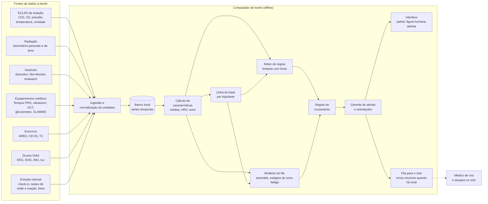

# 05. Arquitetura do software

> Para quem: desenvolvedores e a IA que ajuda no desenvolvimento.
> Pré-requisito: ler [`01-contexto-missao.md`](01-contexto-missao.md) e [`03-indicadores-e-limiares.md`](03-indicadores-e-limiares.md).
> Este documento separa duas coisas: a **visão operacional** (como o sistema funcionaria na ISS ou num habitat em Marte, que é o que apresentamos à NASA) e o **protótipo de 20 horas** (o recorte que a equipe constrói agora).

---

## 1. Princípios de projeto

| # | Princípio | Por quê |
| --- | --- | --- |
| P1 | **Offline-first.** Tudo roda dentro da estação, num computador de bordo. Nenhuma função depende de internet ou do solo. | Quanto mais longe da Terra, maior o atraso de comunicação (minutos por trecho em Marte) e maior a chance de janelas sem contato, que dependem da arquitetura de comunicação e do alinhamento com o Sol. A NASA trata isso como Earth Independent Medical Operations. Detalhes e fontes em [`01-contexto-missao.md`](01-contexto-missao.md), seção 7, e em [`12-fontes-de-dados-abertas.md`](12-fontes-de-dados-abertas.md). |
| P2 | **O astronauta é o primeiro usuário.** A tela explica o que o número significa e o que fazer, em linguagem simples. | O desafio pede que a tripulação avalie e aja sobre a própria saúde. |
| P3 | **Cada pessoa contra a própria linha de base.** Além da faixa de referência populacional, comparamos com o histórico do próprio tripulante. | Astronautas são saudáveis e muito diferentes entre si; o desvio pessoal aparece antes de sair da faixa populacional. |
| P4 | **Todo limiar tem fonte.** A configuração de alertas guarda a referência (norma da NASA, Human Research Roadmap ou diretriz clínica terrestre marcada como tal). | Limiar inventado em software de saúde é defeito grave e derruba a credibilidade do projeto. |
| P5 | **Não substitui o sistema de alarmes da estação nem o médico.** Fogo, despressurização e atmosfera tóxica têm alarme próprio da ISS (Caution and Warning). O software mostra, explica e sugere; não comanda. | Responsabilidade clínica e de segurança é da NASA. O software apoia a decisão. |
| P6 | **Explicável.** Todo alerta mostra quais dados o dispararam, a regra aplicada e a fonte. | Confiança da tripulação e auditoria pelo médico de voo. |
| P7 | **Privacidade por perfil.** O astronauta vê os próprios dados; o Crew Medical Officer e o médico de voo veem o que o protocolo permite. | Dados médicos de astronautas são protegidos. Ver seção 7. |
| P8 | **Unidades canônicas.** Todo dado é convertido na entrada para uma unidade única por grandeza (exemplo: CO2 em mmHg, temperatura em °C) e a unidade original é guardada. | Equipamentos americanos e russos usam unidades diferentes (psia, kPa, mmHg). |

---

## 2. Visão operacional (o que apresentamos à NASA)



### 2.1 Camadas

| Camada | Responsabilidade | Exemplo concreto |
| --- | --- | --- |
| **Adaptadores de entrada** | Um adaptador por fonte. Lê o formato nativo, converte para o modelo de dados comum, marca a qualidade do dado. | Adaptador ECLSS lê pressão parcial de CO2 da telemetria; adaptador Astroskin lê o arquivo da sessão (ECG, respiração, SpO2). |
| **Normalização** | Converte unidade, carimba horário em UTC (a ISS vive em GMT/UTC), associa ao tripulante e ao módulo. | 0,58 kPa de CO2 vira 4,35 mmHg; guarda o valor original. |
| **Armazenamento** | Banco local de séries temporais. Nada sai da estação sem passar pela fila de sincronização. | Na visão operacional, um banco embarcado (SQLite ou similar). No protótipo, IndexedDB do navegador. |
| **Características (features)** | Transforma leituras brutas em indicadores: média móvel, variabilidade da frequência cardíaca, eficiência do sono, dose acumulada, variação percentual em relação à linha de base. | Fórmulas ensinadas em [`04-cruzamento-de-dados.md`](04-cruzamento-de-dados.md). |
| **Linha de base** | Para cada tripulante e indicador: média e desvio padrão de referência (pré-voo e primeiras semanas de voo), atualizados com cuidado. | Frequência cardíaca de repouso do tripulante A: 58 ± 4 bpm. |
| **Motor de regras** | Compara cada indicador com as faixas verde, amarelo e vermelho da configuração. | `ppCO2_cabine > limite de atenção` vira amarelo. |
| **Modelos de ML** | Detecta padrões que regra fixa não pega: anomalias multivariadas, estágios do sono a partir do EEG, índice de fadiga a partir do EOG. | Ver seção 4. |
| **Cruzamento (fusão)** | Combina sinais de fontes diferentes numa hipótese explicável. | CO2 alto no módulo + dor de cabeça relatada + tempo de reação pior que a linha de base = "possível efeito de CO2". |
| **Gerente de alertas** | Define severidade, quem é avisado, deduplica, agenda reavaliação, registra o histórico. | Amarelo: orientação ao próprio tripulante e lembrete de remedir em 4 horas. |
| **Interface** | Painel da tripulação, figura humana clicável, check-in, ambiente da estação, alertas, tendências. | Ver [`07-design-interface.md`](07-design-interface.md). |
| **Sincronização com o solo** | Fila "guarda e envia" (store-and-forward): quando há sinal, envia resumos e alertas ao médico de voo; quando não há, guarda. | Em Marte, o envio é assíncrono por natureza. |

### 2.2 Níveis de alerta

Os níveis foram desenhados para casar com quem age em cada caso. Os limiares concretos por indicador estão em [`03-indicadores-e-limiares.md`](03-indicadores-e-limiares.md).

| Nível | Cor | Significado | Quem age | O que a tela faz |
| --- | --- | --- | --- | --- |
| 0 | Cinza | Sem dado ou dado antigo demais para confiar | Ninguém; lembrete de medir | Mostra "medir agora" com o tempo desde a última leitura |
| 1 | Verde | Dentro da faixa de referência e da linha de base pessoal | Ninguém | Mostra tendência e reforço positivo (gamificação) |
| 2 | Amarelo | Fora da linha de base ou perto do limite | O próprio astronauta | Explica a causa provável, dá a orientação (hidratar, descansar, ajustar exercício, mudar de módulo) e agenda nova medição |
| 3 | Vermelho | Fora da faixa segura ou piora sustentada | Crew Medical Officer e médico de voo | Gera resumo pronto para a conferência médica e coloca na fila para o solo; em Marte, abre o protocolo autônomo |
| 4 | Vermelho estático com a instrução "Contatar CMO agora" | Risco imediato à vida | Toda a tripulação, conforme procedimento de emergência da estação | Mostra o procedimento oficial e aponta para o alarme da estação; não pisca, não toca som e nunca tenta substituir o alarme (piscar, som e luz vermelha são do sistema de Caution and Warning da ISS, ver `docs/07`, 5.1.1) |

---

## 3. Protótipo de 20 horas (o que a equipe constrói)

### 3.1 Stack recomendada

Recomendação padrão, para a equipe confirmar no kickoff (ver [`08-plano-prototipo-20h.md`](08-plano-prototipo-20h.md)). Critério de escolha: rodar 100% no navegador sem servidor (cumpre o princípio offline), ser rápido de montar e fácil para a IA gerar código.

| Necessidade | Escolha | Alternativa |
| --- | --- | --- |
| Base do app | React + Vite + TypeScript | Svelte, Vue |
| Estilo | Tailwind CSS com tokens de cor definidos em [`07-design-interface.md`](07-design-interface.md) | CSS Modules |
| Gráficos | Apache ECharts (séries longas, zoom, faixas coloridas de fundo) | Recharts |
| Estado | Zustand | Redux Toolkit |
| Banco local | IndexedDB via Dexie.js | localStorage para coisas pequenas |
| Estatística | Código próprio (média, desvio padrão, EWMA são poucas linhas) ou simple-statistics | |
| ML no navegador | Modelos pequenos em TypeScript (z-score, EWMA, Isolation Forest simples); se sobrar tempo, ONNX Runtime Web para um modelo treinado fora | TensorFlow.js |
| Figura humana | SVG desenhado à mão ou adaptado de ícone livre, com cada região como um `<path id="...">` clicável | Imagem com mapa de áreas |
| Idioma | Dicionário de textos com PT-BR e EN desde o início | Só PT-BR |

### 3.2 De onde vêm os dados no protótipo

| Fonte | Como entra no protótipo | Por quê |
| --- | --- | --- |
| Ambiente da estação | Gerador de dados simulados com faixas reais; modo opcional "ao vivo" com a telemetria pública da ISS (ISS Live, via Lightstreamer) | Mostra que o software entende dados reais da NASA |
| Clima espacial | Arquivo de exemplo; modo opcional "ao vivo" com os feeds públicos da NOAA SWPC (fluxo de prótons do satélite GOES) e a API DONKI da NASA | Alerta de radiação com dado real |
| Sinais vitais e vestíveis | Gerador simulado com perfis por tripulante e cenários roteirizados | Dados médicos individuais de astronautas não são públicos |
| EEG e EOG (óculos) | Hipnograma e métricas pré-calculados a partir de base pública de sono (Sleep-EDF, PhysioNet) | O óculos ainda não existe; a base pública dá sinal real de EEG |
| Entrada manual | Telas do próprio protótipo (check-in, teste de reação, grade de Amsler, foto) | É a interação principal do astronauta |

Os detalhes de cada fonte, com endpoints e campos, estão em [`12-fontes-de-dados-abertas.md`](12-fontes-de-dados-abertas.md). O esquema dos dados está em [`06-modelo-de-dados.md`](06-modelo-de-dados.md).

### 3.3 Cenários roteirizados para a demonstração

O gerador simulado roda uma "missão" acelerada com quatro tripulantes fictícios e eventos programados. Cada cenário prova uma regra de cruzamento diferente:

| Cenário | O que acontece nos dados | O que o software deve mostrar |
| --- | --- | --- |
| C1. Pico de CO2 | ppCO2 sobe num módulo; um tripulante relata dor de cabeça no check-in; tempo de reação piora | Amarelo no tripulante e no módulo, com a hipótese "CO2" e a orientação |
| C2. Evento de partículas solares | Fluxo de prótons do GOES (≥ 10 MeV) chega a 150 pfu no dia 120, dentro da escala S2 da NOAA, com evento SEP na DONKI; a taxa de dose a bordo sobe pelos multiplicadores observados no evento de setembro de 2017 | Alerta de radiação para toda a tripulação, dose acumulada atualizada, orientação de seguir o procedimento da estação e o controle de missão |
| C3. Sinais iniciais de SANS | Teste de grade de Amsler e de acuidade próxima pioram ao longo de semanas, com relato de visão embaçada | Olhos ficam amarelos na figura humana; sugestão de agendar exame de OCT e fundo de olho com o médico de voo |
| C4. Dívida de sono antes de EVA | **Gatilho:** sono abaixo do programado por 3 noites e EVA no dia seguinte. **Contexto, não dispara sozinho:** ruído na cabine de dormir avaliado por bandas (curva NC) e fadiga autorrelatada, quando registrados | Prontidão baixa no dia da EVA, recomendação de higiene do sono e ajuste da paisagem sonora do óculos; o ruído aparece como "fator possível", nunca como violação de norma a partir de uma leitura isolada |
| C5. Ingestão de água baixa registrada | Ingestão registrada de 1.000 mL por dia por 2 dias (abaixo do parâmetro de demonstração de 1.200 mL), cor da urina 6 de 8, perda óssea estimada em curso | Rins em amarelo com "ingestão registrada abaixo do plano"; orientação de seguir a meta individual aprovada, sem diagnóstico de desidratação |

---

## 4. Onde entra o machine learning

O desafio e a proposta pedem ML embarcado. A regra geral: **regra fixa para o que a norma define, estatística para o desvio pessoal, ML para o padrão que nenhuma das duas pega.**

| Tarefa | Técnica | Entrada | Saída | Protótipo de 20 h? |
| --- | --- | --- | --- | --- |
| Desvio da linha de base | z-score e EWMA (média móvel exponencial) com limites de controle | Qualquer indicador numérico | Nível amarelo quando o desvio passa do limite | Sim, obrigatório |
| Tendência | Regressão linear nos últimos N dias | Indicador diário | Inclinação por dia e projeção ("se continuar assim, cruza o limite em X dias") | Sim |
| Anomalia multivariada | Isolation Forest ou autoencoder pequeno | Vetor diário (FC de repouso, HRV, sono, fadiga, PVT) | Escore de anomalia de 0 a 1 | Opcional |
| Estágios do sono | Rede neural pequena ou algoritmo publicado (por exemplo YASA) aplicado ao EEG | EEG frontal do óculos, épocas de 30 s | Hipnograma (acordado, N1, N2, N3, REM) | Pré-calculado fora do app |
| Fadiga e desatenção | Classificador a partir de piscadas e movimentos oculares | EOG do óculos | Índice de fadiga | Simulado |
| Explicação em linguagem natural | Modelo de linguagem pequeno rodando localmente | Alertas e dados | Texto explicativo | Fora do escopo de 20 h; texto vem de modelos prontos por regra |

Requisitos de hardware e massa para rodar isso na estação estão em [`10-massa-energia-lancamento.md`](10-massa-energia-lancamento.md).

---

## 5. Estrutura de pastas sugerida para o protótipo

```text
prototipo/
  app/                       código do app (a equipe cria)
    src/
      adapters/              um arquivo por fonte (simulador, ISS Live, NOAA, manual)
      domain/                tipos do modelo de dados, unidades, conversões
      engine/                linha de base, regras, cruzamento, alertas
      ml/                    z-score, EWMA, tendência, Isolation Forest
      ui/                    telas e componentes
      i18n/                  textos PT-BR e EN
  config/
    indicadores.json         definição de cada indicador, faixas e fonte (gerado a partir de docs/03)
    cenarios.json            roteiro dos cenários C1 a C5
  dados/
    sono-exemplo.json        hipnograma pré-calculado
    clima-espacial-exemplo.json
```

---

## 6. Requisitos não funcionais

| Requisito | Meta no protótipo | Meta operacional |
| --- | --- | --- |
| Funciona sem internet | Sim, exceto modos "ao vivo" opcionais | Sim, sempre |
| Tempo de carga | Menos de 3 s num laptop comum | Idem no computador de bordo |
| Latência de alerta | Menos de 1 s após a leitura chegar | Idem |
| Acessibilidade | Cor nunca sozinha: sempre ícone e texto junto; contraste AA | Idem, mais uso com luvas e com pouca luz |
| Modo noturno | Paleta âmbar com pouca luz azul no período pré-sono | Integrado ao horário da tripulação |
| Auditoria | Todo alerta guarda dados de entrada, regra e fonte | Idem, exportável para o médico de voo |

---

## 7. Privacidade e perfis de acesso

| Perfil | Vê | Não vê |
| --- | --- | --- |
| Astronauta | Todos os próprios dados, ambiente da estação, alertas próprios e coletivos; no Monitor geral, o que cada colega escolheu compartilhar (ver `docs/07`, T1) | Detalhes clínicos, questionários e conversas médicas de outros tripulantes |
| Monitor geral em tela compartilhada | Estado por sistema de cada tripulante (sempre), sinais vitais com números (se o tripulante permitir), faixa de perigo | Mente e humor (salvo permissão), qualquer detalhe clínico |
| Crew Medical Officer | Status resumido da tripulação e detalhes quando o tripulante autoriza ou em emergência | Diário pessoal e questionários psicológicos privados |
| Médico de voo (solo) | Resumos e alertas sincronizados, conforme protocolo médico da NASA | Nada além do que a política da NASA permitir |
| Comandante | Prontidão agregada (apto, atenção, restrito) para planejamento | Detalhe clínico |

No protótipo basta um seletor de perfil no topo da tela e a tela de configuração de compartilhamento para demonstrar o conceito. As regras reais de privacidade dos dados médicos de astronautas estão resumidas em [`12-fontes-de-dados-abertas.md`](12-fontes-de-dados-abertas.md).
