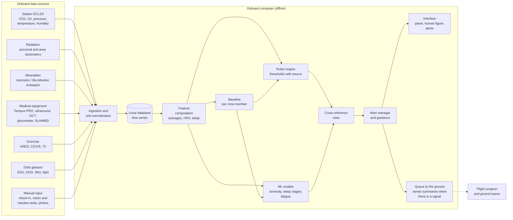

# 05. Software architecture

> For: developers and the AI that helps with development.
> Prerequisite: read [`01-mission-context.md`](01-mission-context.md) and [`03-indicators-and-thresholds.md`](03-indicators-and-thresholds.md).
> This document separates two things: the **operational view** (how the system would work on the ISS or in a habitat on Mars, which is what we present to NASA) and the **20-hour prototype** (the slice the team builds now).

---

## 1. Design principles

| # | Principle | Why |
| --- | --- | --- |
| P1 | **Offline-first.** Everything runs inside the station, on an onboard computer. No function depends on the internet or on the ground. | The farther from Earth, the greater the communication delay (minutes per leg on Mars) and the greater the chance of windows without contact, which depend on the communication architecture and the alignment with the Sun. NASA treats this as Earth Independent Medical Operations. Details and sources in [`01-mission-context.md`](01-mission-context.md), section 7, and in [`12-open-data-sources.md`](12-open-data-sources.md). |
| P2 | **The astronaut is the first user.** The screen explains what the number means and what to do, in plain language. | The challenge asks the crew to assess and act on their own health. |
| P3 | **Each person against their own baseline.** Besides the population reference range, we compare with the crew member's own history. | Astronauts are healthy and very different from one another; the personal deviation shows up before leaving the population range. |
| P4 | **Every threshold has a source.** The alert configuration stores the reference (NASA standard, Human Research Roadmap or Earth clinical guideline marked as such). | An invented threshold in health software is a serious defect and destroys the project's credibility. |
| P5 | **It does not replace the station alarm system or the doctor.** Fire, depressurization and toxic atmosphere have their own ISS alarm (Caution and Warning). The software shows, explains and suggests; it does not command. | Clinical and safety responsibility belongs to NASA. The software supports the decision. |
| P6 | **Explainable.** Every alert shows which data triggered it, the rule applied and the source. | Crew trust and audit by the flight surgeon. |
| P7 | **Privacy by profile.** The astronaut sees their own data; the Crew Medical Officer and the flight surgeon see what the protocol allows. | Astronaut medical data is protected. See section 7. |
| P8 | **Canonical units.** All data is converted at input to a single unit per quantity (example: CO2 in mmHg, temperature in °C) and the original unit is kept. | American and Russian equipment use different units (psia, kPa, mmHg). |

---

## 2. Operational view (what we present to NASA)



### 2.1 Layers

| Layer | Responsibility | Concrete example |
| --- | --- | --- |
| **Input adapters** | One adapter per source. Reads the native format, converts to the common data model, marks the data quality. | The ECLSS adapter reads CO2 partial pressure from telemetry; the Astroskin adapter reads the session file (ECG, respiration, SpO2). |
| **Normalization** | Converts units, stamps time in UTC (the ISS lives on GMT/UTC), associates with the crew member and the module. | 0.58 kPa of CO2 becomes 4.35 mmHg; keeps the original value. |
| **Storage** | Local time-series database. Nothing leaves the station without going through the sync queue. | In the operational view, an embedded database (SQLite or similar). In the prototype, the browser's IndexedDB. |
| **Features** | Turns raw readings into indicators: moving average, heart rate variability, sleep efficiency, accumulated dose, percentage change relative to baseline. | Formulas taught in [`04-data-cross-referencing.md`](04-data-cross-referencing.md). |
| **Baseline** | For each crew member and indicator: reference mean and standard deviation (pre-flight and first weeks of flight), updated carefully. | Resting heart rate of crew member A: 58 ± 4 bpm. |
| **Rules engine** | Compares each indicator with the green, yellow and red ranges of the configuration. | `ppCO2_cabine > attention limit` becomes yellow. |
| **ML models** | Detects patterns that a fixed rule does not catch: multivariate anomalies, sleep stages from EEG, fatigue index from EOG. | See section 4. |
| **Cross-referencing (fusion)** | Combines signals from different sources into an explainable hypothesis. | High CO2 in the module + reported headache + reaction time worse than baseline = "possible effect of CO2". |
| **Alert manager** | Defines severity, who is notified, deduplicates, schedules reassessment, records the history. | Yellow: guidance to the crew member and a reminder to remeasure in 4 hours. |
| **Interface** | Crew panel, clickable human figure, check-in, station environment, alerts, trends. | See [`07-interface-design.md`](07-interface-design.md). |
| **Sync with the ground** | "Store-and-forward" queue: when there is a signal, sends summaries and alerts to the flight surgeon; when there is not, stores them. | On Mars, sending is asynchronous by nature. |

### 2.2 Alert levels

The levels were designed to match who acts in each case. The concrete thresholds per indicator are in [`03-indicators-and-thresholds.md`](03-indicators-and-thresholds.md).

| Level | Color | Meaning | Who acts | What the screen does |
| --- | --- | --- | --- | --- |
| 0 | Gray | No data or data too old to trust | Nobody; reminder to measure | Shows "measure now" with the time since the last reading |
| 1 | Green | Within the reference range and the personal baseline | Nobody | Shows trend and positive reinforcement (gamification) |
| 2 | Yellow | Outside the baseline or near the limit | The astronaut themselves | Explains the probable cause, gives the guidance (hydrate, rest, adjust exercise, change module) and schedules a new measurement |
| 3 | Red | Outside the safe range or sustained worsening | Crew Medical Officer and flight surgeon | Generates a summary ready for the medical conference and puts it in the queue for the ground; on Mars, opens the autonomous protocol |
| 4 | Static red with the instruction "Contact CMO now" | Immediate risk to life | The whole crew, according to the station emergency procedure | Shows the official procedure and points to the station alarm; does not blink, does not play sound and never tries to replace the alarm (blinking, sound and red light belong to the ISS Caution and Warning system, see `docs/07`, 5.1.1) |

---

## 3. 20-hour prototype (what the team builds)

### 3.1 Recommended stack

Default recommendation, for the team to confirm at the kickoff (see [`08-prototype-plan-20h.md`](08-prototype-plan-20h.md)). Selection criterion: run 100% in the browser without a server (meets the offline principle), be quick to assemble and easy for the AI to generate code.

| Need | Choice | Alternative |
| --- | --- | --- |
| App base | React + Vite + TypeScript | Svelte, Vue |
| Style | Tailwind CSS with color tokens defined in [`07-interface-design.md`](07-interface-design.md) | CSS Modules |
| Charts | Apache ECharts (long series, zoom, colored background bands) | Recharts |
| State | Zustand | Redux Toolkit |
| Local database | IndexedDB via Dexie.js | localStorage for small things |
| Statistics | Own code (mean, standard deviation, EWMA are a few lines) or simple-statistics | |
| In-browser ML | Small models in TypeScript (z-score, EWMA, simple Isolation Forest); if time is left, ONNX Runtime Web for a model trained elsewhere | TensorFlow.js |
| Human figure | Hand-drawn SVG or adapted from a free icon, with each region as a clickable `<path id="...">` | Image with an area map |
| Language | Text dictionary with PT-BR and EN from the start | PT-BR only |

### 3.2 Where the data comes from in the prototype

| Source | How it enters the prototype | Why |
| --- | --- | --- |
| Station environment | Simulated data generator with real ranges; optional "live" mode with public ISS telemetry (ISS Live, via Lightstreamer) | Shows that the software understands real NASA data |
| Space weather | Sample file; optional "live" mode with the public NOAA SWPC feeds (proton flux from the GOES satellite) and the NASA DONKI API | Radiation alert with real data |
| Vital signs and wearables | Simulated generator with per-crew-member profiles and scripted scenarios | Individual medical data of astronauts is not public |
| EEG and EOG (glasses) | Hypnogram and metrics precomputed from a public sleep database (Sleep-EDF, PhysioNet) | The glasses do not exist yet; the public database gives a real EEG signal |
| Manual input | The prototype's own screens (check-in, reaction test, Amsler grid, photo) | It is the astronaut's main interaction |

The details of each source, with endpoints and fields, are in [`12-open-data-sources.md`](12-open-data-sources.md). The data schema is in [`06-data-model.md`](06-data-model.md).

### 3.3 Scripted scenarios for the demonstration

The simulated generator runs an accelerated "mission" with four fictional crew members and scheduled events. Each scenario proves a different cross-reference rule:

| Scenario | What happens in the data | What the software must show |
| --- | --- | --- |
| C1. CO2 spike | ppCO2 rises in a module; a crew member reports headache in the check-in; reaction time worsens | Yellow on the crew member and on the module, with the "CO2" hypothesis and the guidance |
| C2. Solar particle event | GOES proton flux (≥ 10 MeV) reaches 150 pfu on day 120, within NOAA scale S2, with an SEP event in DONKI; the onboard dose rate rises by the multipliers observed in the September 2017 event | Radiation alert for the whole crew, accumulated dose updated, guidance to follow the station procedure and mission control |
| C3. Early SANS signs | Amsler grid and near acuity tests worsen over weeks, with a report of blurred vision | Eyes turn yellow on the human figure; suggestion to schedule an OCT and fundus exam with the flight surgeon |
| C4. Sleep debt before EVA | **Trigger:** sleep below schedule for 3 nights and an EVA the next day. **Context, does not trigger on its own:** noise in the sleeping cabin assessed by bands (NC curve) and self-reported fatigue, when recorded | Low readiness on the EVA day, sleep hygiene recommendation and adjustment of the glasses' soundscape; noise appears as a "possible factor", never as a standard violation from a single reading |
| C5. Low recorded water intake | Recorded intake of 1,000 mL per day for 2 days (below the demonstration parameter of 1,200 mL), urine color 6 of 8, estimated bone loss in progress | Kidneys in yellow with "recorded intake below plan"; guidance to follow the approved individual target, without a dehydration diagnosis |

---

## 4. Where machine learning comes in

The challenge and the proposal ask for embedded ML. The general rule: **fixed rule for what the standard defines, statistics for personal deviation, ML for the pattern that neither of the two catches.**

| Task | Technique | Input | Output | 20 h prototype? |
| --- | --- | --- | --- | --- |
| Deviation from baseline | z-score and EWMA (exponentially weighted moving average) with control limits | Any numeric indicator | Yellow level when the deviation passes the limit | Yes, mandatory |
| Trend | Linear regression over the last N days | Daily indicator | Slope per day and projection ("if it continues like this, it crosses the limit in X days") | Yes |
| Multivariate anomaly | Isolation Forest or small autoencoder | Daily vector (resting HR, HRV, sleep, fatigue, PVT) | Anomaly score from 0 to 1 | Optional |
| Sleep stages | Small neural network or published algorithm (for example YASA) applied to EEG | Frontal EEG from the glasses, 30 s epochs | Hypnogram (awake, N1, N2, N3, REM) | Precomputed outside the app |
| Fatigue and inattention | Classifier from blinks and eye movements | EOG from the glasses | Fatigue index | Simulated |
| Natural-language explanation | Small language model running locally | Alerts and data | Explanatory text | Out of scope for 20 h; text comes from ready-made templates per rule |

Hardware and mass requirements to run this on the station are in [`10-mass-energy-launch.md`](10-mass-energy-launch.md).

---

## 5. Suggested folder structure for the prototype

```text
prototipo/
  app/                       app code (the team creates it)
    src/
      adapters/              one file per source (simulator, ISS Live, NOAA, manual)
      domain/                data model types, units, conversions
      engine/                baseline, rules, cross-referencing, alerts
      ml/                    z-score, EWMA, trend, Isolation Forest
      ui/                    screens and components
      i18n/                  PT-BR and EN texts
  config/
    indicadores.json                 37 indicators and 6 rules, with regraCor and source (from docs/03)
    perfis-simulacao.rascunho.json   fictional crew members, 180-day script and scenarios C1 to C5
  dados/
    amostras-reais/          public ISS telemetry, NOAA and DONKI recorded on 11/15/2026
    sono-exemplo.json        precomputed hypnogram (the team generates it from Sleep-EDF)
    clima-espacial-exemplo.json
```

---

## 6. Non-functional requirements

| Requirement | Prototype target | Operational target |
| --- | --- | --- |
| Works without internet | Yes, except optional "live" modes | Yes, always |
| Load time | Under 3 s on an ordinary laptop | Same on the onboard computer |
| Alert latency | Under 1 s after the reading arrives | Same |
| Accessibility | Color never alone: always icon and text together; AA contrast | Same, plus use with gloves and in low light |
| Night mode | Amber palette with little blue light in the pre-sleep period | Integrated with the crew schedule |
| Audit | Every alert stores input data, rule and source | Same, exportable to the flight surgeon |

---

## 7. Privacy and access profiles

| Profile | Sees | Does not see |
| --- | --- | --- |
| Astronaut | All their own data, station environment, own and collective alerts; in the Crew overview monitor, what each colleague chose to share (see `docs/07`, T1) | Clinical details, questionnaires and medical conversations of other crew members |
| Crew overview monitor on a shared screen | Status per system of each crew member (always), vital signs with numbers (if the crew member allows), danger strip | Mind and mood (unless permitted), any clinical detail |
| Crew Medical Officer | Summarized crew status and details when the crew member authorizes or in an emergency | Personal diary and private psychological questionnaires |
| Flight surgeon (ground) | Synchronized summaries and alerts, according to NASA's medical protocol | Nothing beyond what NASA policy allows |
| Commander | Aggregated readiness (fit, attention, restricted) for planning | Clinical detail |

In the prototype, a profile selector at the top of the screen and the sharing configuration screen are enough to demonstrate the concept. The real privacy rules for astronaut medical data are summarized in [`12-open-data-sources.md`](12-open-data-sources.md).
