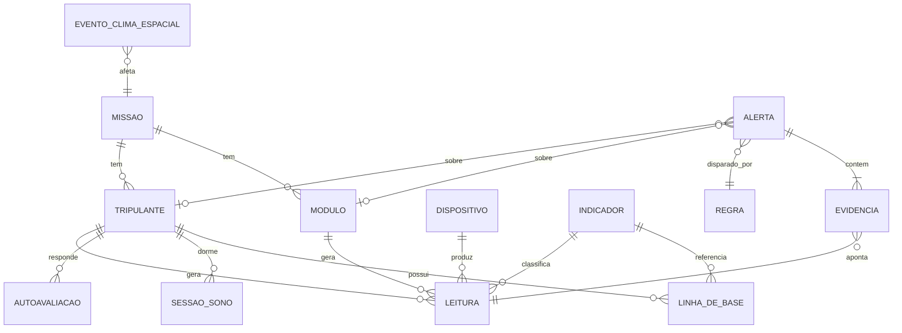

# 06. Data model

> For: the whole development team. It is the contract between adapters, engine and screens.
> Entity and field names are in Portuguese, identical in the code (`src/domain/`). Times are always in UTC, ISO 8601 format.

---

## 1. Overview



## 2. Entities

### 2.1 `Missao` (Mission)

| Field | Type | Example | Note |
| --- | --- | --- | --- |
| `id` | string | `"exp-orbit-01"` | |
| `nome` | string | `"Orbit 01 Expedition (simulated)"` | |
| `plataforma` | `"ISS"` \| `"Gateway"` \| `"Lua"` \| `"Marte"` | `"ISS"` | Changes communication delay and texts |
| `inicioUtc` | ISO string | `"2026-06-25T00:00:00Z"` | Mission day (FD) = days since the start + 1 |
| `atrasoComunicacaoSeg` | number | `1` | ISS is practically immediate; Mars is minutes (see `docs/12`) |

### 2.2 `Tripulante` (Crew member)

| Field | Type | Example | Note |
| --- | --- | --- | --- |
| `id` | string | `"trip-b"` | |
| `codinome` | string | `"Crew member B"` | Always fictional in the prototype |
| `funcao` | string | `"Flight engineer"` | |
| `agencia` | string | `"NASA"` | For the multinational demo |
| `massaPreVooKg` | number | `64.2` | Basis for mass variation |
| `sexo` | `"feminino"` \| `"masculino"` | `"feminino"` | Chooses the Earth reference range that changes by sex (hemoglobin, hematocrit); ORBITA registration (`docs/18`, M01) |
| `alturaCm` | number | `168` | ORBITA registration; used only in calculations that need height, never to judge weight |
| `perfilSonoro` | string | `"mata-atlantica"` | Soundscape of the Orbit glasses |
| `usaOculosOrbit` | boolean | `true` | Takes part in the glasses study; the condition of each night is in `SessaoSono.condicaoEstudo` (see `docs/09`) |
| `horarioSono` | `{ inicio: "21:30", fim: "06:00" }` | | Scheduled time in GMT (reference published by NASA, see `docs/01`) |
| `moduloAtual` | string | `"node3"` | Where the crew member is now; used by the Crew overview monitor and by the cross-reference rules with the environment |
| `compartilhamento` | `Consentimento[]` | see below | What each audience sees in the Crew overview monitor; clinical details never appear (see `docs/07`, T1) |

`Consentimento` (Consent): `{ dado: "estado_sistemas" | "valores" | "modulo" | "mente", audiencia: "so_eu" | "cmo" | "medico_voo" | "buddy" | "tripulacao", buddyId?: string, validoAteUtc?: string, atualizadoUtc: string }`. Default for a new crew member: only `estado_sistemas` for `cmo` and `medico_voo`; the rest `so_eu`. The fictional demo crew members share with the `tripulacao`, except `mente` for one of them. The engine filters before the screen receives the data; "not shared" never becomes an alert color.

### 2.3 `Modulo` (Module)

| Field | Type | Example |
| --- | --- | --- |
| `id` | string | `"node3"` |
| `nome` | string | `"Node 3 (Tranquility)"` |
| `segmento` | `"USOS"` \| `"ROS"` | `"USOS"` |

### 2.4 `Dispositivo` (Device)

| Field | Type | Example | Note |
| --- | --- | --- | --- |
| `id` | string | `"astroskin-b"` | |
| `tipo` | string | `"vestivel"`, `"eclss"`, `"radiacao"`, `"medico"`, `"exercicio"`, `"orbit"`, `"manual"` | |
| `nome` | string | `"Astroskin / Bio-Monitor"` | Real name of the equipment, from `docs/02` |
| `tripulanteId` | optional string | `"trip-b"` | Personal |
| `moduloId` | optional string | `"node3"` | Area-wide |

### 2.5 `Leitura` (Reading, the central entity)

Every measurement, wherever it comes from, becomes a `Leitura`.

| Field | Type | Example | Note |
| --- | --- | --- | --- |
| `id` | string | `"lei-000123"` | |
| `indicadorId` | string | `"ppco2_modulo"` | Key of `config/indicadores.json` |
| `valor` | number | `3.9` | Already in the canonical unit |
| `unidade` | string | `"mmHg"` | Canonical unit of the indicator (section 3) |
| `valorOriginal` | number | `0.52` | As it came from the source |
| `unidadeOriginal` | string | `"kPa"` | |
| `instanteUtc` | ISO string | `"2026-11-14T13:54:00Z"` | |
| `tripulanteId` | optional string | `"trip-b"` | Body readings |
| `moduloId` | optional string | `"node3"` | Environment readings |
| `dispositivoId` | string | `"eclss-node3"` | |
| `origem` | `"automatica"` \| `"manual"` \| `"exame"` \| `"simulada"` \| `"ao_vivo"` \| `"historica"` | `"simulada"` | The screen shows the badge; `historica` is real recorded data that is replayed (workstream 11 samples, EDA or RadLab datasets) |
| `conjuntoDados` | optional string | `"issl-2026-11-15"`, `"cenario-C1"` | Sample file or scenario the reading came from (see `docs/12`, section 7) |
| `qualidade` | `"boa"` \| `"duvidosa"` \| `"invalida"` | `"boa"` | An invalid reading does not generate an alert |
| `disponibilidade` | `"disponivel"` \| `"aguardando_transferencia"` \| `"pendente_laboratorio"` | `"disponivel"` | See note below |
| `instanteDisponivelUtc` | optional ISO string | | When the value reached the software (can be hours or months after `instanteUtc`) |
| `protocolo` | optional string | `"PMC"`, `"Standard Measures"`, `"Bio-Monitor session"` | Where the measurement came from |

**Note on availability.** The workstream 2 research showed that most body data on the ISS is not continuous: the Bio-Monitor records sessions of up to 48 h and downloads them later; blood, urine and saliva are frozen and analyzed on Earth; eye exams happen in mission windows. For that reason a `Leitura` can exist before having a value (sample collected, result pending) and the measurement time (`instanteUtc`) differs from the time it arrived (`instanteDisponivelUtc`). The screen shows these states ("recorded, awaiting transfer", "sample collected, analysis on Earth") and the engine only evaluates `disponivel` readings. Details in [`../pesquisa/bruto/02-equipamentos-medicos-tripulacao.md`](../pesquisa/bruto/02-equipamentos-medicos-tripulacao.md), section "Implications for the software".

### 2.6 `Indicador` (Indicator; configuration, comes from `docs/03`)

| Field | Type | Example | Note |
| --- | --- | --- | --- |
| `id` | string | `"spo2"` | |
| `nome` | string | `"Oxygen saturation (SpO2)"` | |
| `escopo` | `"tripulante"` \| `"ambiente"` | `"tripulante"` | |
| `regiaoCorpo` | string | `"pulmoes"` | Ids from `docs/07`, T2 |
| `unidade` | string | `"%"` | Canonical |
| `direcao` | `"acima"` \| `"abaixo"` \| `"ambos"` | `"abaixo"` | Side on which the value is bad |
| `faixas` | object | see JSON below | Yellow and red limits |
| `usaLinhaDeBase` | boolean | `true` | Turns on the z-score from `docs/04` |
| `validadeHoras` | number | `24` | After that, gray |
| `fonte` | `{ etiqueta, referencia, url }` | | **Required** to have ranges |
| `explicacao` | string | | "Why it matters in space" text |
| `orientacoes` | `{ amarelo: string[], vermelho: string[] }` | | The "what to do" |

JSON format (the real numbers for each indicator are in `docs/03`; the example below shows only the structure):

```json
{
  "id": "ppco2_modulo",
  "nome": "Cabin CO2 (partial pressure)",
  "escopo": "ambiente",
  "regiaoCorpo": "pulmoes",
  "unidade": "mmHg",
  "direcao": "acima",
  "faixas": {
    "amarelo": { "min": 0, "fonteDoValor": "see docs/03" },
    "vermelho": { "min": 0, "fonteDoValor": "see docs/03" }
  },
  "usaLinhaDeBase": false,
  "validadeHoras": 1,
  "fonte": {
    "etiqueta": "OFFICIAL",
    "referencia": "fill in from docs/03",
    "url": "fill in"
  },
  "explicacao": "In microgravity air does not rise when it warms, so the CO2 we exhale can accumulate near the face if ventilation fails.",
  "orientacoes": {
    "amarelo": ["Work for a while in a module with lower CO2.", "Check that the workstation ventilation is on."],
    "vermelho": ["Leave the module and notify environmental control and the flight surgeon."]
  }
}
```

Rule for reading the ranges, for `direcao: "acima"`: value ≥ `vermelho.min` is red; otherwise, value ≥ `amarelo.min` is yellow; otherwise, green. For `"abaixo"`, the ranges use `max` and the comparison is ≤. For `"ambos"`, there are `amareloBaixo`, `amareloAlto`, `vermelhoBaixo`, `vermelhoAlto`.

**Fields added in the threshold consolidation (workstream 12).** The real `prototipo/config/indicadores.json` uses `id` as the indicator key and carries these fields in addition to the ones above. The engine decides the color **only by the `regraCor`**; the other fields explain and cite.

| Field | Type | Purpose |
| --- | --- | --- |
| `classe` | `"requisito_oficial"` \| `"referencia_terrestre"` \| `"linha_de_base"` \| `"gatilho_sintoma"` | How the color is decided (see `docs/03`, section 1) |
| `faixas.valoresPublicados` | object | Numbers exactly as the source publishes them, with the label ([OFFICIAL] or [EARTH-GUIDELINE]) |
| `faixas.verde` / `amarelo` / `vermelho` | `{ criterio, fonteDoValor }` | Explanatory text for each range, for the "why am I seeing this" screen |
| `regraCor` | `{ tipo, regras[], nivelMaximoSemSintoma, linhaDeBase }` | Numeric layer the engine executes: each rule has `nivel`, `operador`, `valor`, `unidade`, `origem` and `texto` |
| `exemplosTeste` | `{ verde, amarelo, vermelho }` | Reference values for the unit test of each indicator |
| `valorDeDemonstracao` / `demonstracao` | boolean / object | Marks a number that is not a NASA threshold and exists only for the demonstration (`docs/03`, section 5) |
| `gatilhosSintoma` | list | Symptoms that raise the level (for example chest pain, sudden vision loss); the only path to level 4 |
| `orientacoes.colega` | string | "How to help" phrase in the Crew overview monitor |
| `orientacoes.gatilhoParaSubir` | string | What would make the alert rise a level |

The same file carries the `regrasCruzamento` array with the 6 rules from `docs/04` in declarative format (`id`, `condicoes`, `janelaMin`, `nivel`, `hipotese`, `orientacoes`, `fonte`).

### 2.7 `LinhaDeBase` (Baseline)

| Field | Type | Example |
| --- | --- | --- |
| `tripulanteId` | string | `"trip-a"` |
| `indicadorId` | string | `"fc_repouso"` |
| `media` | number | `57.43` |
| `desvioPadrao` | number | `1.72` |
| `n` | number | `7` |
| `periodo` | `{ inicioUtc, fimUtc }` | |
| `estado` | `"em_formacao"` \| `"pronta"` | `"pronta"` |

### 2.8 `Autoavaliacao` (Self-assessment)

| Field | Type | Example | Note |
| --- | --- | --- | --- |
| `id` | string | | |
| `tripulanteId` | string | `"trip-b"` | |
| `instanteUtc` | ISO string | | |
| `tipo` | `"checkin"` \| `"pvt"` \| `"amsler"` \| `"acuidade"` \| `"foto_urina"` \| `"hidratacao"` | `"checkin"` | |
| `respostas` | object | `{ "sono": 3, "fadiga": 4, "humor": 4, "sintomas": ["dor_cabeca"], "dorCabeca": 3 }` | Scales from `docs/03` |
| `resultado` | optional object | `{ "tempoMedioMs": 307, "lapsos": 2 }` | For tests |
| `leiturasGeradas` | string[] | | Ids of the derived `Leitura` entries |

Each self-assessment generates `Leitura` entries with `origem: "manual"` (example: fatigue 4 becomes a reading of the `fadiga` indicator). That way the engine treats everything the same.

### 2.9 `SessaoSono` (Sleep session)

| Field | Type | Example |
| --- | --- | --- |
| `tripulanteId` | string | `"trip-c"` |
| `inicioUtc`, `fimUtc` | ISO string | |
| `epocas` | `{ t: number, estagio: "W" \| "N1" \| "N2" \| "N3" \| "REM" }[]` | one per 30 s |
| `fonte` | `"orbit"` \| `"actigrafia"` \| `"simulada"` | `"simulada"` |
| `metricas` | `{ tstMin, eficienciaPct, latenciaMin, wasoMin }` | computed as in `docs/04`, A8 |
| `condicaoEstudo` | `"com_orbit"` \| `"sem_orbit"` \| `"fora_do_estudo"` | `"com_orbit"` |
| `paisagemSonora` | optional `{ perfil, inicioUtc, fimUtc }` | sounds played that night (the "sleep" track is silent by default, see `docs/09`) |

**Why `condicaoEstudo` lives in the session and not in the crew member.** The control-group study recommended by workstream 4 is **crossover and within-subject**: the same crew member alternates periods with and without the glasses, and the result compares the person with themselves. That is why the condition is recorded for each night. The `usaOculosOrbit` field of `Tripulante` only says whether the person takes part in the study. Full design in [`09-orbit-glasses.md`](09-orbit-glasses.md).

### 2.10 `EventoClimaEspacial` (Space weather event)

| Field | Type | Example | Note |
| --- | --- | --- | --- |
| `id` | string | | |
| `tipo` | `"SEP"` \| `"FLR"` \| `"CME"` \| `"GST"` \| `"FLUXO_PROTONS"` | `"SEP"` | Types from DONKI and GOES (see `docs/12`) |
| `inicioUtc`, `fimUtc` | ISO string | | |
| `intensidade` | number | `12` | |
| `unidade` | string | `"pfu"` | For proton flux |
| `fonte` | `"NOAA_SWPC"` \| `"NASA_DONKI"` \| `"simulada"` | | |
| `urlOrigem` | optional string | | Link to the real event |

### 2.11 `Regra` (Rule) and `Alerta` (Alert)

| `Alerta` field | Type | Example |
| --- | --- | --- |
| `id` | string | `"A-0142-03"` |
| `nivel` | 0 to 4 | `2` |
| `tipo` | `"limiar"` \| `"linha_de_base"` \| `"tendencia"` \| `"cruzamento"` \| `"anomalia"` | `"cruzamento"` |
| `regraId` | string | `"R-CO2-01"` |
| `tripulanteId`, `moduloId` | optional string | |
| `titulo` | string | `"Possible effect of elevated CO2"` |
| `evidencias` | `{ leituraId, indicadorId, valor, unidade, nivel }[]` | |
| `orientacoes` | string[] | |
| `gatilhoParaSubir` | string | `"Headache ≥ 7 or dizziness"` |
| `fonte` | `{ etiqueta, referencia, url }` | |
| `estado` | `"aberto"` \| `"reconhecido"` \| `"resolvido"` | |
| `notificacoes` | `{ destino: "tripulante" \| "cmo" \| "medico_voo" \| "controle_ambiental", estado: "enviado" \| "na_fila" \| "nao_aplicavel" }[]` | |
| `criadoUtc`, `atualizadoUtc` | ISO string | |

## 3. Canonical units

One unit per quantity. Anything that arrives in another unit is converted at input (formulas in `docs/04`, A1).

| Quantity | Canonical unit | Why |
| --- | --- | --- |
| CO2 partial pressure | mmHg | Unit used by NASA for CO2 limits on the ISS |
| O2 partial pressure | kPa | Also show in mmHg in the detail |
| Total cabin pressure | kPa | Show psia in the detail for those coming from American documentation |
| Temperature (cabin and body) | °C | |
| Relative humidity | % | |
| Noise | dBA | |
| Illuminance | lux | |
| Dose rate | µGy/h | As area monitors report absorbed dose rate |
| Accumulated dose | mSv | Equivalent dose, the unit of exposure limits |
| Proton flux | pfu (particles per cm² per s per sr) | Unit of the NOAA radiation storm scale |
| Heart rate | bpm | |
| Respiratory rate | breaths/min | |
| Blood pressure | mmHg | Systolic and diastolic as two indicators |
| SpO2 | % | |
| HRV (RMSSD) | ms | |
| Glucose | mg/dL | Unit cited in the challenge |
| Hemoglobin | g/dL | |
| Body mass | kg | |
| Water intake | mL | |
| Reaction time | ms | |
| Sleep | min | |
| Self-reported scales | scale points | The scale is part of the `indicadorId` |

## 4. Indicator identifiers

The complete list of `indicadorId` with unit, ranges and source is the master table in [`03-indicators-and-thresholds.md`](03-indicators-and-thresholds.md). The file `prototipo/config/indicadores.json` is generated from it.
