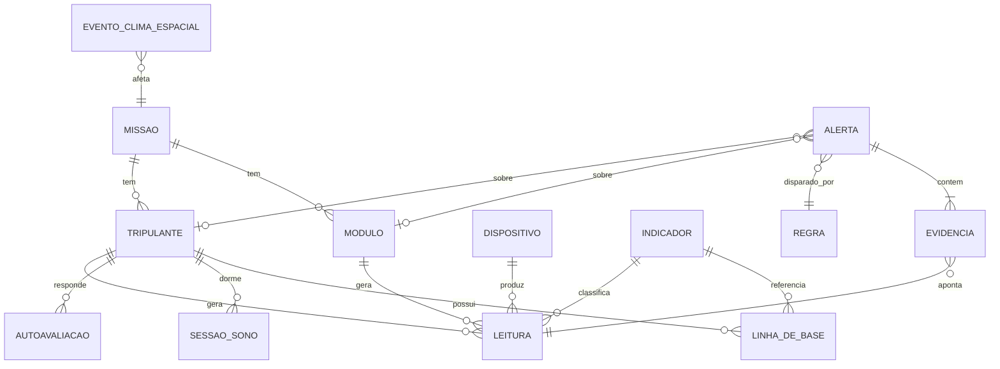

# 06. Modelo de dados

> Para quem: toda a equipe de desenvolvimento. É o contrato entre adaptadores, motor e telas.
> Nomes de entidades e campos em português, iguais no código (`src/domain/`). Horários sempre em UTC, formato ISO 8601.

---

## 1. Visão geral



## 2. Entidades

### 2.1 `Missao`

| Campo | Tipo | Exemplo | Observação |
| --- | --- | --- | --- |
| `id` | string | `"exp-orbit-01"` | |
| `nome` | string | `"Expedição Orbit 01 (simulada)"` | |
| `plataforma` | `"ISS"` \| `"Gateway"` \| `"Lua"` \| `"Marte"` | `"ISS"` | Muda atraso de comunicação e textos |
| `inicioUtc` | string ISO | `"2026-06-25T00:00:00Z"` | Dia de missão (FD) = dias desde o início + 1 |
| `atrasoComunicacaoSeg` | número | `1` | ISS praticamente imediato; Marte de minutos (ver `docs/12`) |

### 2.2 `Tripulante`

| Campo | Tipo | Exemplo | Observação |
| --- | --- | --- | --- |
| `id` | string | `"trip-b"` | |
| `codinome` | string | `"Tripulante B"` | Sempre fictício no protótipo |
| `funcao` | string | `"Engenheira de voo"` | |
| `agencia` | string | `"NASA"` | Para a demo multinacional |
| `massaPreVooKg` | número | `64,2` | Base para variação de massa |
| `perfilSonoro` | string | `"mata-atlantica"` | Paisagem sonora do óculos Orbit |
| `usaOculosOrbit` | booleano | `true` | Participa do estudo do óculos; a condição de cada noite fica em `SessaoSono.condicaoEstudo` (ver `docs/09`) |
| `horarioSono` | `{ inicio: "21:30", fim: "06:00" }` | | Horário programado em GMT (referência publicada pela NASA, ver `docs/01`) |
| `moduloAtual` | string | `"node3"` | Onde o tripulante está agora; usado pelo Monitor geral e pelas regras de cruzamento com o ambiente |
| `compartilhamento` | `{ sinaisVitais: boolean, mente: boolean }` | `{ "sinaisVitais": true, "mente": false }` | O que os colegas veem no Monitor geral; o estado por sistema é sempre compartilhado e detalhes clínicos nunca (ver `docs/07`, T1) |

### 2.3 `Modulo`

| Campo | Tipo | Exemplo |
| --- | --- | --- |
| `id` | string | `"node3"` |
| `nome` | string | `"Node 3 (Tranquility)"` |
| `segmento` | `"USOS"` \| `"ROS"` | `"USOS"` |

### 2.4 `Dispositivo`

| Campo | Tipo | Exemplo | Observação |
| --- | --- | --- | --- |
| `id` | string | `"astroskin-b"` | |
| `tipo` | string | `"vestivel"`, `"eclss"`, `"radiacao"`, `"medico"`, `"exercicio"`, `"orbit"`, `"manual"` | |
| `nome` | string | `"Astroskin / Bio-Monitor"` | Nome real do equipamento, de `docs/02` |
| `tripulanteId` | string opcional | `"trip-b"` | Pessoal |
| `moduloId` | string opcional | `"node3"` | De área |

### 2.5 `Leitura` (a entidade central)

Toda medida, venha de onde vier, vira uma `Leitura`.

| Campo | Tipo | Exemplo | Observação |
| --- | --- | --- | --- |
| `id` | string | `"lei-000123"` | |
| `indicadorId` | string | `"ppco2_modulo"` | Chave do `config/indicadores.json` |
| `valor` | número | `3,9` | Já na unidade canônica |
| `unidade` | string | `"mmHg"` | Unidade canônica do indicador (seção 3) |
| `valorOriginal` | número | `0,52` | Como veio da fonte |
| `unidadeOriginal` | string | `"kPa"` | |
| `instanteUtc` | string ISO | `"2026-11-14T13:54:00Z"` | |
| `tripulanteId` | string opcional | `"trip-b"` | Leituras do corpo |
| `moduloId` | string opcional | `"node3"` | Leituras do ambiente |
| `dispositivoId` | string | `"eclss-node3"` | |
| `origem` | `"automatica"` \| `"manual"` \| `"exame"` \| `"simulada"` \| `"ao_vivo"` | `"simulada"` | A tela mostra o selo |
| `qualidade` | `"boa"` \| `"duvidosa"` \| `"invalida"` | `"boa"` | Leitura inválida não gera alerta |
| `disponibilidade` | `"disponivel"` \| `"aguardando_transferencia"` \| `"pendente_laboratorio"` | `"disponivel"` | Ver nota abaixo |
| `instanteDisponivelUtc` | string ISO opcional | | Quando o valor chegou ao software (pode ser horas ou meses depois de `instanteUtc`) |
| `protocolo` | string opcional | `"PMC"`, `"Standard Measures"`, `"sessao Bio-Monitor"` | De onde veio a medida |

**Nota sobre disponibilidade.** A pesquisa da frente 2 mostrou que a maior parte do dado do corpo na ISS não é contínuo: o Bio-Monitor grava sessões de até 48 h e descarrega depois; sangue, urina e saliva são congelados e analisados na Terra; exames de olhos acontecem em janelas da missão. Por isso uma `Leitura` pode existir antes de ter valor (amostra coletada, resultado pendente) e o tempo da medida (`instanteUtc`) é diferente do tempo em que ela chegou (`instanteDisponivelUtc`). A tela mostra esses estados ("gravado, aguardando transferência", "amostra coletada, análise na Terra") e o motor só avalia leituras `disponivel`. Detalhes em [`../pesquisa/bruto/02-equipamentos-medicos-tripulacao.md`](../pesquisa/bruto/02-equipamentos-medicos-tripulacao.md), seção "Implicações para o software".

### 2.6 `Indicador` (configuração, vem de `docs/03`)

| Campo | Tipo | Exemplo | Observação |
| --- | --- | --- | --- |
| `id` | string | `"spo2"` | |
| `nome` | string | `"Saturação de oxigênio (SpO2)"` | |
| `escopo` | `"tripulante"` \| `"ambiente"` | `"tripulante"` | |
| `regiaoCorpo` | string | `"pulmoes"` | Ids de `docs/07`, T2 |
| `unidade` | string | `"%"` | Canônica |
| `direcao` | `"acima"` \| `"abaixo"` \| `"ambos"` | `"abaixo"` | Lado em que o valor é ruim |
| `faixas` | objeto | ver JSON abaixo | Limites de amarelo e vermelho |
| `usaLinhaDeBase` | booleano | `true` | Liga o z-score de `docs/04` |
| `validadeHoras` | número | `24` | Depois disso, cinza |
| `fonte` | `{ etiqueta, referencia, url }` | | **Obrigatório** para ter faixas |
| `explicacao` | string | | Texto "por que importa no espaço" |
| `orientacoes` | `{ amarelo: string[], vermelho: string[] }` | | O "o que fazer" |

Formato do JSON (os números reais de cada indicador estão em `docs/03`; o exemplo abaixo mostra só a estrutura):

```json
{
  "id": "ppco2_modulo",
  "nome": "CO2 na cabine (pressão parcial)",
  "escopo": "ambiente",
  "regiaoCorpo": "pulmoes",
  "unidade": "mmHg",
  "direcao": "acima",
  "faixas": {
    "amarelo": { "min": 0, "fonteDoValor": "ver docs/03" },
    "vermelho": { "min": 0, "fonteDoValor": "ver docs/03" }
  },
  "usaLinhaDeBase": false,
  "validadeHoras": 1,
  "fonte": {
    "etiqueta": "OFICIAL",
    "referencia": "preencher a partir de docs/03",
    "url": "preencher"
  },
  "explicacao": "Em microgravidade o ar não sobe quando esquenta, então o CO2 que expiramos pode se acumular perto do rosto se a ventilação falhar.",
  "orientacoes": {
    "amarelo": ["Trabalhe por um tempo num módulo com CO2 mais baixo.", "Confira se a ventilação do posto de trabalho está ligada."],
    "vermelho": ["Saia do módulo e avise o controle ambiental e o médico de voo."]
  }
}
```

Regra de leitura das faixas, para `direcao: "acima"`: valor ≥ `vermelho.min` é vermelho; senão, valor ≥ `amarelo.min` é amarelo; senão, verde. Para `"abaixo"`, as faixas usam `max` e a comparação é ≤. Para `"ambos"`, existem `amareloBaixo`, `amareloAlto`, `vermelhoBaixo`, `vermelhoAlto`.

### 2.7 `LinhaDeBase`

| Campo | Tipo | Exemplo |
| --- | --- | --- |
| `tripulanteId` | string | `"trip-a"` |
| `indicadorId` | string | `"fc_repouso"` |
| `media` | número | `57,43` |
| `desvioPadrao` | número | `1,72` |
| `n` | número | `7` |
| `periodo` | `{ inicioUtc, fimUtc }` | |
| `estado` | `"em_formacao"` \| `"pronta"` | `"pronta"` |

### 2.8 `Autoavaliacao`

| Campo | Tipo | Exemplo | Observação |
| --- | --- | --- | --- |
| `id` | string | | |
| `tripulanteId` | string | `"trip-b"` | |
| `instanteUtc` | string ISO | | |
| `tipo` | `"checkin"` \| `"pvt"` \| `"amsler"` \| `"acuidade"` \| `"foto_urina"` \| `"hidratacao"` | `"checkin"` | |
| `respostas` | objeto | `{ "sono": 3, "fadiga": 4, "humor": 4, "sintomas": ["dor_cabeca"], "dorCabeca": 3 }` | Escalas de `docs/03` |
| `resultado` | objeto opcional | `{ "tempoMedioMs": 307, "lapsos": 2 }` | Para testes |
| `leiturasGeradas` | string[] | | Ids das `Leitura` derivadas |

Cada autoavaliação gera `Leitura`s com `origem: "manual"` (exemplo: fadiga 4 vira uma leitura do indicador `fadiga`). Assim o motor trata tudo igual.

### 2.9 `SessaoSono`

| Campo | Tipo | Exemplo |
| --- | --- | --- |
| `tripulanteId` | string | `"trip-c"` |
| `inicioUtc`, `fimUtc` | string ISO | |
| `epocas` | `{ t: number, estagio: "W" \| "N1" \| "N2" \| "N3" \| "REM" }[]` | uma por 30 s |
| `fonte` | `"orbit"` \| `"actigrafia"` \| `"simulada"` | `"simulada"` |
| `metricas` | `{ tstMin, eficienciaPct, latenciaMin, wasoMin }` | calculadas como em `docs/04`, A8 |
| `condicaoEstudo` | `"com_orbit"` \| `"sem_orbit"` \| `"fora_do_estudo"` | `"com_orbit"` |
| `paisagemSonora` | `{ perfil, inicioUtc, fimUtc }` opcional | sons tocados naquela noite (a faixa "dormir" é silenciosa por padrão, ver `docs/09`) |

**Por que `condicaoEstudo` fica na sessão e não no tripulante.** O estudo com grupo controle recomendado pela frente 4 é **cruzado e intrassujeito**: o mesmo tripulante alterna períodos com e sem o óculos, e o resultado compara a pessoa com ela mesma. Por isso a condição é registrada em cada noite. O campo `usaOculosOrbit` do `Tripulante` só diz se a pessoa participa do estudo. Desenho completo em [`09-oculos-orbit.md`](09-oculos-orbit.md).

### 2.10 `EventoClimaEspacial`

| Campo | Tipo | Exemplo | Observação |
| --- | --- | --- | --- |
| `id` | string | | |
| `tipo` | `"SEP"` \| `"FLR"` \| `"CME"` \| `"GST"` \| `"FLUXO_PROTONS"` | `"SEP"` | Tipos da DONKI e do GOES (ver `docs/12`) |
| `inicioUtc`, `fimUtc` | string ISO | | |
| `intensidade` | número | `12` | |
| `unidade` | string | `"pfu"` | Para fluxo de prótons |
| `fonte` | `"NOAA_SWPC"` \| `"NASA_DONKI"` \| `"simulada"` | | |
| `urlOrigem` | string opcional | | Link do evento real |

### 2.11 `Regra` e `Alerta`

| Campo de `Alerta` | Tipo | Exemplo |
| --- | --- | --- |
| `id` | string | `"A-0142-03"` |
| `nivel` | 0 a 4 | `2` |
| `tipo` | `"limiar"` \| `"linha_de_base"` \| `"tendencia"` \| `"cruzamento"` \| `"anomalia"` | `"cruzamento"` |
| `regraId` | string | `"R-CO2-01"` |
| `tripulanteId`, `moduloId` | string opcional | |
| `titulo` | string | `"Possível efeito de CO2 elevado"` |
| `evidencias` | `{ leituraId, indicadorId, valor, unidade, nivel }[]` | |
| `orientacoes` | string[] | |
| `gatilhoParaSubir` | string | `"Dor de cabeça ≥ 7 ou tontura"` |
| `fonte` | `{ etiqueta, referencia, url }` | |
| `estado` | `"aberto"` \| `"reconhecido"` \| `"resolvido"` | |
| `notificacoes` | `{ destino: "tripulante" \| "cmo" \| "medico_voo" \| "controle_ambiental", estado: "enviado" \| "na_fila" \| "nao_aplicavel" }[]` | |
| `criadoUtc`, `atualizadoUtc` | string ISO | |

## 3. Unidades canônicas

Uma unidade por grandeza. Tudo que chega em outra unidade é convertido na entrada (fórmulas em `docs/04`, A1).

| Grandeza | Unidade canônica | Por quê |
| --- | --- | --- |
| Pressão parcial de CO2 | mmHg | Unidade usada pela NASA para limites de CO2 na ISS |
| Pressão parcial de O2 | kPa | Também mostrar em mmHg no detalhe |
| Pressão total da cabine | kPa | Mostrar psia no detalhe para quem vem da documentação americana |
| Temperatura (cabine e corpo) | °C | |
| Umidade relativa | % | |
| Ruído | dBA | |
| Iluminância | lux | |
| Taxa de dose | µGy/h | Como os monitores de área informam taxa de dose absorvida |
| Dose acumulada | mSv | Dose equivalente, a unidade dos limites de exposição |
| Fluxo de prótons | pfu (partículas por cm² por s por sr) | Unidade da escala de tempestades de radiação da NOAA |
| Frequência cardíaca | bpm | |
| Frequência respiratória | respirações/min | |
| Pressão arterial | mmHg | Sistólica e diastólica como dois indicadores |
| SpO2 | % | |
| HRV (RMSSD) | ms | |
| Glicose | mg/dL | Unidade citada no desafio |
| Hemoglobina | g/dL | |
| Massa corporal | kg | |
| Água ingerida | mL | |
| Tempo de reação | ms | |
| Sono | min | |
| Escalas autorrelatadas | pontos da escala | A escala é parte do `indicadorId` |

## 4. Identificadores de indicador

A lista completa de `indicadorId` com unidade, faixas e fonte é a tabela mestra de [`03-indicadores-e-limiares.md`](03-indicadores-e-limiares.md). O arquivo `prototipo/config/indicadores.json` é gerado a partir dela.
