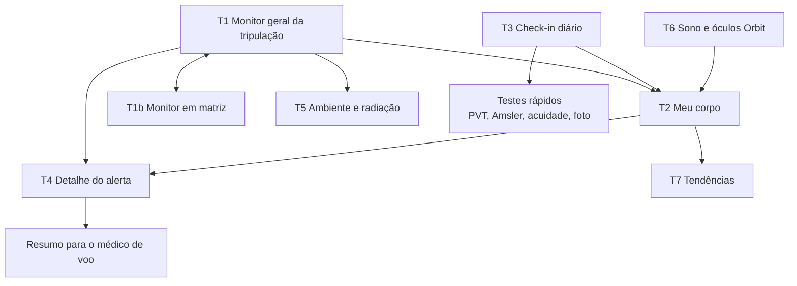

# 07. Design da interface

> Para quem: quem desenha e quem implementa as telas.
> Wireframes navegáveis: abra [`wireframes/telas-prototipo.html`](wireframes/telas-prototipo.html) no navegador.
> **Atualização de 15/11:** o app passou a se chamar ORBITA e o visual final está em [`18-design-orbita-responsivo.md`](18-design-orbita-responsivo.md), com os desenhos em [`wireframes/orbita-responsivo.html`](wireframes/orbita-responsivo.html). Quando os dois discordarem em cor, componente ou layout, vale o `docs/18`; as regras de sinalização, privacidade e convenções da NASA deste documento continuam valendo. O nível 3 agora é laranja.
> Esta é uma **proposta inicial** para acelerar o kickoff. A seção 8 lista as perguntas que a equipe responde juntos antes de fechar o visual; os padrões recomendados permitem começar a codar mesmo antes das respostas.

---

## 1. Para quem é cada tela

| Persona | Contexto de uso | O que precisa em 3 segundos |
| --- | --- | --- |
| **Astronauta** (usuário principal) | Laptop de bordo ou tablet, flutuando, às vezes com pressa, às vezes com pouca luz antes de dormir | "Estou bem? Preciso fazer algo agora?" |
| **Crew Medical Officer (CMO)** | Tripulante com treinamento médico básico que cuida da saúde dos colegas | "Alguém da tripulação precisa de atenção? O que eu levo para a conferência com o médico?" |
| **Médico de voo** (solo, visão secundária) | Recebe resumos quando há comunicação | "O que mudou desde a última conferência e por quê?" |

## 2. Princípios de UX

| # | Princípio | Como aparece na tela |
| --- | --- | --- |
| U1 | **Leitura em 3 segundos.** O estado geral aparece antes de qualquer número. | Anel de prontidão por tripulante, cor da região do corpo, contador de alertas. |
| U2 | **Revelação progressiva.** Estado, depois motivo, depois dado, depois fonte. | Cartão verde ou amarelo → clique → "por que estou vendo isto" → gráfico → fonte da regra. |
| U3 | **Sempre a próxima ação.** Nenhum amarelo ou vermelho sem um "o que fazer". | Bloco "O que fazer" em toda região e em todo alerta. |
| U4 | **Cor nunca sozinha.** Todo estado tem cor, ícone e palavra. | ✓ normal, ! atenção, ✕ acionar médico, ? sem dado. Funciona para daltonismo e em modo noturno. |
| U5 | **Digitar o mínimo.** Em microgravidade o tripulante segura o laptop com uma mão. | Chips, escalas de toque, botões de +250 mL, câmera. Alvos de toque grandes. |
| U6 | **Respeita o relógio biológico.** | Modo noturno âmbar automático no pré-sono, com pouca luz azul. |
| U7 | **Explica sem assustar.** Linguagem simples, tom calmo, sem diagnóstico definitivo. | "Possível efeito de CO2", nunca "você está intoxicado". |
| U8 | **Cooperação, não competição.** Isolamento e conflito de equipe são riscos da missão. | Gamificação com metas da tripulação inteira, sem ranking entre colegas. |
| U9 | **Cuidado mútuo.** A tripulação também cuida uns dos outros. | Monitor geral (T1) com o estado de cada colega, frase de "como ajudar" e botão "Estou indo ver". |

## 3. Mapa de navegação

Barra lateral fixa com: Monitor geral, Meu corpo, Check-in, Ambiente, Alertas (com contador), Tendências, Sono e Orbit. Barra superior com: dia de missão (FD), horário GMT (o horário oficial da ISS), estado da comunicação com o solo, perfil, modo noturno.

## 4. Telas

### T1. Monitor geral da tripulação (tela inicial)

Pedido do dono, 15/11: *"uma tela no software que funciona de monitor geral, que em uma tela apresenta indicadores visuais da saúde dos astronautas individualmente, indicando como normal e se tiver indicadores de perigo ou outros sinaliza nessa tela geral. [...] os astronautas que podem monitorar uns aos outros nessa tela geral."*

É a tela inicial do software e também funciona em **tela cheia** num monitor compartilhado da estação. Junta o monitoramento pessoal com o **cuidado mútuo**: qualquer tripulante bate o olho e vê se um colega precisa de ajuda.

**Dois modos de visualização, mesma informação:**

| Modo | Quando usar | Como é |
| --- | --- | --- |
| **Cartões** (T1) | Tripulação de até 4 a 5 pessoas, tela de laptop | Um cartão por tripulante, lado a lado |
| **Matriz** (T1b) | Tripulação maior (o protótipo testa até 7 pessoas), monitor compartilhado | Linhas = indicadores, colunas = tripulantes, cada célula com cor, ícone e valor |

**Estrutura da tela (modo cartões):**

1. **Faixa "precisa de apoio"** no topo, só quando há algum tripulante em nível 3 ou 4: quem, há quanto tempo e o que fazer ("Oferecer apoio", "Chamar CMO"). O sintoma ou o valor só aparece se a pessoa compartilhou aquele indicador com a tripulação; sem consentimento, a faixa diz apenas "Tripulante C: atenção do CMO solicitada". Quem toca "Oferecer apoio" aparece como "a caminho" só depois que o colega aceita, para evitar visita não solicitada e respostas duplicadas. A faixa usa superfície neutra com ícone e texto, sem fundo vermelho (ver 4.1).
2. **Faixa compacta do ambiente**: CO2, O2, pressão, temperatura, taxa de dose e prótons do GOES. Clique leva à T5.
3. **Um cartão por tripulante**, sempre com os mesmos indicadores na mesma ordem (o olho aprende onde procurar):
   - Cabeçalho: nome ou codinome, função, **módulo onde está agora**, selo de estado geral (✓ normal, ! atenção, ✕ perigo, ? sem dado).
   - Mini figura humana com as regiões coloridas (a mesma lógica da T2, em miniatura).
   - Oito blocos de indicador: **Coração** (bpm), **Oxigenação** (SpO2 %), **Temperatura** (°C), **Sono** da última noite, **Prontidão** (0 a 100), **Hidratação** (% da meta do dia), **Radiação** (dose da missão em mSv), e um bloco que muda conforme o que estiver pior (Olhos, Cabeça, Mente).
   - Rodapé: idade do dado ("atualizado há 2 min", "vestível desconectado há 26 h") e, se houver alerta, uma frase do que está acontecendo **e do que o colega pode fazer para ajudar**.
   - Borda do cartão na cor do estado; tracejada quando falta dado.
4. **Barra do cuidado mútuo**: verificações entre colegas no dia e metas da tripulação (gamificação cooperativa, sem ranking).

**Regras de sinalização:**

| Estado do tripulante | Cartão | Faixa "precisa de apoio" | Som |
| --- | --- | --- | --- |
| ✓ Saúde: normal | Contorno verde discreto, superfície neutra | Não | Nunca |
| ! Saúde: atenção (nível 2) | Contorno amarelo estático, frase de ajuda no rodapé | Não | Nunca |
| ✕ Saúde: acionar CMO (nível 3) | Contorno laranja estático (`--estado-alerta` `#F97316`, `docs/18`), sem halo e sem piscar; texto da ação, horário e origem do dado | Sim | Nunca |
| Saúde: imediato (nível 4, só por sintoma de alarme) | Contorno vermelho estático (`--estado-critico` `#FF6B6B`), com instrução textual estática: "Contatar CMO agora" e "Abrir procedimento oficial" | Sim | Nunca; som e luz vermelha são do sistema de alarmes da estação (ver `docs/05`, princípio P5) |
| ? Sem leitura / leitura vencida / sensor desconectado | Contorno cinza tracejado com a palavra exata do caso e a idade do dado | Não | Nunca; lembrete para o próprio tripulante |
| Não compartilhado | Texto neutro "não compartilhado", sem cor de estado e sem clique | Não | Nunca |

**Idade do dado é informação de saúde.** Como boa parte dos dados do corpo na ISS chega por sessão ou por medida pontual (ver `docs/06`, nota sobre disponibilidade), cada bloco mostra a idade da leitura. Um "normal" de 3 dias atrás não é o mesmo que um "normal" de agora; depois do prazo de validade do indicador, o bloco fica cinza. A norma da NASA exige indicar visualmente dado antigo, ausente, indisponível ou desconhecido (NASA-STD-3001 Vol 2 Rev F, V2 10020), e distinguimos os três casos porque a ação muda: medir, transferir a sessão ou reconectar o sensor.

**Privacidade no monitor geral: consentimento granular.** Registros e comunicações médicas da tripulação são privados pela norma da NASA (NASA-STD-3001 Vol 1, V1 7003, V1 6003 e V1 6011) e não existe regra pública que autorize um monitor coletivo com dados clínicos. Por isso o Monitor geral só mostra o que cada pessoa escolheu compartilhar, com quem e por quanto tempo:

| Dado | Audiências possíveis | Padrão de um tripulante novo | Perfil da demonstração |
| --- | --- | --- | --- |
| Estado por sistema (cor e ícone, sem números) | Só eu, CMO, médico de voo, colega escolhido (buddy), tripulação | CMO e médico de voo | Tripulação |
| Valores de sinais vitais, sono, hidratação e radiação | Idem | Só eu | Tripulação |
| Módulo onde estou | Idem | Só eu | Tripulação |
| Mente e humor (só o estado) | Só eu, CMO, médico de voo, buddy | Só eu | "Privado" para um dos quatro, para mostrar o conceito |
| Detalhes clínicos, questionários, conversas médicas | Fluxo autenticado do CMO e do médico de voo | Nunca no monitor | Nunca no monitor |

Regras: a tela de consentimento mostra finalidade, efeito, última atualização e botão de revogar; "não compartilhado" nunca vira cor de alerta nem inferência; o monitor em tela cheia exige ativação deliberada, oculta detalhes após inatividade e não abre prontuário por clique. O software **não** codifica acesso emergencial irrestrito do CMO: se a autoridade médica do programa aprovar esse conceito, ele será limitado ao mínimo e registrará quem acessou, quando e por quê. Recomendações completas e fontes em [`../pesquisa/bruto/07-desafio-oficial-padroes-interface.md`](../pesquisa/bruto/07-desafio-oficial-padroes-interface.md), seção D5.

### T1b. Monitor geral em modo matriz

Mesmos dados da T1, organizados para leitura rápida de muitos tripulantes. Cada célula traz ícone, cor e valor; a coluna inteira de um tripulante fica destacada quando ele está em perigo. Clique numa célula abre o detalhe que aquele colega permitiu compartilhar. Última linha: idade do dado de cada tripulante.

### T2. Meu corpo (figura humana clicável)

A figura é a ideia central do desafio. Cada região é um `<path>` SVG com `id` próprio, preenchido com a cor do pior estado entre os indicadores daquela região. Ao clicar, o painel lateral mostra: o que aquela parte do corpo faz, por que ela muda no espaço, os indicadores com estado, um gráfico de tendência, o bloco "O que fazer" e os botões de ação (fazer teste, enviar ao médico, por que estou vendo isto).

**Mapa região → indicadores** (a lista completa de indicadores e limiares está em [`03-indicadores-e-limiares.md`](03-indicadores-e-limiares.md)):

| Região (id do SVG) | Por que muda no espaço | Indicadores exibidos |
| --- | --- | --- |
| `cerebro` Cérebro e mente | Sono curto, isolamento, carga de trabalho, CO2, radiação | Horas e eficiência do sono, tempo de reação (PVT), fadiga, humor, estresse, sinais de EEG do óculos |
| `olhos` Olhos | SANS: líquidos sobem para a cabeça | Grade de Amsler, acuidade de perto, sintomas visuais, último OCT e fundo de olho, pressão intraocular |
| `ouvidos` Ouvidos | Ruído constante de ventiladores e bombas | Dose de ruído (dBA), audiometria periódica, zumbido relatado |
| `vestibular` Equilíbrio e orientação (entrou pelo prompt ORBITA, `docs/17`) | Sem gravidade, o ouvido interno perde a referência de cima e baixo: enjoo espacial nos primeiros dias e desorientação na volta | Enjoo, tontura e desorientação relatados; sem indicador numérico em voo, por isso fica cinza até haver sintoma ou teste |
| `coracao` Coração e vasos | Redistribuição de fluidos, descondicionamento | Frequência cardíaca de repouso, variabilidade (HRV), **pressão arterial** (citada no desafio oficial), ECG |
| `pulmoes` Pulmões | Ar fechado, CO2, EVA | Frequência respiratória, SpO2, exposição a CO2 do módulo |
| `sangue` Sangue e imunidade (ícone sistêmico) | Anemia do voo espacial, imunidade alterada, reativação viral | **Glicose em mg/dL** (exemplo citado no desafio oficial; glicosímetro do kit, entrada manual), hemoglobina, hematócrito, temperatura, sintomas de infecção |
| `digestao` Digestão e nutrição | Apetite menor, cardápio limitado | Calorias, proteína, apetite, massa corporal, enjoo |
| `rins` Rins e hidratação | Perda óssea libera cálcio, risco de cálculo | Água ingerida, cor da urina por foto, risco de cálculo |
| `ossos` Ossos | Sem carga, o osso perde massa | Perda óssea estimada, adesão ao exercício resistido, cálcio e vitamina D |
| `musculos` Músculos e coluna | Sem carga, músculo atrofia; coluna alonga | Força de preensão, carga no ARED, capacidade aeróbica no CEVIS, dor lombar |
| `pele` Pele | Ar seco, contato com equipamentos, EVA | Irritações por foto, temperatura da pele |
| `corpo` Corpo inteiro (radiação) | Raios cósmicos e partículas solares | Dose acumulada da missão e em relação ao limite de carreira |

### T3. Check-in diário (meta: 2 minutos)

Seis passos curtos com barra de progresso: **Sono, Energia, Humor, Sintomas, Hidratação, Testes rápidos**. Cada passo é uma pergunta de toque (escala ou chips). Os testes rápidos (PVT de 3 minutos, grade de Amsler, acuidade de perto, foto da urina) aparecem só nos dias em que estão programados, para não cansar. As escalas exatas (fadiga, sonolência, humor, dor) estão em [`03-indicadores-e-limiares.md`](03-indicadores-e-limiares.md), seção de autoavaliação.

### T4. Detalhe do alerta

Quatro blocos fixos, sempre na mesma ordem:
1. **Cabeçalho**: nível com cor, ícone e quem age; título curto; tripulante, local e horário.
2. **Por que estou vendo isto**: cada dado que disparou a regra, com valor, unidade e estado; o nome da regra de cruzamento.
3. **O que fazer agora**: passos numerados, incluindo o gatilho que faria o alerta subir de nível.
4. **Fonte da regra e quem já sabe**: referência oficial do limiar e estado das notificações (tripulante, CMO, solo).

Embaixo, um gráfico com os sinais envolvidos sobrepostos e a linha do limite.

### T5. Ambiente e radiação

- **Mapa esquemático dos módulos** colorido pela grandeza escolhida (CO2 por padrão; trocar para temperatura, umidade, ruído). Clique mostra os valores do módulo e quem está nele.
- **Taxa de dose** das últimas horas, com os picos das passagens pela Anomalia do Atlântico Sul.
- **Dose acumulada** por tripulante em barra relativa ao limite de carreira.
- **Clima espacial**: prótons do GOES, índice Kp, últimos eventos da DONKI.
- Selo indicando a origem do dado: simulado ou ao vivo (telemetria pública).

### T6. Sono e óculos Orbit

- Cartões: sono da última noite, eficiência, ruído na cabine de dormir.
- **Hipnograma** gerado do EEG do óculos (no protótipo, a partir de uma base pública de sono).
- **Paisagem sonora do dia**: perfil cultural escolhido pelo tripulante e a programação por período (manhã, tarde, pré-sono, dormir), com a transição suave para o noturno.
- **Sinais do óculos**: piscadas por minuto e índice de fadiga (EOG), potência alfa (EEG), luz ambiente.

### T7. Tendências (sem wireframe; usa os mesmos componentes)

Seletor de indicador e de período (7 dias, 30 dias, missão inteira), gráfico com faixas coloridas de fundo, linha de base pessoal pontilhada e anotações de eventos (EVA, chegada de veículo, evento solar).

## 5. Sistema visual

### 5.1 Tokens de cor

Os nomes abaixo são os mesmos do CSS dos wireframes. Use como variáveis CSS ou no `tailwind.config`.

| Token | Tema padrão (escuro) | Modo noturno (âmbar) | Uso |
| --- | --- | --- | --- |
| `--bg` | `#0A0F1E` | `#0D0703` | Fundo da página |
| `--surface` | `#111A2F` | `#1A0F07` | Cartões, barras |
| `--surface-2` | `#18233D` | `#24150A` | Elementos dentro de cartões |
| `--border` | `#26324F` | `#3A2414` | Bordas |
| `--text` | `#E8ECF5` | `#F2C79B` | Texto principal |
| `--muted` | `#94A0B8` | `#A98462` | Texto secundário |
| `--accent` | `#4EA8FF` | `#E08A3C` | Ação principal, séries de gráfico |
| `--ok` | `#22C55E` | `#A3B84F` | ✓ normal |
| `--warn` | `#F5B800` | `#F0A030` | ! atenção |
| `--alert` | `#EF4444` | `#E0503A` | ✕ acionar médico |
| `--nodata` | `#6B7280` | `#6E5A48` | ? sem dado |
| `--info` | `#38BDF8` | `#D99A55` | i informação |

Por que tema escuro: os laptops de bordo ficam ligados o dia todo e a tripulação trabalha perto do horário de dormir; um fundo escuro emite menos luz. O modo noturno troca os azuis por âmbar, porque luz azul à noite atrapalha o sono (o tema de iluminação circadiana da ISS está em [`01-contexto-missao.md`](01-contexto-missao.md)).

### 5.1.1 Convivência com as convenções de cor e alarme da NASA

Nas telas de bordo da ISS, vermelho comunica Warning e Emergency, amarelo comunica Caution e azul comunica Advisory, e o piscar vermelho, o som e as luzes pertencem ao sistema de Caution and Warning (C&W) da estação (fonte: frente 7, seção D4, com NASA-STD-3001 Vol 2 Rev F, V2 10114 e Apêndice F). Para não criar um alarme paralelo:

| Regra | Como aplicar |
| --- | --- |
| Estados do Orbit são de **saúde**, não do veículo | Rótulo sempre com o prefixo "Saúde:" (por exemplo "Saúde: atenção"); nunca usar as palavras Caution, Warning ou Emergency |
| Nada pisca, nada toca | Sem animação de pulso, sem halo, sem som em nenhum nível; a ação vem em texto |
| Cor só como contorno e ícone | Superfícies neutras; o estado aparece no contorno, no ícone e na palavra |
| Emergência real é da estação | O nível 4 manda abrir o procedimento oficial e falar com o CMO; o software nunca diz que detectou fogo, despressurização ou atmosfera tóxica |
| Legibilidade medida no hardware real | A norma pede rótulos de pelo menos 12 pontos ou 0,4 grau de ângulo visual na distância de uso (V2 10066); medir no monitor da demonstração, porque pixel de CSS não prova isso |
| Contraste | Mínimo de 6:1 entre texto e fundo nos dois temas, inclusive no modo noturno |

### 5.2 Tipografia e espaçamento

- Fonte do sistema (`system-ui`), sem dependência de rede.
- Números grandes em 26 px com unidade menor ao lado; rótulos em 12 px; texto em 14 px.
- Grade de 14 px entre cartões; raio de 10 px.
- Unidade sempre visível ao lado do número. Nunca mostrar número sem unidade.

### 5.3 Componentes

| Componente | Props principais | Onde aparece |
| --- | --- | --- |
| `StatusBadge` | `nivel` (0 a 4), `texto` | Em todo lugar |
| `MetricCard` | `rotulo`, `valor`, `unidade`, `nivel`, `fonte`, `atualizadoEm` | T1, T5, T6 |
| `CrewMonitorCard` | `tripulante`, `moduloAtual`, `estadoGeral`, `blocos[]` (indicador, valor, unidade, nível, idade), `estadoPorRegiao`, `fraseAjuda`, `compartilhamento` | T1 |
| `CrewMatrix` | `tripulantes[]`, `linhas[]` (indicadores), `celulas[][]` | T1b |
| `DangerBanner` | `alertas[]` de nível 3 ou 4, `quemEstaIndo` | T1, T1b |
| `MiniBodyMap` | `estadoPorRegiao` | T1 |
| `BodyMap` | `estadoPorRegiao`, `onSelect(regiao)`, `lado` (frente ou costas) | T2 |
| `RegionPanel` | `regiao`, `indicadores[]`, `orientacoes[]` | T2 |
| `TrendChart` | `serie[]`, `faixas`, `linhaDeBase`, `eventos[]` | T1, T2, T4, T7 |
| `AlertDetail` | `alerta` (com evidências, ações, fonte) | T4 |
| `CheckinStep` | `pergunta`, `tipo` (escala, chips, contador, câmera) | T3 |
| `ModuleMap` | `modulos[]`, `grandeza`, `onSelect` | T5 |
| `Hypnogram` | `epocas[]` (estágio a cada 30 s) | T6 |
| `SoundscapeSchedule` | `perfil`, `faixas[]` | T6 |

### 5.4 Animações (com moderação)

- Nenhum pulso ou piscar, em nenhum nível (ver 5.1.1).
- Transição de cor de uma região do corpo quando o estado muda (300 ms).
- Nada de animação contínua em tela que fica aberta o dia todo.

## 6. Gamificação

Objetivo: aumentar a adesão aos hábitos que a medicina espacial já recomenda, sem criar competição entre colegas.

| Mecânica | Comportamento incentivado | Como medir |
| --- | --- | --- |
| Sequência de check-ins | Responder o check-in diário | Dias seguidos com check-in completo |
| Missão do dia | Uma meta concreta (hidratação, teste de visão semanal) | Meta cumprida no dia |
| Meta da tripulação | Todos cumprirem a hidratação ou o exercício prescrito | Percentual da tripulação que cumpriu |
| Medalhas com nomes da natureza | Marcos de constância | Exemplo: "Rio Limpo" por 7 dias de hidratação |
| **Sons desbloqueáveis** | Constância nos hábitos | Cada marco libera um novo som do perfil cultural do tripulante no óculos Orbit. Liga o software ao óculos. |

Evitar: ranking individual entre tripulantes, punição por meta perdida, notificações insistentes.

## 7. Acessibilidade e ambiente de uso

- Contraste mínimo AA entre texto e fundo nos dois temas.
- Cor, ícone e palavra juntos em todo estado.
- Alvos de toque de no mínimo 44 px.
- Funciona com teclado (o laptop de bordo é o caso principal).
- Textos curtos; detalhes atrás de "saiba mais".

## 8. Perguntas para o kickoff com a equipe (desenhar juntos)

O dono do projeto pediu que o layout final seja desenhado **com** a equipe. Proposta: 30 minutos no início das 20 horas, passando por estas perguntas. Onde não houver consenso rápido, vale o padrão recomendado.

| # | Pergunta | Padrão recomendado |
| --- | --- | --- |
| K1 | A demonstração roda em laptop, tablet ou telão? Qual resolução? | Laptop, 1366 × 768 no mínimo, projetado no telão |
| K2 | Tema escuro de controle de missão ou tema claro clínico? | Escuro, com modo noturno âmbar |
| K3 | A equipe já tem paleta, logo ou nome visual em mente? | Usar os tokens da seção 5.1 e o nome "Orbit" |
| K4 | Idioma da interface na apresentação: português, inglês ou os dois? | Dicionário PT-BR e EN desde o início, apresentação em PT-BR |
| K5 | Estilo da figura humana: silhueta minimalista, anatômica ou 3D? | Silhueta minimalista em SVG (rápido, nítido, fácil de colorir) |
| K6 | Quanta gamificação: discreta ou forte? | Discreta: sequência, missão do dia e meta da tripulação |
| K7 | Qual cenário é a história principal da demo? | C1 (CO2) para mostrar o cruzamento ambiente e corpo, e C3 (SANS) para ligar ao óculos |
| K8 | Alguma referência visual que a equipe gosta (apps de saúde, painéis da NASA, jogos)? | Anotar e ajustar tokens; não muda a estrutura das telas |
