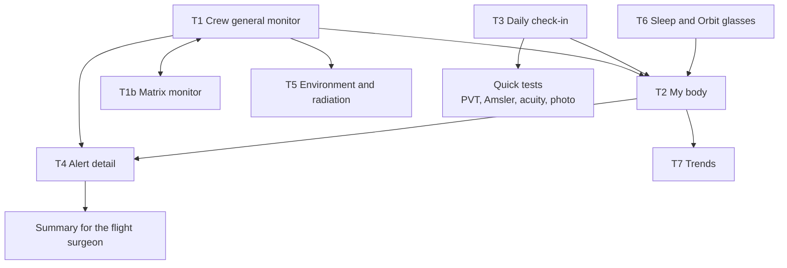

# 07. Interface design

> For whom: those who design and those who implement the screens.
> Navigable wireframes: open [`wireframes/prototype-screens.html`](wireframes/prototype-screens.html) in the browser.
> **Update of 11/15:** the app is now called ORBITA and the final look is in [`18-orbita-responsive-design.md`](18-orbita-responsive-design.md), with the drawings in [`wireframes/orbita-responsive.html`](wireframes/orbita-responsive.html). When the two disagree on color, component or layout, `docs/18` prevails; the signaling, privacy and NASA convention rules in this document remain in force. Level 3 is now orange.
> This is an **initial proposal** to speed up the kickoff. Section 8 lists the questions the team answers together before closing the look; the recommended defaults let you start coding even before the answers.

---

## 1. Who each screen is for

| Persona | Context of use | What they need in 3 seconds |
| --- | --- | --- |
| **Astronaut** (main user) | Onboard laptop or tablet, floating, sometimes in a hurry, sometimes in low light before sleep | "Am I okay? Do I need to do something now?" |
| **Crew Medical Officer (CMO)** | Crew member with basic medical training who looks after the health of colleagues | "Does anyone on the crew need attention? What do I bring to the conference with the doctor?" |
| **Flight surgeon** (solo, secondary view) | Receives summaries when there is communication | "What has changed since the last conference, and why?" |

## 2. UX principles

| # | Principle | How it appears on screen |
| --- | --- | --- |
| U1 | **Reading in 3 seconds.** The overall state appears before any number. | Readiness ring per crew member, body region color, alert counter. |
| U2 | **Progressive disclosure.** State, then reason, then data, then source. | Green or yellow card → click → "why am I seeing this" → chart → rule source. |
| U3 | **Always the next action.** No yellow or red without a "what to do". | "What to do" block in every region and every alert. |
| U4 | **Color never alone.** Every state has color, icon and word. | ✓ normal, ! attention, ✕ call doctor, ? no data. Works for color blindness and in night mode. |
| U5 | **Type as little as possible.** In microgravity the crew member holds the laptop with one hand. | Chips, touch scales, +250 mL buttons, camera. Large touch targets. |
| U6 | **Respects the biological clock.** | Automatic amber night mode before sleep, with little blue light. |
| U7 | **Explains without scaring.** Simple language, calm tone, no definitive diagnosis. | "Possible CO2 effect", never "you are intoxicated". |
| U8 | **Cooperation, not competition.** Isolation and team conflict are mission risks. | Gamification with goals for the whole crew, no ranking among colleagues. |
| U9 | **Mutual care.** The crew also looks after each other. | General Monitor (T1) with each colleague's state, a "how to help" sentence and an "I'm on my way" button. |

## 3. Navigation map

Fixed sidebar with: General monitor, My body, Check-in, Environment, Alerts (with counter), Trends, Sleep and Orbit. Top bar with: mission day (FD), GMT time (the official ISS time), ground communication status, profile, night mode.

## 4. Screens

### T1. Crew general monitor (home screen)

Owner's request, 11/15: *"a screen in the software that works as a general monitor, that shows on a single screen visual indicators of the health of the astronauts individually, indicating normal and, if there are danger indicators or others, flagging them on this general screen. [...] the astronauts who can monitor one another on this general screen."*

It is the software's home screen and also works in **full screen** on a shared station monitor. It joins personal monitoring with **mutual care**: any crew member glances at it and sees whether a colleague needs help.

**Two viewing modes, same information:**

| Mode | When to use | What it looks like |
| --- | --- | --- |
| **Cards** (T1) | Crew of up to 4 to 5 people, laptop screen | One card per crew member, side by side |
| **Matrix** (T1b) | Larger crew (the prototype tests up to 7 people), shared monitor | Rows = indicators, columns = crew members, each cell with color, icon and value |

**Screen structure (cards mode):**

1. **"Needs support" strip** at the top, only when some crew member is at level 3 or 4: who, for how long and what to do ("Offer support", "Call CMO"). The symptom or value only appears if the person shared that indicator with the crew; without consent, the strip says only "Crew member C: CMO attention requested". Whoever taps "Offer support" appears as "on the way" only after the colleague accepts, to avoid unsolicited visits and duplicate responses. The strip uses a neutral surface with icon and text, with no red background (see 4.1).
2. **Compact environment strip**: CO2, O2, pressure, temperature, dose rate and GOES protons. Click leads to T5.
3. **One card per crew member**, always with the same indicators in the same order (the eye learns where to look):
   - Header: name or codename, role, **module where they are now**, overall state badge (✓ normal, ! attention, ✕ danger, ? no data).
   - Mini human figure with colored regions (the same logic as T2, in miniature).
   - Eight indicator blocks: **Heart** (bpm), **Oxygenation** (SpO2 %), **Temperature** (°C), **Sleep** last night, **Readiness** (0 to 100), **Hydration** (% of the day's goal), **Radiation** (mission dose in mSv), and a block that changes according to whatever is worst (Eyes, Head, Mind).
   - Footer: data age ("updated 2 min ago", "wearable disconnected for 26 h") and, if there is an alert, a sentence about what is happening **and what the colleague can do to help**.
   - Card border in the state color; dashed when data is missing.
4. **Mutual care bar**: checks between colleagues during the day and crew goals (cooperative gamification, no ranking).

**Signaling rules:**

| Crew member state | Card | "Needs support" strip | Sound |
| --- | --- | --- | --- |
| ✓ Health: normal | Subtle green outline, neutral surface | No | Never |
| ! Health: attention (level 2) | Static yellow outline, help sentence in the footer | No | Never |
| ✕ Health: call CMO (level 3) | Static orange outline (`--estado-alerta` `#F97316`, `docs/18`), no halo and no blinking; action text, time and data origin | Yes | Never |
| Health: immediate (level 4, only by alarm symptom) | Static red outline (`--estado-critico` `#FF6B6B`), with static text instruction: "Contact CMO now" and "Open official procedure" | Yes | Never; sound and red light belong to the station's alarm system (see `docs/05`, principle P5) |
| ? No reading / stale reading / sensor disconnected | Dashed gray outline with the exact wording for the case and the data age | No | Never; reminder for the crew member themselves |
| Not shared | Neutral text "not shared", no state color and no click | No | Never |

**Data age is health information.** Since much of the body data on the ISS arrives per session or as a one-off measurement (see `docs/06`, note on availability), each block shows the age of the reading. A "normal" from 3 days ago is not the same as a "normal" from right now; after the indicator's validity period, the block turns gray. The NASA standard requires visually indicating old, absent, unavailable or unknown data (NASA-STD-3001 Vol 2 Rev F, V2 10020), and we distinguish the three cases because the action changes: measure, transfer the session or reconnect the sensor.

**Privacy on the general monitor: granular consent.** Crew medical records and communications are private under the NASA standard (NASA-STD-3001 Vol 1, V1 7003, V1 6003 and V1 6011) and there is no public rule authorizing a collective monitor with clinical data. For that reason the General monitor only shows what each person chose to share, with whom and for how long:

| Data | Possible audiences | Default for a new crew member | Demonstration profile |
| --- | --- | --- | --- |
| State per system (color and icon, no numbers) | Only me, CMO, flight surgeon, chosen colleague (buddy), crew | CMO and flight surgeon | Crew |
| Vital sign, sleep, hydration and radiation values | Same | Only me | Crew |
| Module where I am | Same | Only me | Crew |
| Mind and mood (state only) | Only me, CMO, flight surgeon, buddy | Only me | "Private" for one of the four, to show the concept |
| Clinical details, questionnaires, medical conversations | Authenticated flow of the CMO and flight surgeon | Never on the monitor | Never on the monitor |

Rules: the consent screen shows purpose, effect, last update and a revoke button; "not shared" never becomes an alert color or an inference; the full-screen monitor requires deliberate activation, hides details after inactivity and does not open a medical record on click. The software does **not** code unrestricted emergency access for the CMO: if the program's medical authority approves this concept, it will be limited to the minimum and will log who accessed, when and why. Full recommendations and sources in [`../pesquisa/bruto/07-desafio-oficial-padroes-interface.md`](../pesquisa/bruto/07-desafio-oficial-padroes-interface.md), section D5.

### T1b. General monitor in matrix mode

Same data as T1, arranged for quick reading of many crew members. Each cell has icon, color and value; the whole column of a crew member is highlighted when they are in danger. Clicking a cell opens the detail that colleague allowed to be shared. Last row: data age of each crew member.

### T2. My body (clickable human figure)

The figure is the central idea of the challenge. Each region is an SVG `<path>` with its own `id`, filled with the color of the worst state among that region's indicators. On click, the side panel shows: what that part of the body does, why it changes in space, the indicators with state, a trend chart, the "What to do" block and the action buttons (take a test, send to the doctor, why am I seeing this).

**Region → indicators map** (the full list of indicators and thresholds is in [`03-indicators-and-thresholds.md`](03-indicators-and-thresholds.md)):

| Region (SVG id) | Why it changes in space | Indicators shown |
| --- | --- | --- |
| `cerebro` Brain and mind | Short sleep, isolation, workload, CO2, radiation | Sleep hours and efficiency, reaction time (PVT), fatigue, mood, stress, EEG signals from the glasses |
| `olhos` Eyes | SANS: fluids shift toward the head | Amsler grid, near acuity, visual symptoms, latest OCT and fundus exam, intraocular pressure |
| `ouvidos` Ears | Constant noise from fans and pumps | Noise dose (dBA), periodic audiometry, reported tinnitus |
| `vestibular` Balance and orientation (added by the ORBITA prompt, `docs/17`) | Without gravity, the inner ear loses the reference for up and down: space sickness in the first days and disorientation on return | Reported nausea, dizziness and disorientation; no numeric indicator in flight, so it stays gray until there is a symptom or test |
| `coracao` Heart and vessels | Fluid redistribution, deconditioning | Resting heart rate, variability (HRV), **blood pressure** (cited in the official challenge), ECG |
| `pulmoes` Lungs | Closed air, CO2, EVA | Respiratory rate, SpO2, module CO2 exposure |
| `sangue` Blood and immunity (systemic icon) | Spaceflight anemia, altered immunity, viral reactivation | **Glucose in mg/dL** (example cited in the official challenge; kit glucometer, manual entry), hemoglobin, hematocrit, temperature, infection symptoms |
| `digestao` Digestion and nutrition | Lower appetite, limited menu | Calories, protein, appetite, body mass, nausea |
| `rins` Kidneys and hydration | Bone loss releases calcium, stone risk | Water intake, urine color by photo, stone risk |
| `ossos` Bones | Without load, bone loses mass | Estimated bone loss, adherence to resistive exercise, calcium and vitamin D |
| `musculos` Muscles and spine | Without load, muscle atrophies; spine lengthens | Grip strength, ARED load, aerobic capacity on the CEVIS, lower back pain |
| `pele` Skin | Dry air, contact with equipment, EVA | Irritation by photo, skin temperature |
| `corpo` Whole body (radiation) | Cosmic rays and solar particles | Accumulated mission dose and relative to the career limit |

### T3. Daily check-in (goal: 2 minutes)

Six short steps with a progress bar: **Sleep, Energy, Mood, Symptoms, Hydration, Quick tests**. Each step is a touch question (scale or chips). The quick tests (3-minute PVT, Amsler grid, near acuity, urine photo) appear only on the days they are scheduled, to avoid fatigue. The exact scales (fatigue, sleepiness, mood, pain) are in [`03-indicators-and-thresholds.md`](03-indicators-and-thresholds.md), self-assessment section.

### T4. Alert detail

Four fixed blocks, always in the same order:
1. **Header**: level with color, icon and who acts; short title; crew member, place and time.
2. **Why am I seeing this**: each piece of data that triggered the rule, with value, unit and state; the name of the cross-referencing rule.
3. **What to do now**: numbered steps, including the trigger that would raise the alert to a higher level.
4. **Rule source and who already knows**: official reference for the threshold and notification status (crew member, CMO, ground).

Below, a chart with the signals involved overlaid and the limit line.

### T5. Environment and radiation

- **Schematic module map** colored by the chosen quantity (CO2 by default; switch to temperature, humidity, noise). Click shows the module's values and who is in it.
- **Dose rate** over the last hours, with the peaks from South Atlantic Anomaly passes.
- **Accumulated dose** per crew member in a bar relative to the career limit.
- **Space weather**: GOES protons, Kp index, latest DONKI events.
- Badge indicating the data origin: simulated or live (public telemetry).

### T6. Sleep and Orbit glasses

- Cards: last night's sleep, efficiency, noise in the sleeping quarters.
- **Hypnogram** generated from the glasses' EEG (in the prototype, from a public sleep database).
- **Soundscape of the day**: cultural profile chosen by the crew member and the schedule by period (morning, afternoon, pre-sleep, sleep), with the smooth transition to night.
- **Glasses signals**: blinks per minute and fatigue index (EOG), alpha power (EEG), ambient light.

### T7. Trends (no wireframe; uses the same components)

Indicator and period selector (7 days, 30 days, whole mission), chart with colored background bands, dotted personal baseline line and event annotations (EVA, vehicle arrival, solar event).

## 5. Visual system

### 5.1 Color tokens

The names below are the same as in the wireframes' CSS. Use them as CSS variables or in `tailwind.config`.

| Token | Default theme (dark) | Night mode (amber) | Use |
| --- | --- | --- | --- |
| `--bg` | `#0A0F1E` | `#0D0703` | Page background |
| `--surface` | `#111A2F` | `#1A0F07` | Cards, bars |
| `--surface-2` | `#18233D` | `#24150A` | Elements inside cards |
| `--border` | `#26324F` | `#3A2414` | Borders |
| `--text` | `#E8ECF5` | `#F2C79B` | Main text |
| `--muted` | `#94A0B8` | `#A98462` | Secondary text |
| `--accent` | `#4EA8FF` | `#E08A3C` | Primary action, chart series |
| `--ok` | `#22C55E` | `#A3B84F` | ✓ normal |
| `--warn` | `#F5B800` | `#F0A030` | ! attention |
| `--alert` | `#EF4444` | `#E0503A` | ✕ call doctor |
| `--nodata` | `#6B7280` | `#6E5A48` | ? no data |
| `--info` | `#38BDF8` | `#D99A55` | i information |

Why a dark theme: onboard laptops stay on all day and the crew works close to bedtime; a dark background emits less light. Night mode swaps the blues for amber, because blue light at night disrupts sleep (the ISS circadian lighting theme is in [`01-mission-context.md`](01-mission-context.md)).

### 5.1.1 Coexistence with NASA color and alarm conventions

On ISS onboard screens, red communicates Warning and Emergency, yellow communicates Caution and blue communicates Advisory, and red blinking, sound and lights belong to the station's Caution and Warning (C&W) system (source: stream 7, section D4, with NASA-STD-3001 Vol 2 Rev F, V2 10114 and Appendix F). To avoid creating a parallel alarm:

| Rule | How to apply |
| --- | --- |
| Orbit states are **health** states, not vehicle states | Label always with the prefix "Health:" (for example "Health: attention"); never use the words Caution, Warning or Emergency |
| Nothing blinks, nothing sounds | No pulse animation, no halo, no sound at any level; the action comes as text |
| Color only as outline and icon | Neutral surfaces; the state appears in the outline, the icon and the word |
| A real emergency belongs to the station | Level 4 tells the user to open the official procedure and talk to the CMO; the software never says it detected fire, depressurization or a toxic atmosphere |
| Legibility measured on real hardware | The standard requires labels of at least 12 points or 0.4 degree of visual angle at the viewing distance (V2 10066); measure on the demonstration monitor, because CSS pixels do not prove this |
| Contrast | Minimum of 6:1 between text and background in both themes, including night mode |

### 5.2 Typography and spacing

- System font (`system-ui`), no network dependency.
- Large numbers at 26 px with a smaller unit beside them; labels at 12 px; text at 14 px.
- 14 px grid between cards; 10 px radius.
- Unit always visible next to the number. Never show a number without a unit.

### 5.3 Components

| Component | Main props | Where it appears |
| --- | --- | --- |
| `StatusBadge` | `nivel` (0 to 4), `texto` | Everywhere |
| `MetricCard` | `rotulo`, `valor`, `unidade`, `nivel`, `fonte`, `atualizadoEm` | T1, T5, T6 |
| `CrewMonitorCard` | `tripulante`, `moduloAtual`, `estadoGeral`, `blocos[]` (indicator, value, unit, level, age), `estadoPorRegiao`, `fraseAjuda`, `compartilhamento` | T1 |
| `CrewMatrix` | `tripulantes[]`, `linhas[]` (indicators), `celulas[][]` | T1b |
| `DangerBanner` | `alertas[]` of level 3 or 4, `quemEstaIndo` | T1, T1b |
| `MiniBodyMap` | `estadoPorRegiao` | T1 |
| `BodyMap` | `estadoPorRegiao`, `onSelect(regiao)`, `lado` (front or back) | T2 |
| `RegionPanel` | `regiao`, `indicadores[]`, `orientacoes[]` | T2 |
| `TrendChart` | `serie[]`, `faixas`, `linhaDeBase`, `eventos[]` | T1, T2, T4, T7 |
| `AlertDetail` | `alerta` (with evidence, actions, source) | T4 |
| `CheckinStep` | `pergunta`, `tipo` (scale, chips, counter, camera) | T3 |
| `ModuleMap` | `modulos[]`, `grandeza`, `onSelect` | T5 |
| `Hypnogram` | `epocas[]` (stage every 30 s) | T6 |
| `SoundscapeSchedule` | `perfil`, `faixas[]` | T6 |

### 5.4 Animations (in moderation)

- No pulse or blinking, at any level (see 5.1.1).
- Color transition of a body region when the state changes (300 ms).
- No continuous animation on a screen that stays open all day.

## 6. Gamification

Goal: increase adherence to the habits that space medicine already recommends, without creating competition among colleagues.

| Mechanic | Behavior encouraged | How to measure |
| --- | --- | --- |
| Check-in streak | Answering the daily check-in | Consecutive days with a complete check-in |
| Mission of the day | One concrete goal (hydration, weekly vision test) | Goal met on the day |
| Crew goal | Everyone meeting the prescribed hydration or exercise | Percentage of the crew that met it |
| Medals with nature names | Consistency milestones | Example: "Clear River" for 7 days of hydration |
| **Unlockable sounds** | Consistency in habits | Each milestone unlocks a new sound from the crew member's cultural profile on the Orbit glasses. Links the software to the glasses. |

Avoid: individual ranking among crew members, punishment for a missed goal, insistent notifications.

## 7. Accessibility and use environment

- Minimum AA contrast between text and background in both themes.
- Color, icon and word together in every state.
- Touch targets of at least 44 px.
- Works with a keyboard (the onboard laptop is the main case).
- Short texts; details behind "learn more".

## 8. Kickoff questions for the team (design together)

The project owner asked that the final layout be designed **with** the team. Proposal: 30 minutes at the start of the 20 hours, going through these questions. Where there is no quick consensus, the recommended default applies.

| # | Question | Recommended default |
| --- | --- | --- |
| K1 | Does the demonstration run on a laptop, tablet or big screen? What resolution? | Laptop, 1366 × 768 at minimum, projected on the big screen |
| K2 | Dark mission-control theme or light clinical theme? | Dark, with amber night mode |
| K3 | Does the team already have a palette, logo or visual name in mind? | Use the tokens in section 5.1 and the name "Orbit" |
| K4 | Interface language in the presentation: Portuguese, English or both? | PT-BR and EN dictionary from the start, presentation in PT-BR |
| K5 | Human figure style: minimalist silhouette, anatomical or 3D? | Minimalist SVG silhouette (fast, sharp, easy to color) |
| K6 | How much gamification: discreet or strong? | Discreet: streak, mission of the day and crew goal |
| K7 | Which scenario is the main story of the demo? | C1 (CO2) to show environment and body cross-referencing, and C3 (SANS) to link to the glasses |
| K8 | Any visual reference the team likes (health apps, NASA panels, games)? | Note it and adjust tokens; it does not change the screen structure |
