# 08. Plano do protótipo de 20 horas

> Para quem: toda a equipe, no início do desenvolvimento.
> Premissa: 3 pessoas no software (aqui chamadas **Dev A**, **Dev B** e **Dev C**) e o dono do projeto no óculos Orbit, disponível para dúvidas de domínio. Se forem 4 no software, a seção 5 diz como redistribuir.
> Tudo que a equipe precisa saber do domínio está nesta pasta `docs/`. A IA de desenvolvimento deve ler o [`AGENTS.md`](../AGENTS.md) na raiz.

---

## 1. Objetivo da demonstração

Em até 7 minutos, mostrar:

1. O **monitor geral da tripulação** com o ambiente da estação e quatro tripulantes, cada um com seus indicadores e estado em cores, e um colega em perigo sinalizado para os outros.
2. A **figura humana clicável** explicando cada parte do corpo, por que ela muda no espaço e o que fazer.
3. O **check-in diário** de 2 minutos, com pelo menos um teste rápido funcionando (teste de reação PVT ou grade de Amsler).
4. Um **cruzamento de dados ao vivo**: o cenário C1 (CO2 alto + dor de cabeça + reação lenta) disparando um alerta amarelo explicável, com a fonte da regra.
5. **Radiação e clima espacial** com dado real (feed público da NOAA) ou gravado.
6. A tela do **sono e óculos Orbit** em modo noturno, mostrando como o óculos se encaixa.

## 2. Escopo

| Prioridade | Item | Dono sugerido |
| --- | --- | --- |
| **P0** (sem isso não há demo) | Esqueleto do app, navegação e tema (tokens de cor) | Dev A |
| P0 | Modelo de dados em TypeScript e gerador de dados simulados com 4 tripulantes e o cenário C1 | Dev B |
| P0 | Motor de regras lendo `config/indicadores.json` (faixas verde, amarelo, vermelho com fonte) | Dev C |
| P0 | T1 Monitor geral da tripulação (modo cartões, faixa de perigo, idade do dado) | Dev A |
| P1 | T1b Monitor geral em modo matriz e botão de tela cheia | Dev A |
| P1 | Configuração de compartilhamento por tripulante (o que os colegas veem) | Dev B |
| P0 | T2 Meu corpo com a figura SVG clicável e o painel da região | Dev A |
| P0 | T4 Detalhe do alerta explicável | Dev C |
| P0 | Linha de base pessoal (média e desvio padrão) e z-score | Dev C |
| **P1** (deixa a demo forte) | T3 Check-in diário com escalas e chips | Dev B |
| P1 | Teste de reação PVT de 3 minutos | Dev B |
| P1 | T5 Ambiente com mapa de módulos e radiação | Dev A |
| P1 | Cenários C2 (evento solar) e C3 (SANS) | Dev B |
| P1 | Regras de cruzamento R-CO2-01, R-RAD-01, R-SANS-01 (ver [`04-cruzamento-de-dados.md`](04-cruzamento-de-dados.md)) | Dev C |
| P1 | T6 Sono e Orbit com hipnograma pré-calculado e modo noturno | Dev A |
| **P2** (se sobrar tempo) | Modo "ao vivo": feed público de prótons da NOAA e telemetria pública da ISS | Dev C |
| P2 | Grade de Amsler interativa e foto da urina | Dev B |
| P2 | Gamificação: sequência, missão do dia, meta da tripulação | Dev A |
| P2 | Isolation Forest ou outro modelo de anomalia multivariada | Dev C |
| P2 | T7 Tendências | Dev A |
| P2 | Seletor de perfil (astronauta, CMO, médico de voo) | Dev A |
| **Fora** | Backend, login, banco remoto, app mobile nativo, firmware do óculos | |

## 3. Cronograma

```mermaid
gantt
  dateFormat HH:mm
  axisFormat %H:%M
  title Protótipo em 20 horas (horas contadas a partir do kickoff)
  section Todos
  Kickoff, leitura guiada e decisões de design (K1 a K8) :k, 00:00, 1h
  Integração 1 e ensaio parcial :i1, 08:00, 1h
  Integração 2 e congelamento de escopo :i2, 14:00, 1h
  Ensaio da apresentação e correções :e, 18:00, 2h
  section Dev A (interface)
  Esqueleto, tema, navegação :a1, 01:00, 2h
  T1 Monitor geral :a2, 03:00, 3h
  T2 Figura humana e painel da região :a3, 06:00, 2h
  T2 finalização :a4, 09:00, 2h
  T5 Ambiente e T6 Sono :a5, 11:00, 3h
  Polimento visual e P2 :a6, 15:00, 3h
  section Dev B (dados e entrada)
  Tipos, unidades, gerador simulado :b1, 01:00, 3h
  Cenário C1 e linha do tempo da missão :b2, 04:00, 3h
  T3 Check-in e PVT :b3, 09:00, 4h
  Cenários C2 e C3 :b4, 13:00, 1h
  Amsler, foto e P2 :b5, 15:00, 3h
  section Dev C (motor e ML)
  config indicadores.json e motor de regras :c1, 01:00, 3h
  Linha de base e z-score :c2, 04:00, 2h
  T4 Detalhe do alerta :c3, 06:00, 2h
  Regras de cruzamento :c4, 09:00, 3h
  Tendência e P2 ao vivo ou anomalia :c5, 12:00, 2h
  Testes das regras com os cenários :c6, 15:00, 3h
```

Pontos de controle:

| Hora | Ponto de controle | Critério |
| --- | --- | --- |
| 1h | Fim do kickoff | Stack confirmada, perguntas K1 a K8 respondidas, repositório do app criado |
| 8h | Integração 1 | Painel mostra dados simulados de 4 tripulantes com cores vindas do motor de regras |
| 14h | Integração 2 | Cenário C1 roda de ponta a ponta e gera o alerta explicável; escopo congelado |
| 18h | Início do ensaio | Nenhuma funcionalidade nova depois daqui, só correção |
| 20h | Apresentação | Roteiro de 7 minutos ensaiado duas vezes |

## 4. Critérios de pronto

Uma funcionalidade só conta como pronta quando:

- Roda no navegador sem internet (desligar o Wi-Fi e testar).
- Todo número aparece com unidade.
- Todo estado aparece com cor, ícone e palavra.
- Todo limiar usado vem do `config/indicadores.json` e tem fonte preenchida.
- Os cenários C1, C2 e C3 disparam exatamente os alertas descritos em [`05-arquitetura-software.md`](05-arquitetura-software.md), seção 3.3.

## 5. Se forem 4 pessoas no software

A quarta pessoa (**Dev D**) assume: T3 Check-in, PVT e Amsler (tira do Dev B), e a gamificação (tira do Dev A). O Dev B fica só com dados e cenários; o Dev A fica com T1, T2, T5, T6 e polimento.

## 6. Roteiro sugerido da apresentação (7 minutos)

| Tempo | Momento | Tela |
| --- | --- | --- |
| 0:00 | O problema: RIDGE, missões mais longas, a tripulação precisa se autoavaliar. Um número forte de SANS. | Slide |
| 1:00 | "Bom dia, tripulante": o check-in de 2 minutos | T3 |
| 2:00 | O monitor geral: ambiente e tripulação num olhar; um colega em perigo e o "Estou indo ver" | T1 e T1b |
| 2:45 | O cruzamento ao vivo: CO2 sobe, alerta amarelo explicável com fonte | T4 |
| 3:45 | A figura humana: olhos em amarelo, SANS, o que fazer | T2 |
| 4:30 | Radiação real: feed da NOAA e dose acumulada | T5 |
| 5:15 | A noite: modo âmbar, sono e o óculos Orbit | T6 |
| 6:00 | Viabilidade: offline, massa, computação, custo de lançamento, dados que a NASA já tem | Slide (números de [`10-massa-energia-lancamento.md`](10-massa-energia-lancamento.md)) |
| 6:40 | Próximos passos: validação com grupo controle | Slide |

## 7. Riscos do cronograma

| Risco | Mitigação |
| --- | --- |
| Figura humana em SVG demora mais que o previsto | Começar com formas simples (círculos e retângulos, como no wireframe) e refinar só no polimento |
| Feed ao vivo cai durante a apresentação | O modo ao vivo é P2 e sempre tem um arquivo gravado de reserva |
| Discussão longa sobre visual no kickoff | Limite de 30 minutos; sem consenso, vale o padrão recomendado em [`07-design-interface.md`](07-design-interface.md) |
| Dúvida de domínio trava alguém | Consultar `docs/` primeiro; depois o dono do projeto |
