# 08. 20-hour prototype plan

> For: the whole team, at the start of development.
> Premise: 3 people on the software (here called **Dev A**, **Dev B** and **Dev C**) and the project owner on the Orbit glasses, available for domain questions. If there are 4 on the software, section 5 says how to redistribute.
> Everything the team needs to know about the domain is in this `docs/` folder. The development AI must read [`AGENTS.md`](../AGENTS.md) at the root.

---

## 0. Deadline and official challenge rules

The challenge is **"Create Health Monitoring Software for Astronauts on Space Missions"** from the NASA International Space Apps Challenge 2026, Intermediate level ([challenge page](https://www.spaceappschallenge.org/2026/challenges/health-monitoring-software/)). Details in [`../pesquisa/bruto/07-desafio-oficial-padroes-interface.md`](../pesquisa/bruto/07-desafio-oficial-padroes-interface.md), section D1.

| Item | What the research found | What to do |
| --- | --- | --- |
| **Submission deadline** | The event page says that submission through the Project Tab opened Saturday, 11/14, at 9 a.m., and **closes Sunday, 11/15, at 11:59 p.m. in the local time of the chosen event** ([2026 page](https://www.spaceappschallenge.org/2026/)) | Check the exact time of the team's local event; reserve the last hour for submission |
| License | The terms ask for an OSI-compatible open license for original contributions, with Apache 2.0 as the default when nothing is chosen ([terms](https://www.spaceappschallenge.org/legal/)) | The owner decides the license and whether the repository goes public at submission |
| Sources and data | Cite the sources, including open source software; do not submit personally identifiable data; consent from people who appear in the video | The docs already cite the sources; the demo crew members are fictional |
| AI use | Global 2026 rule not found; good practice: declare the tools, the assisted tasks and the human verification | Include a "How we used AI" section in the submission (agent-based research with human and coordinator review) |
| Judging criteria | The five criteria cited by local events (impact, creativity, validity, relevance, presentation) were not confirmed on the global page, which was down | Check on the local event page |

Indicators cited as examples in the challenge text: blood pressure, heart rate, glucose (mg/dL), body temperature, hours of sleep and mood. All of them are in the prototype (T1, T2 and T3).

## 0.1 If the time until the deadline is less than 20 hours

The plan in sections 2 and 3 was written for 20 hours. Since submission closes at 11:59 p.m. on 11/15 (at 8:40 a.m. about 15 hours and 20 minutes remained), a kickoff by 9 a.m. leaves about 14 hours of work plus 1 hour for submission. In that case, use this compressed version (hours counted from the kickoff):

| Hour | Milestone | What must be ready |
| --- | --- | --- |
| 0h45 | End of kickoff | Stack and questions K1 to K8 decided in at most 20 minutes; app repository created |
| 5h30 | Integration 1 | T1 Crew monitor with 4 crew members, colors coming from the `regraCor` in `indicadores.json` and data from the simulation profile |
| 9h | Integration 2 and freeze | Scenario C1 end to end (T1, T2 and T4); no new feature after this point except the list below |
| 11h | Demo essentials | T3 check-in with the 3-minute PVT; T5 with the recorded NOAA proton flux (scenario C2) |
| 12h | Fixes only | Record the video or prepare the project page and the "How we used AI" section |
| 13h | Submission | Submit with at least 1 hour to spare before 11:59 p.m. of the local event time (kickoff at 9 a.m. means submission at 10 p.m.) |

Out of scope in the compressed version, and only back if time is left over: T1b (matrix), T6 (sleep and glasses), gamification, interactive Amsler grid, live mode, multivariate anomaly and T7. T6 can appear in the presentation as a wireframe ([`wireframes/prototype-screens.html`](wireframes/prototype-screens.html)).

## 1. Demo goal

In up to 7 minutes, show:

1. The **crew overview monitor** with the station environment and four crew members, each with their indicators and color-coded status, and a colleague in danger signaled to the others.
2. The **clickable human figure** explaining each body part, why it changes in space and what to do.
3. The 2-minute **daily check-in**, with at least one quick test working (PVT reaction test or Amsler grid).
4. A **live data cross-reference**: scenario C1 (high CO2 + headache + slow reaction) triggering an explainable yellow alert, with the rule source.
5. **Radiation and space weather** with real data (public NOAA feed) or recorded data.
6. The **sleep and Orbit glasses** screen in night mode, showing how the glasses fit in.

## 2. Scope

| Priority | Item | Suggested owner |
| --- | --- | --- |
| **P0** (no demo without it) | App skeleton, navigation and theme (color tokens) | Dev A |
| P0 | Data model in TypeScript and simulated data generator with 4 crew members and scenario C1 | Dev B |
| P0 | Rules engine reading `config/indicadores.json` (green, yellow, red ranges with source) | Dev C |
| P0 | T1 Crew overview monitor (card mode, danger strip, data age) | Dev A |
| P1 | T1b Overview monitor in matrix mode and full-screen button | Dev A |
| P1 | Sharing configuration per crew member (what colleagues see) | Dev B |
| P0 | T2 My body with the clickable SVG figure and the region panel | Dev A |
| P0 | T4 Explainable alert detail | Dev C |
| P0 | Personal baseline (mean and standard deviation) and z-score | Dev C |
| **P1** (makes the demo strong) | T3 Daily check-in with scales and chips | Dev B |
| P1 | 3-minute PVT reaction test | Dev B |
| P1 | T5 Environment with module map and radiation | Dev A |
| P1 | Scenarios C2 (solar event) and C3 (SANS) | Dev B |
| P1 | Cross-reference rules R-CO2-01, R-RAD-01, R-SANS-01 (see [`04-data-cross-referencing.md`](04-data-cross-referencing.md)) | Dev C |
| P1 | T6 Sleep and Orbit with precomputed hypnogram and night mode | Dev A |
| **P2** (if time is left) | "Live" mode: public NOAA proton feed and public ISS telemetry | Dev C |
| P2 | Interactive Amsler grid and urine photo | Dev B |
| P2 | Gamification: streak, daily mission, crew goal | Dev A |
| P2 | Isolation Forest or another multivariate anomaly model | Dev C |
| P2 | T7 Trends | Dev A |
| P2 | Profile selector (astronaut, CMO, flight surgeon) | Dev A |
| **Out** | Backend, login, remote database, native mobile app, glasses firmware | |

## 3. Schedule

```mermaid
gantt
  dateFormat HH:mm
  axisFormat %H:%M
  title Prototype in 20 hours (hours counted from the kickoff)
  section Everyone
  Kickoff, guided reading and design decisions (K1 to K8) :k, 00:00, 1h
  Integration 1 and partial rehearsal :i1, 08:00, 1h
  Integration 2 and scope freeze :i2, 14:00, 1h
  Presentation rehearsal and fixes :e, 18:00, 2h
  section Dev A (interface)
  Skeleton, theme, navigation :a1, 01:00, 2h
  T1 Crew overview monitor :a2, 03:00, 3h
  T2 Human figure and region panel :a3, 06:00, 2h
  T2 finishing :a4, 09:00, 2h
  T5 Environment and T6 Sleep :a5, 11:00, 3h
  Visual polish and P2 :a6, 15:00, 3h
  section Dev B (data and input)
  Types, units, simulated generator :b1, 01:00, 3h
  Scenario C1 and mission timeline :b2, 04:00, 3h
  T3 Check-in and PVT :b3, 09:00, 4h
  Scenarios C2 and C3 :b4, 13:00, 1h
  Amsler, photo and P2 :b5, 15:00, 3h
  section Dev C (engine and ML)
  config indicadores.json and rules engine :c1, 01:00, 3h
  Baseline and z-score :c2, 04:00, 2h
  T4 Alert detail :c3, 06:00, 2h
  Cross-reference rules :c4, 09:00, 3h
  Trend and P2 live or anomaly :c5, 12:00, 2h
  Rule tests with the scenarios :c6, 15:00, 3h
```

Checkpoints:

| Hour | Checkpoint | Criterion |
| --- | --- | --- |
| 1h | End of kickoff | Stack confirmed, questions K1 to K8 answered, app repository created |
| 8h | Integration 1 | Panel shows simulated data of 4 crew members with colors coming from the rules engine |
| 14h | Integration 2 | Scenario C1 runs end to end and generates the explainable alert; scope frozen |
| 18h | Start of rehearsal | No new feature after this point, fixes only |
| 20h | Presentation | 7-minute script rehearsed twice |

## 4. Definition of done

A feature only counts as done when:

- It runs in the browser without internet (turn off Wi-Fi and test).
- Every number appears with a unit.
- Every status appears with color, icon and word.
- Every threshold used comes from `config/indicadores.json` and has the source filled in.
- Scenarios C1, C2 and C3 trigger exactly the alerts described in [`05-software-architecture.md`](05-software-architecture.md), section 3.3.

## 5. If there are 4 people on the software

The fourth person (**Dev D**) takes over: T3 Check-in, PVT and Amsler (taken from Dev B), and gamification (taken from Dev A). Dev B keeps only data and scenarios; Dev A keeps T1, T2, T5, T6 and polish.

## 6. Suggested presentation script (7 minutes)

| Time | Moment | Screen |
| --- | --- | --- |
| 0:00 | The problem: RIDGE, longer missions, the crew needs to self-assess. A strong SANS number. | Slide |
| 1:00 | "Good morning, crew member": the 2-minute check-in | T3 |
| 2:00 | The overview monitor: environment and crew at a glance; a colleague in danger and the "I'm going to check" | T1 and T1b |
| 2:45 | The live cross-reference: CO2 rises, explainable yellow alert with source | T4 |
| 3:45 | The human figure: eyes in yellow, SANS, what to do | T2 |
| 4:30 | Real radiation: NOAA feed and accumulated dose | T5 |
| 5:15 | The night: amber mode, sleep and the Orbit glasses | T6 |
| 6:00 | Feasibility: offline, mass, computing, launch cost, data NASA already has | Slide (numbers from [`10-mass-energy-launch.md`](10-mass-energy-launch.md)) |
| 6:40 | Next steps: crossover pilot with the glasses (each crew member with and without, compared with themselves) and path to the ISS | Slide (numbers and phrases from [`16-next-steps-and-impact.md`](16-next-steps-and-impact.md)) |

## 7. Schedule risks

| Risk | Mitigation |
| --- | --- |
| SVG human figure takes longer than planned | Start with simple shapes (circles and rectangles, as in the wireframe) and refine only during polish |
| Live feed goes down during the presentation | Live mode is P2 and always has a recorded fallback file |
| Long discussion about visuals at the kickoff | 30-minute limit; without consensus, the default recommended in [`07-interface-design.md`](07-interface-design.md) applies |
| A domain question blocks someone | Consult `docs/` first; then the project owner |
