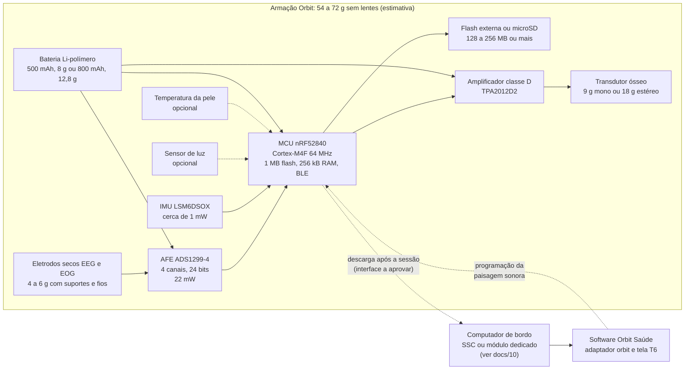

# 09. Óculos Orbit

> Para quem: o dono do projeto (que vai construir o óculos) e quem apresenta.
> Como usar: as seções 1, 2, 8 e 9 dão a narrativa para o pitch; as seções 3 a 7 e 10 são a especificação de trabalho para montar o protótipo. Massa, computação e custo de lançamento em detalhe estão em [`10-massa-energia-lancamento.md`](10-massa-energia-lancamento.md).
> Fontes: [`../pesquisa/bruto/04-precedentes-oculos-sono.md`](../pesquisa/bruto/04-precedentes-oculos-sono.md) (frente 4: precedentes, sono, áudio, estudo) e [`../pesquisa/bruto/05-massa-computacao-lancamento.md`](../pesquisa/bruto/05-massa-computacao-lancamento.md) (frente 5: massa, energia, certificação). Etiquetas de confiança como em [`00-guia-de-leitura.md`](00-guia-de-leitura.md).
> Aviso: massas e consumos marcados [INFERÊNCIA] são estimativas de projeto, não peças pesadas nem certificação de voo. O óculos é ferramenta de bem-estar e pesquisa, não de diagnóstico.

---

## 1. O que o óculos faz

O Orbit junta três funções numa armação de óculos e entrega os dados ao painel do Orbit Saúde (tela T6 de [`07-design-interface.md`](07-design-interface.md)).

| # | Função | O que faz | O que aparece no software | Estado da evidência |
| --- | --- | --- | --- | --- |
| 1 | **Áudio por condução óssea** | Toca sons de natureza escolhidos pelo próprio tripulante (chuva, fauna, água), com programação por período do dia e transição suave para o noturno antes de dormir | Paisagem sonora do dia (`SoundscapeSchedule`), sons desbloqueáveis da gamificação | Opção de bem-estar em avaliação; não há prova de efeito no sono de astronautas (seção 7) |
| 2 | **EEG** (eletroencefalograma) | Registra atividade elétrica do cérebro por eletrodos secos na armação | Hipnograma estimado (`Hypnogram`), potência alfa | Estimativa de sono a validar contra polissonografia (PSG); não é PSG nem diagnóstico |
| 3 | **EOG** (eletrooculografia) | Registra o potencial elétrico dos movimentos dos olhos e das piscadas | Piscadas por minuto, índice de fadiga | Sinal auxiliar de sono, piscadas e sonolência em validação; não é detector de sono REM (movimentos oculares rápidos) nem de SANS (síndrome neuro-ocular associada ao voo espacial) |

Sensores auxiliares na placa: IMU (unidade de medida inercial: acelerômetro e giroscópio), sensor de luz ambiente e, opcionalmente, temperatura da pele.

**O que o óculos não faz:** não diagnostica, não detecta SANS, não substitui o alarme da estação e não gera cor de risco a partir de EEG ou EOG sem limiar aprovado e protocolo do médico de voo. [INFERÊNCIA da frente 4, seção "Implicações para o óculos Orbit e para o software"]

### 1.1 Programação do áudio pelo horário da tripulação

A ISS (Estação Espacial Internacional) vive em GMT/UTC. O horário de referência publicado pela NASA é acordar por volta de 06:00, trabalhar de 08:00 a 17:00 e iniciar a janela de sono por volta de 21:30; o dia varia com veículos visitantes, EVA (atividade extraveicular) e contingências. [OFICIAL, [NASA, ISS Operating an Outpost](https://www.nasa.gov/wp-content/uploads/2018/04/iss-operating_an_outpost-tagged.pdf)] A NASA-STD-3001 recomenda oportunidade de sono de 8,5 h e reserva 2 h antes do sono e 1,5 h depois de acordar para transição e rotina pessoal. [OFICIAL, [NASA, Medical Operations](https://www.nasa.gov/reference/6-0-medical-operations/)]

Exemplo de programação derivado desse horário (o real vem de `Tripulante.horarioSono` em [`06-modelo-de-dados.md`](06-modelo-de-dados.md)):

| Faixa | Horário de exemplo (GMT) | Conta | Áudio padrão |
| --- | --- | --- | --- |
| Manhã | 06:00 a 07:30 | 06:00 + 1,5 h de transição | Sons diurnos do perfil escolhido, se o tripulante quiser |
| Tarde | 17:00 a 19:30 | fim do trabalho até o pré-sono | Opcional |
| Pré-sono | 19:30 a 21:30 | 21:30 menos 2 h de transição | Transição suave para o noturno |
| Dormir | a partir de 21:30 | início da janela de sono | **Silêncio por padrão** (desligamento gradual), até que teste acústico, segurança e protocolo ético autorizem tocar durante o sono (seção 9) |

---

## 2. Por que óculos

O argumento correto, sustentado pela frente 4:

1. **Óculos já fazem parte do kit de voo.** A NASA informa que toda a tripulação leva ao menos três pares de lentes prescritas de poderes diferentes, para compensar mudanças de visão associadas a deslocamentos hipermetrópicos; o tripulante escolhe a correção quando precisa. [OFICIAL, [NASA OCHMO, briefing de SANS](https://www.nasa.gov/wp-content/uploads/2024/02/ochmo-mtb-001-sans.pdf)]
2. **As "Space Anticipation Glasses" são lentes corretivas**, não óculos com sensores, câmera ou tela. [OFICIAL, [NASA OCHMO](https://www.nasa.gov/wp-content/uploads/2024/02/ochmo-mtb-001-sans.pdf)]
3. **Logo, a armação é um objeto que o astronauta já conhece e já leva.** Colocar sensores e áudio numa armação que pode receber a lente de grau do tripulante aproveita um hábito existente em vez de criar mais um vestível. [INFERÊNCIA]

O que esse argumento **não** prova: que todos usem lentes o dia inteiro, nem que a estação distribua um modelo único de óculos inteligentes. [OFICIAL, [NASA OCHMO](https://www.nasa.gov/wp-content/uploads/2024/02/ochmo-mtb-001-sans.pdf)]

> **Não diga que o EOG detecta SANS.** A frente 4 não encontrou evidência de que EOG, piscadas ou rastreamento ocular por armação detectem ou diagnostiquem SANS. SANS é acompanhada com fundoscopia, OCT (tomografia de coerência óptica), ultrassom ocular e testes de acuidade. [INFERÊNCIA, distinção entre medidas EOG e exames da [NASA OCHMO](https://www.nasa.gov/wp-content/uploads/2024/02/ochmo-mtb-001-sans.pdf)] No software, o cenário C3 (SANS) usa grade de Amsler e acuidade de perto (regra R-SANS-01 em [`04-cruzamento-de-dados.md`](04-cruzamento-de-dados.md)), não os sensores do óculos. A ligação do C3 com o Orbit é a armação que recebe a lente, não um diagnóstico. Os números de prevalência de SANS ficam em [`01-contexto-missao.md`](01-contexto-missao.md) e [`03-indicadores-e-limiares.md`](03-indicadores-e-limiares.md).

Frase para o slide: "O astronauta já leva óculos por causa das mudanças de visão no espaço. O Orbit transforma essa armação numa ferramenta de sono e bem-estar ligada ao painel de saúde."

---

## 3. Arquitetura do hardware

### 3.1 Diagrama em blocos



Placa, AFE (front-end analógico), MCU (microcontrolador), flash e sensores somam 6 g no cenário mínimo e 8 g no realista [INFERÊNCIA, frente 5]. As setas pontilhadas são opcionais ou dependem de autorização.

### 3.2 Componentes de referência

| Bloco | Peça de referência | Dado que importa para o projeto | Massa no orçamento | Fonte |
| --- | --- | --- | --- | --- |
| Armação | JINS MEME (referência de massa) | Armação de cerca de 20 a 21 g, sem o módulo CORE de 6 g e sem lentes | 21 g | [FABRICANTE, JINS](https://www.jins.com/jp/client_info/JINSJINS/infoimage/20211006_Press%20Release1.pdf) |
| AFE de EEG/EOG | TI ADS1299-4 | 4 canais simultâneos, 24 bits, a partir de 250 amostras/s, 22 mW típicos (a versão de 8 canais dissipa 39 mW) | na placa | [FABRICANTE, TI](https://www.ti.com/lit/ds/symlink/ads1299.pdf) |
| AFE alternativo | TI ADS1292 | Cerca de 335 µW por canal, mas só 2 canais: não registra EEG, EOG horizontal e EOG vertical independentes | na placa | [FABRICANTE, TI](https://www.ti.com/lit/ds/symlink/ads1292.pdf) |
| MCU e rádio | Nordic nRF52840 | Cortex-M4F 64 MHz, 1 MB de flash, 256 kB de RAM; pico de 4,8 mA transmitindo por Bluetooth Low Energy (BLE) a 0 dBm e 4,6 mA recebendo; a flash interna não guarda uma noite | na placa | [FABRICANTE, Nordic](https://docs.nordicsemi.com/r/bundle/ps_nrf52840/page/keyfeatures_html5.html) |
| Armazenamento | Flash externa ou microSD, a escolher | 128 MB úteis no mínimo, 256 MB ou mais de preferência | na placa | [INFERÊNCIA, frente 5] |
| IMU | ST LSM6DSOX | Pacote de 2,5 × 3 × 0,83 mm, cerca de 0,55 mA em alto desempenho | na placa | [FABRICANTE, ST](https://www.st.com/resource/en/datasheet/lsm6dsox.pdf) |
| Luz ambiente | ams OSRAM TSL2591 (catálogo) | Opcional; escolher depois de definir precisão e posição | não atribuída | [FABRICANTE, ams OSRAM](https://ams-osram.com/products/sensor-solutions/ambient-light-color-spectral-proximity-sensors/ams-tsl25911-ambient-light-sensor) |
| Amplificador | TI TPA2012D2 | Estéreo classe D, 2,5 a 5,5 V, até 720 mW por canal em 3,6 V com 8 Ω; repouso perto de 5 mA; desligado cerca de 1,5 µA | na placa | [FABRICANTE, TI](https://www.ti.com/lit/ds/symlink/tpa2012d2.pdf) |
| Transdutor ósseo | ISL SPK-I-81368 | 9 g por peça, 22 × 14 × 7,5 mm, 4 Ω, 3 W nominais; a ficha diz corrente máxima de 5 mA, o que é incoerente com 3 W em 4 Ω | 9 g mono, 18 g estéreo | [FABRICANTE, ISL](https://media.digikey.com/pdf/Data%20Sheets/ISL%20PDFs/SPK-I-81368.pdf) |
| Bateria | Li-polímero TinyCircuits 500 mAh | 8 g, 3,7 V, 1,85 Wh, cerca de 52 × 34 × 2 mm | 8 g ou 12,8 g (800 mAh, escala linear) | [FABRICANTE, TinyCircuits](https://files.tinycircuits.com/Datasheets/ASR00035_500mAh.pdf), [FABRICANTE, FPBattery](https://www.fpbattery.com/wp-content/uploads/2024/06/fpbattery-293450-3.7V-500mAh-Lithium-Polymer-Battery-Specification.pdf) |

Referência de headset completo: o Shokz OpenRun pesa 26 g e publica 8 h de reprodução com bateria de 160 mAh. [FABRICANTE, [Shokz](https://shokz.com/products/openrun)]

### 3.3 Posições de eletrodo e canais

Proposta mínima da frente 5 [INFERÊNCIA]: **três canais diferenciais simultâneos** (um EEG frontal ou temporal, um EOG horizontal e um EOG vertical) e um **quarto canal** para redundância, referência ou segunda derivação de EEG. Posições candidatas: testa acima das lentes, têmporas, perto dos cantos externos dos olhos e plaquetas da ponte nasal. Uma distribuição possível:

| Canal | Sinal | Posição candidata | Como os precedentes fizeram |
| --- | --- | --- | --- |
| 1 | EEG | Têmpora, na haste, ou testa acima da lente | AttentivU: EEG em TP9 e TP10 nas hastes, referência em Fpz na ponte [PAPER, [Kosmyna et al., 2019](https://dam-prod.media.mit.edu/x/2019/05/29/1570522368.pdf)]; Dreem: FpZ, F7, F8, O1 e O2 numa faixa [PAPER, [Debellemanière et al.](https://pmc.ncbi.nlm.nih.gov/articles/PMC7751170/)] |
| 2 | EOG horizontal | Perto dos cantos externos dos dois olhos | Eletrodos perto dos olhos ou no nariz captam componentes horizontais e verticais [PAPER, [AttentivU](https://dam-prod.media.mit.edu/x/2019/05/29/1570522368.pdf)] |
| 3 | EOG vertical | Plaquetas da ponte nasal e testa acima da lente | JINS MEME: três eletrodos secos, um perto da ponte e dois nas plaquetas [FABRICANTE, [JINS MEME](https://jins-meme.github.io/jinsmeme-platform/en/hardware.html)]; AttentivU: dois EOG nas plaquetas |
| 4 | EEG da têmpora oposta, ou referência | Haste oposta ao canal 1 | AttentivU usa dois canais de EEG, um em cada haste |

Cuidados de projeto (frente 5): as posições exatas dependem de anatomia, pressão de contato, impedância pele-eletrodo e rejeição de artefato de movimento, e precisam de teste com usuários e comparação com EEG clínico. Referência compartilhada reduz contatos, mas pode acoplar canais. Eletrodos secos de ouro, polímero condutor ou material metalizado são candidatos; Ag/AgCl com gel é a referência clínica, mas exige teste de conforto e secagem para uso prolongado. Nenhum eletrodo foi escolhido, por isso a massa de eletrodos é [INFERÊNCIA]. No AttentivU, o EOG em prata teve amplitude e qualidade inferiores ao EOG úmido de referência, embora os movimentos fossem visíveis. [PAPER, [Kosmyna et al., 2019](https://dam-prod.media.mit.edu/x/2019/05/29/1570522368.pdf)]

Taxa de amostragem sugerida: EEG a 250 Hz ou mais; EOG de 100 a 250 Hz; IMU de 25 a 50 Hz. [INFERÊNCIA, frente 4] Como o ADS1299 amostra os canais ao mesmo tempo a partir de 250 amostras/s, o caminho mais simples é EEG e EOG a 250 Hz. Para comparação, a faixa Dreem usa 250 Hz e o AttentivU amostrava a 1.000 Hz; são taxas desses dispositivos, não escolha já feita para o Orbit. [PAPER, [Dreem](https://pmc.ncbi.nlm.nih.gov/articles/PMC7751170/); [AttentivU](https://dam-prod.media.mit.edu/x/2019/05/29/1570522368.pdf)]

---

## 4. Orçamento de massa

Totais **sem lentes** (a lente de grau, a proteção e a fixação ainda não foram definidas; o óculos real pesará mais). [INFERÊNCIA, frente 5, seção D1]

| Bloco | Mínimo de conceito | Realista para protótipo | Base |
| --- | ---: | ---: | --- |
| Armação leve | 21 g | 21 g | JINS MEME, sem CORE e sem lentes [FABRICANTE] |
| Transdutor ósseo | 9 g (mono) | 18 g (estéreo) | 9 g por peça, ficha ISL [FABRICANTE] |
| Bateria | 8 g (500 mAh) | 12,8 g (800 mAh) | 500 mAh do fabricante; 800 mAh por escala linear [INFERÊNCIA] |
| Placa, AFE, MCU, flash e sensores | 6 g | 8 g | Estimativa sem placa escolhida [INFERÊNCIA] |
| Eletrodos, suportes e fiação | 4 g | 6 g | Estimativa, geometria não escolhida [INFERÊNCIA] |
| Caixa, proteção, conectores e retenção | 6 g | 6 g | Estimativa [INFERÊNCIA] |
| **Total** | **54 g** | **71,8 g, arredondado para 72 g** | Orçamento inicial, não massa pesada |

Conferência: 21 + 9 + 8 + 6 + 4 + 6 = 54 g; 21 + 18 + 12,8 + 8 + 6 + 6 = 71,8 g.

Conforto: um estudo sobre armações cita a ISO 12870, que recomenda contato das plaquetas nasais de pelo menos 200 mm² para armações até 25 g e 250 mm² acima de 25 g. O Orbit passa de 25 g, então deve distribuir a carga também pelas hastes e laterais, com contatos macios e ajuste individual. [PAPER, [estudo de armações](https://onlinelibrary.wiley.com/doi/full/10.1111/j.1475-1313.2010.00755.x)] Na ISS o peso sobre o nariz quase some, mas massa e inércia continuam (conta de força em [`10-massa-energia-lancamento.md`](10-massa-energia-lancamento.md), seção 1). [OFICIAL, [NASA Glenn](https://www.nasa.gov/centers-and-facilities/glenn/what-is-microgravity/)]

---

## 5. Orçamento de energia

### 5.1 De onde vêm os consumos

| Bloco | Consumo usado na conta | Fonte |
| --- | --- | --- |
| AFE ADS1299-4 | 22 mW típicos | [FABRICANTE, TI](https://www.ti.com/lit/ds/symlink/ads1299.pdf) |
| MCU e rádio BLE | Média estimada de 5 a 15 mW conforme ciclo de rádio (pico cerca de 14 mW) | [INFERÊNCIA, frente 5, sobre a ficha Nordic] |
| Flash externa | Reserva de 5 mW | [INFERÊNCIA, frente 5] |
| IMU | Cerca de 1 mW (0,55 mA × 1,8 V = 0,99 mW) | [FABRICANTE, ST, para a corrente; conta da frente 5] |
| Luz e temperatura (opcionais) | Reserva de 1 mW cada | [INFERÊNCIA, frente 5] |
| Áudio noturno (amplificador e transdutor) | 30 mW médios | [INFERÊNCIA, frente 5] |

A frente 5 usa **35 mW médios** para toda a eletrônica de aquisição e registro. Somando os blocos: 22 + 5 + 5 + 1 = 33 mW com rádio em ciclo baixo e sem opcionais; 22 + 15 + 5 + 1 + 1 + 1 = 45 mW com rádio mais ativo e os dois opcionais. Ou seja, **35 mW só fecha com rádio pouco ativo**; o cenário de 50 mW da frente 5 é o mais prudente para o protótipo. [INFERÊNCIA, conta nossa sobre os números da frente 5]

Atenção ao amplificador: 5 mA de repouso a 3,6 V são 18 mW. Se o TPA2012D2 ficar ligado sem tocar nada, ele sozinho come metade do orçamento de 35 mW. O firmware precisa colocá-lo em desligamento (cerca de 1,5 µA) fora das sessões de áudio. [INFERÊNCIA sobre a [ficha TI](https://www.ti.com/lit/ds/symlink/tpa2012d2.pdf)]

### 5.2 Conta da bateria (frente 5)

Premissas [INFERÊNCIA]: eletrônica a 35 mW durante 17 h e áudio a 30 mW durante as 9 h de sono; 30 % de reserva e 85 % de eficiência de conversão.

| Passo | Conta | Resultado |
| --- | --- | --- |
| Energia da eletrônica | 35 mW × 17 h | 0,595 Wh |
| Energia do áudio | 30 mW × 9 h | 0,27 Wh |
| Energia útil por ciclo | 0,595 + 0,27 | 0,865 Wh |
| Fator de reserva e eficiência | 0,70 × 0,85 | 0,595 |
| Energia nominal necessária | 0,865 ÷ 0,595 | 1,454 Wh |
| Capacidade a 3,7 V | 1,454 Wh ÷ 3,7 V | 0,393 Ah, cerca de **393 mAh** |
| Cenário alto: energia útil | 50 mW × 17 h + 100 mW × 9 h | 0,85 + 0,90 = 1,75 Wh |
| Cenário alto: capacidade | 1,75 ÷ 0,595 ÷ 3,7 | cerca de **795 mAh** |

Conclusão da frente 5: a bateria de 500 mAh (1,85 Wh) cobre o cenário-base com margem limitada; 800 mAh (estimados em 12,8 g e 2,96 Wh) é o alvo prudente para o cenário alto. [INFERÊNCIA, frente 5]

Leitura das 17 h: a frente 5 não diz se as 17 h de eletrônica incluem as 9 h de sono. Como 17 h + 9 h = 26 h passariam de um dia, a leitura coerente é 17 h de uso por dia, das quais 9 h com áudio (65 mW nesse trecho, como a tabela D4 da frente 5 indica). Confirmar ao fechar o firmware.

### 5.3 Autonomia (conta derivada)

| Pergunta | Conta | Resultado |
| --- | --- | --- |
| Energia entregue pela bateria de 500 mAh, guardando 30 % de reserva | 1,85 Wh × 0,70 × 0,85 | 1,10 Wh |
| Ciclos de uso por carga no cenário-base | 1,10 ÷ 0,865 | 1 ciclo, com sobra de 0,24 Wh (cerca de 27 %) |
| Horas só de aquisição (35 mW) | 1.100 mWh ÷ 35 mW | cerca de 31 h |
| Horas de aquisição com áudio (65 mW) | 1.100 mWh ÷ 65 mW | cerca de 17 h |
| Bateria de 800 mAh no cenário alto | 2,96 Wh × 0,595 = 1,76 Wh, contra 1,75 Wh necessários | fecha no limite |

Resultado prático: **recarga diária**. Para comparar: JINS MEME, cerca de 11 h no modo acadêmico completo e 15 h no modo padrão [FABRICANTE, [JINS MEME](https://jins-meme.github.io/jinsmeme-platform/en/hardware.html)]; AttentivU, cerca de 5 h com bateria integrada e até 15 h com bateria externa [PAPER, [Kosmyna et al., 2019](https://dam-prod.media.mit.edu/x/2019/05/29/1570522368.pdf)].

---

## 6. O que o óculos entrega ao software (contrato de dados)

### 6.1 Sinais e métricas

Especificação exploratória para prototipagem, não requisito NASA nem limite clínico. [INFERÊNCIA, frente 4, tabela "Implicações"]

| Dado | Unidade | Frequência | Onde entra no software ([`06-modelo-de-dados.md`](06-modelo-de-dados.md)) | Limite de interpretação |
| --- | --- | --- | --- | --- |
| EEG bruto (canais 1 e 4) | µV | 250 Hz | Arquivo bruto da sessão, guardado no computador de bordo; não vira `Leitura` | Não diagnosticar condição neurológica |
| Qualidade do contato (impedância, se o AFE informar) | conforme o sensor | por época de 30 s | `Leitura.qualidade` (`boa`, `duvidosa`, `invalida`) | Época inválida não entra em métrica |
| Potência por banda (alfa, teta, delta) | µV²/Hz | janelas de 1 s, resumo por época | `Leitura` só com tendência e linha de base pessoal | Varia com pessoa, posição, contato, olhos abertos ou fechados e artefatos [PAPER, [Ogilvie et al.](https://pmc.ncbi.nlm.nih.gov/articles/PMC6497715/)] |
| Estágio do sono estimado (W, N1, N2, N3, REM) | estágio | épocas de 30 s | `SessaoSono.epocas` com `fonte: "orbit"` | Rotular como estimativa até validar contra PSG |
| Métricas de sono (TST, tempo total de sono; eficiência; latência; WASO, tempo acordado após dormir) | min, % | por noite | `SessaoSono.metricas`, fórmulas de [`04-cruzamento-de-dados.md`](04-cruzamento-de-dados.md), A8 | Herda a incerteza do estadiamento |
| EOG bruto (canais 2 e 3) | µV | 100 a 250 Hz | Arquivo bruto da sessão | Não substitui rastreamento óptico calibrado |
| Piscadas: frequência e duração | eventos por minuto; ms | agregado por minuto | `Leitura` (tela T6: piscadas por minuto) | Não inferir SANS, REM nem atenção clínica por EOG isolado |
| Índice de fadiga | escala do modelo, a definir | por janela | `Leitura` com `origem` indicando estimativa; no protótipo, `simulada` | Sinal em validação, sem cor de limiar |
| Movimento da cabeça (IMU) | g ou m/s² | 25 a 50 Hz gravado; resumo por minuto | Períodos de repouso | Movimento da cabeça não equivale a sono |
| Luz ambiente | lux | 1 por segundo ou média por minuto | `Leitura` em lux (unidade canônica de iluminância) | Leitura no rosto não representa toda a iluminação circadiana |
| Reprodução de som | id do conteúdo; min; dBA calibrado | por sessão, com eventos de pausa | Registro da sessão sonora (alimenta `SoundscapeSchedule` e o estudo) | Volume não pode ser estimado só pelo valor do software |
| Diário de sono e humor, PVT (teste de vigilância psicomotora) | hora UTC; escalas; ms | antes e depois do sono; diário | `Autoavaliacao` (já existe) | Autorrelato é contexto, não diagnóstico |

Frequência cardíaca e microfone ambiental são opcionais na frente 4 e só entram se a armação tiver sensor confiável; o microfone mediria nível sonoro sem gravar fala por padrão.

Regras do contrato (seguem [`../AGENTS.md`](../AGENTS.md), seção 3):

- **Nenhuma cor de limiar fixo** para EEG e EOG: esses indicadores aparecem só com tendência e linha de base pessoal, porque não há limiar aprovado com fonte. Nenhum alerta clínico sai de estimativa de EEG ou EOG sem limiar aprovado e encaminhamento ao médico de voo. [INFERÊNCIA, frente 4]
- O painel separa quatro coisas: **dado medido**, **estimativa de algoritmo**, **autorrelato** e **interpretação aprovada pela equipe médica**. [INFERÊNCIA, frente 4]
- Toda leitura leva `dispositivoId` do tipo `"orbit"`, `origem`, `qualidade` e `instanteUtc`. Leituras gravadas e ainda não descarregadas ficam com `disponibilidade: "aguardando_transferencia"`.
- A aquisição continua funcionando mesmo se uma etapa de inteligência artificial falhar; cada métrica guarda versão do modelo e qualidade do dado. [INFERÊNCIA, frente 5]
- No protótipo de 20 horas, os dados do óculos vêm de uma base pública de sono (Sleep-EDF), como define [`05-arquitetura-software.md`](05-arquitetura-software.md), seção 3.2.

### 6.2 Volume de dados por noite

Com 4 canais, 250 Hz e 24 bits (3 bytes por amostra). [INFERÊNCIA, frente 5, sobre a [ficha ADS1299](https://www.ti.com/lit/ds/symlink/ads1299.pdf)]

```text
4 canais × 250 amostras/s × 3 bytes/amostra = 3.000 bytes/s
3.000 bytes/s × 3.600 s/h = 10.800.000 bytes/h = 10,8 MB por hora
3.000 bytes/s × 3.600 s/h × 9 h = 97.200.000 bytes = 97,2 MB por noite
```

| Configuração | Por noite de 9 h | Observação |
| --- | ---: | --- |
| 3 canais (mínimo da proposta) | 72,9 MB | 3 × 250 × 3 × 32.400 s |
| **4 canais (proposta)** | **97,2 MB** | Número de referência da frente 5 |
| 8 canais | 194,4 MB | Se usar o ADS1299 de 8 canais |

MB aqui é decimal (10⁶ bytes); 97,2 MB equivalem a cerca de 92,7 MiB. O número não inclui carimbos de tempo, metadados, checksum nem IMU e luz. Por isso a frente 5 recomenda **128 MB úteis no mínimo e de preferência 256 MB ou mais**: 128 MB guardam uma noite com folga (128 ÷ 97,2 = 1,3 noite) e 256 MB guardam duas (256 ÷ 97,2 = 2,6 noites), o que protege contra uma descarga atrasada. A flash interna de 1 MB do nRF52840 não serve para isso.

### 6.3 Onde cada coisa é processada

Proposta [INFERÊNCIA, coerente com as frentes 4 e 5]: o óculos amostra, filtra pouco e grava o bruto; depois da sessão, o arquivo vai para o computador de bordo, que calcula bandas, estadiamento do sono e métricas. Filtros e FFT (transformada rápida de Fourier) custam muito pouco; estadiamento por características (tipo YASA) cabe na CPU (processador central) de um laptop (contas em [`10-massa-energia-lancamento.md`](10-massa-energia-lancamento.md), seção 3). A interface de descarga (BLE, cabo ou cartão) depende de autorização de integração (seção 10).

---

## 7. O áudio: o que se sabe e o que não se sabe

### 7.1 O precedente direto: NASA e o traje xEMU (2024)

O artigo de Bridget Cavanaugh (NASA Johnson Space Center, ICES-2024-209, apresentado na 53ª International Conference on Environmental Systems em julho de 2024) estudou condução óssea como alternativa para o áudio recebido no capacete do traje xEMU, porque alto-falantes abertos e microfones causavam eco. A condução óssea aparece como solução de reserva em desenvolvimento, não equipamento adotado. [OFICIAL, [Cavanaugh, ICES-2024-209](https://ntrs.nasa.gov/api/citations/20240005885/downloads/ICES_final_manuscript_Cavanaugh.pdf)]

| Aspecto | O que o estudo fez |
| --- | --- |
| Equipamentos | Cinco produtos comerciais: quatro cabeados (Code Red Battle Zero-M e três Motorola) e o Shokz OpenComm sem fio como controle |
| Participantes | Cinco pessoas de engenharia (três homens, duas mulheres), não astronautas; duas usavam óculos |
| Protocolo | Seis horas com cada headset em tarefas leves; questionários no início, com 3 h e no fim; ordem distribuída em cinco dias |
| O que mediu | Ajuste, estabilidade, pontos de pressão, percepção de peso e conforto, pensando numa EVA de 8 h |
| Resultado | Modelos 2, 4 e 5 empataram em segurança do ajuste; o Shokz foi o mais confortável, mas a bateria Bluetooth não atendia uma EVA longa; o modelo 3 causou pontos de pressão em todos |
| O que **não** mediu | Inteligibilidade, qualidade do áudio, música, sono, efeito terapêutico. A meta de 90 % de reconhecimento de palavras é plano de teste futuro, não resultado |
| Próximos passos citados | Integrar transdutores às almofadas do traje, testar inteligibilidade, estudar cefaleia ou vertigem por vibração prolongada, testar com astronautas em flutuabilidade neutra |

**Limites para o Orbit:** cinco não astronautas, seis horas de conforto, sem missão, sono, música ou efeito psicológico. O estudo sustenta que a NASA avalia condução óssea para voz em traje e que o contato prolongado merece avaliação ergonômica. Não mostra que a tecnologia melhora humor, sono ou saúde. [INFERÊNCIA, frente 4]

### 7.2 Física e pontos de contato

O transdutor vibra o crânio e a vibração estimula a cóclea. No artigo do xEMU, a região lateral da cabeça perto do côndilo foi indicada como posição favorável, a força de contato discutida é de cerca de 4,9 N, a sensibilidade é maior em frequências médias (perto de 1 kHz) e transdutores de superfície rígida acoplam melhor. É orientação para o headset estudado, não especificação para óculos. [OFICIAL, [Cavanaugh](https://ntrs.nasa.gov/api/citations/20240005885/downloads/ICES_final_manuscript_Cavanaugh.pdf)] Na armação, regiões temporais diante ou acima das orelhas são candidatas; a NASA encontrou problema de ajuste numa cabeça mais larga e notou que óculos podem precisar de adaptação junto ao headset. [INFERÊNCIA, frente 4]

### 7.3 O que não se sabe

- **Condução óssea em microgravidade:** não foi encontrada validação de headset de condução óssea em astronautas em voo nem medição da transmissão óssea em microgravidade. Um estudo de inclinação da cabeça (análogo terrestre do deslocamento de fluidos) não achou mudança auditiva clinicamente significativa, mas não responde à pergunta em voo. [PAPER, [análogo de microgravidade](https://pubmed.ncbi.nlm.nih.gov/8214826/)]
- **"Ouvido aberto" não garante ouvir alarmes:** volume, ruído da cabine, vazamento e atenção interferem. Transdutores ósseos também produzem som aéreo audível, sobretudo em volume alto, o que pode incomodar quem dorme perto. [PAPER, [vazamento aéreo](https://doi.org/10.1080/14992027.2023.2208287)]
- **Graves e fidelidade musical:** não avaliados; não prometer experiência equivalente a fone convencional até medir o protótipo. [INFERÊNCIA, frente 4]

### 7.4 Ruído e alarmes na ISS

| Referência | Valor | Fonte |
| --- | --- | --- |
| Ruído típico histórico nos módulos (publicado em 2010) | 56 a 69 dBA; 77 dBA perto da esteira | [OFICIAL, NASA, Acoustic Issues](https://ntrs.nasa.gov/archive/nasa/casi.ntrs.nasa.gov/20100031889.pdf) |
| Limite geral de exposição | 85 dBA em média ponderada de 8 h | [OFICIAL, NASA-STD-3001 Vol. 2](https://www.nasa.gov/reference/6-0-natural-and-induced-environments-vol-2/) |
| Alarmes na posição de recepção | abaixo de 95 dBA | idem |
| Áudio pessoal, máximo de projeto | 115 dBA em campo difuso (teto que cobre lançamento e descida, não volume recomendado) | idem |
| Durante o sono | ruído impulsivo ou intermitente até 10 dB acima do fundo, exceto comunicações e alarmes | idem |

Consequência: mascarar alarmes com áudio contínuo seria incompatível com a norma. [OFICIAL, NASA-STD-3001 Vol. 2]

### 7.5 Sons de natureza: o que a evidência permite dizer

- Meta-análise de 15 estudos e 1.285 participantes: sons naturais reduziram ansiedade, frequência cardíaca, pressão arterial e frequência respiratória, com grande variação entre estudos e resultado inconsistente para desempenho cognitivo. Não prova melhora de sono nem transferência para astronautas. [PAPER, [Zhu et al., 2024](https://pubmed.ncbi.nlm.nih.gov/38373459/)]
- Antártida (estação Amundsen-Scott, 25 participantes no inverno, realidade virtual, VR, com natureza ou cidade): natureza teve melhor restauração percebida e menor ansiedade; 15 preferiram natureza, 3 cidade e 7 não tiveram preferência. Vídeo, som e imersão não foram isolados. [PAPER, [Anderson et al., 2025](https://www.nature.com/articles/s41526-025-00471-2)]
- Na ISS, a ESA testou o VAMB (Virtual Assistance Mental Balance, ou VR Mental Care) com Andreas Mogensen em 2023: vídeo 360 graus com sons para relaxamento; sem resultado de eficácia publicado nas páginas consultadas. [OFICIAL, [NASA, 6 dez. 2023](https://www.nasa.gov/blogs/stationreport/2023/12/06/iss-daily-summary-report-12-06-2023/)]
- Nenhum estudo localizado testou som de natureza por condução óssea como intervenção de sono com astronautas, nem sons escolhidos por cultura como intervenção de saúde. [INFERÊNCIA, frente 4]

### 7.6 Regras de desenho do áudio

1. **Opcional e fácil de interromper**, com pausa instantânea no próprio óculos.
2. **Nunca toca automaticamente durante alarme ou procedimento crítico**; preserva a audibilidade dos alertas da cabine.
3. **Volume calibrado e registrado em dBA**, testado com áudio ligado e desligado, ruído de fundo e alarmes representativos.
4. **A cultura é escolha do tripulante**, nunca inferida pela nacionalidade (`Tripulante.perfilSonoro`). [INFERÊNCIA, frente 4, apoiada no [HRP Evidence Report](https://humanresearchroadmap.nasa.gov/Evidence/other/HRP-ER-BMED-HFBP-20250210.pdf)]
5. **Sons desbloqueáveis** ([`07-design-interface.md`](07-design-interface.md), seção 6) ampliam a biblioteca do perfil escolhido; o desbloqueio premia hábitos de saúde e não deve empurrar o uso do áudio durante o sono.
6. **Faixa "dormir" em silêncio por padrão** até o protocolo autorizar (seção 1.1).

Linguagem para o pitch: "sons como opção voluntária de bem-estar, em avaliação", nunca "terapia", "hipnótico" ou "tratamento". [INFERÊNCIA, frente 4]

---

## 8. Precedentes mais próximos e diferencial

### 8.1 Os três mais próximos

| Precedente | Quem e quando | O que tem | O que falta em relação ao Orbit |
| --- | --- | --- | --- |
| **AttentivU** (MIT Media Lab) | Protótipo publicado em 2019; voo parabólico P-POP em maio de 2022, com seis pessoas e 20 parábolas, apoio da NASA e da Space Exploration Initiative | Armação com EEG em TP9 e TP10, dois EOG nas plaquetas, referência em Fpz, 1.000 Hz, Bluetooth e **feedback auditivo por condução óssea** (piezoelétrico); variações de potência alfa, beta e teta entre condições de gravidade | Não foi à ISS; foco em atenção e engajamento, não sono nem saúde da tripulação. [PAPER, [Kosmyna et al., 2019](https://dam-prod.media.mit.edu/x/2019/05/29/1570522368.pdf); [AIAA 2023-4656](https://www.abstractscorecard.com/uploads/Tasks/upload/21810/DPPWZUCK-1650206-1-PDF.pdf)] |
| **Dreem na ISS** (experimento Dreams) | CNES/CADMOS, CHU de Toulouse e Dreem; Thomas Pesquet usou em 2021 (três sessões de duas noites); a faixa ficou na estação e a NASA registrou uso em 2023 | Faixa de EEG seco (FpZ, F7, F8, O1, O2), acelerômetro, oximetria de pulso, 250 Hz; o produto tem **transdutores de condução óssea** (desligados na validação publicada) e pode tocar sons de terapia cognitivo-comportamental para o pré-sono | Não é óculos, não tem EOG facial, sem natureza nem cultura, sem painel clínico. [OFICIAL, [CNES](https://cnes.fr/en/projects/mission-alpha); [NASA](https://www.nasa.gov/blogs/stationreport/2023/07/10/iss-daily-summary-report-7-10-2023/); [NASA, Sleep on Station](https://www.nasa.gov/humans-in-space/science-in-space-week-of-sept-15-2023/); PAPER, [Debellemanière et al.](https://pmc.ncbi.nlm.nih.gov/articles/PMC7751170/)] |
| **Sleep in Orbit** | ESA e Aarhus University, missão Huginn de Andreas Mogensen, 2023 | Peças auriculares moldadas sob medida com EEG intra-auricular; 20 noites com boa qualidade de sinal | Não é óculos, sem EOG facial, sem sons. [OFICIAL, [ESA](https://www.esa.int/articles/about-us/directorates/human-and-robotic-exploration/health-science-in-orbit); [Aarhus University](https://ece.au.dk/forskning/forskningscentre/center-for-ear-eeg/projects/sleep-in-orbit)] |

Outros precedentes (Skylab M133, Neurolab, Nightcap na Mir, Neurospat, ETD, JINS MEME, Actiwatch) estão na tabela 8.1 da frente 4 e em [`11-precedentes.md`](11-precedentes.md).

### 8.2 Matriz de diferencial (resumo da frente 4, seção 8.2)

✓ = coberto; ◐ = parcial ou demonstrado sem validação no uso proposto; vazio = não cobre.

| Precedente | Condução óssea | EEG | EOG ou rastreamento ocular | Sons ambientais personalizados | Integração com software de saúde |
| --- | :---: | :---: | :---: | :---: | :---: |
| NASA xEMU | ✓ voz no traje | | | | |
| Dreem / Dreams na ISS | ◐ existe no produto, sem uso sonoro em voo | ✓ | | ◐ sons de pré-sono, sem natureza nem cultura | ◐ relatório de sono, sem painel |
| AttentivU / P-POP | ✓ | ✓ | ✓ | ◐ feedback de áudio | ◐ app de pesquisa de atenção |
| Sleep in Orbit | | ✓ intra-auricular | | | ◐ dados de pesquisa |
| ETD da ISS | | | ✓ câmera | | ◐ pesquisa |
| JINS MEME | | | ✓ EOG na armação | | ◐ ecossistema do produto |
| ESA VAMB | | | | ✓ natureza em vídeo e som, sem cultura | |
| NASA Actiwatch / Standard Measures | | | | | ✓ integração longitudinal |
| **Orbit proposto** | **✓ opcional, limites acústicos a validar** | **✓ a validar** | **✓ auxiliar, sem alegação de SANS** | **✓ escolhido pela pessoa, sem validação espacial** | **✓ offline proposto; autorização e protocolo a definir** |

### 8.3 O que dizer no pitch

**A combinação de condução óssea, EEG e EOG não é inédita.** O AttentivU já integra as três numa armação e voou em parábolas; o Dreem já combina EEG seco e condução óssea e esteve na ISS. [INFERÊNCIA, frente 4, seção 3.4]

O **diferencial defensável** é a experiência integrada para a tripulação, que nenhum precedente citado demonstra completa em missão: [INFERÊNCIA, frente 4, seção 8.2]

1. **Integração com o painel de saúde** da tripulação, com fronteira explícita entre bem-estar experimental e avaliação clínica.
2. **Operação offline**, com processamento e armazenamento locais e sincronização posterior controlada.
3. **Personalização cultural escolhida pelo tripulante**, respeitando alarmes e rotina.
4. **Validação progressiva em missão**: solo, análogo e voo, com estudo intrassujeito (seção 9).

---

## 9. Estudo com grupo controle

### 9.1 A ideia original e o ajuste necessário

O documento inicial ([`../pesquisa/documento-inicial.md`](../pesquisa/documento-inicial.md)) sugeria usar quem não precisa de óculos como grupo controle. A frente 4 recomenda outro desenho, por três motivos:

1. Um grupo "usou" contra "não usou" escolhido pela própria pessoa confunde o efeito com preferência, estado de saúde ou motivação. [INFERÊNCIA, frente 4, seção 7.2]
2. Com tripulações pequenas, comparar um ou dois usuários com um grupo controle minúsculo informa pouco; a NASA já extrai tendências de populações pequenas com medidas repetidas antes, durante e depois do voo (Standard Measures). [OFICIAL, [NASA, Standard Measures](https://ntrs.nasa.gov/api/citations/20230014025/downloads/SSM%20IWS24%20Spaceflight%20Standard%20Measures.pdf)]
3. Toda a tripulação leva lentes de grau (seção 2), e precisar de correção está ligado justamente a mudanças de visão; dividir os grupos por isso misturaria a comparação com um estado de saúde. [INFERÊNCIA]

Por que o tema vale o estudo: o sono obtido fica abaixo do programado. Com actigrafia, 21 astronautas da ISS dormiram em média 6,09 ± 0,67 h por noite em voo [PAPER, [Barger et al., 2014](https://pubmed.ncbi.nlm.nih.gov/25127232/)]; em outro estudo, 24 astronautas relataram 6,5 ± 1,4 h e só 5,9 % das noites ficaram dentro da oportunidade de 8,5 h [PAPER, [Flynn-Evans et al., 2022](https://pmc.ncbi.nlm.nih.gov/articles/PMC8919197/)].

### 9.2 Desenho recomendado: piloto intrassujeito

**[INFERÊNCIA, proposta da frente 4, não protocolo NASA aprovado]** Estudo intrassujeito, prospectivo, cruzado e randomizado: cada tripulante é o próprio controle.

| Etapa ou condição | O que acontece | Para que serve |
| --- | --- | --- |
| Linha de base | Período inicial sem intervenção | Referência de cada pessoa |
| A. Rotina usual | Sem o óculos | Condição de comparação |
| B. Sensor sem áudio | Usa o óculos com áudio desligado | Separa o efeito de usar o objeto do efeito do som |
| C. Áudio escolhido | Paisagem sonora escolhida pelo tripulante, **no pré-sono** | A intervenção |
| D. Opcional | Áudio de referência não natural | Separa "natureza" de "qualquer som", sem obrigar trilha que a pessoa rejeite |

A ordem das condições é sorteada por participante, com vários dias por condição. Não tocar áudio durante o sono até que teste acústico, segurança e protocolo ético autorizem. Registrar o que mexe no sono: veículos visitantes, EVA, exercício, luz, cafeína, medicamentos, carga de trabalho e ruído.

### 9.3 Desfechos

| Tipo | Medida | Instrumento |
| --- | --- | --- |
| Primário (escolher um antes de começar) | Duração total do sono por actigrafia **ou** qualidade subjetiva do sono | Actiwatch Spectrum Plus, já usado nas Standard Measures [OFICIAL, [NASA](https://www.nasa.gov/humans-in-space/spaceflight-standard-measures-characterizing-how-humans-adapt-in-space/)]; diário antes e depois do sono |
| Secundário | Alerta diurno | PVT (teste de vigilância psicomotora; o NASA PVT+ recomenda no mínimo 5 min) e escala de sonolência de Karolinska (KSS, de 1 a 9) [OFICIAL, [NASA PVT+](https://www.nasa.gov/wp-content/uploads/2026/02/2026-02-27-nasa-pvtuser-guide.pdf)] |
| Secundário | Humor | Escala breve validada, sempre no mesmo horário |
| Viabilidade | Noites convidadas e usadas, abandono, conforto, carga percebida, falhas técnicas, volume medido, conteúdo escolhido, condição sorteada, sintomas, eventos de voo | Registro do estudo |
| Exploratório | Qualidade de sinal, estágios do sono, eventos oculares | EEG e EOG do Orbit, validados contra PSG |

Se a pergunta for só "o áudio é agradável e viável?", não é preciso coletar EEG contínuo. [INFERÊNCIA, frente 4]

### 9.4 Ética e governança

- Estudos com tripulantes do segmento americano (USOS) precisam de aprovação do NASA/JSC IRB (comitê de ética institucional) e do HRMRB (Human Research Multilateral Review Board), com protocolo e consentimento; a tripulação recebe briefing de consentimento antes da missão. [OFICIAL, [NASA, For Prospective Researchers](https://www.nasa.gov/hrp/for-prospective-researchers/); [IRB Submission Guidance](https://www.nasa.gov/irb-submission-guidance/)]
- Dados fisiológicos minimizados, protegidos e acessados conforme consentimento. Resultado de bem-estar não dispara alerta clínico sem validação, limiar aprovado e interpretação do médico de voo. [OFICIAL, [NPR 7100.1C](https://nodis3.gsfc.nasa.gov/displayAll.cfm?Internal_ID=N_PR_7100_001C_&page_name=ALL); INFERÊNCIA]
- Caminho proporcional: validar no solo; testar em análogo (HERA ou estação polar como Concordia; o NEEMO foi descontinuado em 2023 e a missão 2 do CHAPEA terminou em 31/10/2026, ver [`16-proximos-passos-e-impacto.md`](16-proximos-passos-e-impacto.md)); corrigir ergonomia e algoritmos; só então propor demonstração em órbita. Poucos astronautas estimam viabilidade e variabilidade, mas não provam eficácia generalizável. [INFERÊNCIA, frente 4, seção 7.3]

### 9.5 Consequência para o modelo de dados

Hoje [`06-modelo-de-dados.md`](06-modelo-de-dados.md) tem `Tripulante.usaOculosOrbit` (booleano) como "base do grupo controle". No desenho cruzado, a condição muda por período, então o dado necessário é a **condição de cada sessão** (A, B, C ou D) junto com `SessaoSono`. Sugestão para atualizar o `docs/06`.

---

## 10. Requisitos para levar à ISS

Nada abaixo foi avaliado para o Orbit; é a lista de trabalho derivada das normas, não certificação. [INFERÊNCIA, frente 5]

| Área | Referência | O que pede | Fonte |
| --- | --- | --- | --- |
| Bateria | JSC-20793 Rev. D (8 de março de 2017, ativa) | Perigos da célula e da montagem final; proteção contra sobrecorrente e curto; carga e descarga; limites de temperatura; isolamento; contenção de falha; chicote e conectores; fixação; carregador aprovado. Célula Li-polímero comercial ou porta USB não satisfazem isso sozinhas | [OFICIAL, ficha](https://standards.nasa.gov/standard/JSC/JSC-20793_D), [documento](https://standards.nasa.gov/sites/default/files/standards/JSC/D/0/jsc-20793_revd.pdf) |
| Materiais | NASA-STD-6001 B com Change 3 (ativa em 9 de junho de 2025) | Inflamabilidade e desgaseificação de polímeros da armação, adesivos, espumas, isolamento de fios, revestimentos, encapsulantes e partes da bateria | [OFICIAL](https://standards.nasa.gov/standard/nasa/nasa-std-6001) |
| EMI/EMC (interferência e compatibilidade eletromagnética) | SSP 30237, 30238, 30240, 30242 e 30245 (acesso controlado) | Emissões conduzidas e radiadas, suscetibilidade, cabos, aterramento e descarga eletrostática | [OFICIAL, lista de padrões ISS](https://standards.nasa.gov/sites/default/files/standards/GSFC/B/0/gsfc-std-7000b_signature_cycle_04_28_2021_fixed_links.pdf) |
| Rádio | Bluetooth e Wi-Fi existem na ISS, mas não há autorização automática | Autorização de integração e testes de coexistência no arranjo aprovado | [OFICIAL, Wi-Fi a bordo](https://www.nasa.gov/blogs/stationreport/2024/07/26/iss-daily-summary-report-7-26-2024/), [laboratório EMI/EMC](https://www.nasa.gov/centers-and-facilities/glenn/electromagnetic-interference-laboratory/) |
| Temperatura de toque | NASA-STD-3001 Vol. 2 Rev. F | Pele entre 15 °C e 43 °C como referência; temperatura permitida do material depende da condutividade e do tempo de contato; placa, bateria e eletrodos precisam de análise e medição | [OFICIAL](https://www.nasa.gov/wp-content/uploads/2025/05/nasa-std-3001-vol-2.pdf), [brief](https://www.nasa.gov/wp-content/uploads/2023/12/ochmo-tb-009-touch-temperature.pdf) |
| Acústica | NASA-STD-3001 Vol. 2 | Limites da seção 7.4 e prioridade de alarmes e comunicação | [OFICIAL](https://www.nasa.gov/reference/6-0-natural-and-induced-environments-vol-2/) |
| Energia para recarga | Painel de serviço de 120 V DC (corrente contínua) confirmado; 28 V DC não confirmado como tomada da tripulação | Fonte, conversão, cabo e carregador aprovados para a configuração | [OFICIAL, painel de utilidade](https://www.nasa.gov/blogs/stationreport/2021/05/07/iss-daily-summary-report-5-07-2021/) |
| Pesquisa humana | IRB e HRMRB | Seção 9.4 | [OFICIAL](https://www.nasa.gov/hrp/for-prospective-researchers/) |

Pacote de evidências esperado antes do voo (frente 5): rastreio de células e materiais; revisão de perigos e testes da bateria; inflamabilidade e desgaseificação; análise térmica e de contato; verificação mecânica e de retenção; EMI/EMC e rádio; inspeção elétrica e de carga; análise de falha e procedimento de uso.

---

## 11. Lacunas e próximos passos para quem constrói

- **Pesar o protótipo.** 54 g e 72 g são limites inferiores sem lentes; placa, eletrodos, fiação, carcaça e transdutor precisam de balança.
- **Medir o áudio.** A ficha do transdutor ISL é incoerente (5 mA contra 3 W) e o amplificador TPA2012D2 tem potência especificada em 8 Ω, enquanto o transdutor de referência tem 4 Ω; medir corrente, vibração e nível no crânio antes de fechar bateria e áudio.
- **Escolher eletrodos secos** e testar qualidade de EEG em têmpora, testa e nariz com movimento; validar o estadiamento contra PSG. A configuração publicada do YASA usa EEG central, EOG e EMG (eletromiografia); sem EMG e com eletrodos na armação, precisa de validação própria.
- **Condução óssea em voo** e inteligibilidade de alarmes com áudio ligado continuam sem teste.
- **EOG e SANS:** não há evidência; não alegar.
- **Personalização cultural:** falta estudo com tripulantes de culturas e línguas diferentes.
- **Aceitação ao longo de meses**, conforto das hastes, vibração no sono, uso com lente corretiva e EMC.
- **Software clínico:** autoridade dos dados, privacidade, acesso do tripulante e do médico de voo, sincronização e retenção ainda por definir.
- **Tamanho do estudo:** falta estimar número de sessões e efeito mínimo detectável.
