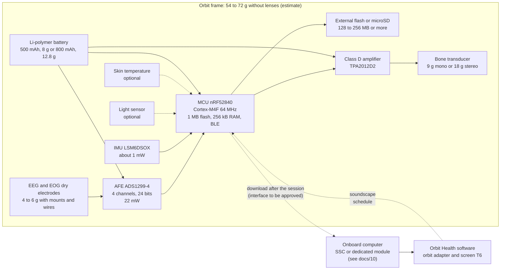

# 09. Orbit glasses

> For whom: the project owner (who will build the glasses) and whoever presents.
> How to use: sections 1, 2, 8 and 9 give the narrative for the pitch; sections 3 to 7 and 10 are the working specification for assembling the prototype. Mass, computation and launch cost in detail are in [`10-mass-energy-launch.md`](10-mass-energy-launch.md).
> Sources: [`../pesquisa/bruto/04-precedentes-oculos-sono.md`](../pesquisa/bruto/04-precedentes-oculos-sono.md) (stream 4: precedents, sleep, audio, study) and [`../pesquisa/bruto/05-massa-computacao-lancamento.md`](../pesquisa/bruto/05-massa-computacao-lancamento.md) (stream 5: mass, energy, certification). Confidence labels as in [`00-reading-guide.md`](00-reading-guide.md).
> Warning: masses and consumptions marked [INFERENCE] are design estimates, not weighed parts or flight certification. The glasses are a wellness and research tool, not a diagnostic one.

---

## 1. What the glasses do

Orbit combines three functions in an eyeglass frame and delivers the data to the Orbit Health dashboard (screen T6 of [`07-interface-design.md`](07-interface-design.md)).

| # | Function | What it does | What appears in the software | State of the evidence |
| --- | --- | --- | --- | --- |
| 1 | **Bone conduction audio** | Plays nature sounds chosen by the crew member (rain, wildlife, water), with a schedule by time of day and a smooth transition to night before sleep | Soundscape of the day (`SoundscapeSchedule`), unlockable sounds from gamification | Wellness option under evaluation; no proof of effect on astronaut sleep (section 7) |
| 2 | **EEG** (electroencephalogram) | Records the brain's electrical activity through dry electrodes on the frame | Estimated hypnogram (`Hypnogram`), alpha power | Sleep estimate to be validated against polysomnography (PSG); it is not PSG or a diagnosis |
| 3 | **EOG** (electrooculography) | Records the electrical potential of eye movements and blinks | Blinks per minute, fatigue index | Auxiliary signal for sleep, blinks and sleepiness under validation; it is not a detector of REM sleep (rapid eye movements) or of SANS (spaceflight associated neuro-ocular syndrome) |

Auxiliary sensors on the board: IMU (inertial measurement unit: accelerometer and gyroscope), ambient light sensor and, optionally, skin temperature.

**What the glasses do not do:** they do not diagnose, do not detect SANS, do not replace the station alarm and do not generate a risk color from EEG or EOG without an approved threshold and a flight surgeon protocol. [INFERENCE from stream 4, section "Implications for the Orbit glasses and the software"]

### 1.1 Audio schedule by crew time

The ISS (International Space Station) runs on GMT/UTC. The reference schedule published by NASA is wake around 06:00, work from 08:00 to 17:00 and start the sleep window around 21:30; the day varies with visiting vehicles, EVA (extravehicular activity) and contingencies. [OFFICIAL, [NASA, ISS Operating an Outpost](https://www.nasa.gov/wp-content/uploads/2018/04/iss-operating_an_outpost-tagged.pdf)] NASA-STD-3001 recommends an 8.5 h sleep opportunity and reserves 2 h before sleep and 1.5 h after waking for transition and personal routine. [OFFICIAL, [NASA, Medical Operations](https://www.nasa.gov/reference/6-0-medical-operations/)]

Example schedule derived from that timetable (the real one comes from `Tripulante.horarioSono` in [`06-data-model.md`](06-data-model.md)):

| Band | Example time (GMT) | Calculation | Default audio |
| --- | --- | --- | --- |
| Morning | 06:00 to 07:30 | 06:00 + 1.5 h transition | Daytime sounds from the chosen profile, if the crew member wants |
| Afternoon | 17:00 to 19:30 | end of work until pre-sleep | Optional |
| Pre-sleep | 19:30 to 21:30 | 21:30 minus 2 h transition | Smooth transition to night |
| Sleep | from 21:30 | start of the sleep window | **Silence by default** (gradual shutdown), until acoustic testing, safety and the ethics protocol authorize playing during sleep (section 9) |

---

## 2. Why glasses

The correct argument, supported by stream 4:

1. **Glasses are already part of the flight kit.** NASA reports that the whole crew carries at least three pairs of prescription lenses of different powers, to compensate for vision changes associated with hyperopic shifts; the crew member chooses the correction when needed. [OFFICIAL, [NASA OCHMO, SANS brief](https://www.nasa.gov/wp-content/uploads/2024/02/ochmo-mtb-001-sans.pdf)]
2. **The "Space Anticipation Glasses" are corrective lenses**, not glasses with sensors, camera or display. [OFFICIAL, [NASA OCHMO](https://www.nasa.gov/wp-content/uploads/2024/02/ochmo-mtb-001-sans.pdf)]
3. **So the frame is an object the astronaut already knows and already carries.** Putting sensors and audio on a frame that can take the crew member's prescription lens builds on an existing habit instead of creating one more wearable. [INFERENCE]

What this argument does **not** prove: that everyone wears lenses all day, or that the station distributes a single smart glasses model. [OFFICIAL, [NASA OCHMO](https://www.nasa.gov/wp-content/uploads/2024/02/ochmo-mtb-001-sans.pdf)]

> **Do not say that EOG detects SANS.** Stream 4 found no evidence that EOG, blinks or frame-based eye tracking detect or diagnose SANS. SANS is followed with fundoscopy, OCT (optical coherence tomography), ocular ultrasound and acuity tests. [INFERENCE, distinction between EOG measures and exams from [NASA OCHMO](https://www.nasa.gov/wp-content/uploads/2024/02/ochmo-mtb-001-sans.pdf)] In the software, scenario C3 (SANS) uses the Amsler grid and near acuity (rule R-SANS-01 in [`04-data-cross-referencing.md`](04-data-cross-referencing.md)), not the glasses' sensors. The link between C3 and Orbit is the frame that takes the lens, not a diagnosis. SANS prevalence numbers are in [`01-mission-context.md`](01-mission-context.md) and [`03-indicators-and-thresholds.md`](03-indicators-and-thresholds.md).

Sentence for the slide: "The astronaut already carries glasses because of vision changes in space. Orbit turns that frame into a sleep and wellness tool linked to the health dashboard."

---

## 3. Hardware architecture

### 3.1 Block diagram



Board, AFE (analog front end), MCU (microcontroller), flash and sensors add up to 6 g in the minimum scenario and 8 g in the realistic one [INFERENCE, stream 5]. Dotted arrows are optional or depend on authorization.

### 3.2 Reference components

| Block | Reference part | Data that matters for the project | Mass in the budget | Source |
| --- | --- | --- | --- | --- |
| Frame | JINS MEME (mass reference) | Frame of about 20 to 21 g, without the 6 g CORE module and without lenses | 21 g | [MANUFACTURER, JINS](https://www.jins.com/jp/client_info/JINSJINS/infoimage/20211006_Press%20Release1.pdf) |
| EEG/EOG AFE | TI ADS1299-4 | 4 simultaneous channels, 24 bits, from 250 samples/s, 22 mW typical (the 8-channel version dissipates 39 mW) | on the board | [MANUFACTURER, TI](https://www.ti.com/lit/ds/symlink/ads1299.pdf) |
| Alternative AFE | TI ADS1292 | About 335 µW per channel, but only 2 channels: it does not record independent EEG, horizontal EOG and vertical EOG | on the board | [MANUFACTURER, TI](https://www.ti.com/lit/ds/symlink/ads1292.pdf) |
| MCU and radio | Nordic nRF52840 | Cortex-M4F 64 MHz, 1 MB of flash, 256 kB of RAM; peak of 4.8 mA transmitting over Bluetooth Low Energy (BLE) at 0 dBm and 4.6 mA receiving; the internal flash does not hold a night | on the board | [MANUFACTURER, Nordic](https://docs.nordicsemi.com/r/bundle/ps_nrf52840/page/keyfeatures_html5.html) |
| Storage | External flash or microSD, to be chosen | 128 MB usable at minimum, 256 MB or more preferably | on the board | [INFERENCE, stream 5] |
| IMU | ST LSM6DSOX | Package of 2.5 × 3 × 0.83 mm, about 0.55 mA in high performance | on the board | [MANUFACTURER, ST](https://www.st.com/resource/en/datasheet/lsm6dsox.pdf) |
| Ambient light | ams OSRAM TSL2591 (catalog) | Optional; choose after defining accuracy and position | not assigned | [MANUFACTURER, ams OSRAM](https://ams-osram.com/products/sensor-solutions/ambient-light-color-spectral-proximity-sensors/ams-tsl25911-ambient-light-sensor) |
| Amplifier | TI TPA2012D2 | Stereo class D, 2.5 to 5.5 V, up to 720 mW per channel at 3.6 V with 8 Ω; quiescent near 5 mA; shutdown about 1.5 µA | on the board | [MANUFACTURER, TI](https://www.ti.com/lit/ds/symlink/tpa2012d2.pdf) |
| Bone transducer | ISL SPK-I-81368 | 9 g per piece, 22 × 14 × 7.5 mm, 4 Ω, 3 W rated; the datasheet says maximum current of 5 mA, which is inconsistent with 3 W at 4 Ω | 9 g mono, 18 g stereo | [MANUFACTURER, ISL](https://media.digikey.com/pdf/Data%20Sheets/ISL%20PDFs/SPK-I-81368.pdf) |
| Battery | TinyCircuits Li-polymer 500 mAh | 8 g, 3.7 V, 1.85 Wh, about 52 × 34 × 2 mm | 8 g or 12.8 g (800 mAh, linear scale) | [MANUFACTURER, TinyCircuits](https://files.tinycircuits.com/Datasheets/ASR00035_500mAh.pdf), [MANUFACTURER, FPBattery](https://www.fpbattery.com/wp-content/uploads/2024/06/fpbattery-293450-3.7V-500mAh-Lithium-Polymer-Battery-Specification.pdf) |

Complete headset reference: the Shokz OpenRun weighs 26 g and publishes 8 h of playback with a 160 mAh battery. [MANUFACTURER, [Shokz](https://shokz.com/products/openrun)]

### 3.3 Electrode positions and channels

Minimum proposal from stream 5 [INFERENCE]: **three simultaneous differential channels** (one frontal or temporal EEG, one horizontal EOG and one vertical EOG) and a **fourth channel** for redundancy, reference or a second EEG derivation. Candidate positions: forehead above the lenses, temples, near the outer corners of the eyes and nose bridge pads. One possible distribution:

| Channel | Signal | Candidate position | How the precedents did it |
| --- | --- | --- | --- |
| 1 | EEG | Temple, on the temple arm, or forehead above the lens | AttentivU: EEG at TP9 and TP10 on the arms, reference at Fpz on the bridge [PAPER, [Kosmyna et al., 2019](https://dam-prod.media.mit.edu/x/2019/05/29/1570522368.pdf)]; Dreem: FpZ, F7, F8, O1 and O2 on a headband [PAPER, [Debellemanière et al.](https://pmc.ncbi.nlm.nih.gov/articles/PMC7751170/)] |
| 2 | Horizontal EOG | Near the outer corners of both eyes | Electrodes near the eyes or on the nose capture horizontal and vertical components [PAPER, [AttentivU](https://dam-prod.media.mit.edu/x/2019/05/29/1570522368.pdf)] |
| 3 | Vertical EOG | Nose bridge pads and forehead above the lens | JINS MEME: three dry electrodes, one near the bridge and two on the pads [MANUFACTURER, [JINS MEME](https://jins-meme.github.io/jinsmeme-platform/en/hardware.html)]; AttentivU: two EOG on the pads |
| 4 | EEG from the opposite temple, or reference | Arm opposite to channel 1 | AttentivU uses two EEG channels, one on each arm |

Design cautions (stream 5): exact positions depend on anatomy, contact pressure, skin-electrode impedance and motion artifact rejection, and need testing with users and comparison with clinical EEG. A shared reference reduces contacts but can couple channels. Dry electrodes of gold, conductive polymer or metallized material are candidates; Ag/AgCl with gel is the clinical reference, but requires comfort and drying testing for prolonged use. No electrode has been chosen, so the electrode mass is [INFERENCE]. On AttentivU, silver EOG had lower amplitude and quality than the reference wet EOG, although the movements were visible. [PAPER, [Kosmyna et al., 2019](https://dam-prod.media.mit.edu/x/2019/05/29/1570522368.pdf)]

Suggested sampling rate: EEG at 250 Hz or more; EOG from 100 to 250 Hz; IMU from 25 to 50 Hz. [INFERENCE, stream 4] Since the ADS1299 samples the channels simultaneously from 250 samples/s, the simplest path is EEG and EOG at 250 Hz. For comparison, the Dreem headband uses 250 Hz and AttentivU sampled at 1,000 Hz; these are rates of those devices, not a choice already made for Orbit. [PAPER, [Dreem](https://pmc.ncbi.nlm.nih.gov/articles/PMC7751170/); [AttentivU](https://dam-prod.media.mit.edu/x/2019/05/29/1570522368.pdf)]

---

## 4. Mass budget

Totals **without lenses** (the prescription lens, protection and mounting are not yet defined; the real glasses will weigh more). [INFERENCE, stream 5, section D1]

| Block | Concept minimum | Realistic for prototype | Basis |
| --- | ---: | ---: | --- |
| Light frame | 21 g | 21 g | JINS MEME, without CORE and without lenses [MANUFACTURER] |
| Bone transducer | 9 g (mono) | 18 g (stereo) | 9 g per piece, ISL datasheet [MANUFACTURER] |
| Battery | 8 g (500 mAh) | 12.8 g (800 mAh) | 500 mAh from the manufacturer; 800 mAh by linear scale [INFERENCE] |
| Board, AFE, MCU, flash and sensors | 6 g | 8 g | Estimate with no board chosen [INFERENCE] |
| Electrodes, mounts and wiring | 4 g | 6 g | Estimate, geometry not chosen [INFERENCE] |
| Case, protection, connectors and retention | 6 g | 6 g | Estimate [INFERENCE] |
| **Total** | **54 g** | **71.8 g, rounded to 72 g** | Initial budget, not weighed mass |

Check: 21 + 9 + 8 + 6 + 4 + 6 = 54 g; 21 + 18 + 12.8 + 8 + 6 + 6 = 71.8 g.

Comfort: a frame study cites ISO 12870, which recommends nasal pad contact of at least 200 mm² for frames up to 25 g and 250 mm² above 25 g. Orbit goes over 25 g, so it must also distribute the load through the arms and sides, with soft contacts and individual adjustment. [PAPER, [frame study](https://onlinelibrary.wiley.com/doi/full/10.1111/j.1475-1313.2010.00755.x)] On the ISS the weight on the nose nearly disappears, but mass and inertia remain (force calculation in [`10-mass-energy-launch.md`](10-mass-energy-launch.md), section 1). [OFFICIAL, [NASA Glenn](https://www.nasa.gov/centers-and-facilities/glenn/what-is-microgravity/)]

---

## 5. Power budget

### 5.1 Where the consumption figures come from

| Block | Consumption used in the calculation | Source |
| --- | --- | --- |
| AFE ADS1299-4 | 22 mW typical | [MANUFACTURER, TI](https://www.ti.com/lit/ds/symlink/ads1299.pdf) |
| MCU and BLE radio | Estimated average of 5 to 15 mW depending on radio duty cycle (peak about 14 mW) | [INFERENCE, stream 5, on the Nordic datasheet] |
| External flash | Reserve of 5 mW | [INFERENCE, stream 5] |
| IMU | About 1 mW (0.55 mA × 1.8 V = 0.99 mW) | [MANUFACTURER, ST, for the current; calculation from stream 5] |
| Light and temperature (optional) | Reserve of 1 mW each | [INFERENCE, stream 5] |
| Night audio (amplifier and transducer) | 30 mW average | [INFERENCE, stream 5] |

Stream 5 uses **35 mW average** for all the acquisition and recording electronics. Adding the blocks: 22 + 5 + 5 + 1 = 33 mW with a low-duty-cycle radio and no optionals; 22 + 15 + 5 + 1 + 1 + 1 = 45 mW with a more active radio and both optionals. In other words, **35 mW only closes with a barely active radio**; the 50 mW scenario from stream 5 is the most prudent for the prototype. [INFERENCE, our calculation on the stream 5 numbers]

Attention to the amplifier: 5 mA quiescent at 3.6 V is 18 mW. If the TPA2012D2 stays on without playing anything, it alone eats half of the 35 mW budget. The firmware must put it in shutdown (about 1.5 µA) outside audio sessions. [INFERENCE on the [TI datasheet](https://www.ti.com/lit/ds/symlink/tpa2012d2.pdf)]

### 5.2 Battery calculation (stream 5)

Assumptions [INFERENCE]: electronics at 35 mW for 17 h and audio at 30 mW during the 9 h of sleep; 30% reserve and 85% conversion efficiency.

| Step | Calculation | Result |
| --- | --- | --- |
| Electronics energy | 35 mW × 17 h | 0.595 Wh |
| Audio energy | 30 mW × 9 h | 0.27 Wh |
| Useful energy per cycle | 0.595 + 0.27 | 0.865 Wh |
| Reserve and efficiency factor | 0.70 × 0.85 | 0.595 |
| Nominal energy required | 0.865 ÷ 0.595 | 1.454 Wh |
| Capacity at 3.7 V | 1.454 Wh ÷ 3.7 V | 0.393 Ah, about **393 mAh** |
| High scenario: useful energy | 50 mW × 17 h + 100 mW × 9 h | 0.85 + 0.90 = 1.75 Wh |
| High scenario: capacity | 1.75 ÷ 0.595 ÷ 3.7 | about **795 mAh** |

Conclusion from stream 5: the 500 mAh battery (1.85 Wh) covers the base scenario with limited margin; 800 mAh (estimated at 12.8 g and 2.96 Wh) is the prudent target for the high scenario. [INFERENCE, stream 5]

Reading of the 17 h: stream 5 does not say whether the 17 h of electronics include the 9 h of sleep. Since 17 h + 9 h = 26 h would exceed a day, the coherent reading is 17 h of use per day, of which 9 h with audio (65 mW in that stretch, as table D4 of stream 5 indicates). Confirm when the firmware is finalized.

### 5.3 Autonomy (derived calculation)

| Question | Calculation | Result |
| --- | --- | --- |
| Energy delivered by the 500 mAh battery, keeping 30% reserve | 1.85 Wh × 0.70 × 0.85 | 1.10 Wh |
| Use cycles per charge in the base scenario | 1.10 ÷ 0.865 | 1 cycle, with 0.24 Wh to spare (about 27%) |
| Hours of acquisition only (35 mW) | 1,100 mWh ÷ 35 mW | about 31 h |
| Hours of acquisition with audio (65 mW) | 1,100 mWh ÷ 65 mW | about 17 h |
| 800 mAh battery in the high scenario | 2.96 Wh × 0.595 = 1.76 Wh, against 1.75 Wh required | closes at the limit |

Practical result: **daily recharge**. For comparison: JINS MEME, about 11 h in full academic mode and 15 h in standard mode [MANUFACTURER, [JINS MEME](https://jins-meme.github.io/jinsmeme-platform/en/hardware.html)]; AttentivU, about 5 h with the integrated battery and up to 15 h with an external battery [PAPER, [Kosmyna et al., 2019](https://dam-prod.media.mit.edu/x/2019/05/29/1570522368.pdf)].

---

## 6. What the glasses deliver to the software (data contract)

### 6.1 Signals and metrics

Exploratory specification for prototyping, not a NASA requirement or clinical limit. [INFERENCE, stream 4, "Implications" table]

| Data | Unit | Frequency | Where it enters the software ([`06-data-model.md`](06-data-model.md)) | Interpretation limit |
| --- | --- | --- | --- | --- |
| Raw EEG (channels 1 and 4) | µV | 250 Hz | Raw session file, stored on the onboard computer; does not become a `Leitura` (Reading) | Do not diagnose a neurological condition |
| Contact quality (impedance, if the AFE reports it) | per the sensor | per 30 s epoch | `Leitura.qualidade` (`boa`, `duvidosa`, `invalida`) | An invalid epoch does not enter any metric |
| Band power (alpha, theta, delta) | µV²/Hz | 1 s windows, summary per epoch | `Leitura` with trend and personal baseline only | Varies with person, position, contact, eyes open or closed and artifacts [PAPER, [Ogilvie et al.](https://pmc.ncbi.nlm.nih.gov/articles/PMC6497715/)] |
| Estimated sleep stage (W, N1, N2, N3, REM) | stage | 30 s epochs | `SessaoSono.epocas` with `fonte: "orbit"` | Label as an estimate until validated against PSG |
| Sleep metrics (TST, total sleep time; efficiency; latency; WASO, wake after sleep onset) | min, % | per night | `SessaoSono.metricas`, formulas in [`04-data-cross-referencing.md`](04-data-cross-referencing.md), A8 | Inherits the staging uncertainty |
| Raw EOG (channels 2 and 3) | µV | 100 to 250 Hz | Raw session file | Does not replace calibrated optical tracking |
| Blinks: frequency and duration | events per minute; ms | aggregated per minute | `Leitura` (screen T6: blinks per minute) | Do not infer SANS, REM or clinical attention from isolated EOG |
| Fatigue index | model scale, to be defined | per window | `Leitura` with `origem` indicating an estimate; in the prototype, `simulada` | Signal under validation, no threshold color |
| Head movement (IMU) | g or m/s² | 25 to 50 Hz recorded; summary per minute | Rest periods | Head movement is not equivalent to sleep |
| Ambient light | lux | 1 per second or average per minute | `Leitura` in lux (canonical unit of illuminance) | A reading on the face does not represent all circadian lighting |
| Sound playback | content id; min; calibrated dBA | per session, with pause events | Sound session record (feeds `SoundscapeSchedule` and the study) | Volume cannot be estimated from the software value alone |
| Sleep and mood diary, PVT (psychomotor vigilance test) | UTC time; scales; ms | before and after sleep; daily | `Autoavaliacao` (already exists) | Self-report is context, not diagnosis |

Heart rate and ambient microphone are optional in stream 4 and only enter if the frame has a reliable sensor; the microphone would measure sound level without recording speech by default.

Contract rules (following [`../AGENTS.md`](../AGENTS.md), section 3):

- **No fixed threshold color** for EEG and EOG: these indicators appear only with trend and personal baseline, because there is no approved threshold with a source. No clinical alert comes from an EEG or EOG estimate without an approved threshold and referral to the flight surgeon. [INFERENCE, stream 4]
- The dashboard separates four things: **measured data**, **algorithm estimate**, **self-report** and **interpretation approved by the medical team**. [INFERENCE, stream 4]
- Every reading carries `dispositivoId` of type `"orbit"`, `origem`, `qualidade` and `instanteUtc`. Readings recorded and not yet downloaded stay with `disponibilidade: "aguardando_transferencia"`.
- Acquisition keeps working even if an artificial intelligence step fails; each metric stores the model version and data quality. [INFERENCE, stream 5]
- In the 20-hour prototype, the glasses' data comes from a public sleep database (Sleep-EDF), as defined in [`05-software-architecture.md`](05-software-architecture.md), section 3.2.

### 6.2 Data volume per night

With 4 channels, 250 Hz and 24 bits (3 bytes per sample). [INFERENCE, stream 5, on the [ADS1299 datasheet](https://www.ti.com/lit/ds/symlink/ads1299.pdf)]

```text
4 channels × 250 samples/s × 3 bytes/sample = 3,000 bytes/s
3,000 bytes/s × 3,600 s/h = 10,800,000 bytes/h = 10.8 MB per hour
3,000 bytes/s × 3,600 s/h × 9 h = 97,200,000 bytes = 97.2 MB per night
```

| Configuration | Per 9 h night | Note |
| --- | ---: | --- |
| 3 channels (proposal minimum) | 72.9 MB | 3 × 250 × 3 × 32,400 s |
| **4 channels (proposal)** | **97.2 MB** | Reference number from stream 5 |
| 8 channels | 194.4 MB | If using the 8-channel ADS1299 |

MB here is decimal (10⁶ bytes); 97.2 MB is about 92.7 MiB. The number does not include timestamps, metadata, checksum or IMU and light. That is why stream 5 recommends **128 MB usable at minimum and preferably 256 MB or more**: 128 MB holds one night with room to spare (128 ÷ 97.2 = 1.3 nights) and 256 MB holds two (256 ÷ 97.2 = 2.6 nights), which protects against a delayed download. The nRF52840's 1 MB internal flash is not suitable for this.

### 6.3 Where each thing is processed

Proposal [INFERENCE, consistent with streams 4 and 5]: the glasses sample, filter little and record the raw data; after the session, the file goes to the onboard computer, which computes bands, sleep staging and metrics. Filters and FFT (fast Fourier transform) cost very little; feature-based staging (YASA type) fits on a laptop CPU (central processing unit) (calculations in [`10-mass-energy-launch.md`](10-mass-energy-launch.md), section 3). The download interface (BLE, cable or card) depends on integration authorization (section 10).

---

## 7. Audio: what is known and what is not

### 7.1 The direct precedent: NASA and the xEMU suit (2024)

The paper by Bridget Cavanaugh (NASA Johnson Space Center, ICES-2024-209, presented at the 53rd International Conference on Environmental Systems in July 2024) studied bone conduction as an alternative for the audio received in the xEMU suit helmet, because open speakers and microphones caused echo. Bone conduction appears as a backup solution under development, not adopted equipment. [OFFICIAL, [Cavanaugh, ICES-2024-209](https://ntrs.nasa.gov/api/citations/20240005885/downloads/ICES_final_manuscript_Cavanaugh.pdf)]

| Aspect | What the study did |
| --- | --- |
| Equipment | Five commercial products: four wired (Code Red Battle Zero-M and three Motorola) and the wireless Shokz OpenComm as a control |
| Participants | Five engineering staff (three men, two women), not astronauts; two wore glasses |
| Protocol | Six hours with each headset on light tasks; questionnaires at the start, at 3 h and at the end; order distributed over five days |
| What it measured | Fit, stability, pressure points, perception of weight and comfort, with an 8 h EVA in mind |
| Result | Models 2, 4 and 5 tied on fit security; the Shokz was the most comfortable, but its Bluetooth battery did not meet a long EVA; model 3 caused pressure points in everyone |
| What it did **not** measure | Intelligibility, audio quality, music, sleep, therapeutic effect. The 90% word recognition goal is a future test plan, not a result |
| Next steps cited | Integrate transducers into the suit's pads, test intelligibility, study headache or vertigo from prolonged vibration, test with astronauts in neutral buoyancy |

**Limits for Orbit:** five non-astronauts, six hours of comfort, no mission, sleep, music or psychological effect. The study supports that NASA is evaluating bone conduction for voice in the suit and that prolonged contact merits ergonomic evaluation. It does not show that the technology improves mood, sleep or health. [INFERENCE, stream 4]

### 7.2 Physics and contact points

The transducer vibrates the skull and the vibration stimulates the cochlea. In the xEMU paper, the lateral region of the head near the condyle was indicated as a favorable position, the contact force discussed is about 4.9 N, sensitivity is higher at mid frequencies (near 1 kHz) and rigid-surface transducers couple better. This is guidance for the headset studied, not a specification for glasses. [OFFICIAL, [Cavanaugh](https://ntrs.nasa.gov/api/citations/20240005885/downloads/ICES_final_manuscript_Cavanaugh.pdf)] On the frame, temporal regions in front of or above the ears are candidates; NASA found a fit problem on a wider head and noted that glasses may need adaptation together with the headset. [INFERENCE, stream 4]

### 7.3 What is not known

- **Bone conduction in microgravity:** no validation of a bone conduction headset on astronauts in flight was found, nor any measurement of bone transmission in microgravity. A head-down tilt study (a terrestrial analog of fluid shift) found no clinically significant hearing change, but does not answer the question in flight. [PAPER, [microgravity analog](https://pubmed.ncbi.nlm.nih.gov/8214826/)]
- **"Open ear" does not guarantee hearing alarms:** volume, cabin noise, leakage and attention interfere. Bone transducers also produce audible airborne sound, especially at high volume, which can bother someone sleeping nearby. [PAPER, [air leakage](https://doi.org/10.1080/14992027.2023.2208287)]
- **Bass and music fidelity:** not evaluated; do not promise an experience equivalent to conventional headphones until the prototype is measured. [INFERENCE, stream 4]

### 7.4 Noise and alarms on the ISS

| Reference | Value | Source |
| --- | --- | --- |
| Historical typical noise in the modules (published in 2010) | 56 to 69 dBA; 77 dBA near the treadmill | [OFFICIAL, NASA, Acoustic Issues](https://ntrs.nasa.gov/archive/nasa/casi.ntrs.nasa.gov/20100031889.pdf) |
| General exposure limit | 85 dBA as an 8 h weighted average | [OFFICIAL, NASA-STD-3001 Vol. 2](https://www.nasa.gov/reference/6-0-natural-and-induced-environments-vol-2/) |
| Alarms at the reception position | below 95 dBA | same |
| Personal audio, design maximum | 115 dBA in a diffuse field (ceiling that covers launch and descent, not a recommended volume) | same |
| During sleep | impulsive or intermittent noise up to 10 dB above background, except communications and alarms | same |

Consequence: masking alarms with continuous audio would be incompatible with the standard. [OFFICIAL, NASA-STD-3001 Vol. 2]

### 7.5 Nature sounds: what the evidence allows us to say

- Meta-analysis of 15 studies and 1,285 participants: natural sounds reduced anxiety, heart rate, blood pressure and respiratory rate, with large variation between studies and an inconsistent result for cognitive performance. It does not prove improved sleep or transfer to astronauts. [PAPER, [Zhu et al., 2024](https://pubmed.ncbi.nlm.nih.gov/38373459/)]
- Antarctica (Amundsen-Scott station, 25 winter-over participants, virtual reality, VR, with nature or city): nature had better perceived restoration and lower anxiety; 15 preferred nature, 3 city and 7 had no preference. Video, sound and immersion were not isolated. [PAPER, [Anderson et al., 2025](https://www.nature.com/articles/s41526-025-00471-2)]
- On the ISS, ESA tested VAMB (Virtual Assistance Mental Balance, or VR Mental Care) with Andreas Mogensen in 2023: 360-degree video with sounds for relaxation; no efficacy result published in the pages consulted. [OFFICIAL, [NASA, Dec. 6, 2023](https://www.nasa.gov/blogs/stationreport/2023/12/06/iss-daily-summary-report-12-06-2023/)]
- No study located tested nature sound over bone conduction as a sleep intervention with astronauts, nor culturally chosen sounds as a health intervention. [INFERENCE, stream 4]

### 7.6 Audio design rules

1. **Optional and easy to interrupt**, with instant pause on the glasses themselves.
2. **Never plays automatically during an alarm or critical procedure**; preserves the audibility of cabin alerts.
3. **Volume calibrated and logged in dBA**, tested with audio on and off, background noise and representative alarms.
4. **Culture is the crew member's choice**, never inferred from nationality (`Tripulante.perfilSonoro`). [INFERENCE, stream 4, supported by the [HRP Evidence Report](https://humanresearchroadmap.nasa.gov/Evidence/other/HRP-ER-BMED-HFBP-20250210.pdf)]
5. **Unlockable sounds** ([`07-interface-design.md`](07-interface-design.md), section 6) expand the chosen profile's library; unlocking rewards health habits and must not push audio use during sleep.
6. **"Sleep" band silent by default** until the protocol authorizes it (section 1.1).

Language for the pitch: "sounds as a voluntary wellness option, under evaluation", never "therapy", "hypnotic" or "treatment". [INFERENCE, stream 4]

---

## 8. Closest precedents and differentiator

### 8.1 The three closest

| Precedent | Who and when | What it has | What is missing relative to Orbit |
| --- | --- | --- | --- |
| **AttentivU** (MIT Media Lab) | Prototype published in 2019; P-POP parabolic flight in May 2022, with six people and 20 parabolas, supported by NASA and the Space Exploration Initiative | Frame with EEG at TP9 and TP10, two EOG on the pads, reference at Fpz, 1,000 Hz, Bluetooth and **auditory feedback by bone conduction** (piezoelectric); changes in alpha, beta and theta power between gravity conditions | Did not go to the ISS; focus on attention and engagement, not sleep or crew health. [PAPER, [Kosmyna et al., 2019](https://dam-prod.media.mit.edu/x/2019/05/29/1570522368.pdf); [AIAA 2023-4656](https://www.abstractscorecard.com/uploads/Tasks/upload/21810/DPPWZUCK-1650206-1-PDF.pdf)] |
| **Dreem on the ISS** (Dreams experiment) | CNES/CADMOS, CHU de Toulouse and Dreem; Thomas Pesquet used it in 2021 (three sessions of two nights); the headband stayed on the station and NASA recorded use in 2023 | Dry EEG headband (FpZ, F7, F8, O1, O2), accelerometer, pulse oximetry, 250 Hz; the product has **bone conduction transducers** (turned off in the published validation) and can play cognitive behavioral therapy sounds for pre-sleep | Not glasses, no facial EOG, no nature or culture, no clinical dashboard. [OFFICIAL, [CNES](https://cnes.fr/en/projects/mission-alpha); [NASA](https://www.nasa.gov/blogs/stationreport/2023/07/10/iss-daily-summary-report-7-10-2023/); [NASA, Sleep on Station](https://www.nasa.gov/humans-in-space/science-in-space-week-of-sept-15-2023/); PAPER, [Debellemanière et al.](https://pmc.ncbi.nlm.nih.gov/articles/PMC7751170/)] |
| **Sleep in Orbit** | ESA and Aarhus University, Andreas Mogensen's Huginn mission, 2023 | Custom-molded earpieces with in-ear EEG; 20 nights with good signal quality | Not glasses, no facial EOG, no sounds. [OFFICIAL, [ESA](https://www.esa.int/articles/about-us/directorates/human-and-robotic-exploration/health-science-in-orbit); [Aarhus University](https://ece.au.dk/forskning/forskningscentre/center-for-ear-eeg/projects/sleep-in-orbit)] |

Other precedents (Skylab M133, Neurolab, Nightcap on Mir, Neurospat, ETD, JINS MEME, Actiwatch) are in table 8.1 of stream 4 and in [`11-precedents.md`](11-precedents.md).

### 8.2 Differentiator matrix (summary of stream 4, section 8.2)

✓ = covered; ◐ = partial or demonstrated without validation in the proposed use; blank = not covered.

| Precedent | Bone conduction | EEG | EOG or eye tracking | Personalized ambient sounds | Integration with health software |
| --- | :---: | :---: | :---: | :---: | :---: |
| NASA xEMU | ✓ voice in the suit | | | | |
| Dreem / Dreams on the ISS | ◐ exists in the product, no sound use in flight | ✓ | | ◐ pre-sleep sounds, no nature or culture | ◐ sleep report, no dashboard |
| AttentivU / P-POP | ✓ | ✓ | ✓ | ◐ audio feedback | ◐ attention research app |
| Sleep in Orbit | | ✓ in-ear | | | ◐ research data |
| ISS ETD | | | ✓ camera | | ◐ research |
| JINS MEME | | | ✓ EOG in the frame | | ◐ product ecosystem |
| ESA VAMB | | | | ✓ nature in video and sound, no culture | |
| NASA Actiwatch / Standard Measures | | | | | ✓ longitudinal integration |
| **Orbit proposed** | **✓ optional, acoustic limits to be validated** | **✓ to be validated** | **✓ auxiliary, no SANS claim** | **✓ chosen by the person, no space validation** | **✓ offline proposed; authorization and protocol to be defined** |

### 8.3 What to say in the pitch

**The combination of bone conduction, EEG and EOG is not new.** AttentivU already integrates all three in a frame and flew in parabolas; Dreem already combines dry EEG and bone conduction and was on the ISS. [INFERENCE, stream 4, section 3.4]

The **defensible differentiator** is the integrated experience for the crew, which none of the cited precedents demonstrates complete in a mission: [INFERENCE, stream 4, section 8.2]

1. **Integration with the crew's health dashboard**, with an explicit boundary between experimental wellness and clinical assessment.
2. **Offline operation**, with local processing and storage and controlled later synchronization.
3. **Cultural personalization chosen by the crew member**, respecting alarms and routine.
4. **Progressive validation in mission**: ground, analog and flight, with a within-subject study (section 9).

---

## 9. Study with a control group

### 9.1 The original idea and the necessary adjustment

The initial document ([`../pesquisa/documento-inicial.md`](../pesquisa/documento-inicial.md)) suggested using those who do not need glasses as a control group. Stream 4 recommends a different design, for three reasons:

1. A "used" versus "did not use" group chosen by the person confounds the effect with preference, health status or motivation. [INFERENCE, stream 4, section 7.2]
2. With small crews, comparing one or two users with a tiny control group says little; NASA already extracts trends from small populations with repeated measures before, during and after flight (Standard Measures). [OFFICIAL, [NASA, Standard Measures](https://ntrs.nasa.gov/api/citations/20230014025/downloads/SSM%20IWS24%20Spaceflight%20Standard%20Measures.pdf)]
3. The whole crew carries prescription lenses (section 2), and needing correction is tied precisely to vision changes; splitting the groups by that would mix the comparison with a health state. [INFERENCE]

Why the topic merits the study: the sleep obtained is below what is scheduled. With actigraphy, 21 ISS astronauts slept an average of 6.09 ± 0.67 h per night in flight [PAPER, [Barger et al., 2014](https://pubmed.ncbi.nlm.nih.gov/25127232/)]; in another study, 24 astronauts reported 6.5 ± 1.4 h and only 5.9% of nights fell within the 8.5 h opportunity [PAPER, [Flynn-Evans et al., 2022](https://pmc.ncbi.nlm.nih.gov/articles/PMC8919197/)].

### 9.2 Recommended design: within-subject pilot

**[INFERENCE, stream 4 proposal, not an approved NASA protocol]** Within-subject, prospective, crossover and randomized study: each crew member is their own control.

| Stage or condition | What happens | What it is for |
| --- | --- | --- |
| Baseline | Initial period without intervention | Each person's reference |
| A. Usual routine | Without the glasses | Comparison condition |
| B. Sensor without audio | Wears the glasses with audio off | Separates the effect of wearing the object from the effect of the sound |
| C. Chosen audio | Soundscape chosen by the crew member, **at pre-sleep** | The intervention |
| D. Optional | Non-natural reference audio | Separates "nature" from "any sound", without forcing a track the person rejects |

The order of conditions is randomized per participant, with several days per condition. Do not play audio during sleep until acoustic testing, safety and the ethics protocol authorize it. Record what affects sleep: visiting vehicles, EVA, exercise, light, caffeine, medications, workload and noise.

### 9.3 Outcomes

| Type | Measure | Instrument |
| --- | --- | --- |
| Primary (choose one before starting) | Total sleep duration by actigraphy **or** subjective sleep quality | Actiwatch Spectrum Plus, already used in Standard Measures [OFFICIAL, [NASA](https://www.nasa.gov/humans-in-space/spaceflight-standard-measures-characterizing-how-humans-adapt-in-space/)]; diary before and after sleep |
| Secondary | Daytime alertness | PVT (psychomotor vigilance test; NASA PVT+ recommends at least 5 min) and Karolinska Sleepiness Scale (KSS, 1 to 9) [OFFICIAL, [NASA PVT+](https://www.nasa.gov/wp-content/uploads/2026/02/2026-02-27-nasa-pvtuser-guide.pdf)] |
| Secondary | Mood | Brief validated scale, always at the same time |
| Feasibility | Nights invited and used, dropout, comfort, perceived burden, technical failures, measured volume, chosen content, randomized condition, symptoms, flight events | Study log |
| Exploratory | Signal quality, sleep stages, ocular events | Orbit EEG and EOG, validated against PSG |

If the question is only "is the audio pleasant and feasible?", continuous EEG does not need to be collected. [INFERENCE, stream 4]

### 9.4 Ethics and governance

- Studies with crew members of the US segment (USOS) need approval from the NASA/JSC IRB (institutional review board) and the HRMRB (Human Research Multilateral Review Board), with protocol and consent; the crew receives a consent briefing before the mission. [OFFICIAL, [NASA, For Prospective Researchers](https://www.nasa.gov/hrp/for-prospective-researchers/); [IRB Submission Guidance](https://www.nasa.gov/irb-submission-guidance/)]
- Physiological data minimized, protected and accessed according to consent. A wellness result does not trigger a clinical alert without validation, an approved threshold and flight surgeon interpretation. [OFFICIAL, [NPR 7100.1C](https://nodis3.gsfc.nasa.gov/displayAll.cfm?Internal_ID=N_PR_7100_001C_&page_name=ALL); INFERENCE]
- Proportional path: validate on the ground; test in an analog (HERA or a polar station such as Concordia; NEEMO was discontinued in 2023 and CHAPEA mission 2 ended on 10/31/2026, see [`16-next-steps-and-impact.md`](16-next-steps-and-impact.md)); fix ergonomics and algorithms; only then propose an in-orbit demonstration. A few astronauts estimate feasibility and variability, but do not prove generalizable efficacy. [INFERENCE, stream 4, section 7.3]

### 9.5 Consequence for the data model

Today [`06-data-model.md`](06-data-model.md) has `Tripulante.usaOculosOrbit` (boolean) as the "basis of the control group". In the crossover design, the condition changes per period, so the data needed is the **condition of each session** (A, B, C or D) together with `SessaoSono`. Suggestion for updating `docs/06`.

---

## 10. Requirements for taking it to the ISS

Nothing below has been evaluated for Orbit; it is the working list derived from the standards, not certification. [INFERENCE, stream 5]

| Area | Reference | What it requires | Source |
| --- | --- | --- | --- |
| Battery | JSC-20793 Rev. D (March 8, 2017, active) | Hazards of the cell and the final assembly; overcurrent and short protection; charge and discharge; temperature limits; isolation; failure containment; harness and connectors; mounting; approved charger. A commercial Li-polymer cell or a USB port do not satisfy this alone | [OFFICIAL, datasheet](https://standards.nasa.gov/standard/JSC/JSC-20793_D), [document](https://standards.nasa.gov/sites/default/files/standards/JSC/D/0/jsc-20793_revd.pdf) |
| Materials | NASA-STD-6001 B with Change 3 (active as of June 9, 2025) | Flammability and offgassing of frame polymers, adhesives, foams, wire insulation, coatings, encapsulants and battery parts | [OFFICIAL](https://standards.nasa.gov/standard/nasa/nasa-std-6001) |
| EMI/EMC (electromagnetic interference and compatibility) | SSP 30237, 30238, 30240, 30242 and 30245 (controlled access) | Conducted and radiated emissions, susceptibility, cables, grounding and electrostatic discharge | [OFFICIAL, ISS standards list](https://standards.nasa.gov/sites/default/files/standards/GSFC/B/0/gsfc-std-7000b_signature_cycle_04_28_2021_fixed_links.pdf) |
| Radio | Bluetooth and Wi-Fi exist on the ISS, but there is no automatic authorization | Integration authorization and coexistence tests in the approved arrangement | [OFFICIAL, onboard Wi-Fi](https://www.nasa.gov/blogs/stationreport/2024/07/26/iss-daily-summary-report-7-26-2024/), [EMI/EMC laboratory](https://www.nasa.gov/centers-and-facilities/glenn/electromagnetic-interference-laboratory/) |
| Touch temperature | NASA-STD-3001 Vol. 2 Rev. F | Skin between 15 °C and 43 °C as a reference; allowed material temperature depends on conductivity and contact time; board, battery and electrodes need analysis and measurement | [OFFICIAL](https://www.nasa.gov/wp-content/uploads/2025/05/nasa-std-3001-vol-2.pdf), [brief](https://www.nasa.gov/wp-content/uploads/2023/12/ochmo-tb-009-touch-temperature.pdf) |
| Acoustics | NASA-STD-3001 Vol. 2 | Limits in section 7.4 and priority of alarms and communication | [OFFICIAL](https://www.nasa.gov/reference/6-0-natural-and-induced-environments-vol-2/) |
| Charging power | 120 V DC (direct current) utility panel confirmed; 28 V DC not confirmed as a crew outlet | Source, conversion, cable and charger approved for the configuration | [OFFICIAL, utility panel](https://www.nasa.gov/blogs/stationreport/2021/05/07/iss-daily-summary-report-5-07-2021/) |
| Human research | IRB and HRMRB | Section 9.4 | [OFFICIAL](https://www.nasa.gov/hrp/for-prospective-researchers/) |

Evidence package expected before flight (stream 5): cell and material tracing; battery hazard review and tests; flammability and offgassing; thermal and contact analysis; mechanical and retention verification; EMI/EMC and radio; electrical and charge inspection; failure analysis and use procedure.

---

## 11. Gaps and next steps for the builder

- **Weigh the prototype.** 54 g and 72 g are lower bounds without lenses; board, electrodes, wiring, housing and transducer need a scale.
- **Measure the audio.** The ISL transducer datasheet is inconsistent (5 mA versus 3 W) and the TPA2012D2 amplifier has power specified at 8 Ω, while the reference transducer is 4 Ω; measure current, vibration and level on the skull before finalizing battery and audio.
- **Choose dry electrodes** and test EEG quality at the temple, forehead and nose with movement; validate staging against PSG. The published YASA configuration uses central EEG, EOG and EMG (electromyography); without EMG and with electrodes on the frame, it needs its own validation.
- **Bone conduction in flight** and alarm intelligibility with audio on remain untested.
- **EOG and SANS:** there is no evidence; do not claim it.
- **Cultural personalization:** a study with crew members of different cultures and languages is missing.
- **Acceptance over months**, temple arm comfort, vibration during sleep, use with corrective lens and EMC.
- **Clinical software:** data authority, privacy, access by the crew member and flight surgeon, synchronization and retention are still to be defined.
- **Study size:** the number of sessions and minimum detectable effect still need to be estimated.
