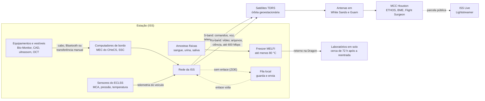

# 12. Fontes de dados abertas

> Para quem: Dev B (dados e entrada) e Dev C (motor e ML).
> Pré-requisito: [`06-modelo-de-dados.md`](06-modelo-de-dados.md) (entidades e unidades canônicas) e [`05-arquitetura-software.md`](05-arquitetura-software.md), seção 3.2 (de onde vêm os dados no protótipo).
> Como usar: a seção 1 é o mapa rápido. A seção 2 detalha cada base: dono, conteúdo, formato, acesso, licença, campos úteis, uso no protótipo e se a pesquisa testou o endpoint. As seções 3 a 6 explicam privacidade, comunicação entre estação e solo, o que é monitorado em tempo real e o software de saúde que a NASA usa. A seção 7 diz o que o protótipo usa de real e o que simula.
> Fonte principal: [`../pesquisa/bruto/06-dados-abertos-software-fluxo.md`](../pesquisa/bruto/06-dados-abertos-software-fluxo.md), verificada em 15/11/2026. Complementos: [`../pesquisa/bruto/01-eclss-ambiente-radiacao.md`](../pesquisa/bruto/01-eclss-ambiente-radiacao.md) (telemetria pública e radiação) e [`../pesquisa/bruto/02-equipamentos-medicos-tripulacao.md`](../pesquisa/bruto/02-equipamentos-medicos-tripulacao.md) (equipamentos médicos). Etiquetas de confiança como em [`00-guia-de-leitura.md`](00-guia-de-leitura.md).

---

## 1. Mapa rápido

| Fonte | Dono | O que entrega | Acesso | Testada pela pesquisa? | Papel no protótipo |
| --- | --- | --- | --- | --- | --- |
| OSDR, com GeneLab e ALSDA | NASA | Estudos de biologia espacial e dados humanos de pesquisa, com metadados | Aberto (site, API REST, AWS); parte controlada | Sim (API v2, OSD-575) | Exemplos de exame e contexto; nunca entrada ao vivo |
| EDA (dentro do OSDR) | NASA | Temperatura, umidade, CO2 e radiação históricos de campanhas da ISS | Aberto, download | Não | Série ambiental histórica de reserva |
| RadLab (dentro do OSDR) | NASA | Taxa de dose e fluxo por instrumento, com posição orbital | Aberto, API | Sim (DosTel) | Série histórica de radiação |
| NLSP, LSDA e LSAH | NASA, Johnson Space Center | Catálogo de pesquisas humanas e vigilância longitudinal de saúde | Catálogo aberto; dado por solicitação formal | Não | Só catálogo e pedido de valores agregados |
| data.nasa.gov | NASA | Catálogo de metadados | Aberto | Não | Descobrir conjuntos |
| NTRS | NASA | Relatórios técnicos e PDFs | Aberto, API documentada | Não | Referência para normas e limites |
| DONKI | NASA CCMC | Eventos de clima espacial (FLR, SEP, CME, GST) | Aberto, API REST JSON | Sim (FLR, SEP, GST; rota antiga deu 404) | Contexto de evento |
| NOAA SWPC | NOAA | Prótons do GOES, índice Kp, alertas e escalas | Aberto, JSON | Sim (prótons, Kp) | Modo ao vivo do clima espacial |
| ISS Live, via Lightstreamer | Lightstreamer, com feed público da NASA | Parcela da telemetria do ECLSS e de engenharia | Aberto, protocolo push | Não; unidades em disputa (ver 2.7) | Modo ao vivo opcional do ambiente |
| Where the ISS at | Terceiro | Latitude, longitude, altitude, velocidade | Aberto, REST JSON | Não | Contexto orbital |
| Análogos (HERA, SIRIUS, Antártida, Mars-500, CHAPEA) | NASA, IBMP, ESA | Sono, humor, cognição e fisiologia em isolamento | Por estudo; em geral solicitação | Não | Inspiração para cenários |
| Datasets terrestres (PhysioNet, MASS, REFUGE, OLIVES) | Universidades e hospitais | EEG, EOG, ECG, fundo de olho, OCT | Aberto com atribuição ou controlado | Não | Sinal e imagem reais para a demo |

"Testada" significa que a equipe de pesquisa abriu o endpoint em novembro de 2026 e registrou a resposta ([TESTADO]). Os trechos registrados aparecem nos blocos de código da seção 2. A pesquisa anotou campos e valores, não a resposta inteira: os blocos reproduzem só o que foi anotado e marcam com `...` o que não foi copiado.

---

## 2. Catálogo detalhado

### 2.1 OSDR, GeneLab e ALSDA

O NASA Open Science Data Repository (OSDR) integra dados que antes ficavam separados no GeneLab e no Ames Life Sciences Data Archive (ALSDA). O ALSDA entrou no ecossistema GeneLab em 2021 e o portal consolidado foi lançado em 2025. [OFICIAL](https://science.nasa.gov/biological-physical/data/osdr/) [OFICIAL](https://science.nasa.gov/science-research/biological-physical-sciences/osdr-and-psi-unveil-new-consolidated-website/)

| Item | Detalhe |
| --- | --- |
| Dono | NASA |
| O que contém | GeneLab: transcriptômica, genômica, epigenômica, proteômica, metabolômica. ALSDA: dados fisiológicos, clínicos de pesquisa, comportamentais e de experimentos, inclusive humanos. Metadados na hierarquia ISA (Investigation, Study, Assay) com accession, espécie, missão, datas, grupos e protocolos. [OFICIAL](https://science.nasa.gov/reference/osdr-faq/) |
| Formato | Tabelas CSV, TSV e JSON; arquivos de ensaio em FASTQ, BAM, matrizes, imagens e planilhas. Não há esquema comum: nome e unidade de cada campo vêm do dicionário do accession. |
| Acesso | Site, API REST v2 sem autenticação para metadados públicos [OFICIAL](https://visualization.osdr.nasa.gov/biodata/api/), e cópia em Amazon Web Services (AWS) S3 [OFICIAL](https://registry.opendata.aws/nasa-osdr/). Dados de sequência de astronautas podem ter acesso controlado [OFICIAL](https://science.nasa.gov/reference/osdr-tutorials-requesting-controlled-access-datasets/). |
| Licença | Não existe licença única para o repositório. Conferir termos e licença no registro de cada estudo e arquivo. [OFICIAL](https://science.nasa.gov/reference/osdr-help-terms-and-conditions/) |
| Rotas úteis | `/v2/datasets/`, `/v2/dataset/{accession}/`, `/v2/dataset/{accession}/assays/`, `/v2/dataset/{accession}/files/`, `/v2/query/metadata/`, `/v2/query/samples/`, `/v2/query/assays/`, `/v2/query/data/`. Os exemplos da documentação são antigos; monte a URL com um accession vigente e valide a resposta. A API antiga em osdr.nasa.gov (`/osdr/data/search`, `/osdr/data/osd/meta/{id}`) é legada: não usar sem teste. [OFICIAL](https://visualization.osdr.nasa.gov/biodata/api/) |
| Uso no protótipo | Exemplo de como mostrar resultado de exame com unidade e janela relativa ao voo, marcado como pesquisa. Nunca como faixa normativa nem como feed. |
| Testado | Sim. |

Trecho registrado pela pesquisa [TESTADO](https://visualization.osdr.nasa.gov/biodata/api/v2/dataset/OSD-575/):

```text
GET https://visualization.osdr.nasa.gov/biodata/api/v2/dataset/OSD-575/
Resposta: JSON com chave "OSD-575" e enlaces REST para metadados, ensaios e arquivos
  accession .......... OSD-575
  data source type ... alsda
  mission ............ SpaceX Inspiration4 (16 a 18 de setembro de 2021)
  título ............. painel de soro (metabolic panel, citocinas e painel cardiovascular)
  ...
```

Coleções de astronautas citadas pela pesquisa:

| Coleção | Conteúdo | Cuidado |
| --- | --- | --- |
| Inspiration4, OSD-575 | Painel metabólico sérico (CMP), citocinas e painel cardiovascular, coletas pré e pós-voo [TESTADO](https://visualization.osdr.nasa.gov/biodata/api/v2/dataset/OSD-575/) [PAPER](https://www.nature.com/articles/s41586-024-07639-y) | Coorte comercial pequena; algumas saídas em log2 normalizado, não em concentração clínica |
| SOMA (Space Omics and Medical Atlas) | Atlas que integra Twins Study, Inspiration4 e outras missões, com CBC, CMP, citocinas e multiômica [PAPER](https://www.nature.com/articles/s41586-024-07639-y) | É publicação, não API nem licença única; usar os accession citados |
| NASA Twins Study | Um astronauta em voo longo e o gêmeo em solo, multiômica, cognição, fisiologia [OFICIAL](https://www.nasa.gov/twins-study-the-research/) | N igual a 1; parte com restrição de acesso |
| Axiom e Polaris Dawn | Citadas no SOMA [PAPER](https://www.nature.com/articles/s41586-024-07639-y) | **NÃO ENCONTRADO:** catálogo único que confirme publicação aberta de todos os dados clínicos |

### 2.2 EDA e RadLab (ambiente e radiação históricos)

| Item | EDA (Environmental Data Application) | RadLab |
| --- | --- | --- |
| Dono | NASA, dentro do OSDR [OFICIAL](https://visualization.osdr.nasa.gov/eda/) | NASA, dentro do OSDR [OFICIAL](https://visualization.osdr.nasa.gov/radlab/gui/overview/) |
| O que contém | Telemetria ambiental histórica de experimentos da ISS: cabine, hardware e radiação de campanhas selecionadas | Medidas de radiação de vários instrumentos, inclusive séries da ISS |
| Formato | Exportação CSV, Excel e PDF | API com saída JSON, CSV, TSV ou HTML [OFICIAL](https://visualization.osdr.nasa.gov/radlab/gui/data-api/) |
| Campos e unidades | `Controller_Time_GMT`, temperatura em solo e na ISS em °C, umidade relativa em %, CO2 em ppm; algumas tabelas trazem dose de GCR, SAA, total ou acumulada [OFICIAL](https://github.com/nasa/OSDR_Tutorials/blob/main/source/pages/guides/environmental_data_application.md) | `timestamp`, `spacecraft`, `module`, `instrument`, `instrument_id`, `absorbed_dose_rate` em µGy/h, `dose_equivalent_rate` em µSv/h, `flux` em cm⁻² sr⁻¹ s⁻¹, latitude e longitude em graus, altitude em km, campo magnético em nT, coordenada L sem unidade [OFICIAL](https://visualization.osdr.nasa.gov/radlab/gui/data-api/) |
| Cadência | Varia por missão e dispositivo; não há frequência universal | Varia por conjunto: DORELI cerca de 5 min; Liulin-5 20 s perto da SAA e 90 s fora dela; alguns conjuntos agregados em 24 h; parte marcada como preliminar [OFICIAL](https://visualization.osdr.nasa.gov/radlab/gui/knowledgebase/Release_history) |
| Acesso e licença | Aberto; regras do OSDR valem por conjunto | Aberto para os registros disponibilizados |
| Limite | Não é sensor ao vivo nem série universal da ISS; o exemplo documentado é a missão Rodent Research-1 (2014) [OFICIAL](https://github.com/nasa/OSDR_Tutorials/blob/main/source/pages/guides/environmental_data_application.md) | Dose de instrumento de área não é dose individual de tripulante nem previsão |
| Uso no protótipo | Arquivo gravado de reserva para o painel de ambiente, com missão, horário e origem visíveis | Série histórica de taxa de dose (casa com a unidade canônica µGy/h de `docs/06`) |
| Testado | Não | Sim |

Atenção à conversão: o EDA traz CO2 em ppm, mas a unidade canônica de `docs/06` é pressão parcial em mmHg. Converter só com a pressão total da cabine conhecida ([`04-cruzamento-de-dados.md`](04-cruzamento-de-dados.md), A1). [OFICIAL](https://standards.nasa.gov/standard/NASA/NASA-STD-3001_VOL_2)

Trecho registrado pela pesquisa [TESTADO](https://visualization.osdr.nasa.gov/radlab/api/?spacecraft=ISS&instrument=DosTel&timestamp%3E=2022-04-01T23%3A00&timestamp%3C2022-04-02T01%3A05&absorbed_dose_rate%3E2&format=json):

```text
GET https://visualization.osdr.nasa.gov/radlab/api/?spacecraft=ISS&instrument=DosTel&timestamp%3E=2022-04-01T23%3A00&timestamp%3C2022-04-02T01%3A05&absorbed_dose_rate%3E2&format=json
Janela: 2022-04-01 23:00 a 2022-04-02 01:05 UTC
Resposta: JSON
  colunas: timestamp, instrument_id, absorbed_dose_rate, instrument, spacecraft
  primeira linha: instrument_id = DosTel2 ; absorbed_dose_rate = 10.2160856666667  (µGy/h)
  ...
```

### 2.3 NLSP, LSDA e LSAH (dados humanos com acesso controlado)

| Base | Dono e conteúdo | Acesso | Uso no protótipo |
| --- | --- | --- | --- |
| NASA Life Sciences Portal (NLSP) | Portal de descoberta das investigações do Human Research Program (HRP), do LSDA, das solicitações de dados e dos arquivos de saúde longitudinal [OFICIAL](https://nlsp.nasa.gov/) | Pesquisa web; download conforme a classe de acesso; fluxo próprio de solicitação | Catálogo; nunca entrada ao vivo |
| Life Sciences Data Archive (LSDA) | Arquivo do Johnson Space Center com estudos de voo e de análogos desde as primeiras missões tripuladas; não é prontuário médico [OFICIAL](https://www.nasa.gov/missions/station/open-source-science-opportunities/) | Descrições e dados não identificáveis podem ser baixados; dados sensíveis exigem pedido formal | Pedir estatísticas agregadas, se necessário |
| Lifetime Surveillance of Astronaut Health (LSAH) | Vigilância longitudinal da saúde ocupacional de astronautas [OFICIAL](https://nlsp.nasa.gov/) | Sem download público de dado clínico individual; pedido com revisão [OFICIAL](https://nlsp.nasa.gov/explore/lsdahome/datarequest) | Não presumir acesso; usar dado sintético |

Como pedir dado ao LSDA ou ao LSAH, segundo o guia de solicitação retrospectiva da NASA [OFICIAL](https://www.nasa.gov/wp-content/uploads/2015/05/hrp_retrospective_data_request_study_information_package_guidelines_final.pdf):

1. Abrir o pedido pelo NLSP com justificativa, escopo mínimo, campos e amostra necessários.
2. Preferir dados agrupados ou desidentificados; é o caminho mais simples.
3. Dado atribuível a uma pessoa pode exigir consentimento escrito do astronauta, parecer do Evidence Book Working Group (EBWG), do conselho consultivo do LSAH e do Institutional Review Board (IRB) do Johnson Space Center.
4. A aprovação pode vir limitada: não libera o prontuário inteiro nem toda variável. Combinações de missão, duração e sexo podem reidentificar alguém.

Dois casos concretos: os resultados processados e anonimizados da Artemis II poderão ser solicitados ao LSDA [OFICIAL](https://science.nasa.gov/missions/artemis/artemis-2/nasas-artemis-ii-moon-mission-research-continues-on-earth/); os dados do comissionamento do Bio-Monitor não foram arquivados no LSDA [OFICIAL](https://nlsp.nasa.gov/search/data/details/f9f4485d-656c-5980-9a5f-4f57c7ba383a?dataType=EXPERIMENTS).

### 2.4 data.nasa.gov e NTRS

| Item | data.nasa.gov | NASA Technical Reports Server (NTRS) |
| --- | --- | --- |
| O que é | Catálogo de metadados de datasets da NASA: título, descrição, organização, tags e links. É índice; o dado mora em outro serviço [OFICIAL](https://data.nasa.gov/) | Catálogo de relatórios técnicos, artigos e apresentações, com resumo, autores, data e PDF quando liberado [OFICIAL](https://ntrs.nasa.gov/) |
| Acesso | Busca por tags como astronaut, ECLSS e ISS | API pública documentada [OFICIAL](https://sti.nasa.gov/docs/STI_Open_API_Documentation_20210426.pdf); a distribuição varia por registro (pública, restrita, sem arquivo) |
| Licença | A do arquivo de origem; a do catálogo não a substitui | Conferir o campo de distribuição de cada registro |
| Uso no protótipo | Achar conjuntos e guardar a citação | Fonte das normas, manuais e históricos citados nos `docs/` |

Um exemplo útil achado via catálogo: o dataset de 10 segundos do contador TEPC da ISS [OFICIAL](https://catalog.data.gov/dataset/iss-tissue-equivalent-proportional-counter-tepc-dose-analyzer-10-s-data).

### 2.5 api.nasa.gov e DONKI (eventos de clima espacial)

O Space Weather Database Of Notifications, Knowledge, Information (DONKI) é do Community Coordinated Modeling Center (CCMC) da NASA. Registra flares (FLR), Solar Energetic Particles (SEP), coronal mass ejections (CME) e geomagnetic storms (GST), com intervalos, classe, instrumentos e links. [OFICIAL](https://ccmc.gsfc.nasa.gov/tools/DONKI/)

| Item | Detalhe |
| --- | --- |
| Endpoint vigente | `https://ccmc.gsfc.nasa.gov/DONKI-API/get/{TIPO}`. Em 30/09/2026 a API mudou para esse host; os caminhos de evento continuam os mesmos [OFICIAL](https://ccmc.gsfc.nasa.gov/news/major-updates/) |
| Rota antiga | A URL `api.nasa.gov/DONKI/...` respondeu 404 no teste desta pesquisa. Não usar em código novo |
| Formato | JSON |
| Campos úteis | `eventType`, `beginTime`, `peakTime`, `endTime`, `classType`, `instruments`, `linkedEvents`, `link` |
| Qualidade | A própria CCMC qualifica a informação quase em tempo real como de prototipagem e pesquisa, sem garantia operacional. Para alerta, priorizar a NOAA [OFICIAL](https://ccmc.gsfc.nasa.gov/tools/DONKI/) |
| Uso no protótipo | `EventoClimaEspacial` com `tipo` FLR, SEP, CME ou GST e `fonte: "NASA_DONKI"` (`docs/06`, 2.10) |

Trechos registrados pela pesquisa em 15/11/2026 [TESTADO](https://ccmc.gsfc.nasa.gov/DONKI-API/get/FLR?startDate=2024-05-01&endDate=2024-05-03):

```text
GET https://ccmc.gsfc.nasa.gov/DONKI-API/get/FLR?startDate=2024-05-01&endDate=2024-05-03
Resposta: JSON
  evento ........ 2024-05-01T05:53:00-FLR-001
  beginTime, peakTime, endTime ... (valores não copiados)
  classType ..... C5.3
  instrumentos, região ativa, link do evento ... (presentes)

GET https://ccmc.gsfc.nasa.gov/DONKI-API/get/SEP  (mesma janela)
Resposta: []   (lista sem itens)

GET https://ccmc.gsfc.nasa.gov/DONKI-API/get/GST  (mesma janela)
Resposta: época da tempestade e série de Kp

GET api.nasa.gov/DONKI/...  (rota antiga)
Resposta: 404
```

### 2.6 NOAA SWPC: prótons do GOES, Kp e alertas

O Space Weather Prediction Center (SWPC) da NOAA publica produtos abertos em JSON. É a fonte preferida para alerta de clima espacial. Atenção: o SWPC publicou em 2026 um aviso de mudança de formatos, então o adaptador precisa validar esquema e horário. [OFICIAL](https://www.weather.gov/media/notification/pdf_2026/scn26-21_Data_Format_Changes_Impacting_SWPC_Products.pdf)

| Produto | Endpoint | Campos e unidade | Testado |
| --- | --- | --- | --- |
| Fluxo integral de prótons do GOES, 1 dia | `https://services.swpc.noaa.gov/json/goes/primary/integral-protons-1-day.json` [OFICIAL](https://www.swpc.noaa.gov/products/goes-proton-flux) | `time_tag`, `satellite`, `flux` em pfu (partículas por cm² por s por sr), `energy` | Sim |
| Índice Kp planetário, 1 minuto | `https://services.swpc.noaa.gov/json/planetary_k_index_1m.json` [OFICIAL](https://services.swpc.noaa.gov/json/planetary_k_index_1m.json) | `time_tag`, `kp_index`, `estimated_kp`, `kp` | Sim |
| Alertas, avisos e cancelamentos | `/products/alerts.json` (a rota `/json/alerts.json` não existe no índice) [OFICIAL](https://www.swpc.noaa.gov/products/alerts-watches-and-warnings) | Horário de emissão, código do produto, texto variável | Não |
| Escalas oficiais | `/products/noaa-scales.json` [OFICIAL](https://services.swpc.noaa.gov/products/) | Escalas S (radiação) e G (geomagnética) | Não |

Não há SLA citado para os feeds. [OFICIAL](https://www.swpc.noaa.gov/products/goes-proton-flux)

Escala S de tempestade de radiação, canal de 10 MeV [OFICIAL](https://www.swpc.noaa.gov/products/notifications-timeline):

| Nível | S1 | S2 | S3 | S4 | S5 |
| --- | --- | --- | --- | --- | --- |
| Fluxo ≥10 MeV | 10 pfu | 100 pfu | 1.000 pfu | 10.000 pfu | 100.000 pfu |

Trechos registrados pela pesquisa [TESTADO](https://services.swpc.noaa.gov/json/goes/primary/integral-protons-1-day.json) [TESTADO](https://services.swpc.noaa.gov/json/planetary_k_index_1m.json):

```text
GET https://services.swpc.noaa.gov/json/goes/primary/integral-protons-1-day.json
Resposta: lista de objetos com time_tag, satellite, flux, energy
  energy presentes nas linhas: ">=1 MeV", ">=10 MeV", ...

GET https://services.swpc.noaa.gov/json/planetary_k_index_1m.json
Resposta: lista de objetos com time_tag, kp_index, estimated_kp, kp
  linha de 14/11/2026: estimated_kp = 1.33 ; kp = "1P"
```

Regra de interpretação: fluxo do GOES e Kp descrevem o ambiente espacial fora da estação. Não converta fluxo em dose prevista para alguém dentro da ISS. O cenário C2 de `docs/05` usa a passagem do limiar S1. [OFICIAL](https://www.swpc.noaa.gov/products/goes-proton-flux)

### 2.7 ISS Live, via Lightstreamer (telemetria pública da estação)

A NASA tornou pública uma parcela selecionada da telemetria da ISS, descrita como um subconjunto dos mais de 100 mil itens. O acesso é pelo servidor `push.lightstreamer.com`, adapter set `ISSLIVE`; o cliente assina itens individuais e recebe o campo `Value`. [SECUNDÁRIA](https://lightstreamer.com/customer-story/how-nasa-is-using-lightstreamer/) [SECUNDÁRIA](https://github.com/Lightstreamer/Lightstreamer-example-ISSLive-client-javascript)

| Item | Detalhe |
| --- | --- |
| Dono | Lightstreamer, retransmitindo feed público da NASA |
| Formato | Protocolo push; cliente JavaScript Lightstreamer ou biblioteca compatível. O cliente pode limitar frequência por item |
| Cadência | Varia por item; sem taxa única nem SLA |
| Dicionário | **NÃO ENCONTRADO** dicionário oficial da NASA com identificador, unidade, calibração e frequência. Só existem mapas comunitários (ISS-Mimic) e o dicionário do projeto de exemplo (`PUIList.xml`) [SECUNDÁRIA](https://iss-mimic.github.io/Mimic/) [SECUNDÁRIA](https://github.com/Lightstreamer/Lightstreamer-example-ISSLive-client-javascript/blob/master/src/assets/PUIList.xml) |
| O que não tem | Item público fácil para umidade relativa, dose pessoal, ruído, lux, microbiologia ou temperatura corporal; nenhum sinal vital [SECUNDÁRIA](https://iss-mimic.github.io/Mimic/) |
| Uso no protótipo | Modo "ao vivo" opcional do painel de ambiente, atrás de seletor, com arquivo gravado de reserva (regra 4 do [`../AGENTS.md`](../AGENTS.md)) |
| Testado | Não |

Itens mais úteis segundo os mapas comunitários (frente 1 da pesquisa) [SECUNDÁRIA](https://iss-mimic.github.io/Mimic/) [SECUNDÁRIA](https://github.com/joepavitt/node-red-iss-data-streamer):

| ID no feed | Descrição | Módulo no mapa | Unidade no mapa ISS-Mimic | Unidade no dicionário `PUIList.xml` |
| --- | --- | --- | --- | --- |
| USLAB000053 / NODE3000001 | ppO2 | US Lab / Node 3 | torr | psia |
| USLAB000054 / NODE3000002 | ppN2 | US Lab / Node 3 | torr | psia |
| USLAB000055 / NODE3000003 | ppCO2 | US Lab / Node 3 | torr | psia |
| USLAB000058 | Pressão da cabine | US Lab | torr (escala a confirmar) | não detalhado no bruto |
| USLAB000059 | Temperatura de entrada do CCAA | US Lab | °C | CNT em "certos subsistemas" |
| NODE3000010 / NODE3000011 | Estado do OGA / produção de O2 | Node 3 | código enumerado / lb por dia | LBM/D |
| NODE3000005, 8, 9 | Níveis de tanque UPA e WPA | Node 3 | percentual, unidade não confirmada | percentual |

Cuidados de leitura: os IDs indicam o grupo do item, não a posição física do sensor; o OGA voltou ao US Lab em 2022, então NODE3000010/11 podem ser itens históricos ou espelhos [OFICIAL](https://ntrs.nasa.gov/api/citations/20240007995/downloads/ICES2024141%20ISS%20ECLS%20Presentaton%20RevA.pdf). Estado de equipamento (OGA em PROCESS) não prova ppO2 adequado.

#### 2.7.1 Divergência registrada: unidade dos itens de pressão

As duas frentes de pesquisa discordam sobre a unidade dos itens de pressão parcial:

| Frente | Fonte | O que diz |
| --- | --- | --- |
| Frente 1 ([`01-eclss-ambiente-radiacao.md`](../pesquisa/bruto/01-eclss-ambiente-radiacao.md), D4) | Mapa comunitário ISS-Mimic [SECUNDÁRIA](https://iss-mimic.github.io/Mimic/) | ppO2, ppN2, ppCO2 e pressão da cabine em **torr** |
| Frente 6 ([`06-dados-abertos-software-fluxo.md`](../pesquisa/bruto/06-dados-abertos-software-fluxo.md), 1.3) | Dicionário do projeto de exemplo da Lightstreamer [SECUNDÁRIA](https://github.com/Lightstreamer/Lightstreamer-example-ISSLive-client-javascript/blob/master/src/assets/PUIList.xml) | ppO2, ppN2 e ppCO2 de nós e laboratório em **psia** |

As duas fontes são secundárias e nenhuma é dicionário oficial. A mesma discordância aparece, menor, nas temperaturas (°C no mapa comunitário, CNT no dicionário do projeto). **A frente 11 da pesquisa vai resolver com amostras reais do feed.** Até lá, o adaptador ISS Live guarda `valorOriginal` e `unidadeOriginal` como vieram e não gera cor de limiar a partir desses itens.

Pista para a frente 11 [INFERÊNCIA, com as conversões de [`04-cruzamento-de-dados.md`](04-cruzamento-de-dados.md), A1: 1 psia = 6,89476 kPa = 51,71 mmHg; a pesquisa trata torr e mmHg como equivalentes]: a ordem de grandeza da amostra separa as hipóteses.

| Item | Valor esperado se for torr | Valor esperado se for psia | Base |
| --- | --- | --- | --- |
| ppCO2 | cerca de 1,7 a 2,1 (leituras divulgadas para parte de 2025) | cerca de 0,033 a 0,041 | [OFICIAL](https://www.nasa.gov/wp-content/uploads/2023/12/ochmo-tb-004-carbon-dioxide.pdf) [OFICIAL](https://www.nasa.gov/missions/station/iss-research/science-in-space-august-4-2023-spacecraft-air-quality/) |
| ppO2 | cerca de 146 a 171 | cerca de 2,82 a 3,3 (requisito genérico NASA) | [OFICIAL](https://ntrs.nasa.gov/api/citations/20170001943/downloads/20170001943.pdf?__source=newsletter%7Cspacenewsletter) |
| Pressão da cabine | cerca de 760 | cerca de 14,7 (nominal da ISS) | [OFICIAL](https://www.nasa.gov/wp-content/uploads/2023/08/np-2022-06-009-jsc-iss-tech-demo-mini-book-proof-3.pdf) |

### 2.8 Posição da ISS

| Item | Detalhe |
| --- | --- |
| Fonte | Where the ISS at, serviço de terceiros [SECUNDÁRIA](https://wheretheiss.at/w/developer) |
| Campos | Latitude, longitude, altitude, velocidade, timestamp |
| Acesso | REST JSON aberto; disponibilidade depende do provedor. Open Notify é API legada, sem confirmação de suporte |
| Uso no protótipo | Contexto orbital (por exemplo, passagem pela Anomalia do Atlântico Sul, SAA) |
| Limite | Posição não é dose. Correlacionar com um dosímetro do RadLab quando houver medida; nunca inferir exposição individual só por latitude e longitude |

### 2.9 Dados de análogos (isolamento em solo)

| Análogo | Dono | O que tem | Acesso e licença | Uso e limite |
| --- | --- | --- | --- | --- |
| Human Exploration Research Analog (HERA), não confundir com o detector de radiação HERA | NASA Johnson | Questionários semanais, cortisol, actigrafia, cognição [OFICIAL](https://ntrs.nasa.gov/api/citations/20240011157/downloads/NASA%20TM20240011157.pdf) | Por estudo no LSDA, com solicitação [OFICIAL](https://humanresearchroadmap.nasa.gov/gaps/gap.aspx?i=700) | Tendência de sono e humor em isolamento; amostra pequena, sem microgravidade |
| NEK e SIRIUS | IBMP com NASA HRP | Fisiologia, imunologia, psicologia, telemedicina [OFICIAL](https://www.nasa.gov/mission-nek-and-sirius-faqs/) | Resultados por publicação; **NÃO ENCONTRADO** catálogo aberto completo | Questionários de equipe; marcar como análogo |
| Inverno antártico | NASA e parceiros | Comportamento e sono [OFICIAL](https://nlsp.nasa.gov/search/data/details/6e611fcf-06df-5ef0-b76d-7862f6c1b499?dataType=EXPERIMENTS) | Pedido formal pelo NLSP | Comparar autorrelato e actigrafia |
| Mars-500 | IBMP, dados no ESA HREDA | Controle cardiovascular autonômico; atividade, desempenho e humor (2009 a 2012) [OFICIAL](https://esdcdoi.esac.esa.int/doi/html/data/hre/hreda/21903430-ae04-4969-9e49-0dc629c30968.html) | Datasets com DOI; licença CC BY-NC 3.0 IGO [OFICIAL](https://esdcdoi.esac.esa.int/doi/html/data/hre/hreda/feb2804b-34e9-4c4d-8cb8-0ca7a44d01aa.html) | Validar importação de séries longas; uso não comercial |
| CHAPEA | NASA | Saúde física e comportamental, sono, missão 2 encerrada em 31/10/2026 [OFICIAL](https://www.nasa.gov/missions/analog-field-testing/chapea/chapea-mission-2-crew-reflects-after-378-days-on-simulated-mars/) | **NÃO ENCONTRADO:** liberação pública de registros individuais | Só inspiração de cenário sintético |

### 2.10 Datasets terrestres de sinais e imagens

São dados de pessoas na Terra. Servem para testar leitura de arquivo, gráficos, anotação e pipeline; não representam astronautas e não autorizam diagnóstico. [OFICIAL](https://physionet.org/)

| Dataset | Sinal | Formato e taxa | Acesso e licença | Uso no protótipo |
| --- | --- | --- | --- | --- |
| Sleep-EDF Expanded (PhysioNet) | EEG, EOG, EMG, hipnogramas; 197 noites [OFICIAL](https://physionet.org/content/sleep-edfx/1.0.0/) | EDF/EDF+; EEG e EOG a 100 Hz | Aberto, ODC-By 1.0 (atribuição obrigatória) [OFICIAL](https://physionet.org/content/sleep-edfx/view-license/1.0.0/) | **Escolhido:** hipnograma pré-calculado do óculos Orbit (`docs/05`, 3.2) |
| Sleep Heart Health Study PSG (PhysioNet) | EEG, EOG, EMG, ECG, SaO2, FC [OFICIAL](https://physionet.org/content/shhpsgdb/1.0.0/) | EEG 125 Hz, EOG 50 Hz, ECG 125 ou 250 Hz, SaO2 1 Hz [OFICIAL](https://archive.physionet.org/standards/npsg/Loparo.pdf) | Aberto, ODC-By 1.0 [OFICIAL](https://physionet.org/content/shhpsgdb/view-license/1.0.0/) | Exemplo de SpO2 e EOG; coorte de apneia acima de 40 anos |
| MASS (CÉAMS) | EEG, EOG, ECG, EMG [OFICIAL](https://ceams-carsm.ca/MASS/) | EDF++; 256 Hz [PAPER](https://onlinelibrary.wiley.com/doi/10.1111/jsr.12169) | Biossinais exigem proposta e aprovação ética | Só com aprovação; não redistribuir |
| MIT-BIH Arrhythmia (PhysioNet) | ECG, 48 registros de 30 min [OFICIAL](https://physionet.org/content/mitdb/1.0.0/) | WFDB; 360 amostras/s por canal, 11 bits, 10 mV | Aberto, ODC-By 1.0 [OFICIAL](https://physionet.org/content/mitdb/view-license/1.0.0/) | Traçado de ECG opcional; arritmias raras de propósito |
| MIMIC-IV (PhysioNet) | Sinais vitais de UTI [OFICIAL](https://physionet.org/content/mimiciv/3.1/) | Tabelas | Controlado: credenciamento, CITI e Data Use Agreement [OFICIAL](https://physionet.org/about/faqs/) | **Não usar** na demo |
| REFUGE | Fundo de olho, 1.200 imagens JPEG [OFICIAL](https://refuge.grand-challenge.org/Details/) | JPEG com rótulos de glaucoma | Licença de redistribuição não clara: verificar | Demo de upload de imagem, se a licença permitir |
| OLIVES (Zenodo) | OCT e fundo de olho; 78.283 B-scans de 96 olhos [PAPER](https://papers.neurips.cc/paper_files/paper/2022/file/3be60b4a739b95a07a944a1a2c41e05e-Paper-Datasets_and_Benchmarks.pdf) | Imagens e tabelas de rótulos [OFICIAL](https://zenodo.org/records/7105232) | CC BY 4.0, segundo o artigo [PAPER](https://papers.neurips.cc/paper_files/paper/2022/file/3be60b4a739b95a07a944a1a2c41e05e-Supplemental-Datasets_and_Benchmarks.pdf) | Imagem de OCT para o cenário C3; doença diabética, não SANS |

---

## 3. Privacidade e acesso a dados médicos de astronautas

A NASA-STD-3001 manda manter, guardar e transmitir com segurança registros de saúde, de saúde comportamental e de exames, recuperáveis para análise longitudinal. A justificativa cita o Privacy Act de 1974 (5 U.S.C. §552a): informação individual não é divulgada sem consentimento. [OFICIAL](https://www.nasa.gov/reference/7-0-crew-health-records/) [OFICIAL](https://www.nasa.gov/wp-content/uploads/2023/11/nasa-std-3001-vol-1-rev-c-with-signature.pdf) Parceiros internacionais podem acrescentar regras. [OFICIAL](https://www.nasa.gov/wp-content/uploads/2025/08/ochmo-tb-044-medical-operations.pdf)

| Nível | Exemplos | Quem acessa |
| --- | --- | --- |
| Público | Ambiente e radiação históricos (EDA, RadLab), clima espacial (NOAA, DONKI), telemetria ISS Live, metadados e arquivos abertos do OSDR, datasets terrestres abertos | Qualquer pessoa, respeitando a licença de cada arquivo |
| Agregado ou desidentificado | Dados processados de estudos (Inspiration4), descrições do LSDA, resultados anonimizados da Artemis II sob pedido | Pesquisador, com termos de uso e citação |
| Restrito | Prontuário e histórico do LSAH, dado identificável, sequências genéticas de astronautas, conteúdo de conferências médicas e psicológicas privadas | Só com consentimento, revisão ética e aprovação; muitas vezes nunca |

O documento inicial do projeto resumiu bem a regra geral ("agregados livres, individuais por solicitação e comitê de ética"). A pesquisa acrescenta que até combinações de variáveis podem reidentificar alguém. [OFICIAL](https://www.nasa.gov/wp-content/uploads/2015/05/hrp_retrospective_data_request_study_information_package_guidelines_final.pdf)

Acesso por função na operação real [OFICIAL](https://www.nasa.gov/directorates/esdmd/hhp/flight-surgeons/) [OFICIAL](https://www.nasa.gov/directorates/esdmd/hhp/biomedical-flight-controllers/):

| Perfil | Precisa de | Não deve receber |
| --- | --- | --- |
| Tripulante | Os próprios dados, tendências, autoavaliações, consentimento | Prontuário ou notas de colegas sem autorização |
| Crew Medical Officer (CMO) | Dados de colega quando a função e o atendimento autorizam | Acesso livre a todos |
| Flight Surgeon e International Medical Group | Saúde da tripulação dentro do escopo e dos acordos | Replicação automática para todo o controle de voo |
| Biomedical Engineer (BME) | Dado biomédico, ambiental e de hardware para operar e encaminhar | Notas clínicas e de saúde comportamental |
| Flight Director | Estado operacional e risco à missão | Detalhe clínico além do necessário |
| Pesquisador e público | Conjunto agregado e aprovado | Identificador direto ou combinação reidentificável |

Consequências para o software [INFERÊNCIA, apoiada na recomendação da arquitetura MDA da NASA](https://ntrs.nasa.gov/api/citations/20220017869/downloads/HRP-48032%20ExMC%20CDSS%20Architecture%20Recommendation%20Rev%20B.pdf):

1. **Nenhum dado real de astronauta no protótipo.** Tripulantes com codinome fictício (`Tripulante.codinome` em `docs/06`) e sinais vitais simulados.
2. **Filtro no motor, antes da tela.** O Monitor geral mostra cada colega conforme `Tripulante.compartilhamento` (regra 9 do [`../AGENTS.md`](../AGENTS.md); perfis em `docs/05`, seção 7).
3. **Menor privilégio e trilha.** Perfis separados, log de consulta e alteração, consentimento e escopo guardados.
4. **Separar sinal bruto de alerta derivado** e nunca sobrescrever leitura: corrigir com nova versão.
5. **Texto livre e conversas privadas** (PMC, PPC, diário) ficam fora de qualquer tela compartilhada.
6. **Criptografia local e em trânsito** e pacote de sincronização resistente a perda de conexão (seção 4) na visão operacional.

---

## 4. Fluxo de dados entre estação e solo

A ISS fala com o solo pelo Space Network da NASA: satélites Tracking and Data Relay Satellite (TDRS) em órbita geoestacionária, antenas em White Sands e Guam e encaminhamento até o Mission Control Center em Houston (MCC-H). Isso dá cobertura quase contínua. Desde 8/11/2024 a NASA não atribui novas missões ao TDRS, mas ele segue atendendo a ISS. [OFICIAL](https://www.nasa.gov/missions/station/the-space-network-cell-towers-for-astronauts/) [OFICIAL](https://www.nasa.gov/missions/tdrs/tdrs-generations-of-spacecraft/)



| Canal | Uso | Capacidade e cautela |
| --- | --- | --- |
| S-band | Comandos, voz, telemetria; canal robusto e redundante | Especificação histórica: retorno até 192 kbps e envio até 72 kbps [OFICIAL](https://ntrs.nasa.gov/api/citations/20030001141/downloads/20030001141.pdf) |
| Ku-band | Vídeo, arquivos, ciência, alta taxa | Capacidade ampliada para 600 Mbps em 2019; testes emulam enlace de 500 Mbps, dividido entre usuários [OFICIAL](https://www.nasa.gov/missions/station/data-rate-increase-on-the-international-space-station-supports-future-exploration/) [OFICIAL](https://ntrs.nasa.gov/citations/20240007078) |
| Perda de sinal | Estrutura, apontamento e troca de satélite criam a Zone of Exclusion (ZOE) | Manual histórico estima cobertura Ku de cerca de 70% de cada órbita; serve só para mostrar que o enlace não é 100% [OFICIAL](https://ntrs.nasa.gov/api/citations/20030001141/downloads/20030001141.pdf) |

Como o dado médico viaja hoje: coletado no equipamento, carregado por cabo, rede local, aplicativo ou digitação, associado ao registro do CHeCS e enviado ao solo. Alguns aparelhos transmitem pela rede da ISS; outros precisam de transferência manual. A NASA reconhece que dados de saúde ficavam em formatos e lugares diferentes e que parte era baixada à mão. [OFICIAL](https://humanresearchroadmap.nasa.gov/gaps/gap.aspx?i=639) A voz médica usa a Private Medical Conference (PMC), semanal, com o BME fazendo a ponte. [OFICIAL](https://www.nasa.gov/directorates/esdmd/hhp/flight-surgeons/) Amostras físicas não viajam como arquivo: vão congeladas e voltam em cápsula; a NASA registra entrega aos pesquisadores em cerca de 72 horas após a reentrada. [OFICIAL](https://www.nasa.gov/wp-content/uploads/2015/02/human_adaptation_2021_final.pdf)

Atraso de comunicação por destino (casa com `Missao.atrasoComunicacaoSeg` em `docs/06`):

| Destino | Atraso e interrupções | Consequência |
| --- | --- | --- |
| ISS, órbita baixa | Inferior a um segundo do ponto de vista humano; testes de rede usaram 600 ms de ida e volta emulados [OFICIAL](https://www.nasa.gov/missions/station/the-space-network-cell-towers-for-astronauts/) [OFICIAL](https://ntrs.nasa.gov/citations/20240007078) | Conversa quase em tempo real com o médico de voo |
| Lua, Orion | Luz leva cerca de 1,3 s por trecho; estudo da NASA estima comando 2,7 s (pior caso 3,9 s), voz e vídeo 5,6 a 6,5 s, telemetria 5,9 a 8,6 s [PAPER](https://science.nasa.gov/wp-content/uploads/2023/05/188_fed0ad8278e728107533d509b24dc68b_SmithsimmonsDrew.pdf) [OFICIAL](https://ntrs.nasa.gov/api/citations/20250003885/downloads/NASA%20TM20250003885.pdf) | Procedimentos com contexto local, sem depender de diálogo contínuo |
| Marte | Cerca de 4 a 24 minutos por trecho; outro estudo avalia até 22 min por trecho e 44 min ida e volta [OFICIAL](https://ntrs.nasa.gov/api/citations/20220002905/downloads/NESC-RP-20-01589_NASA-TM-20220002905final.pdf) [OFICIAL](https://ntrs.nasa.gov/api/citations/20250003885/downloads/NASA%20TM20250003885.pdf) | Avaliação inicial e cuidado urgente feitos a bordo |
| Conjunção solar de Marte | Cerca de uma vez a cada 26 meses; apagão de cerca de duas semanas, com análises citando duas a três [OFICIAL](https://science.nasa.gov/blog/hunkering-down-for-solar-conjunction/) [OFICIAL](https://www.nasa.gov/wp-content/uploads/2024/01/mars-communications-disruption-and-delay.pdf) | A tripulação opera sozinha por semanas |

**EIMO.** Earth-Independent Medical Operations é a transferência gradual da decisão médica para recursos a bordo, à medida que crescem atraso, interrupção e impossibilidade de evacuação. A NASA descreve a ISS como dependente do solo em tempo quase real e pesquisa um Clinical Decision Support System (CDSS) para missões mais autônomas. [OFICIAL](https://ntrs.nasa.gov/citations/20240001402) [OFICIAL](https://www.nasa.gov/centers-and-facilities/ames/ames-science/ames-space-biosciences/a-clinical-decision-support-system-for-earth-independent-medical-operations/) Para o Orbit Saúde, isso justifica o princípio offline-first (P1 em `docs/05`): exibir, guardar e alertar sem rede; quando houver enlace, sincronizar anexando horário de observação e de recebimento, sem sobrescrever o histórico local. O protótipo não pode alegar equivalência a um CDSS certificado. [INFERÊNCIA](https://ntrs.nasa.gov/citations/20220017869)

---

## 5. Monitoramento em tempo real hoje

**O ambiente é contínuo; os sinais vitais da tripulação não são.**

- **Contínuo: ambiente.** O ECLSS controla ar, água, ventilação e pressão. No MCC, a posição Environmental and Thermal Operating Systems (ETHOS) acompanha sistemas ambientais e térmicos, inclusive oxigênio, nitrogênio e água; ETHOS é posição de controle, não nome de software. [OFICIAL](https://www.nasa.gov/reference/environmental-control-and-life-support-systems-eclss/) [OFICIAL](https://ntrs.nasa.gov/api/citations/20160012370/downloads/20160012370.pdf) O BME, representante técnico do CHeCS, monitora em tempo real dados bioambientais como CO2 e O2 e encaminha dados fisiológicos e de hardware aos especialistas. [OFICIAL](https://www.nasa.gov/directorates/esdmd/hhp/biomedical-flight-controllers/) O software de supervisão do ETHOS não é público. [OFICIAL](https://ntrs.nasa.gov/api/citations/20250003953/downloads/ICES-2025-125%20Final_Rev%20C.pdf)
- **Não contínuo: sinais vitais.** Não há monitoramento contínuo de todos os sinais vitais de cada astronauta na rotina da ISS. A NASA descreve dispositivos médicos separados, usados periodicamente. [OFICIAL](https://www.nasa.gov/glenn/glenn-expertise-space-exploration/human-health-performance/exploration-medical-technologies/multifunctional-integrated-medical-devices/) O Spaceflight Standard Measures prevê coletas programadas. [OFICIAL](https://ntrs.nasa.gov/citations/20210022783)

| Exceção | O que é monitorado | Limite |
| --- | --- | --- |
| Atividade extraveicular (EVA) | ECG e frequência cardíaca, metabolismo medido ou estimado, estado do traje, pressão, O2 consumido, CO2 do traje; historicamente, taxa metabólica estimada a cada 2 minutos [OFICIAL](https://standards.nasa.gov/sites/default/files/standards/NASA/B/0/nasa-std-3001_vol_2_rev_b.pdf) [PAPER](https://ntrs.nasa.gov/citations/20210024317) | Só durante a EVA e no traje; Orlan russo: **NÃO ENCONTRADO** |
| Exercício | ECG ou FC, desempenho e prescrição, via OnePortal e CHeCS [OFICIAL](https://www.nasa.gov/reference/jsc-exercise-countermeasures/) | Por sessão |
| Emergência médica | ECG, pressão, SpO2, temperatura, ultrassom conforme o kit [OFICIAL](https://www.nasa.gov/wp-content/uploads/2025/08/ochmo-tb-044-medical-operations.pdf) | Acionado por sintoma |
| Sessões Bio-Monitor | ECG, respiração, temperatura da pele, SpO2, atividade, até 48 h [OFICIAL](https://www.asc-csa.gc.ca/eng/sciences/bio-monitor.asp) | Pesquisa; descarga depois da sessão |
| Lançamento e pouso | Suporte médico preparado; historicamente ECG nessas fases [OFICIAL](https://www.nasa.gov/reference/medical-operations-and-clinical-care/) | Não confirmado para todas as cápsulas atuais |
| Sono e atividade | Actigrafia em estudos; na Artemis II, pulseiras registraram movimento e sono continuamente [OFICIAL](https://www.nasa.gov/reference/archer/) | Actigrafia não é sinal vital |
| Smart Flight Suit 2 | Colete de ECG e pulseira de pressão e temperatura, demonstração de 2024 [OFICIAL](https://www.nasa.gov/blogs/stationreport/2024/01/25/iss-daily-summary-report-1-25-2024/) | Demonstração, não sistema permanente |

Para o modelo de dados, isso é a razão de `Leitura.disponibilidade` e de `instanteDisponivelUtc` em `docs/06`: a maior parte do dado do corpo chega horas ou meses depois de medido.

---

## 6. Software de saúde da NASA

Leitura do status: "confirmado" quando fonte recente da NASA mostra uso; "última evidência" quando a fonte é histórica; "não confirmado" quando não houve prova pública de uso em 2025 ou 2026. [OFICIAL](https://ntrs.nasa.gov/api/citations/20250005232/downloads/International%20Space%20Station%20Familiarization.pdf)

| Nome | Função | Quem desenvolveu | Desde quando | Segue em uso? | Substituiu ou sucedeu |
| --- | --- | --- | --- | --- | --- |
| CHeCS e Medical Equipment Computer (MEC) | Arquitetura de saúde a bordo; o MEC é laptop com software de operações médicas para registros e transferência [OFICIAL](https://ntrs.nasa.gov/api/citations/20090021477/downloads/20090021477.pdf) | NASA JSC; fornecedor do software não nomeado | Catálogos de 2008 e 2011 (laptops IBM A31p) | Função confirmada em 2025; versão atual não pública [OFICIAL](https://ntrs.nasa.gov/api/citations/20250005232/downloads/International%20Space%20Station%20Familiarization.pdf) | Não há anúncio de troca universal pelo SSC |
| Space Station Computer (SSC) | Laptop geral onde rodam WinSCAT, KUDUwave e visualizador de procedimentos [OFICIAL](https://nlsp.nasa.gov/explore/api/v1/getfiles3?alias=lsda&id=IDP-LSDA_DOCUMENT-0000000000002936&type=lsda_document) | NASA JSC mantém | Citado em requisitos de voo | Sim | Não é aplicação clínica única |
| Medical Information Systems and Tools (MIST) | Suíte em solo: prontuário eletrônico, PACS, banco do LSAH, Mission Medical Repository, sistema de exercício, análise de radiação, IMPALA [OFICIAL](https://www.nasa.gov/general/medical-information-systems-and-tools-mist/) | NASA JSC | Descrição publicada em 2023 | Função confirmada; versão não confirmada | Sistemas internos, sem download |
| WinSCAT | Triagem cognitiva autoaplicada: memória de trabalho, cálculo, atenção, processamento espacial [PAPER](https://ntrs.nasa.gov/citations/20100036584) | NASA JSC, operações médicas | Expedition 1 | Sim até 2025, mensal [OFICIAL](https://ntrs.nasa.gov/api/citations/20250011491/downloads/BHP%20Operations%20Overview_Navy_Revised.pdf); 2026 não confirmado | Segue como requisito operacional |
| Cognition Test Battery (CTB) | Dez testes cognitivos para pesquisa [OFICIAL](https://www.nasa.gov/humans-in-space/spaceflight-standard-measures-characterizing-how-humans-adapt-in-space/) | University of Pennsylvania (Basner) para o HRP | Em voo desde 2016 [OFICIAL](https://www.nasa.gov/blogs/stationreport/2016/06/08/iss-daily-summary-report-06-08-16/) | Pesquisa; rotina 2025/26 não confirmada | Não substitui o WinSCAT [OFICIAL](https://humanresearchroadmap.nasa.gov/evidence/reports/HRP-ER-BMED-HFBP-20250210.pdf) |
| Reaction Self Test (RST, um PVT) | Vigilância psicomotora de cerca de 3 min, mais sono, fadiga e estresse autorrelatados [OFICIAL](https://techport.nasa.gov/projects/23201) | NASA com University of Pennsylvania | Estudo com 24 astronautas; projeto concluído (TechPort, 2024) | Rotina 2025/26 não confirmada | |
| ISS Food Intake Tracker (ISS FIT) | App de iPad para registrar alimentos e líquidos, envio semanal a nutricionistas [OFICIAL](https://www.nasa.gov/directorates/esdmd/hhp/nutritional-biochemistry/) | NASA com Topcoder e Astronaut Office | ISS em 2016; atualizações 2019 e 2020 [OFICIAL](https://www.nasa.gov/wp-content/uploads/2023/03/human-adaptation-2020-final.pdf) | Até 2024 confirmado | Planilhas e questionários |
| OnePortal | Interface comum dos equipamentos de exercício (ARED, T2, CEVIS, MED-2): coleta, exibe, recebe prescrição [OFICIAL](https://www.nasa.gov/reference/jsc-exercise-countermeasures/) | NASA JSC | Primeiro uso no MED-2 | Ativo [OFICIAL](https://www.nasa.gov/software-robotics-and-simulation-division/flight-systems-branch/) | |
| On-Orbit Hearing Assessment (OOHA) | Audiometria a bordo, revisada em solo [PAPER](https://ntrs.nasa.gov/citations/20240009887) | NASA; KUDUwave no SSC | EarQ de 2000 a 2021, depois KUDUwave | KUDUwave usado em 2023 [OFICIAL](https://www.nasa.gov/blogs/stationreport/2023/06/21/iss-daily-summary-report-6-21-2023/) | KUDUwave substituiu EarQ |
| Bio-Monitor | Vestível fisiológico com tablet [OFICIAL](https://www.asc-csa.gc.ca/eng/sciences/bio-monitor.asp) | Canadian Space Agency (CSA) com indústria (Hexoskin) | Comissionado em 2019 | Instrumento de pesquisa | |
| Everywear / Smartshirt | App de iPad com camisa inteligente e exercício [OFICIAL](https://www.nasa.gov/blogs/stationreport/2016/12/08/iss-daily-summary-report-12-08-2016/) | Não identificado na fonte | Sessão em 2016 | Experimental | Não substituiu FIT, OnePortal nem CHeCS |
| Ultrassom e OCT com guia remota | Imagem operada pelo astronauta com especialista em solo [OFICIAL](https://www.nasa.gov/missions/station/ultrasound-scans-in-space-transform-medicine-on-earth/) | NASA JSC com WINFOCUS; aparelhos comerciais | OCT desde 2013 [PAPER](https://ntrs.nasa.gov/citations/20160012270) | Sim, por estudo ou indicação | Não é diagnóstico automático |
| Autonomous Medical Officer Support (AMOS) | Instrução just-in-time para ultrassom renal e vesical sem operador clínico [PAPER](https://ntrs.nasa.gov/citations/20220014327) | NASA JSC, HRP/ExMC | Demonstração na ISS | Sem rotina pública | |
| MDSS, AMO e AMP | Apoio ao CMO na escolha e execução de procedimentos [OFICIAL](https://www.nasa.gov/directorates/stmd/game-changing-development-program/autonomous-medical-operations-amo/) [OFICIAL](https://techport.nasa.gov/projects/18874) | NASA | Protótipos | Sem uso operacional de rotina | |
| Integrated Medical Model (IMM) | Modelo probabilístico de risco médico e de kit antes do voo [OFICIAL](https://www.nasa.gov/nasa-integrated-medical-model-imm-overview/) | NASA HRP | Descrição atualizada em 09/2026 | Sim, padrão aceito [OFICIAL](https://ntrs.nasa.gov/citations/20240012058) | |
| MEDPRAT | Simulação probabilística por eventos discretos [OFICIAL](https://ntrs.nasa.gov/citations/20240012058) | ExMC com NASA Glenn, Johnson, Banner Quality Management e Aegis Aerospace | Versões 1.0 e 2.0 avaliadas em 2025 | Engenharia de cenários; motor do IMPACT [OFICIAL](https://ntrs.nasa.gov/api/citations/20240001436/downloads/bulky_analysis.pdf) | Evolui o IMM, sem substituição confirmada |
| Medical Data Architecture (MDA) e CDSS | Arquitetura para reunir registros, sensores, imagens, controlar acesso e sustentar apoio à decisão [OFICIAL](https://ntrs.nasa.gov/citations/20220017869) | NASA ExMC | Protótipos relatados em 2018 [OFICIAL](https://ntrs.nasa.gov/archive/nasa/casi.ntrs.nasa.gov/20190000384.pdf); arquitetura em 2023 | Recomendação, não sistema de voo | |
| CHP-IDA | Integração de dados de saúde e desempenho para voo e solo [OFICIAL](https://ntrs.nasa.gov/citations/20240008508) | HRP com NASA JSC/ExMC | Requisitos em FY22 | Em desenvolvimento | |
| Exploration EHR (xEHR) | Prontuário embarcado com envio assíncrono [OFICIAL](https://ntrs.nasa.gov/citations/20230003216) | NASA JSC | Requisitos em 2023 | Projeto; o EHR de 2023 era só de solo | |
| OPTIMIS, Score e OSTPV | Cronograma da tripulação e dos controladores [OFICIAL](https://ntrs.nasa.gov/api/citations/20230007636/downloads/AsMa%20CSpine%20Presentation%20-%20Markings%20Removed%20v3.pdf) | NASA JSC (Flight Operations) e parceiros; ferramentas anteriores da NASA Ames | OPTIMIS desde 2015 | Sim | OPTIMIS substituiu o OSTPV, que sucedeu cronogramas impressos |
| Playbook | Autoprogramação de planos [PAPER](https://ntrs.nasa.gov/api/citations/20190027148/downloads/20190027148.pdf) | NASA Ames | Versão 5 em 2016 | Demonstração | Não substituiu OPTIMIS |
| International Procedure Viewer (IPV) e JITT | Procedimentos e treinamento a bordo no SSC [OFICIAL](https://ntrs.nasa.gov/api/citations/20240001015/downloads/Med%20Ops%20Crew%20Training%20%20Ground%20Support%20Training.pdf) | NASA e parceiros; viewer sem fornecedor público | IPV 4.1.2 em 2024 | Sim em 2024 | |
| CIMON | Assistente de voz robótico [OFICIAL](https://www.nasa.gov/image-article/robot-colleagues-meet-aboard-international-space-station/) | DLR contratou; Airbus e IBM desenvolveram | 2018; depois CIMON-2 | Demonstração | |

Resposta direta: não existe um aplicativo único da NASA, em 2025 ou 2026, que receba todos os sensores e prescreva tratamento. Existem sistemas separados de voo (CHeCS/MEC, SSC, OnePortal, procedimentos), suítes de solo (MIST) e projetos de integração (MDA, CHP-IDA). Em 2024 a NASA ainda registrava dados de saúde dispersos e baixados à mão. [OFICIAL](https://ntrs.nasa.gov/citations/20240008508) [INFERÊNCIA](https://ntrs.nasa.gov/citations/20220017869) É nessa lacuna que o Orbit Saúde se posiciona.

---

## 7. Proposta de dados para o protótipo

Coerente com `docs/05` (seção 3.2) e `docs/06`. Regra geral: **real onde existe dado público, simulado onde o dado é privado ou o equipamento não existe**, sempre com o selo de `origem` na tela.

| Domínio | Fonte real | Como entra | `origem` (`docs/06`) | O que é simulado |
| --- | --- | --- | --- | --- |
| Ambiente (CO2, O2, pressão, temperatura) | ISS Live (2.7); EDA (2.2) | Gerador com faixas de `docs/03` por padrão; ISS Live atrás de seletor, só depois da frente 11 fixar as unidades; EDA como arquivo de reserva | `simulada`; `ao_vivo`; `automatica` para o arquivo EDA | Valores por módulo e o pico do cenário C1 |
| Clima espacial | NOAA SWPC (2.6); DONKI (2.5) | Arquivo `clima-espacial-exemplo.json` gravado de resposta real; modo ao vivo opcional | `EventoClimaEspacial.fonte`: `NOAA_SWPC`, `NASA_DONKI` ou `simulada` | O evento do cenário C2 |
| Radiação | RadLab (2.2) | Série histórica de taxa em µGy/h de instrumento de área | `automatica` | Dose pessoal (CAD) e dose acumulada em mSv por tripulante |
| Posição orbital | Where the ISS at (2.8) | Opcional, só contexto | `ao_vivo` | |
| Sinais vitais | Nenhuma pública | Gerador com perfis por tripulante; referências terrestres (MedlinePlus) só para valores realistas, nunca como limiar [OFICIAL](https://medlineplus.gov/ency/article/002341.htm) | `simulada` | Tudo |
| ECG (traçado) | MIT-BIH (2.10) | Opcional, para demo de traçado | `simulada`, com atribuição ODC-By | |
| Sono do óculos (EEG e EOG) | Sleep-EDF (2.10) | Hipnograma pré-calculado `sono-exemplo.json` | `SessaoSono.fonte: "simulada"` | O óculos ainda não existe |
| Imagem ocular | OLIVES (2.10) | Upload de exemplo no cenário C3 | `exame` | Classificação de SANS nunca é feita pela imagem |
| Exames de laboratório | Inspiration4 só como modelo de layout | Leituras com `disponibilidade: "pendente_laboratorio"` antes do resultado | `exame` | Valores |
| Entrada manual | Telas do protótipo | Check-in, PVT, Amsler, foto | `manual` | |

Regras de ingestão para o Dev B (adaptadores em `src/adapters/`):

1. **Dois horários.** O bruto 06 sugere `observed_at_utc` e `received_at_utc`; em `docs/06` eles se chamam `instanteUtc` e `instanteDisponivelUtc`, e `docs/06` vence nos nomes ([`../AGENTS.md`](../AGENTS.md), seção 2). [INFERÊNCIA](https://ntrs.nasa.gov/citations/20220017869)
2. **Unidade original sempre guardada** (`valorOriginal`, `unidadeOriginal`) e conversão pelas fórmulas de `docs/04`, A1. Nunca converter mGy em mSv "um para um".
3. **Dado vencido aparece como vencido.** Feed fora do ar mostra "sem conexão" ou "desatualizado" com o tempo desde a última amostra; nada de inventar atualização. O intervalo de consulta é decisão do cliente, não promessa do fornecedor. [INFERÊNCIA](https://services.swpc.noaa.gov/products/)
4. **Guardar o payload original** e a URL de origem dos eventos externos (`EventoClimaEspacial.urlOrigem`). Evento DONKI, medida GOES, alerta SWPC e dose RadLab são tipos distintos.
5. **Ambiente não é pessoa.** Não misturar cabine, traje, dosímetro de área e posição orbital; `moduloId` e `dispositivoId` dizem de onde veio a medida.
6. **Sugestão para o dono de `docs/06`:** o bruto 06 recomenda marcar cada leitura com o conjunto de dados e o cenário de origem (`dataset_origin`, `scenario_id`). `Leitura` hoje não tem esse campo; avaliar incluir antes de misturar dado real histórico com simulado. [INFERÊNCIA](https://standards.nasa.gov/standard/NASA/NASA-STD-3001_VOL_2)

---

## 8. Lacunas e pendências

- **Unidade dos itens de pressão e temperatura do ISS Live:** torr ou psia, °C ou CNT (seção 2.7.1). A frente 11 resolve com amostras reais.
- **NÃO ENCONTRADO:** fluxo público de dados fisiológicos individuais, telemetria de saúde ou prontuário da ISS; dicionário oficial versionado do ISS Live com unidades e SLA. [OFICIAL](https://nlsp.nasa.gov/)
- **DONKI:** a rota de api.nasa.gov deu 404 e a CCMC migrou de host; revalidar endpoint e autenticação na data da integração. [OFICIAL](https://ccmc.gsfc.nasa.gov/news/major-updates/)
- **NOAA:** aviso de mudança de formatos em 2026; o adaptador precisa validar esquema. [OFICIAL](https://www.weather.gov/media/notification/pdf_2026/scn26-21_Data_Format_Changes_Impacting_SWPC_Products.pdf)
- **Licenças:** cada arquivo do OSDR tem a sua; REFUGE sem licença de redistribuição clara.
- **NÃO ENCONTRADO:** catálogo completo dos dados clínicos de Axiom, Polaris Dawn e CHAPEA; download aberto dos registros do ARCHeR (Artemis II).
- **Software interno:** a NASA não publica telas, regras nem APIs do CHeCS, MIST e ETHOS; não inventar nome de produto ou API.

Lista completa de URLs, agrupadas por domínio, no fim de [`../pesquisa/bruto/06-dados-abertos-software-fluxo.md`](../pesquisa/bruto/06-dados-abertos-software-fluxo.md).
