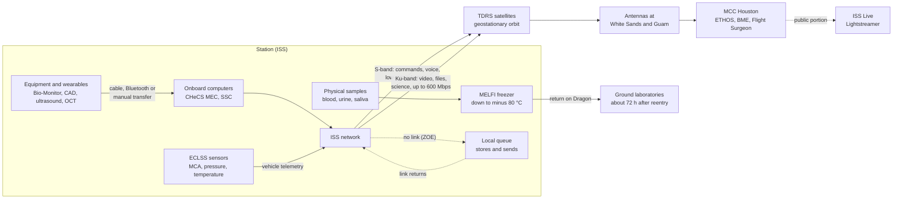

# 12. Open data sources

> For: Dev B (data and input) and Dev C (engine and ML).
> Prerequisite: [`06-data-model.md`](06-data-model.md) (entities and canonical units) and [`05-software-architecture.md`](05-software-architecture.md), section 3.2 (where the data comes from in the prototype).
> How to use: section 1 is the quick map. Section 2 details each source: owner, content, format, access, license, useful fields, use in the prototype and whether the research tested the endpoint. Sections 3 to 6 explain privacy, communication between station and ground, what is monitored in real time and the health software NASA uses. Section 7 says what the prototype uses as real and what it simulates.
> Main source: [`../pesquisa/bruto/06-dados-abertos-software-fluxo.md`](../pesquisa/bruto/06-dados-abertos-software-fluxo.md), verified on 15/11/2026. Complements: [`../pesquisa/bruto/01-eclss-ambiente-radiacao.md`](../pesquisa/bruto/01-eclss-ambiente-radiacao.md) (public telemetry and radiation) and [`../pesquisa/bruto/02-equipamentos-medicos-tripulacao.md`](../pesquisa/bruto/02-equipamentos-medicos-tripulacao.md) (medical equipment). Confidence labels as in [`00-reading-guide.md`](00-reading-guide.md).

---

## 1. Quick map

| Source | Owner | What it delivers | Access | Tested by the research? | Role in the prototype |
| --- | --- | --- | --- | --- | --- |
| OSDR, with GeneLab and ALSDA | NASA | Space biology studies and human research data, with metadata | Open (website, REST API, AWS); part controlled | Yes (API v2, OSD-575) | Examples of lab results and context; never live input |
| EDA (inside the OSDR) | NASA | Historical temperature, humidity, CO2 and radiation from ISS campaigns | Open, download | No | Historical environmental series as a fallback |
| RadLab (inside the OSDR) | NASA | Dose rate and flux per instrument, with orbital position | Open, API | Yes (DosTel) | Historical radiation series |
| NLSP, LSDA and LSAH | NASA, Johnson Space Center | Catalog of human research and longitudinal health surveillance | Open catalog; data by formal request | No | Catalog only and request for aggregated values |
| data.nasa.gov | NASA | Metadata catalog | Open | No | Discover datasets |
| NTRS | NASA | Technical reports and PDFs | Open, documented API | No | Reference for standards and limits |
| DONKI | NASA CCMC | Space weather events (FLR, SEP, CME, GST) | Open, REST JSON API | Yes (FLR, SEP, GST; old route returned 404) | Event context |
| NOAA SWPC | NOAA | GOES protons, Kp index, alerts and scales | Open, JSON | Yes (protons, Kp) | Live mode for space weather |
| ISS Live, via Lightstreamer | Lightstreamer, with a public NASA feed | Portion of the ECLSS and engineering telemetry | Open, push protocol | No; units disputed (see 2.7) | Optional live mode for the environment |
| Where the ISS at | Third party | Latitude, longitude, altitude, speed | Open, REST JSON | No | Orbital context |
| Analogs (HERA, SIRIUS, Antarctica, Mars-500, CHAPEA) | NASA, IBMP, ESA | Sleep, mood, cognition and physiology in isolation | Per study; usually by request | No | Inspiration for scenarios |
| Earth datasets (PhysioNet, MASS, REFUGE, OLIVES) | Universities and hospitals | EEG, EOG, ECG, fundus, OCT | Open with attribution or controlled | No | Real signal and imagery for the demo |

"Tested" means the research team opened the endpoint in November 2026 and recorded the response ([TESTED]). The recorded excerpts appear in the code blocks of section 2. The research noted fields and values, not the whole response: the blocks reproduce only what was noted and mark with `...` what was not copied.

---

## 2. Detailed catalog

### 2.1 OSDR, GeneLab and ALSDA

The NASA Open Science Data Repository (OSDR) integrates data that used to be separate in GeneLab and the Ames Life Sciences Data Archive (ALSDA). The ALSDA joined the GeneLab ecosystem in 2021 and the consolidated portal was launched in 2025. [OFFICIAL](https://science.nasa.gov/biological-physical/data/osdr/) [OFFICIAL](https://science.nasa.gov/science-research/biological-physical-sciences/osdr-and-psi-unveil-new-consolidated-website/)

| Item | Detail |
| --- | --- |
| Owner | NASA |
| What it contains | GeneLab: transcriptomics, genomics, epigenomics, proteomics, metabolomics. ALSDA: physiological, clinical research, behavioral and experiment data, including human data. Metadata in the ISA hierarchy (Investigation, Study, Assay) with accession, species, mission, dates, groups and protocols. [OFFICIAL](https://science.nasa.gov/reference/osdr-faq/) |
| Format | CSV, TSV and JSON tables; assay files in FASTQ, BAM, matrices, images and spreadsheets. There is no common schema: the name and unit of each field come from the accession dictionary. |
| Access | Website, REST API v2 without authentication for public metadata [OFFICIAL](https://visualization.osdr.nasa.gov/biodata/api/), and a copy in Amazon Web Services (AWS) S3 [OFFICIAL](https://registry.opendata.aws/nasa-osdr/). Astronaut sequence data may have controlled access [OFFICIAL](https://science.nasa.gov/reference/osdr-tutorials-requesting-controlled-access-datasets/). |
| License | There is no single license for the repository. Check the terms and license in each study and file record. [OFFICIAL](https://science.nasa.gov/reference/osdr-help-terms-and-conditions/) |
| Useful routes | `/v2/datasets/`, `/v2/dataset/{accession}/`, `/v2/dataset/{accession}/assays/`, `/v2/dataset/{accession}/files/`, `/v2/query/metadata/`, `/v2/query/samples/`, `/v2/query/assays/`, `/v2/query/data/`. The examples in the documentation are old; build the URL with a current accession and validate the response. The old API at osdr.nasa.gov (`/osdr/data/search`, `/osdr/data/osd/meta/{id}`) is legacy: do not use without testing. [OFFICIAL](https://visualization.osdr.nasa.gov/biodata/api/) |
| Use in the prototype | Example of how to show a lab result with unit and a window relative to the flight, marked as research. Never as a normative range or as a feed. |
| Tested | Yes. |

Excerpt recorded by the research [TESTED](https://visualization.osdr.nasa.gov/biodata/api/v2/dataset/OSD-575/):

```text
GET https://visualization.osdr.nasa.gov/biodata/api/v2/dataset/OSD-575/
Response: JSON with key "OSD-575" and REST links for metadata, assays and files
  accession .......... OSD-575
  data source type ... alsda
  mission ............ SpaceX Inspiration4 (16 to 18 September 2021)
  title .............. serum panel (metabolic panel, cytokines and cardiovascular panel)
  ...
```

Astronaut collections cited by the research:

| Collection | Content | Caution |
| --- | --- | --- |
| Inspiration4, OSD-575 | Serum metabolic panel (CMP), cytokines and cardiovascular panel, pre- and post-flight collections [TESTED](https://visualization.osdr.nasa.gov/biodata/api/v2/dataset/OSD-575/) [PAPER](https://www.nature.com/articles/s41586-024-07639-y) | Small commercial cohort; some outputs in normalized log2, not in clinical concentration |
| SOMA (Space Omics and Medical Atlas) | Atlas that integrates the Twins Study, Inspiration4 and other missions, with CBC, CMP, cytokines and multiomics [PAPER](https://www.nature.com/articles/s41586-024-07639-y) | It is a publication, not an API or a single license; use the cited accessions |
| NASA Twins Study | One astronaut on a long flight and the twin on the ground, multiomics, cognition, physiology [OFFICIAL](https://www.nasa.gov/twins-study-the-research/) | N equals 1; part has restricted access |
| Axiom and Polaris Dawn | Cited in the SOMA [PAPER](https://www.nature.com/articles/s41586-024-07639-y) | **NOT FOUND:** a single catalog confirming open publication of all clinical data |

### 2.2 EDA and RadLab (historical environment and radiation)

| Item | EDA (Environmental Data Application) | RadLab |
| --- | --- | --- |
| Owner | NASA, inside the OSDR [OFFICIAL](https://visualization.osdr.nasa.gov/eda/) | NASA, inside the OSDR [OFFICIAL](https://visualization.osdr.nasa.gov/radlab/gui/overview/) |
| What it contains | Historical environmental telemetry from ISS experiments: cabin, hardware and radiation from selected campaigns | Radiation measurements from several instruments, including ISS series |
| Format | CSV, Excel and PDF export | API with JSON, CSV, TSV or HTML output [OFFICIAL](https://visualization.osdr.nasa.gov/radlab/gui/data-api/) |
| Fields and units | `Controller_Time_GMT`, ground and ISS temperature in °C, relative humidity in %, CO2 in ppm; some tables carry GCR, SAA, total or accumulated dose [OFFICIAL](https://github.com/nasa/OSDR_Tutorials/blob/main/source/pages/guides/environmental_data_application.md) | `timestamp`, `spacecraft`, `module`, `instrument`, `instrument_id`, `absorbed_dose_rate` in µGy/h, `dose_equivalent_rate` in µSv/h, `flux` in cm⁻² sr⁻¹ s⁻¹, latitude and longitude in degrees, altitude in km, magnetic field in nT, L coordinate unitless [OFFICIAL](https://visualization.osdr.nasa.gov/radlab/gui/data-api/) |
| Cadence | Varies by mission and device; there is no universal frequency | Varies by dataset: DORELI about 5 min; Liulin-5 20 s near the SAA and 90 s outside it; some datasets aggregated over 24 h; part marked as preliminary [OFFICIAL](https://visualization.osdr.nasa.gov/radlab/gui/knowledgebase/Release_history) |
| Access and license | Open; OSDR rules apply per dataset | Open for the records made available |
| Limit | It is not a live sensor or a universal ISS series; the documented example is the Rodent Research-1 mission (2014) [OFFICIAL](https://github.com/nasa/OSDR_Tutorials/blob/main/source/pages/guides/environmental_data_application.md) | An area instrument dose is not an individual crew member dose nor a forecast |
| Use in the prototype | Recorded fallback file for the environment panel, with mission, time and origin visible | Historical dose rate series (matches the canonical unit µGy/h of `docs/06`) |
| Tested | No | Yes |

Attention to conversion: the EDA reports CO2 in ppm, but the canonical unit in `docs/06` is partial pressure in mmHg. Convert only when the total cabin pressure is known ([`04-data-cross-referencing.md`](04-data-cross-referencing.md), A1). [OFFICIAL](https://standards.nasa.gov/standard/NASA/NASA-STD-3001_VOL_2)

Excerpt recorded by the research [TESTED](https://visualization.osdr.nasa.gov/radlab/api/?spacecraft=ISS&instrument=DosTel&timestamp%3E=2022-04-01T23%3A00&timestamp%3C2022-04-02T01%3A05&absorbed_dose_rate%3E2&format=json):

```text
GET https://visualization.osdr.nasa.gov/radlab/api/?spacecraft=ISS&instrument=DosTel&timestamp%3E=2022-04-01T23%3A00&timestamp%3C2022-04-02T01%3A05&absorbed_dose_rate%3E2&format=json
Window: 2022-04-01 23:00 to 2022-04-02 01:05 UTC
Response: JSON
  columns: timestamp, instrument_id, absorbed_dose_rate, instrument, spacecraft
  first row: instrument_id = DosTel2 ; absorbed_dose_rate = 10.2160856666667  (µGy/h)
  ...
```

### 2.3 NLSP, LSDA and LSAH (human data with controlled access)

| Source | Owner and content | Access | Use in the prototype |
| --- | --- | --- | --- |
| NASA Life Sciences Portal (NLSP) | Discovery portal for Human Research Program (HRP) investigations, the LSDA, data requests and longitudinal health files [OFFICIAL](https://nlsp.nasa.gov/) | Web search; download depending on the access class; own request flow | Catalog; never live input |
| Life Sciences Data Archive (LSDA) | Johnson Space Center archive with flight and analog studies since the first crewed missions; it is not a medical record [OFFICIAL](https://www.nasa.gov/missions/station/open-source-science-opportunities/) | Descriptions and non-identifiable data can be downloaded; sensitive data requires a formal request | Request aggregated statistics, if needed |
| Lifetime Surveillance of Astronaut Health (LSAH) | Longitudinal surveillance of astronaut occupational health [OFFICIAL](https://nlsp.nasa.gov/) | No public download of individual clinical data; request with review [OFFICIAL](https://nlsp.nasa.gov/explore/lsdahome/datarequest) | Do not assume access; use synthetic data |

How to request data from the LSDA or LSAH, according to NASA's retrospective request guide [OFFICIAL](https://www.nasa.gov/wp-content/uploads/2015/05/hrp_retrospective_data_request_study_information_package_guidelines_final.pdf):

1. Open the request through the NLSP with justification, minimum scope, and the fields and sample needed.
2. Prefer grouped or de-identified data; it is the simplest path.
3. Data attributable to one person may require the astronaut's written consent, an opinion from the Evidence Book Working Group (EBWG), the LSAH advisory board and the Johnson Space Center Institutional Review Board (IRB).
4. Approval may come limited: it does not release the whole record or every variable. Combinations of mission, duration and sex can re-identify someone.

Two concrete cases: the processed and anonymized Artemis II results may be requested from the LSDA [OFFICIAL](https://science.nasa.gov/missions/artemis/artemis-2/nasas-artemis-ii-moon-mission-research-continues-on-earth/); the Bio-Monitor commissioning data were not archived in the LSDA [OFFICIAL](https://nlsp.nasa.gov/search/data/details/f9f4485d-656c-5980-9a5f-4f57c7ba383a?dataType=EXPERIMENTS).

### 2.4 data.nasa.gov and NTRS

| Item | data.nasa.gov | NASA Technical Reports Server (NTRS) |
| --- | --- | --- |
| What it is | Metadata catalog of NASA datasets: title, description, organization, tags and links. It is an index; the data lives in another service [OFFICIAL](https://data.nasa.gov/) | Catalog of technical reports, papers and presentations, with abstract, authors, date and PDF when released [OFFICIAL](https://ntrs.nasa.gov/) |
| Access | Search by tags such as astronaut, ECLSS and ISS | Documented public API [OFFICIAL](https://sti.nasa.gov/docs/STI_Open_API_Documentation_20210426.pdf); distribution varies by record (public, restricted, no file) |
| License | That of the source file; the catalog's does not replace it | Check the distribution field of each record |
| Use in the prototype | Find datasets and keep the citation | Source of the standards, manuals and histories cited in `docs/` |

A useful example found via the catalog: the 10-second dataset of the ISS TEPC counter [OFFICIAL](https://catalog.data.gov/dataset/iss-tissue-equivalent-proportional-counter-tepc-dose-analyzer-10-s-data).

### 2.5 api.nasa.gov and DONKI (space weather events)

The Space Weather Database Of Notifications, Knowledge, Information (DONKI) belongs to NASA's Community Coordinated Modeling Center (CCMC). It records flares (FLR), Solar Energetic Particles (SEP), coronal mass ejections (CME) and geomagnetic storms (GST), with intervals, class, instruments and links. [OFFICIAL](https://ccmc.gsfc.nasa.gov/tools/DONKI/)

| Item | Detail |
| --- | --- |
| Current endpoint | `https://ccmc.gsfc.nasa.gov/DONKI-API/get/{TIPO}`. On 30/09/2026 the API moved to this host; the event paths remain the same [OFFICIAL](https://ccmc.gsfc.nasa.gov/news/major-updates/) |
| Old route | The URL `api.nasa.gov/DONKI/...` returned 404 in this research's test. Do not use in new code |
| Format | JSON |
| Useful fields | `eventType`, `beginTime`, `peakTime`, `endTime`, `classType`, `instruments`, `linkedEvents`, `link` |
| Quality | The CCMC itself qualifies the near real-time information as prototyping and research, with no operational guarantee. For alerts, prioritize NOAA [OFFICIAL](https://ccmc.gsfc.nasa.gov/tools/DONKI/) |
| Use in the prototype | `EventoClimaEspacial` with `tipo` FLR, SEP, CME or GST and `fonte: "NASA_DONKI"` (`docs/06`, 2.10) |

Excerpts recorded by the research on 15/11/2026 [TESTED](https://ccmc.gsfc.nasa.gov/DONKI-API/get/FLR?startDate=2024-05-01&endDate=2024-05-03):

```text
GET https://ccmc.gsfc.nasa.gov/DONKI-API/get/FLR?startDate=2024-05-01&endDate=2024-05-03
Response: JSON
  event ......... 2024-05-01T05:53:00-FLR-001
  beginTime, peakTime, endTime ... (values not copied)
  classType ..... C5.3
  instruments, active region, event link ... (present)

GET https://ccmc.gsfc.nasa.gov/DONKI-API/get/SEP  (same window)
Response: []   (empty list)

GET https://ccmc.gsfc.nasa.gov/DONKI-API/get/GST  (same window)
Response: storm epoch and Kp series

GET api.nasa.gov/DONKI/...  (old route)
Response: 404
```

### 2.6 NOAA SWPC: GOES protons, Kp and alerts

NOAA's Space Weather Prediction Center (SWPC) publishes open products in JSON. It is the preferred source for space weather alerts. Attention: in 2026 the SWPC published a notice of format changes, so the adapter must validate the schema and the time. [OFFICIAL](https://www.weather.gov/media/notification/pdf_2026/scn26-21_Data_Format_Changes_Impacting_SWPC_Products.pdf)

| Product | Endpoint | Fields and unit | Tested |
| --- | --- | --- | --- |
| GOES integral proton flux, 1 day | `https://services.swpc.noaa.gov/json/goes/primary/integral-protons-1-day.json` [OFFICIAL](https://www.swpc.noaa.gov/products/goes-proton-flux) | `time_tag`, `satellite`, `flux` in pfu (particles per cm² per s per sr), `energy` | Yes |
| Planetary Kp index, 1 minute | `https://services.swpc.noaa.gov/json/planetary_k_index_1m.json` [OFFICIAL](https://services.swpc.noaa.gov/json/planetary_k_index_1m.json) | `time_tag`, `kp_index`, `estimated_kp`, `kp` | Yes |
| Alerts, watches and warnings | `/products/alerts.json` (the route `/json/alerts.json` does not exist in the index) [OFFICIAL](https://www.swpc.noaa.gov/products/alerts-watches-and-warnings) | Issue time, product code, variable text | No |
| Official scales | `/products/noaa-scales.json` [OFFICIAL](https://services.swpc.noaa.gov/products/) | S (radiation) and G (geomagnetic) scales | No |

No SLA is cited for the feeds. [OFFICIAL](https://www.swpc.noaa.gov/products/goes-proton-flux)

S radiation storm scale, 10 MeV channel [OFFICIAL](https://www.swpc.noaa.gov/products/notifications-timeline):

| Level | S1 | S2 | S3 | S4 | S5 |
| --- | --- | --- | --- | --- | --- |
| Flux ≥10 MeV | 10 pfu | 100 pfu | 1,000 pfu | 10,000 pfu | 100,000 pfu |

Excerpts recorded by the research [TESTED](https://services.swpc.noaa.gov/json/goes/primary/integral-protons-1-day.json) [TESTED](https://services.swpc.noaa.gov/json/planetary_k_index_1m.json):

```text
GET https://services.swpc.noaa.gov/json/goes/primary/integral-protons-1-day.json
Response: list of objects with time_tag, satellite, flux, energy
  energy values present in the rows: ">=1 MeV", ">=10 MeV", ...

GET https://services.swpc.noaa.gov/json/planetary_k_index_1m.json
Response: list of objects with time_tag, kp_index, estimated_kp, kp
  row of 14/11/2026: estimated_kp = 1.33 ; kp = "1P"
```

Interpretation rule: GOES flux and Kp describe the space environment outside the station. Do not convert flux into a predicted dose for anyone inside the ISS. Scenario C2 in `docs/05` uses the crossing of the S1 threshold. [OFFICIAL](https://www.swpc.noaa.gov/products/goes-proton-flux)

### 2.7 ISS Live, via Lightstreamer (public station telemetry)

NASA made a selected portion of the ISS telemetry public, described as a subset of the more than 100 thousand items. Access is through the server `push.lightstreamer.com`, adapter set `ISSLIVE`; the client subscribes to individual items and receives the `Value` field. [SECONDARY](https://lightstreamer.com/customer-story/how-nasa-is-using-lightstreamer/) [SECONDARY](https://github.com/Lightstreamer/Lightstreamer-example-ISSLive-client-javascript)

| Item | Detail |
| --- | --- |
| Owner | Lightstreamer, relaying a public NASA feed |
| Format | Push protocol; Lightstreamer JavaScript client or a compatible library. The client can limit frequency per item |
| Cadence | Varies by item; no single rate or SLA |
| Dictionary | **NOT FOUND:** an official NASA dictionary with identifier, unit, calibration and frequency. Only community maps (ISS-Mimic) and the dictionary of the example project (`PUIList.xml`) exist [SECONDARY](https://iss-mimic.github.io/Mimic/) [SECONDARY](https://github.com/Lightstreamer/Lightstreamer-example-ISSLive-client-javascript/blob/master/src/assets/PUIList.xml) |
| What it lacks | An easy public item for relative humidity, personal dose, noise, lux, microbiology or body temperature; no vital signs [SECONDARY](https://iss-mimic.github.io/Mimic/) |
| Use in the prototype | Optional "live" mode of the environment panel, behind a selector, with a recorded fallback file (rule 4 of [`../AGENTS.md`](../AGENTS.md)) |
| Tested | No |

Most useful items according to the community maps (workstream 1 of the research) [SECONDARY](https://iss-mimic.github.io/Mimic/) [SECONDARY](https://github.com/joepavitt/node-red-iss-data-streamer):

| ID in the feed | Description | Module on the map | Unit on the ISS-Mimic map | Unit in the `PUIList.xml` dictionary |
| --- | --- | --- | --- | --- |
| USLAB000053 / NODE3000001 | ppO2 | US Lab / Node 3 | torr | psia |
| USLAB000054 / NODE3000002 | ppN2 | US Lab / Node 3 | torr | psia |
| USLAB000055 / NODE3000003 | ppCO2 | US Lab / Node 3 | torr | psia |
| USLAB000058 | Cabin pressure | US Lab | torr (scale to be confirmed) | not detailed in the raw research |
| USLAB000059 | CCAA inlet temperature | US Lab | °C | CNT in "certain subsystems" |
| NODE3000010 / NODE3000011 | OGA state / O2 production | Node 3 | enumerated code / lb per day | LBM/D |
| NODE3000005, 8, 9 | UPA and WPA tank levels | Node 3 | percent, unit not confirmed | percent |

Reading cautions: the IDs indicate the item's group, not the physical position of the sensor; the OGA returned to the US Lab in 2022, so NODE3000010/11 may be historical items or mirrors [OFFICIAL](https://ntrs.nasa.gov/api/citations/20240007995/downloads/ICES2024141%20ISS%20ECLS%20Presentaton%20RevA.pdf). Equipment state (OGA in PROCESS) does not prove adequate ppO2.

#### 2.7.1 Recorded divergence: unit of the pressure items

The two research workstreams disagree about the unit of the partial pressure items:

| Workstream | Source | What it says |
| --- | --- | --- |
| Workstream 1 ([`01-eclss-ambiente-radiacao.md`](../pesquisa/bruto/01-eclss-ambiente-radiacao.md), D4) | ISS-Mimic community map [SECONDARY](https://iss-mimic.github.io/Mimic/) | ppO2, ppN2, ppCO2 and cabin pressure in **torr** |
| Workstream 6 ([`06-dados-abertos-software-fluxo.md`](../pesquisa/bruto/06-dados-abertos-software-fluxo.md), 1.3) | Dictionary of the Lightstreamer example project [SECONDARY](https://github.com/Lightstreamer/Lightstreamer-example-ISSLive-client-javascript/blob/master/src/assets/PUIList.xml) | ppO2, ppN2 and ppCO2 of the nodes and laboratory in **psia** |

Both sources are secondary and neither is an official dictionary. The same disagreement appears, smaller, in the temperatures (°C on the community map, CNT in the project dictionary). **Resolved by workstream 11 with 2 hours of real samples (15/11/2026):** by order of magnitude, the pressure items **are not in psia**; they are compatible with torr or mmHg, which in practice are the same scale. The laboratory CO2 partial pressure (`USLAB000055`) had a median of 2.44, consistent with mmHg. The temperatures remain in doubt between °C and counts (CNT), and the tanks were left without a confirmed unit. The ISS Live adapter stores `valorOriginal` and `unidadeOriginal`, treats the pressures as mmHg and does not generate a threshold color from the temperatures and tanks. Details, per-item cadence and feed gaps in [`../pesquisa/bruto/11-amostras-reais.md`](../pesquisa/bruto/11-amostras-reais.md); files in `prototipo/dados/amostras-reais/`.

Hint for workstream 11 [INFERENCE, with the conversions of [`04-data-cross-referencing.md`](04-data-cross-referencing.md), A1: 1 psia = 6.89476 kPa = 51.71 mmHg; the research treats torr and mmHg as equivalent]: the order of magnitude of the sample separates the hypotheses.

| Item | Expected value if torr | Expected value if psia | Basis |
| --- | --- | --- | --- |
| ppCO2 | about 1.7 to 2.1 (readings published for part of 2025) | about 0.033 to 0.041 | [OFFICIAL](https://www.nasa.gov/wp-content/uploads/2023/12/ochmo-tb-004-carbon-dioxide.pdf) [OFFICIAL](https://www.nasa.gov/missions/station/iss-research/science-in-space-august-4-2023-spacecraft-air-quality/) |
| ppO2 | about 146 to 171 | about 2.82 to 3.3 (generic NASA requirement) | [OFFICIAL](https://ntrs.nasa.gov/api/citations/20170001943/downloads/20170001943.pdf?__source=newsletter%7Cspacenewsletter) |
| Cabin pressure | about 760 | about 14.7 (nominal ISS) | [OFFICIAL](https://www.nasa.gov/wp-content/uploads/2023/08/np-2022-06-009-jsc-iss-tech-demo-mini-book-proof-3.pdf) |

### 2.8 ISS position

| Item | Detail |
| --- | --- |
| Source | Where the ISS at, third-party service [SECONDARY](https://wheretheiss.at/w/developer) |
| Fields | Latitude, longitude, altitude, speed, timestamp |
| Access | Open REST JSON; availability depends on the provider. Open Notify is a legacy API, with no confirmation of support |
| Use in the prototype | Orbital context (for example, passage through the South Atlantic Anomaly, SAA) |
| Limit | Position is not dose. Correlate with a RadLab dosimeter when there is a measurement; never infer individual exposure from latitude and longitude alone |

### 2.9 Analog data (ground-based isolation)

| Analog | Owner | What it has | Access and license | Use and limit |
| --- | --- | --- | --- | --- |
| Human Exploration Research Analog (HERA), not to be confused with the HERA radiation detector | NASA Johnson | Weekly questionnaires, cortisol, actigraphy, cognition [OFFICIAL](https://ntrs.nasa.gov/api/citations/20240011157/downloads/NASA%20TM20240011157.pdf) | Per study in the LSDA, by request [OFFICIAL](https://humanresearchroadmap.nasa.gov/gaps/gap.aspx?i=700) | Sleep and mood trend in isolation; small sample, no microgravity |
| NEK and SIRIUS | IBMP with NASA HRP | Physiology, immunology, psychology, telemedicine [OFFICIAL](https://www.nasa.gov/mission-nek-and-sirius-faqs/) | Results by publication; **NOT FOUND** a complete open catalog | Team questionnaires; mark as an analog |
| Antarctic winter | NASA and partners | Behavior and sleep [OFFICIAL](https://nlsp.nasa.gov/search/data/details/6e611fcf-06df-5ef0-b76d-7862f6c1b499?dataType=EXPERIMENTS) | Formal request through the NLSP | Compare self-report and actigraphy |
| Mars-500 | IBMP, data in the ESA HREDA | Autonomic cardiovascular control; activity, performance and mood (2009 to 2012) [OFFICIAL](https://esdcdoi.esac.esa.int/doi/html/data/hre/hreda/21903430-ae04-4969-9e49-0dc629c30968.html) | Datasets with DOI; license CC BY-NC 3.0 IGO [OFFICIAL](https://esdcdoi.esac.esa.int/doi/html/data/hre/hreda/feb2804b-34e9-4c4d-8cb8-0ca7a44d01aa.html) | Validate import of long series; non-commercial use |
| CHAPEA | NASA | Physical and behavioral health, sleep, mission 2 ended on 31/10/2026 [OFFICIAL](https://www.nasa.gov/missions/analog-field-testing/chapea/chapea-mission-2-crew-reflects-after-378-days-on-simulated-mars/) | **NOT FOUND:** public release of individual records | Only synthetic scenario inspiration |

### 2.10 Earth datasets of signals and images

These are data from people on Earth. They serve to test file reading, charts, annotation and the pipeline; they do not represent astronauts and do not authorize diagnosis. [OFFICIAL](https://physionet.org/)

| Dataset | Signal | Format and rate | Access and license | Use in the prototype |
| --- | --- | --- | --- | --- |
| Sleep-EDF Expanded (PhysioNet) | EEG, EOG, EMG, hypnograms; 197 nights [OFFICIAL](https://physionet.org/content/sleep-edfx/1.0.0/) | EDF/EDF+; EEG and EOG at 100 Hz | Open, ODC-By 1.0 (attribution required) [OFFICIAL](https://physionet.org/content/sleep-edfx/view-license/1.0.0/) | **Chosen:** precomputed hypnogram of the Orbit glasses (`docs/05`, 3.2) |
| Sleep Heart Health Study PSG (PhysioNet) | EEG, EOG, EMG, ECG, SaO2, HR [OFFICIAL](https://physionet.org/content/shhpsgdb/1.0.0/) | EEG 125 Hz, EOG 50 Hz, ECG 125 or 250 Hz, SaO2 1 Hz [OFFICIAL](https://archive.physionet.org/standards/npsg/Loparo.pdf) | Open, ODC-By 1.0 [OFFICIAL](https://physionet.org/content/shhpsgdb/view-license/1.0.0/) | Example of SpO2 and EOG; apnea cohort over 40 years of age |
| MASS (CÉAMS) | EEG, EOG, ECG, EMG [OFFICIAL](https://ceams-carsm.ca/MASS/) | EDF++; 256 Hz [PAPER](https://onlinelibrary.wiley.com/doi/10.1111/jsr.12169) | Biosignals require a proposal and ethical approval | Only with approval; do not redistribute |
| MIT-BIH Arrhythmia (PhysioNet) | ECG, 48 records of 30 min [OFFICIAL](https://physionet.org/content/mitdb/1.0.0/) | WFDB; 360 samples/s per channel, 11 bits, 10 mV | Open, ODC-By 1.0 [OFFICIAL](https://physionet.org/content/mitdb/view-license/1.0.0/) | Optional ECG trace; arrhythmias rare on purpose |
| MIMIC-IV (PhysioNet) | ICU vital signs [OFFICIAL](https://physionet.org/content/mimiciv/3.1/) | Tables | Controlled: credentialing, CITI and Data Use Agreement [OFFICIAL](https://physionet.org/about/faqs/) | **Do not use** in the demo |
| REFUGE | Fundus, 1,200 JPEG images [OFFICIAL](https://refuge.grand-challenge.org/Details/) | JPEG with glaucoma labels | Redistribution license unclear: verify | Image upload demo, if the license allows |
| OLIVES (Zenodo) | OCT and fundus; 78,283 B-scans of 96 eyes [PAPER](https://papers.neurips.cc/paper_files/paper/2022/file/3be60b4a739b95a07a944a1a2c41e05e-Paper-Datasets_and_Benchmarks.pdf) | Images and label tables [OFFICIAL](https://zenodo.org/records/7105232) | CC BY 4.0, according to the paper [PAPER](https://papers.neurips.cc/paper_files/paper/2022/file/3be60b4a739b95a07a944a1a2c41e05e-Supplemental-Datasets_and_Benchmarks.pdf) | OCT image for scenario C3; diabetic disease, not SANS |

---

## 3. Privacy and access to astronaut medical data

NASA-STD-3001 requires that health, behavioral health and exam records be maintained, stored and transmitted securely, and be retrievable for longitudinal analysis. The justification cites the Privacy Act of 1974 (5 U.S.C. §552a): individual information is not disclosed without consent. [OFFICIAL](https://www.nasa.gov/reference/7-0-crew-health-records/) [OFFICIAL](https://www.nasa.gov/wp-content/uploads/2023/11/nasa-std-3001-vol-1-rev-c-with-signature.pdf) International partners may add rules. [OFFICIAL](https://www.nasa.gov/wp-content/uploads/2025/08/ochmo-tb-044-medical-operations.pdf)

| Level | Examples | Who accesses |
| --- | --- | --- |
| Public | Historical environment and radiation (EDA, RadLab), space weather (NOAA, DONKI), ISS Live telemetry, open OSDR metadata and files, open Earth datasets | Anyone, respecting the license of each file |
| Aggregated or de-identified | Processed study data (Inspiration4), LSDA descriptions, anonymized Artemis II results on request | Researcher, with terms of use and citation |
| Restricted | LSAH record and history, identifiable data, astronaut genetic sequences, content of private medical and psychological conferences | Only with consent, ethical review and approval; often never |

The project's initial document summarized the general rule well ("aggregates free, individual by request and ethics committee"). The research adds that even combinations of variables can re-identify someone. [OFFICIAL](https://www.nasa.gov/wp-content/uploads/2015/05/hrp_retrospective_data_request_study_information_package_guidelines_final.pdf)

Access by role in real operations [OFFICIAL](https://www.nasa.gov/directorates/esdmd/hhp/flight-surgeons/) [OFFICIAL](https://www.nasa.gov/directorates/esdmd/hhp/biomedical-flight-controllers/):

| Profile | Needs | Should not receive |
| --- | --- | --- |
| Crew member | Their own data, trends, self-assessments, consent | A colleague's record or notes without authorization |
| Crew Medical Officer (CMO) | A colleague's data when the role and the care authorize it | Free access to everyone |
| Flight Surgeon and International Medical Group | Crew health within the scope and agreements | Automatic replication to all of flight control |
| Biomedical Engineer (BME) | Biomedical, environmental and hardware data to operate and escalate | Clinical and behavioral health notes |
| Flight Director | Operational state and mission risk | Clinical detail beyond what is necessary |
| Researcher and public | Aggregated and approved dataset | Direct identifier or re-identifiable combination |

Consequences for the software [INFERENCE, supported by the recommendation of NASA's MDA architecture](https://ntrs.nasa.gov/api/citations/20220017869/downloads/HRP-48032%20ExMC%20CDSS%20Architecture%20Recommendation%20Rev%20B.pdf):

1. **No real astronaut data in the prototype.** Crew members with fictional codenames (`Tripulante.codinome` in `docs/06`) and simulated vital signs.
2. **Filter in the engine, before the screen.** The Monitor geral (T1, general monitor) shows each colleague according to `Tripulante.compartilhamento` (rule 9 of [`../AGENTS.md`](../AGENTS.md); profiles in `docs/05`, section 7).
3. **Least privilege and audit trail.** Separate profiles, query and change log, consent and scope stored.
4. **Separate the raw signal from the derived alert** and never overwrite a reading: correct with a new version.
5. **Free text and private conversations** (PMC, PPC, diary) stay out of any shared screen.
6. **Local and in-transit encryption** and a sync package resilient to connection loss (section 4) in the operational view.

---

## 4. Data flow between station and ground

The ISS talks to the ground through NASA's Space Network: Tracking and Data Relay Satellite (TDRS) satellites in geostationary orbit, antennas at White Sands and Guam, and forwarding to the Mission Control Center in Houston (MCC-H). This gives near-continuous coverage. Since 8/11/2024 NASA no longer assigns new missions to the TDRS, but it still serves the ISS. [OFFICIAL](https://www.nasa.gov/missions/station/the-space-network-cell-towers-for-astronauts/) [OFFICIAL](https://www.nasa.gov/missions/tdrs/tdrs-generations-of-spacecraft/)



| Channel | Use | Capacity and caution |
| --- | --- | --- |
| S-band | Commands, voice, telemetry; robust and redundant channel | Historical specification: return up to 192 kbps and forward up to 72 kbps [OFFICIAL](https://ntrs.nasa.gov/api/citations/20030001141/downloads/20030001141.pdf) |
| Ku-band | Video, files, science, high rate | Capacity increased to 600 Mbps in 2019; tests emulate a 500 Mbps link, shared among users [OFFICIAL](https://www.nasa.gov/missions/station/data-rate-increase-on-the-international-space-station-supports-future-exploration/) [OFFICIAL](https://ntrs.nasa.gov/citations/20240007078) |
| Signal loss | Structure, pointing and satellite handover create the Zone of Exclusion (ZOE) | A historical manual estimates Ku coverage of about 70% of each orbit; it serves only to show that the link is not 100% [OFFICIAL](https://ntrs.nasa.gov/api/citations/20030001141/downloads/20030001141.pdf) |

How medical data travels today: collected on the equipment, loaded by cable, local network, app or typing, associated with the CHeCS record and sent to the ground. Some devices transmit over the ISS network; others need manual transfer. NASA acknowledges that health data used to be in different formats and places and that part was downloaded by hand. [OFFICIAL](https://humanresearchroadmap.nasa.gov/gaps/gap.aspx?i=639) Medical voice uses the weekly Private Medical Conference (PMC), with the BME acting as the bridge. [OFFICIAL](https://www.nasa.gov/directorates/esdmd/hhp/flight-surgeons/) Physical samples do not travel as a file: they go frozen and return in a capsule; NASA records delivery to researchers about 72 hours after reentry. [OFFICIAL](https://www.nasa.gov/wp-content/uploads/2015/02/human_adaptation_2021_final.pdf)

Communication delay by destination (matches `Missao.atrasoComunicacaoSeg` in `docs/06`):

| Destination | Delay and interruptions | Consequence |
| --- | --- | --- |
| ISS, low orbit | Under one second from a human point of view; network tests used an emulated 600 ms round trip [OFFICIAL](https://www.nasa.gov/missions/station/the-space-network-cell-towers-for-astronauts/) [OFFICIAL](https://ntrs.nasa.gov/citations/20240007078) | Near real-time conversation with the flight surgeon |
| Moon, Orion | Light takes about 1.3 s per leg; a NASA study estimates command 2.7 s (worst case 3.9 s), voice and video 5.6 to 6.5 s, telemetry 5.9 to 8.6 s [PAPER](https://science.nasa.gov/wp-content/uploads/2023/05/188_fed0ad8278e728107533d509b24dc68b_SmithsimmonsDrew.pdf) [OFFICIAL](https://ntrs.nasa.gov/api/citations/20250003885/downloads/NASA%20TM20250003885.pdf) | Procedures with local context, without depending on continuous dialogue |
| Mars | About 4 to 24 minutes per leg; another study evaluates up to 22 min per leg and 44 min round trip [OFFICIAL](https://ntrs.nasa.gov/api/citations/20220002905/downloads/NESC-RP-20-01589_NASA-TM-20220002905final.pdf) [OFFICIAL](https://ntrs.nasa.gov/api/citations/20250003885/downloads/NASA%20TM20250003885.pdf) | Initial assessment and urgent care done onboard |
| Mars solar conjunction | About once every 26 months; a blackout of about two weeks, with analyses citing two to three [OFFICIAL](https://science.nasa.gov/blog/hunkering-down-for-solar-conjunction/) [OFFICIAL](https://www.nasa.gov/wp-content/uploads/2024/01/mars-communications-disruption-and-delay.pdf) | The crew operates alone for weeks |

**EIMO.** Earth-Independent Medical Operations is the gradual transfer of medical decisions to onboard resources, as delay, interruption and the impossibility of evacuation grow. NASA describes the ISS as dependent on the ground in near real time and researches a Clinical Decision Support System (CDSS) for more autonomous missions. [OFFICIAL](https://ntrs.nasa.gov/citations/20240001402) [OFFICIAL](https://www.nasa.gov/centers-and-facilities/ames/ames-science/ames-space-biosciences/a-clinical-decision-support-system-for-earth-independent-medical-operations/) For Orbit Health, this justifies the offline-first principle (P1 in `docs/05`): display, store and alert without a network; when a link exists, synchronize by attaching observation time and receipt time, without overwriting the local history. The prototype cannot claim equivalence to a certified CDSS. [INFERENCE](https://ntrs.nasa.gov/citations/20220017869)

---

## 5. Real-time monitoring today

**The environment is continuous; the crew's vital signs are not.**

- **Continuous: environment.** The ECLSS controls air, water, ventilation and pressure. In the MCC, the Environmental and Thermal Operating Systems (ETHOS) position tracks environmental and thermal systems, including oxygen, nitrogen and water; ETHOS is a control position, not a software name. [OFFICIAL](https://www.nasa.gov/reference/environmental-control-and-life-support-systems-eclss/) [OFFICIAL](https://ntrs.nasa.gov/api/citations/20160012370/downloads/20160012370.pdf) The BME, technical representative of the CHeCS, monitors bioenvironmental data such as CO2 and O2 in real time and forwards physiological and hardware data to the specialists. [OFFICIAL](https://www.nasa.gov/directorates/esdmd/hhp/biomedical-flight-controllers/) The ETHOS supervisory software is not public. [OFFICIAL](https://ntrs.nasa.gov/api/citations/20250003953/downloads/ICES-2025-125%20Final_Rev%20C.pdf)
- **Not continuous: vital signs.** There is no continuous monitoring of all vital signs of each astronaut in the ISS routine. NASA describes separate medical devices, used periodically. [OFFICIAL](https://www.nasa.gov/glenn/glenn-expertise-space-exploration/human-health-performance/exploration-medical-technologies/multifunctional-integrated-medical-devices/) The Spaceflight Standard Measures provides for scheduled collections. [OFFICIAL](https://ntrs.nasa.gov/citations/20210022783)

| Exception | What is monitored | Limit |
| --- | --- | --- |
| Extravehicular activity (EVA) | ECG and heart rate, measured or estimated metabolism, suit state, pressure, O2 consumed, suit CO2; historically, metabolic rate estimated every 2 minutes [OFFICIAL](https://standards.nasa.gov/sites/default/files/standards/NASA/B/0/nasa-std-3001_vol_2_rev_b.pdf) [PAPER](https://ntrs.nasa.gov/citations/20210024317) | Only during the EVA and in the suit; Russian Orlan: **NOT FOUND** |
| Exercise | ECG or HR, performance and prescription, via OnePortal and CHeCS [OFFICIAL](https://www.nasa.gov/reference/jsc-exercise-countermeasures/) | Per session |
| Medical emergency | ECG, pressure, SpO2, temperature, ultrasound according to the kit [OFFICIAL](https://www.nasa.gov/wp-content/uploads/2025/08/ochmo-tb-044-medical-operations.pdf) | Triggered by symptom |
| Bio-Monitor sessions | ECG, respiration, skin temperature, SpO2, activity, up to 48 h [OFFICIAL](https://www.asc-csa.gc.ca/eng/sciences/bio-monitor.asp) | Research; download after the session |
| Launch and landing | Medical support prepared; historically ECG in these phases [OFFICIAL](https://www.nasa.gov/reference/medical-operations-and-clinical-care/) | Not confirmed for all current capsules |
| Sleep and activity | Actigraphy in studies; on Artemis II, wristbands recorded movement and sleep continuously [OFFICIAL](https://www.nasa.gov/reference/archer/) | Actigraphy is not a vital sign |
| Smart Flight Suit 2 | ECG vest and pressure and temperature wristband, 2024 demonstration [OFFICIAL](https://www.nasa.gov/blogs/stationreport/2024/01/25/iss-daily-summary-report-1-25-2024/) | Demonstration, not a permanent system |

For the data model, this is the reason for `Leitura.disponibilidade` and `instanteDisponivelUtc` in `docs/06`: most body data arrives hours or months after it was measured.

---

## 6. NASA health software

Reading the status: "confirmed" when a recent NASA source shows use; "last evidence" when the source is historical; "not confirmed" when there was no public proof of use in 2025 or 2026. [OFFICIAL](https://ntrs.nasa.gov/api/citations/20250005232/downloads/International%20Space%20Station%20Familiarization.pdf)

| Name | Function | Who developed it | Since when | Still in use? | Replaced or succeeded |
| --- | --- | --- | --- | --- | --- |
| CHeCS and Medical Equipment Computer (MEC) | Onboard health architecture; the MEC is a laptop with medical operations software for records and transfer [OFFICIAL](https://ntrs.nasa.gov/api/citations/20090021477/downloads/20090021477.pdf) | NASA JSC; software vendor not named | 2008 and 2011 catalogs (IBM A31p laptops) | Function confirmed in 2025; current version not public [OFFICIAL](https://ntrs.nasa.gov/api/citations/20250005232/downloads/International%20Space%20Station%20Familiarization.pdf) | No announcement of a universal swap for the SSC |
| Station Support Computer (SSC; the LSDA source writes Space Station Computer) | General laptop where WinSCAT, KUDUwave and the procedure viewer run [OFFICIAL](https://nlsp.nasa.gov/explore/api/v1/getfiles3?alias=lsda&id=IDP-LSDA_DOCUMENT-0000000000002936&type=lsda_document) | NASA JSC maintains | Cited in flight requirements | Yes | It is not a single clinical application |
| Medical Information Systems and Tools (MIST) | Ground suite: electronic record, PACS, LSAH database, Mission Medical Repository, exercise system, radiation analysis, IMPALA [OFFICIAL](https://www.nasa.gov/general/medical-information-systems-and-tools-mist/) | NASA JSC | Description published in 2023 | Function confirmed; version not confirmed | Internal systems, no download |
| WinSCAT | Self-administered cognitive screening: working memory, arithmetic, attention, spatial processing [PAPER](https://ntrs.nasa.gov/citations/20100036584) | NASA JSC, medical operations | Expedition 1 | Yes through 2025, monthly [OFFICIAL](https://ntrs.nasa.gov/api/citations/20250011491/downloads/BHP%20Operations%20Overview_Navy_Revised.pdf); 2026 not confirmed | Remains an operational requirement |
| Cognition Test Battery (CTB) | Ten cognitive tests for research [OFFICIAL](https://www.nasa.gov/humans-in-space/spaceflight-standard-measures-characterizing-how-humans-adapt-in-space/) | University of Pennsylvania (Basner) for the HRP | In flight since 2016 [OFFICIAL](https://www.nasa.gov/blogs/stationreport/2016/06/08/iss-daily-summary-report-06-08-16/) | Research; 2025/26 routine not confirmed | Does not replace WinSCAT [OFFICIAL](https://humanresearchroadmap.nasa.gov/evidence/reports/HRP-ER-BMED-HFBP-20250210.pdf) |
| Reaction Self Test (RST, a PVT) | Psychomotor vigilance of about 3 min, plus self-reported sleep, fatigue and stress [OFFICIAL](https://techport.nasa.gov/projects/23201) | NASA with University of Pennsylvania | Study with 24 astronauts; project concluded (TechPort, 2024) | 2025/26 routine not confirmed | |
| ISS Food Intake Tracker (ISS FIT) | iPad app to log foods and liquids, weekly submission to nutritionists [OFFICIAL](https://www.nasa.gov/directorates/esdmd/hhp/nutritional-biochemistry/) | NASA with Topcoder and Astronaut Office | ISS in 2016; updates 2019 and 2020 [OFFICIAL](https://www.nasa.gov/wp-content/uploads/2023/03/human-adaptation-2020-final.pdf) | Confirmed through 2024 | Spreadsheets and questionnaires |
| OnePortal | Common interface of the exercise equipment (ARED, T2, CEVIS, MED-2): collects, displays, receives prescription [OFFICIAL](https://www.nasa.gov/reference/jsc-exercise-countermeasures/) | NASA JSC | First use on MED-2 | Active [OFFICIAL](https://www.nasa.gov/software-robotics-and-simulation-division/flight-systems-branch/) | |
| On-Orbit Hearing Assessment (OOHA) | Onboard audiometry, reviewed on the ground [PAPER](https://ntrs.nasa.gov/citations/20240009887) | NASA; KUDUwave on the SSC | EarQ from 2000 to 2021, then KUDUwave | KUDUwave used in 2023 [OFFICIAL](https://www.nasa.gov/blogs/stationreport/2023/06/21/iss-daily-summary-report-6-21-2023/) | KUDUwave replaced EarQ |
| Bio-Monitor | Physiological wearable with tablet [OFFICIAL](https://www.asc-csa.gc.ca/eng/sciences/bio-monitor.asp) | Canadian Space Agency (CSA) with industry (Hexoskin) | Commissioned in 2019 | Research instrument | |
| Everywear / Smartshirt | iPad app with smart shirt and exercise [OFFICIAL](https://www.nasa.gov/blogs/stationreport/2016/12/08/iss-daily-summary-report-12-08-2016/) | Not identified in the source | Session in 2016 | Experimental | Did not replace FIT, OnePortal or CHeCS |
| Ultrasound and OCT with remote guidance | Imaging operated by the astronaut with a specialist on the ground [OFFICIAL](https://www.nasa.gov/missions/station/ultrasound-scans-in-space-transform-medicine-on-earth/) | NASA JSC with WINFOCUS; commercial devices | OCT since 2013 [PAPER](https://ntrs.nasa.gov/citations/20160012270) | Yes, per study or indication | It is not an automatic diagnosis |
| Autonomous Medical Officer Support (AMOS) | Just-in-time instruction for renal and bladder ultrasound without a clinical operator [PAPER](https://ntrs.nasa.gov/citations/20220014327) | NASA JSC, HRP/ExMC | Demonstration on the ISS | No public routine | |
| MDSS, AMO and AMP | Support for the CMO in choosing and performing procedures [OFFICIAL](https://www.nasa.gov/directorates/stmd/game-changing-development-program/autonomous-medical-operations-amo/) [OFFICIAL](https://techport.nasa.gov/projects/18874) | NASA | Prototypes | No routine operational use | |
| Integrated Medical Model (IMM) | Probabilistic model of medical risk and kit before flight [OFFICIAL](https://www.nasa.gov/nasa-integrated-medical-model-imm-overview/) | NASA HRP | Description updated in 09/2026 | Yes, accepted standard [OFFICIAL](https://ntrs.nasa.gov/citations/20240012058) | |
| MEDPRAT | Probabilistic discrete-event simulation [OFFICIAL](https://ntrs.nasa.gov/citations/20240012058) | ExMC with NASA Glenn, Johnson, Banner Quality Management and Aegis Aerospace | Versions 1.0 and 2.0 evaluated in 2025 | Scenario engineering; engine of IMPACT [OFFICIAL](https://ntrs.nasa.gov/api/citations/20240001436/downloads/bulky_analysis.pdf) | Evolves the IMM, no confirmed replacement |
| Medical Data Architecture (MDA) and CDSS | Architecture to gather records, sensors and images, control access and sustain decision support [OFFICIAL](https://ntrs.nasa.gov/citations/20220017869) | NASA ExMC | Prototypes reported in 2018 [OFFICIAL](https://ntrs.nasa.gov/archive/nasa/casi.ntrs.nasa.gov/20190000384.pdf); architecture in 2023 | Recommendation, not a flight system | |
| CHP-IDA | Integration of health and performance data for flight and ground [OFFICIAL](https://ntrs.nasa.gov/citations/20240008508) | HRP with NASA JSC/ExMC | Requirements in FY22 | In development | |
| Exploration EHR (xEHR) | Onboard record with asynchronous sending [OFFICIAL](https://ntrs.nasa.gov/citations/20230003216) | NASA JSC | Requirements in 2023 | Project; the 2023 EHR was ground-only | |
| OPTIMIS, Score and OSTPV | Schedule of the crew and controllers [OFFICIAL](https://ntrs.nasa.gov/api/citations/20230007636/downloads/AsMa%20CSpine%20Presentation%20-%20Markings%20Removed%20v3.pdf) | NASA JSC (Flight Operations) and partners; earlier tools from NASA Ames | OPTIMIS since 2015 | Yes | OPTIMIS replaced the OSTPV, which succeeded printed schedules |
| Playbook | Self-scheduling of plans [PAPER](https://ntrs.nasa.gov/api/citations/20190027148/downloads/20190027148.pdf) | NASA Ames | Version 5 in 2016 | Demonstration | Did not replace OPTIMIS |
| International Procedure Viewer (IPV) and JITT | Procedures and onboard training on the SSC [OFFICIAL](https://ntrs.nasa.gov/api/citations/20240001015/downloads/Med%20Ops%20Crew%20Training%20%20Ground%20Support%20Training.pdf) | NASA and partners; viewer without a public vendor | IPV 4.1.2 in 2024 | Yes in 2024 | |
| CIMON | Robotic voice assistant [OFFICIAL](https://www.nasa.gov/image-article/robot-colleagues-meet-aboard-international-space-station/) | DLR contracted; Airbus and IBM developed | 2018; then CIMON-2 | Demonstration | |

Direct answer: there is no single NASA application, in 2025 or 2026, that receives all sensors and prescribes treatment. There are separate flight systems (CHeCS/MEC, SSC, OnePortal, procedures), ground suites (MIST) and integration projects (MDA, CHP-IDA). In 2024 NASA still recorded health data as scattered and downloaded by hand. [OFFICIAL](https://ntrs.nasa.gov/citations/20240008508) [INFERENCE](https://ntrs.nasa.gov/citations/20220017869) It is in this gap that Orbit Health positions itself.

---

## 7. Data proposal for the prototype

Consistent with `docs/05` (section 3.2) and `docs/06`. General rule: **real where public data exists, simulated where the data is private or the equipment does not exist**, always with the `origem` seal on the screen.

| Domain | Real source | How it enters | `origem` (`docs/06`) | What is simulated |
| --- | --- | --- | --- | --- |
| Environment (CO2, O2, pressure, temperature) | ISS Live (2.7); EDA (2.2) | Generator with ranges from `docs/03` by default; ISS Live behind a selector, only after workstream 11 fixes the units; EDA as a fallback file | `simulada`; `ao_vivo`; `automatica` for the EDA file | Values per module and the peak of scenario C1 |
| Space weather | NOAA SWPC (2.6); DONKI (2.5) | File `clima-espacial-exemplo.json` recorded from a real response; optional live mode | `EventoClimaEspacial.fonte`: `NOAA_SWPC`, `NASA_DONKI` or `simulada` | The event of scenario C2 |
| Radiation | RadLab (2.2) | Historical dose rate series in µGy/h from an area instrument | `automatica` | Personal dose (CAD) and accumulated dose in mSv per crew member |
| Orbital position | Where the ISS at (2.8) | Optional, context only | `ao_vivo` | |
| Vital signs | None public | Generator with per-crew-member profiles; Earth references (MedlinePlus) only for realistic values, never as a threshold [OFFICIAL](https://medlineplus.gov/ency/article/002341.htm) | `simulada` | Everything |
| ECG (trace) | MIT-BIH (2.10) | Optional, for a trace demo | `simulada`, with ODC-By attribution | |
| Glasses sleep (EEG and EOG) | Sleep-EDF (2.10) | Precomputed hypnogram `sono-exemplo.json` | `SessaoSono.fonte: "simulada"` | The glasses do not exist yet |
| Eye image | OLIVES (2.10) | Example upload in scenario C3 | `exame` | SANS classification is never made from the image |
| Laboratory exams | Inspiration4 only as a layout model | Readings with `disponibilidade: "pendente_laboratorio"` before the result | `exame` | Values |
| Manual input | Prototype screens | Check-in, PVT, Amsler, photo | `manual` | |

Ingestion rules for Dev B (adapters in `src/adapters/`):

1. **Two timestamps.** Raw research 06 suggests `observed_at_utc` and `received_at_utc`; in `docs/06` they are called `instanteUtc` and `instanteDisponivelUtc`, and `docs/06` wins on names ([`../AGENTS.md`](../AGENTS.md), section 2). [INFERENCE](https://ntrs.nasa.gov/citations/20220017869)
2. **Original unit always stored** (`valorOriginal`, `unidadeOriginal`) and conversion by the formulas in `docs/04`, A1. Never convert mGy to mSv "one to one".
3. **Expired data appears as expired.** A feed that is down shows "no connection" or "outdated" with the time since the last sample; do not invent an update. The polling interval is the client's decision, not a promise from the provider. [INFERENCE](https://services.swpc.noaa.gov/products/)
4. **Store the original payload** and the origin URL of external events (`EventoClimaEspacial.urlOrigem`). A DONKI event, a GOES measurement, a SWPC alert and a RadLab dose are distinct types.
5. **Environment is not a person.** Do not mix cabin, suit, area dosimeter and orbital position; `moduloId` and `dispositivoId` say where the measurement came from.
6. **Suggestion for the owner of `docs/06`:** raw research 06 recommends tagging each reading with the dataset and scenario of origin (`dataset_origin`, `scenario_id`). `Leitura` does not have this field today; consider adding it before mixing real historical data with simulated data. [INFERENCE](https://standards.nasa.gov/standard/NASA/NASA-STD-3001_VOL_2)

---

## 8. Gaps and open items

- **Unit of the ISS Live temperature and tank items:** °C or CNT still open (section 2.7.1). The pressures were resolved by workstream 11: torr or mmHg, not psia.
- **NOT FOUND:** public flow of individual physiological data, health telemetry or ISS medical record; official versioned ISS Live dictionary with units and SLA. [OFFICIAL](https://nlsp.nasa.gov/)
- **DONKI:** the api.nasa.gov route returned 404 and the CCMC migrated hosts; revalidate the endpoint and authentication on the date of integration. [OFFICIAL](https://ccmc.gsfc.nasa.gov/news/major-updates/)
- **NOAA:** format change notice in 2026; the adapter must validate the schema. [OFFICIAL](https://www.weather.gov/media/notification/pdf_2026/scn26-21_Data_Format_Changes_Impacting_SWPC_Products.pdf)
- **Licenses:** each OSDR file has its own; REFUGE without a clear redistribution license.
- **NOT FOUND:** complete catalog of the clinical data of Axiom, Polaris Dawn and CHAPEA; open download of the ARCHeR (Artemis II) records.
- **Internal software:** NASA does not publish screens, rules or APIs of the CHeCS, MIST and ETHOS; do not invent a product name or API.

Full list of URLs, grouped by domain, at the end of [`../pesquisa/bruto/06-dados-abertos-software-fluxo.md`](../pesquisa/bruto/06-dados-abertos-software-fluxo.md).
