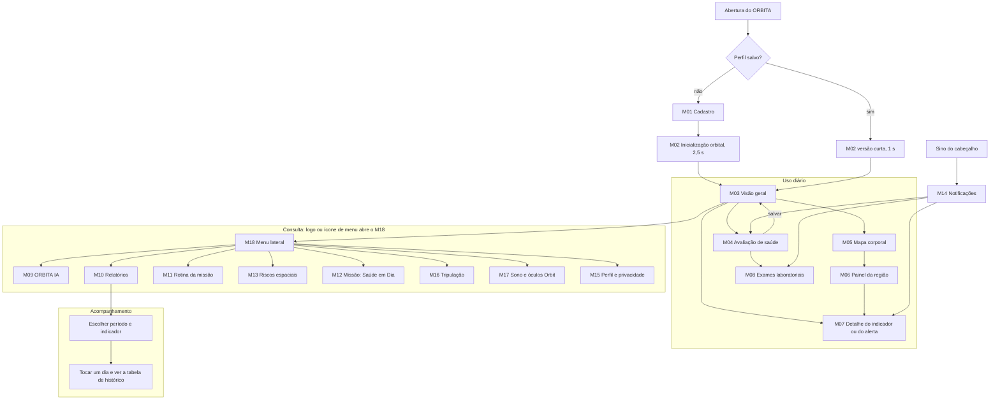

# 18. Design do ORBITA responsivo: telas, componentes e dados de demonstração

> Para quem: quem vai executar o código no Lovable (React, TypeScript, Tailwind, Lucide, Recharts) e quem revisa as telas antes da entrega.
> Formato: web app responsivo, que funciona bem no celular, no tablet e no laptop; a Visão geral também abre em tela grande (monitor compartilhado da estação, laptop ou telão da apresentação). Decisão do dono do projeto em 15/11/2026, às 10h45.
> Base: decisões obrigatórias de [`17-revisao-prompt-orbita.md`](17-revisao-prompt-orbita.md) (inventário M01 a M18 na seção 5 e valores da seção 4); prompt da equipe em [`../pesquisa/prompt-orbita-equipe.md`](../pesquisa/prompt-orbita-equipe.md) (identidade, nome ORBITA, paleta e estrutura); princípios U1 a U9 e regras de convivência com o alarme da estação de [`07-design-interface.md`](07-design-interface.md); limiares de [`03-indicadores-e-limiares.md`](03-indicadores-e-limiares.md) e [`../prototipo/config/indicadores.json`](../prototipo/config/indicadores.json); modelo de dados de [`06-modelo-de-dados.md`](06-modelo-de-dados.md); regras de cruzamento de [`04-cruzamento-de-dados.md`](04-cruzamento-de-dados.md).
> Desenhos: [`wireframes/orbita-responsivo.html`](wireframes/orbita-responsivo.html) (abra no navegador): uma moldura de celular de 390 x 844 px por tela, uma moldura de tela grande de 1920 x 1080 px para a Visão geral em modo de exibição e uma moldura de laptop de 1366 x 768 px para os Relatórios com o menu lateral fixo. Este documento não traz código do aplicativo.

---

## 1. Princípios

| # | Princípio | Como aparece no ORBITA |
| --- | --- | --- |
| P1 | **Leitura em 3 segundos** | O topo da Visão geral diz o estado geral com cor, ícone e palavra antes de qualquer número ("Saúde: atenção · 3 indicadores e 1 alerta"). |
| P2 | **Revelação progressiva** | Estado, depois motivo, depois dado, depois fonte. Cartão → detalhe (M07) → gráfico → regra e referência. |
| P3 | **Sempre a próxima ação** | Todo amarelo, laranja e vermelho traz "O que fazer" e "Sobe de nível se". Nenhum alerta termina sem ação. |
| P4 | **Cor nunca sozinha** | Todo estado tem cor, ícone e palavra (seção 2.2). Funciona com daltonismo e no modo noturno. |
| P5 | **Digitar o mínimo** | Escalas de toque, chips, botões de +0,25 L, seletor de horas. Teclado só em nome, observações, exames e perguntas à IA. Alvos de toque de no mínimo 44 px. |
| P6 | **Modo noturno** | Paleta âmbar automática a partir do pré-sono (19:30 GMT no horário padrão), com pouca luz azul. |
| P7 | **Cuidado mútuo com consentimento** | A Tripulação (M16) mostra de cada colega só o que ele aceitou compartilhar. "Não compartilhado" é texto neutro, nunca cor de alerta. O filtro acontece no motor, antes da tela. |
| P8 | **Não imitar o alarme da estação** | Nada pisca, nada toca som, nada vibra. Rótulos sempre com o prefixo "Saúde:". Nunca usar as palavras Caution, Warning ou Emergency. Superfícies neutras: o estado aparece só no contorno, no ícone e na palavra. |
| P9 | **Apoio, não diagnóstico** | "Possível", "sugere", "compatível com". Toda referência terrestre leva o rótulo "referência terrestre, não limite de voo". |
| P10 | **Dado simulado é marcado** | Todo valor mostra o selo de origem (seção 2.7). Nada finge conexão com equipamento. |
| P11 | **Uma tela, vários tamanhos** | O mesmo conteúdo se reorganiza do celular ao laptop. Na tela grande, a Visão geral vira painel da missão, legível a distância: números grandes, poucos elementos e nenhuma rolagem. |

---

## 2. Design system

Use os nomes de token abaixo como variáveis CSS e no `tailwind.config` (por exemplo `bg-surface`, `text-muted`, `border-estado-atencao`). São os mesmos nomes do [`19-prompt-lovable-revisado.md`](19-prompt-lovable-revisado.md) e do CSS do arquivo de wireframes.

### 2.1 Cores da marca e superfícies

| Token | Tema padrão (escuro) | Modo noturno (âmbar) | Uso | Contraste do texto sobre `--bg` |
| --- | --- | --- | --- | --- |
| `--bg` | `#07111F` (azul-marinho profundo) | `#120A04` | Fundo da tela | |
| `--surface` | `#0B1B2B` (azul-marinho secundário) | `#1C1108` | Cartões, cabeçalho, barra inferior, folha inferior | |
| `--surface-2` | `#11243A` | `#26170B` | Elementos dentro de cartões, escalas, campos | |
| `--border` | `#91A4B8` com 20% de opacidade (cerca de `#232E3E` sobre `--bg`) | `#3A2414` | Bordas discretas (decorativas, não carregam informação) | |
| `--border-strong` | `#2A4A6B` | `#553620` | Contorno de campos, botões secundários, silhueta do corpo | |
| `--text` | `#F4F8FC` (branco) | `#F2C79B` | Texto principal | 17,75:1 (noturno 12,53:1) |
| `--muted` | `#91A4B8` (cinza azulado) | `#BC9672` | Texto secundário, rótulos | 7,40:1 (noturno 7,23:1) |
| `--primary` | `#21C5EF` (ciano principal) | `#E8963F` | Ação principal, item ativo, foco, séries de gráfico | 9,29:1 (noturno 8,28:1) |
| `--primary-2` | `#16A9C4` (azul turquesa) | `#C77B30` | Segunda série de gráfico, faixa da linha de base | 6,77:1 |

Texto sobre botão ciano: `#07111F` sobre `#21C5EF` dá 9,29:1.

### 2.2 Cores de estado e níveis

Mapeamento obrigatório do `docs/17` (correção 5): cinza = nível 0, verde = 1, amarelo = 2, laranja = 3, vermelho = 4. Os níveis são estados de interface, sem unidade física. Contrastes medidos sobre `#07111F` (fundo) e sobre o fundo de selo indicado.

| Nível | Cor | Token | Hex do texto e do contorno | Fundo de selo (14% da cor sobre `--surface`) | Contraste sobre `#07111F` | Contraste no selo | Ícone Lucide | Símbolo de reserva | Rótulo | Quem age |
| --- | --- | --- | --- | --- | --- | --- | --- | --- | --- | --- |
| 0 | Cinza | `--estado-sem-dado` | `#A3ADBA` | `#202F3F` | 8,34:1 | 6,00:1 | `CircleHelp` | ? | Sem dado | O próprio tripulante (medir, transferir, reconectar) |
| 1 | Verde | `--estado-normal` | `#22C55E` | `#0E3332` | 8,31:1 | 5,99:1 | `CircleCheck` | ✓ | Saúde: normal | Ninguém |
| 2 | Amarelo | `--estado-atencao` | `#F5B800` | `#2C3125` | 10,58:1 | 7,46:1 | `CircleAlert` | ! | Saúde: atenção | Tripulante; CMO se persistir |
| 3 | Laranja | `--estado-alerta` | `#F97316` | `#2C2728` | 6,76:1 | 5,25:1 | `CircleX` | ✕ | Saúde: alerta, acionar CMO | CMO e médico de voo |
| 4 | Vermelho | `--estado-critico` | `#FF6B6B` | `#2D2634` | 6,82:1 | 5,26:1 | `OctagonX` | ✕ em octógono | Saúde: crítico, contatar CMO agora | "Contatar CMO agora" e abrir o procedimento oficial |

Os cinco valores são os mesmos do `docs/19`. Cinza e vermelho foram escolhidos por contraste: o `#6B7280` da primeira versão dava só 3,92:1 sobre `#07111F` (abaixo do mínimo de 4,5:1 para texto) e o `#EF4444` caía para 4,10:1 dentro do fundo de selo; por isso os dois documentos usam `#A3ADBA` e `#FF6B6B` (alinhados em 15/11). Todos passam de 6:1 sobre `--bg` e `--surface`, como pede o `docs/07`, seção 5.1.1. Fundo de selo: cada token tem a variante `-bg` (por exemplo `--estado-atencao-bg`).

Modo noturno: verde `#A9C25A`, amarelo `#F2B544`, laranja `#EE8A45`, vermelho `#F07A62`, cinza `#AC9884`, todos acima de 6:1 sobre `#120A04`. No noturno, amarelo e laranja ficam próximos: a diferença é garantida pelo ícone e pela palavra.

Regras de uso:

- **Selo de estado** (`StatusBadge`): pílula com borda de 1 px na cor do nível, fundo de selo, ícone em círculo preenchido e rótulo. O nível 0 usa borda tracejada.
- **Forma compacta**: em linhas de lista, blocos de tripulante e células de matriz, o selo encolhe para ícone mais palavra curta ("atenção", "normal", "sem dado") ou só o ícone; o rótulo completo com "Saúde:" fica no título do bloco, no resumo ou no rótulo acessível. Valores de ambiente usam a forma compacta sem "Saúde:", porque não são estado de saúde.
- **Cartão com estado**: superfície neutra (`--surface`) e só o contorno na cor (1,5 px). Nunca pintar o fundo inteiro de amarelo, laranja ou vermelho. Sem halo, sem sombra colorida.
- **Vermelho (nível 4) só por sintoma de alarme relatado**, listado em `gatilhosSintoma` e `regraCor.sintomas` do `indicadores.json` (`docs/06`: é o único caminho para o nível 4). Nenhum número produz vermelho. Requisito oficial excedido (CO2 acima de 3 mmHg na média de 1 h, dose de carreira em 600 mSv ou mais) e corte clínico com fonte (SpO2 em ou abaixo de 92%) produzem nível 3, laranja, conforme a `regraCor`.
- **Linha de base sozinha chega no máximo ao amarelo** (`linhaDeBase.nuncaVermelho: true`).
- **"Sem dado" sempre com a palavra exata do caso**: "Sem leitura", "Leitura vencida há 26 h", "Sensor desconectado", "Teste semanal pendente". A validade vem de `validadeHoras` de cada indicador.
- **Medida opcional nunca registrada** (pressão, glicose, temperatura antes do primeiro registro) não usa selo cinza: mostra o texto neutro "Sem registro" e o convite "Registrar quando medir com o kit".
- **Lembretes de rotina** usam ciano ou cinza, nunca as cores de estado.

### 2.3 Tipografia

| Papel | Família | Tamanho em 360 a 430 px | Peso | Observação |
| --- | --- | --- | --- | --- |
| Número de destaque (valor do cartão) | Space Grotesk, reserva `system-ui` | 26 px (até 30 px em 430 px) | 700 | `font-variant-numeric: tabular-nums`; unidade ao lado em 13 px, cor `--muted` |
| Título da tela | Space Grotesk | 20 px | 700 | Quebra em duas linhas se precisar, nunca reticências em título |
| Título de seção (MONITORAMENTO AUTOMÁTICO) | Inter, reserva `system-ui` | 12 px, caixa alta, espaçamento 0,08 em | 700 | É rótulo; mínimo de 12 px |
| Texto corrido, botões, itens de lista | Inter | 14 px (botão 14 a 15 px) | 400 a 600 | Mínimo de 14 px para texto |
| Rótulo, legenda, selo, hora | Inter | 12 px | 500 a 700 | Mínimo de 12 px |
| Marca ORBITA no cabeçalho | Space Grotesk | 15 px, espaçamento 0,14 em | 700 | Ao lado do ícone oficial |

As fontes entram empacotadas com o app (`@fontsource/inter` e `@fontsource/space-grotesk`), sem depender de rede. Escala fluida opcional: `clamp(26px, 7vw, 30px)` para números de destaque. Altura de linha de 1,4 a 1,5 para texto.

**Tamanhos por ponto de quebra** (seção 2.11):

| Papel | Celular | Tablet | Laptop | Tela grande (modo de exibição, 1920 x 1080) |
| --- | --- | --- | --- | --- |
| Número de destaque | 26 px | 28 px | 32 px | 56 px (bloco de tripulante 28 a 40 px) |
| Título da tela ou do painel | 20 px | 22 px | 24 px | 32 px |
| Rótulo e título de seção | 12 px | 12 px | 13 px | 22 px (mínimo de 20 px) |
| Texto | 14 px | 15 px | 15 px | 24 px |

Legibilidade a distância: a norma da NASA pede rótulos de pelo menos 12 pontos ou 0,4 grau de ângulo visual na distância de uso (NASA-STD-3001 Vol. 2, V2 10066, citado em `docs/07`, seção 5.1.1). Numa TV de 55 polegadas com 1920 x 1080 vista a 3 m, 0,4 grau dá cerca de 21 mm de altura de caractere, perto de 33 px; por isso a tela grande usa no mínimo 20 px para rótulos e 40 a 56 px para valores. Medir no monitor ou telão real da apresentação, porque pixel de CSS não prova a legibilidade.

### 2.4 Espaçamento, raios, sombras e brilho

- **Grade de 4 px**: espaçamentos permitidos 4, 8, 12, 16, 20, 24 e 32 px. Margem lateral da tela 16 px. Espaço entre cartões de 10 a 12 px. Preenchimento do cartão 12 px (cartão grande 16 px).
- **Raios**: cartão 16 px; elemento interno, campo e botão 12 px; selo, chip e pílula 999 px; folha inferior 24 px no topo; drawer sem raio.
- **Sombras**: quase nenhuma. Cartão sem sombra; folha inferior e drawer com `0 -10px 30px rgba(0,0,0,.5)`.
- **Brilho ciano com moderação**: `0 0 0 1px rgba(33,197,239,.35), 0 0 16px rgba(33,197,239,.22)` só em três lugares: foco de teclado, opção escolhida numa escala e o ponto orbital da M02. Nunca em alertas, nunca em estados de saúde. No modo noturno o brilho é desligado.
- **Largura**: no celular, conteúdo de largura total com margem de 16 px. Do tablet em diante, a grade e a navegação seguem a seção 2.11; a tripulação da ISS usa iPads e laptops (`docs/17`, seção 2, item 1).

### 2.5 Ícones Lucide sugeridos

| Item | Ícone | Item | Ícone |
| --- | --- | --- | --- |
| Menu | `Menu` | Notificações | `Bell` |
| Início | `House` | Mapa | `PersonStanding` |
| Avaliar | `ClipboardCheck` | IA | `Bot` |
| Frequência cardíaca | `HeartPulse` | Dosimetria | `Radiation` |
| Oximetria | `Activity` | Atenção ocular (EOG) | `Glasses` |
| CO2 e ar do módulo | `Wind` | Pressão da cabine | `Gauge` |
| Clima espacial (prótons) | `Sun` | Hidratação | `GlassWater` |
| Fadiga | `BatteryLow` | Apetite | `Utensils` |
| Sono | `BedDouble` | Humor | `Smile` |
| Pressão arterial | `HeartPulse` | Glicose | `Droplet` |
| Temperatura | `Thermometer` | Hemograma | `TestTube` |
| Teste de visão | `Grid3x3` (Amsler) e `Eye` | PVT | `Timer` |
| Cabeça e cérebro | `Brain` | Olhos | `Eye` |
| Ouvidos | `Ear` | Vestibular | `Compass` |
| Coração | `Heart` | Pulmões | `Wind` |
| Sangue e imunidade | `Droplet` | Digestão | `Utensils` |
| Rins | `Droplets` | Ossos | `Bone` |
| Músculos | `Dumbbell` | Corpo inteiro | `Radiation` |
| Relatórios | `ChartLine` | Rotina | `ListChecks` |
| Gamificação | `Trophy` | Riscos | `ShieldAlert` |
| Tripulação | `Users` | Sono e óculos | `Moon` |
| Perfil | `UserCog` | Privado | `Lock` |
| Offline | `WifiOff` | Comunicação com o solo | `Satellite` |
| Oferecer apoio | `HandHeart` | Chamar CMO | `Stethoscope` |
| Link externo | `ExternalLink` | Enviar pergunta | `Send` |

### 2.6 Modo noturno âmbar

- Liga sozinho no início do pré-sono (horário de sono menos 2 h; 19:30 GMT no padrão 21:30 a 06:00) e desliga 1,5 h depois de acordar. Também pode ser ligado à mão em Perfil (M15).
- Troca todos os tokens pela coluna "Modo noturno" das seções 2.1 e 2.2. A figura do corpo segue os tokens, sem azul.
- Brilho ciano desligado. Gráficos usam o `--primary` âmbar.
- O wireframe da M17 está desenhado no modo noturno.

### 2.7 Selos de origem do dado

Campo `origem` da `Leitura` (`docs/06`, seção 2.5). Selo pequeno e neutro (`--surface-2`, borda `--border`, texto `--muted`, 12 px), nunca em cor de estado.

| `origem` | Texto do selo | Ícone | Quando aparece |
| --- | --- | --- | --- |
| `simulada` | Simulado | `FlaskConical` | Todo dado do perfil de demonstração, inclusive os manuais pré-carregados |
| `manual` | Registrado por você | `PencilLine` | Valor digitado ou tocado pelo astronauta depois de restaurar a demonstração |
| `automatica` | Equipamento (integração futura) | `Cpu` | Integração futura com vestível ou equipamento; não usar no protótipo |
| `exame` | Exame de laboratório | `TestTube` | Resultado de laboratório registrado em M08 |
| `historica` | Real gravado (data) | `Database` | Dado real gravado e reproduzido (telemetria da ISS e NOAA de `prototipo/dados/amostras-reais/`), por exemplo "Real gravado 15/11" |
| `ao_vivo` | Ao vivo | `Radio` | Só se a integração opcional for ligada; desligada por padrão |

Selo extra para o óculos: **"óculos Orbit (proposto) · simulado · experimental"** (`Glasses`). Valores marcados com `valorDeDemonstracao` levam o selo "valor de demonstração". Na linha de contexto da Visão geral aparece o selo fixo "DADOS SIMULADOS" enquanto o perfil de demonstração estiver ativo. Textos iguais aos do `docs/19`, seção 16.

### 2.8 Estados de disponibilidade

Campo `disponibilidade` (`docs/06`). Selo neutro com borda tracejada; o motor só avalia leituras `disponivel`.

| Estado na tela | Campo | Ícone | Texto |
| --- | --- | --- | --- |
| Coleta agendada | (tarefa da rotina) | `CalendarClock` | "Coleta agendada para o FD 53" |
| Aguardando transferência | `aguardando_transferencia` | `HardDriveUpload` | "Gravado, aguardando transferência" |
| Amostra coletada, análise na Terra | `pendente_laboratorio` | `Earth` | "Amostra coletada no FD 38 · análise na Terra" |
| Resultado disponível | `disponivel` | `FileCheck` | "Resultado disponível em 15/11, 06:00 GMT" |

### 2.9 Componentes

| Componente | Props principais | Onde aparece |
| --- | --- | --- |
| `AppHeader` | `onMenu`, `naoLidas`, `contexto` (astronauta, missão, FD, GMT), `modoExibicao` | Todas as telas internas |
| `BottomNav` | `ativo` (inicio, mapa, avaliar, ia) | Telas internas no celular |
| `Drawer` | `itens[]`, `ativo`, `conectividade` | M18 no celular |
| `SideNav` | `itens[]`, `ativo`, `recolhido`, `conectividade` | Tablet e laptop |
| `MissionDisplay` | `ambiente[]`, `tripulantes[]` (já filtrados por consentimento para a audiência tripulação), `alertasAbertos[]`, `precisaApoio[]`, `metaTripulacao` | M03 em tela grande |
| `StatusBadge` | `nivel` (0 a 4), `texto` opcional | Em todo lugar |
| `OriginBadge` | `origem`, `proposto` | Cartões, linhas de dado, M07 |
| `AvailabilityBadge` | `disponibilidade`, `instante` | M03, M08, M11 |
| `MetricCard` | `rotulo`, `valor`, `unidade`, `nivel`, `linhaDeBase`, `serie[]`, `origem`, `atualizadoEm` | M03, M17 |
| `EnvCard` | `modulo`, `leituras[]` (indicador, valor, unidade, nível) | M03 |
| `SelfReportList` | `itens[]` (indicador, valor, unidade, habitual, nível), `registradoEm` | M03 |
| `AlertCard` | `alerta` (nível, título, resumo, regraId) | M03, M14 |
| `AlertDetail` | `alerta` (evidências, ações, gatilhoParaSubir, fonte, notificações) | M07 |
| `IndicatorDetail` | `indicador`, `leituras[]`, `linhaDeBase`, `regraAplicada` | M07 |
| `BodyMap` | `estadoPorRegiao`, `lado` (frente, costas), `sexo`, `onSelect` | M05, M06, prévia em M03 |
| `RegionSheet` | `regiao`, `riscos[]`, `indicadores[]`, `orientacoes`, `linkHRP` | M06 |
| `ScaleSelector` | `min`, `max`, `valor`, `rotulos[]`, `habitual` | M04 |
| `ChipGroup` | `opcoes[]`, `valor`, `multiplo` | M04, M10, M14 |
| `Stepper` | `valor`, `passo`, `unidade` | M04 (hidratação, sono) |
| `TrendChart` (Recharts) | `serie[]`, `faixaLinhaDeBase`, `faixaReferencia`, `eventos[]`, `diaSelecionado` | M07, M10 |
| `LabStatusStepper` | `estado` (agendada, coletada, disponível) | M08 |
| `ChatMessage` | `autor`, `texto`, `fontes[]` | M09 |
| `TaskItem` | `nome`, `descricao`, `periodicidade`, `prazoGmt`, `estado` | M11 |
| `XpBar`, `AchievementCard` | `xp`, `nivel`, `proximo`; `conquista`, `progresso` | M12 |
| `HazardCard` | `perigo`, `descricao`, `impactos[]`, `regioes[]`, `indicadores[]`, `url` | M13 |
| `NotificationItem` | `tipo` (saude, rotina, info), `nivel`, `texto`, `destino`, `instante` | M14 |
| `ConsentRow` | `dado`, `audiencia`, `atualizadoEm`, `onRevogar` | M01, M15 |
| `CrewCard`, `CrewMatrix` | `tripulante`, `moduloAtual`, `estadoGeral`, `blocos[]`, `compartilhamento`, `fraseAjuda`, `tamanho` (lista, cartão, exibição) | M16 e M03 em tela grande |
| `Hypnogram` | `epocas[]` (estágio a cada 30 s) | M17 |
| `SoundscapeSchedule` | `perfil`, `faixas[]`, `audioNoSono` | M17 |

### 2.10 Movimento e acessibilidade

- Permitido: transição entre telas (200 a 250 ms), abertura do drawer e da folha inferior (250 ms), troca de cor de uma região do corpo (300 ms), animação da M02.
- Proibido: pulso, piscar, halo, brilho em alerta, contagem regressiva, animação contínua em tela que fica aberta, som e vibração em qualquer nível.
- `prefers-reduced-motion`: troca todas as transições por corte simples e mostra a M02 estática.
- Esqueleto de carregamento estático (blocos cinza sem brilho correndo).
- Todo controle com rótulo acessível; a figura do corpo tem lista equivalente de regiões (M05) para leitor de tela e teclado.
- Textos vêm do dicionário `src/i18n/` (português do Brasil, com inglês), nunca fixos no componente.

### 2.11 Pontos de quebra e navegação

| Faixa | Larguras | Navegação | Grade da Visão geral (M03) | Outras telas |
| --- | --- | --- | --- | --- |
| Celular | 360 a 430 px (vale até 767 px) | Barra inferior com 4 atalhos (Início, Mapa, Avaliar, IA); menu lateral (M18) em gaveta, aberto pelo logo mais o ícone de menu; sino no cabeçalho | Uma coluna, painel pessoal (layout M03a) | Uma coluna; M06 como folha inferior |
| Tablet | 768 a 1024 px | Menu lateral fixo e recolhível: 240 px aberto, 72 px recolhido só com ícones (padrão recolhido em retrato, aberto em paisagem); sem barra inferior; logo e sino no topo | Duas colunas: à esquerda resumo, alerta, automático e ambiente; à direita avaliação pessoal e mapa | M05 e M06 lado a lado (figura e painel); M16 em grade de 2 cartões |
| Laptop | a partir de 1280 px (1024 a 1279 px segue o tablet) | Menu lateral fixo de 240 px, recolhível a 72 px; sem barra inferior | Três colunas, conteúdo com no máximo 1200 px | M10 com gráfico largo e tabela ao lado; M16 em grade de 4 cartões |
| Tela grande | a partir de 1920 px (ou o botão "Modo de exibição" em qualquer tela de 1280 px ou mais) | Sem menu e sem barra inferior: modo de exibição. Uma tecla ou um botão discreto no canto ("Sair do modo de exibição") volta ao layout de laptop | Painel da missão (layout M03b), sem rolagem | Só a M03 tem modo de exibição; as demais telas usam o layout de laptop |

Regras:

- Mesmo conteúdo e mesma ordem de leitura em todas as faixas; muda só o arranjo. Nada aparece só no celular ou só no laptop, exceto o painel da missão da tela grande.
- O menu lateral fixo tem os mesmos 12 itens do M18, o item atual destacado e o rodapé de conectividade; recolhido, mostra só ícones com dica ao passar o mouse e rótulo acessível.
- Alvos de toque de 44 px valem em todas as faixas; no laptop, foco de teclado visível em todo controle.
- Tailwind: `sm` 360 px, `md` 768 px, `lg` 1280 px, `xl` 1920 px (configurar os pontos no `tailwind.config`, porque os padrões do Tailwind são outros).
- O modo de exibição exige ativação deliberada (botão "Tela cheia" no cabeçalho do laptop, seletor "Modo exibição" ou abertura da rota `/painel`), não reage a toque para abrir detalhes e depois de alguns minutos sem uso (configurável) esconde os valores e mantém só os estados (`docs/07`, T1; `docs/19`, seção 4).

---

## 3. Navegação

### 3.1 Mapa de fluxos

O fluxo é o mesmo em todas as faixas; no tablet e no laptop, o "M18 Menu lateral" é o menu fixo. A tela grande abre direto no painel da missão (M03b) e sai dele por "Sair do modo de exibição".

### 3.2 Estrutura fixa das telas internas

| Elemento | Celular | Tablet e laptop | Tela grande |
| --- | --- | --- | --- |
| **Cabeçalho** | 48 px. À esquerda, um único botão com o ícone oficial do ORBITA, a palavra ORBITA e o ícone `Menu` visível (o prompt pede o logo interativo; o ícone de menu torna isso descobrível); o toque abre o drawer (M18). À direita, o sino com o número de notificações não lidas em ciano (não em cor de estado). | 56 px. Logo no topo do menu fixo; no cabeçalho, título da tela, contexto, botão "Modo de exibição" (só na M03) e sino. | 80 px: logo, "Painel da missão", missão, dia, GMT grande, selos de dados e de conectividade. Sem sino. |
| **Linha de contexto** | Só na Visão geral: "ASTRONAUTA 001 · ISS EXP-01 · DIA 045" e "GMT 319 / 06:40" (dia do ano e hora, horário oficial da ISS), com o selo "DADOS SIMULADOS". Some ao rolar. | Dentro do cabeçalho, sempre visível | Dentro do cabeçalho |
| **Navegação** | Barra inferior de 62 px com Início (M03), Mapa (M05), Avaliar (M04) e IA (M09); item ativo em ciano, rótulo sempre visível. Drawer de 300 px que desliza da esquerda em 250 ms e fecha pelo X, pelo toque fora ou pelo gesto de voltar. | Menu lateral fixo de 240 px, recolhível a 72 px | Nenhuma (modo de exibição) |
| **Voltar** | Telas abertas a partir de um cartão (M06, M07, M08) mostram seta de voltar à esquerda do título; o cabeçalho com o logo continua. | Igual, com trilha "Visão geral › Detalhe" | Não se aplica |

### 3.3 Regras

- O astronauta chega a qualquer funcionalidade sem voltar à Visão geral: drawer e barra inferior em todas as telas internas.
- Toque numa notificação leva direto ao indicador, ao alerta ou à tarefa (M07, M04, M08).
- Rotas internas: `/inicio`, `/mapa`, `/mapa/:regiao`, `/avaliar/:aba`, `/indicador/:indicadorId`, `/alerta/:alertaId`, `/exames`, `/ia`, `/relatorios`, `/rotina`, `/missao`, `/riscos`, `/notificacoes`, `/perfil`, `/tripulacao`, `/sono`.
- Sem lembretes no horário de sono (21:30 a 06:00 GMT no padrão) nem durante atividade crítica marcada na rotina.

---

## 4. Telas

Formato de cada tela: objetivo; layout de cima para baixo; componentes; dados (com `indicadorId` e unidade); estados; interações; textos; critérios de pronto. Os valores citados são os da demonstração (seção 5). Ids entre crases são exatamente os do `indicadores.json`. Os ids `apetite` (categoria ordinal de 1 a 3, região `digestao`) e `eog_piscadas` (região `cerebro`) já estão no JSON; `sintomas_checkin`, `hematocrito`, `leucocitos`, `audiometria` e `zumbido` existem no `docs/03`, mas ainda não no JSON.

### M01. Cadastro

**Objetivo.** Criar o perfil local no primeiro acesso. Obrigatório para começar; não reaparece depois de concluído, a menos que o astronauta escolha "Editar perfil" em M15.

**Layout, de cima para baixo.**
1. Ícone oficial do ORBITA (marcador provisório até o SVG chegar em `prototipo/marca/orbita-icone.svg`), título e descrição.
2. Bloco "Você": Nome completo; Sexo (dois botões: Masculino, Feminino); Massa corporal (kg) e Altura (cm) lado a lado; Observações pessoais (opcional, com cadeado).
3. Bloco "Missão": Nome da missão; Data de início (o app mostra o dia de missão calculado); Horário de sono em GMT.
4. Bloco "O que a tripulação pode ver": três interruptores.
5. Botão "SALVAR E CONTINUAR", largura total.

**Componentes.** Campos de texto e número, `ChipGroup` de duas opções, seletor de data, seletor de horário, três `ConsentRow` simplificados, botão primário.

**Dados.**

| Campo | Entidade e campo (`docs/06`) | Unidade | Demonstração |
| --- | --- | --- | --- |
| Nome completo | `Tripulante.codinome` | | Astronauta 001 |
| Sexo | `Tripulante.sexo` (existe no perfil de simulação; acrescentar ao `docs/06`) | | Masculino |
| Massa corporal | `Tripulante.massaPreVooKg` | kg | 78 kg |
| Altura | `Tripulante.alturaCm` (campo novo; acrescentar ao `docs/06`) | cm | 180 cm |
| Observações pessoais | guardado só no aparelho, marcado como privado | | vazio |
| Nome da missão | `Missao.nome` | | ISS EXP-01 |
| Data de início | `Missao.inicioUtc` | data ISO em UTC | 44 dias antes de hoje, para o dia ficar 45 |
| Horário de sono | `Tripulante.horarioSono` | GMT | 21:30 a 06:00 |
| Compartilhamento | `Tripulante.compartilhamento` | | demonstração: tudo com a tripulação |

Dia de missão (FD) = dias desde o início + 1 (`docs/06`, `Missao`). O sexo também escolhe a figura do mapa corporal e a faixa de referência de hemoglobina (13 a 18 g/dL em homens e 12 a 16 g/dL em mulheres, referência terrestre).

**Estados.** Vazio (primeiro acesso; a validação acontece ao tocar em salvar); erro de validação (mensagem embaixo do campo com o ícone `CircleAlert`; a borda do campo fica em `--text`, sem cor de estado de saúde); salvando (o botão mostra "Salvando" e fica desabilitado, sem spinner girando); edição (vindo de M15: título "Editar perfil", botão "SALVAR").

**Interações.**

| Toque | Resultado |
| --- | --- |
| SALVAR E CONTINUAR (válido, primeiro acesso) | Grava no armazenamento local e abre M02 |
| SALVAR (edição) | Grava e volta para M15 |
| Cadeado de Observações | Abre a explicação: "Fica só neste aparelho. Nunca aparece na Tripulação nem nos relatórios." |
| "Ajustar depois em Perfil e privacidade" | Só informa; o ajuste completo fica em M15 |

**Textos.** Título: "Cadastro do Astronauta". Descrição: "Crie seu perfil para personalizar o monitoramento da sua saúde durante a missão." Ajuda do sexo: "Define o modelo do mapa corporal e a faixa de referência do hemograma." Rótulo: "Massa corporal (kg)" (no espaço se mede massa, não peso). Observações: "Restrições, condições preexistentes ou outras informações. Privado: fica só neste aparelho." Dia calculado: "Hoje é o dia 45 da missão." Interruptores: "Estado por sistema (cor e ícone, sem números)", "Valores (sinais vitais, sono, hidratação, radiação)", "Humor". Erros: "Informe seu nome completo.", "Escolha uma opção.", "Informe a massa corporal em kg, só números.", "Informe a altura em cm, só números.", "A data de início não pode ser depois de hoje."

**Critérios de pronto.**
- [ ] Os quatro campos obrigatórios bloqueiam o envio quando vazios ou não numéricos, com a mensagem acima.
- [ ] Depois de salvar, fechar e reabrir o app leva à M02 curta e depois à M03, sem passar pela M01.
- [ ] O FD mostrado é dias desde o início + 1.
- [ ] Trocar o sexo troca a figura em M05.
- [ ] Observações nunca aparecem em M16, M10 ou M09.
- [ ] Padrão de compartilhamento de um perfil novo: estado por sistema só para CMO e médico de voo; valores e humor "Só eu" (`docs/06`).

### M02. Inicialização orbital

**Objetivo.** Apresentar a identidade do ORBITA entre o cadastro e a Visão geral, sem parecer carregamento.

**Layout.** Fundo `--bg`. Ícone oficial centralizado (cerca de 140 px). Abaixo, "ORBITA" e o subtítulo. Rodapé: "Toque para pular".

**Roteiro da animação.**

| Tempo | O que acontece |
| --- | --- |
| 0 a 0,3 s | Ícone estático |
| 0,3 a 1,7 s | O pequeno círculo ciano percorre 360 graus exatamente sobre o anel elíptico do ícone, com um rastro curto de luz ciano |
| 1,7 a 2,3 s | O ícone inteiro se dissolve (opacidade e leve desfoque; partículas são opcionais) |
| 2,3 a 2,5 s | Transição cruzada para a M03 |

Total de no máximo 2,5 s. Depois do primeiro acesso, versão de 1 s (órbita rápida e corte). Com `prefers-reduced-motion`, ícone estático por 0,6 s e corte. Implementação recomendada: o caminho da elipse vem do próprio SVG oficial (`offset-path` em CSS ou `animateMotion`), para respeitar a geometria. Não redesenhar o ícone.

**Estados.** Primeiro acesso (versão longa); acessos seguintes (versão curta); menos movimento (estática); ícone oficial ausente (marcador provisório com círculo, anel e ponto, com aviso no código para trocar).

**Interações.** Toque em qualquer ponto pula para M03.

**Textos.** "ORBITA". "Sistema de Monitoramento de Saúde para Astronautas em Missões Espaciais." "Toque para pular".

**Critérios de pronto.**
- [ ] Duração total de no máximo 2,5 s no primeiro acesso e 1 s depois.
- [ ] O ponto segue a elipse do SVG oficial, sem deformar o símbolo.
- [ ] Toque pula imediatamente.
- [ ] Com menos movimento ligado no sistema, nada se move.

### M03. Visão geral (dashboard)

**Objetivo.** Responder em 3 segundos "estou bem? preciso fazer algo agora?" e concentrar os dados automáticos, o ambiente, a avaliação pessoal e a prévia do mapa. É a tela mais usada. Tem dois layouts: **M03a, painel pessoal** (celular, tablet e laptop) e **M03b, painel da missão** (tela grande, modo de exibição).

**Layout M03a, celular, de cima para baixo** (rolagem vertical; o wireframe mostra duas molduras: topo e depois de rolar). No tablet, o mesmo conteúdo em duas colunas (à esquerda resumo, alerta, automático e ambiente; à direita avaliação pessoal e mapa); no laptop, em três colunas, com o menu lateral fixo.
1. Cabeçalho (seção 3.2).
2. Linha de contexto: "ASTRONAUTA 001 · ISS EXP-01 · DIA 045", "GMT 319 / 06:40", selo "DADOS SIMULADOS".
3. **Resumo do dia**: `StatusBadge` do estado geral (maior nível entre os indicadores e alertas) e uma frase.
4. **Alerta explicável** (um `AlertCard` por alerta aberto, maior nível primeiro): "Possível efeito de CO2 elevado".
5. **MONITORAMENTO AUTOMÁTICO**: quatro `MetricCard` em grade 2 x 2.
6. **AMBIENTE DO MÓDULO**: `EnvCard` do módulo onde o astronauta está.
7. **AVALIAÇÃO PESSOAL**: Diária (cinco itens, data e hora do registro, botão "Atualizar avaliação"); Sinais vitais manuais (opcional); Periódica (hemograma); Semanal (testes de visão e PVT).
8. **MAPA CORPORAL**: prévia da figura com as regiões coloridas e a lista do que pede atenção.
9. Barra inferior, Início ativo.

**Dados.**

| Bloco | Rótulo na tela | `indicadorId` | Valor e unidade na tela | Unidade canônica nos dados | Estado na demonstração | Origem |
| --- | --- | --- | --- | --- | --- | --- |
| Automático | Frequência cardíaca | `fc_repouso` | 86 bpm; "Seu padrão: 64 bpm"; mini gráfico de 7 dias | bpm | ! Saúde: atenção, por desvio da linha de base, mesmo dentro da referência terrestre de 60 a 100 bpm | Simulado |
| Automático | Dosimetria | `dose_acumulada` (e a dose do dia, derivada do acumulado) | "Hoje 0,42 mSv"; "Missão 18,9 mSv"; barra "3,2% do limite de carreira de 600 mSv" | mSv | ✓ Saúde: normal (requisito oficial: menor que 600 mSv de carreira, NASA-STD-3001 Vol. 1, V1 4030) | Simulado |
| Automático | Oximetria | `spo2` | 97 %; "Referência terrestre: 95 a 100%, não limite de voo"; último registro | % | ✓ Saúde: normal | Simulado |
| Automático | Atenção ocular (EOG) | `eog_piscadas` | 12,4 piscadas/min; "Dentro do seu padrão. Experimental, não é diagnóstico." | piscadas/min | ✓ Saúde: normal (só linha de base, sem limiar) | óculos Orbit (proposto) · simulado · experimental |
| Ambiente | CO2 · Node 3 | `ppco2_modulo` | 2,95 mmHg | mmHg | ! atenção pela regra R-CO2-01 (EWMA acima do marcador demonstrativo de 2,8 mmHg, com sintoma relatado; o requisito oficial é média de 1 h até 3 mmHg) | Simulado (cenário C1; pico igual ao valor real gravado do Node 3) |
| Ambiente | O2 (PIO2) · Node 3 | `pio2_cabine` | 18,84 kPa (141,3 mmHg); "O2 um pouco abaixo do alvo no Node 3; confira o sensor e acompanhe a tendência" | kPa | ! atenção: fora do alvo de normoxia de 19,33 a 20,67 kPa (145 a 155 mmHg), dentro dos limites (127 mmHg na média de 1 h, 122 mmHg absoluto) | Real gravado 15/11 |
| Ambiente | Pressão da cabine · US Lab | `pressao_cabine` | 101,0 kPa | kPa | ✓ (envelope oficial acima de 34,47 até 103,42 kPa) | Real gravado 15/11 |
| Ambiente | Prótons GOES | `fluxo_protons_goes` | 0,21 pfu | pfu | ✓ (abaixo do início de S1 da NOAA, 10 pfu) | Real gravado 15/11 |
| Ambiente | Índice Kp | `kp` | 1 | adimensional | ✓ (só linha de base, contexto) | Real gravado 15/11 |
| Diária | Hidratação | `agua_ingerida` | 1,8 L | mL (1.800 mL) | ✓ | Simulado |
| Diária | Fadiga | `fadiga` | 6 de 7; "habitual: 2" | pontos, escala de 1 a 7 | ! atenção (linha de base) | Simulado |
| Diária | Apetite | `apetite` | Reduzido; "habitual: normal" | ordinal: normal, reduzido, muito reduzido | ✓ (ver seção 7, item 4) | Simulado |
| Diária | Sono | `sono_tst` | 5,4 h; "habitual: 7,5 h" | min (324 min) | ! atenção (linha de base) | Simulado |
| Diária | Humor | `humor` | 3 de 5; "habitual: 4" | pontos, escala de 1 a 5 | ✓ | Simulado |
| Sinais vitais | Pressão arterial, glicose, temperatura | `pa_sistolica`, `pa_diastolica`, `glicose`, `temperatura_corporal` | 120 por 80 mmHg; 90 mg/dL em jejum; 36,8 °C | mmHg, mg/dL, °C | ✓ nos três (referência terrestre; linha de base em formação) | Simulado |
| Periódica | Hemograma | `hemoglobina` e demais do laudo | "Amostra coletada no FD 38 · análise na Terra"; "Próxima coleta: FD 53" | g/dL | selo de disponibilidade, sem cor; o resultado de 22 dias aparece com a idade do dado | Exame de laboratório |
| Semanal | Testes de visão e PVT | `acuidade_perto`, `amsler_distorcao`, `pvt_tempo_reacao`, `pvt_lapsos` | "Último há 6 dias · próximo no FD 46" | | ✓ (sem distorção nova; PVT de 268 ms, padrão de 270 ms) | Simulado |

A dose do dia (0,42 mSv) é a diferença diária do acumulado, em dose equivalente. Ela não é o indicador `taxa_dose_radiacao` (taxa de dose ambiental em µGy/h, linha de base), que só aparece quando houver leitura desse tipo.

A PIO2 (`pio2_cabine`) é a pressão **inspirada** de O2, calculada da ppO2 do módulo e da pressão total: PIO2 = (pressão total menos 47 mmHg) × ppO2 ÷ pressão total (OCHMO-TB-003; `docs/04`, A1). Com a gravação real (ppO2 do Node 3 de 150,67 mmHg e pressão total de 757,64 mmHg), dá 141,3 mmHg, ou 18,84 kPa. Nunca mostrar a ppO2 crua como se fosse a PIO2.

**Estados.**

| Estado | Como aparece |
| --- | --- |
| Normal sem alerta | Resumo "✓ Saúde: normal · nenhum alerta aberto"; o bloco de alerta some |
| Carregando | Esqueleto estático nos cartões, sem brilho correndo |
| Vazio (primeiros dias) | Cartão com valor e o texto "Linha de base em formação: 3 de 7 leituras"; cor só por referência com fonte |
| Sem dado | Cartão com contorno cinza tracejado, ? e a palavra exata: "Sem leitura", "Leitura vencida há 26 h", "Sensor desconectado" |
| Pendente | Hemograma com selo de disponibilidade |
| Avaliação diária vencida (24 h) | Bloco Diária com "Avaliação de hoje pendente" e botão "Fazer avaliação" em ciano |

**Interações.**

| Toque | Destino |
| --- | --- |
| Resumo do dia, "Ver o que fazer" | M07 do alerta de maior nível |
| Cartão de alerta, "Por que estou vendo isto" | M07, modo alerta |
| Cada cartão automático e cada item do ambiente | M07, modo indicador |
| Item da avaliação diária ou "Atualizar avaliação" | M04, aba Diária |
| Sinais vitais | M04, aba Sinais vitais |
| Hemograma | M08 |
| Testes semanais | M04, aba Testes |
| Prévia do mapa ou "Abrir mapa" | M05 |
| Logo ou ícone de menu | M18 |
| Sino | M14 |

**Textos.** "MONITORAMENTO AUTOMÁTICO", "AMBIENTE DO MÓDULO", "AVALIAÇÃO PESSOAL", "MAPA CORPORAL". Resumo: "Saúde: atenção · 3 indicadores pedem atenção e há 1 alerta. Os demais indicadores medidos estão normais." Alerta: "Possível efeito de CO2 elevado" / "CO2 do Node 3 em 2,95 mmHg e dificuldade de concentração relatada há 40 min." / contexto: "Também diferentes do seu padrão hoje: frequência cardíaca e fadiga." / botão "Por que estou vendo isto". O2: "O2 um pouco abaixo do alvo no Node 3; confira o sensor e acompanhe a tendência." EOG: "Experimental. Não é diagnóstico de desatenção." Diária: "Diária · últimas 24 horas · registrada às 06:00 GMT". Sinais vitais: "Opcional: registre quando medir com o kit." Mapa: "Atenção: Cabeça e cérebro, Coração, Pulmões".

**Critérios de pronto.**
- [ ] Com os dados da demonstração, a tela mostra exatamente três amarelos no corpo (frequência cardíaca, fadiga, sono), o O2 do Node 3 em amarelo no ambiente, um alerta de CO2 e o resto verde.
- [ ] Todo número tem unidade ao lado e todo estado tem cor, ícone e palavra.
- [ ] Todo cartão mostra o selo de origem.
- [ ] O cartão de oximetria e o detalhe de FC mostram "referência terrestre, não limite de voo".
- [ ] A dosimetria mostra dose do dia, acumulado e percentual de 600 mSv; nenhuma cor de aproximação do limite sem patamar aprovado.
- [ ] O cartão de EOG diz "óculos Orbit (proposto)" e nunca usa cor por limiar.
- [ ] Salvar a avaliação em M04 atualiza os valores, a data e a hora deste bloco sem recarregar.
- [ ] Nenhum elemento pisca, pulsa ou emite som.
- [ ] No tablet e no laptop o conteúdo é o mesmo, em duas ou três colunas, com o menu lateral fixo.

#### M03b. Visão geral em tela grande: painel da missão (1920 x 1080)

**Objetivo.** Num monitor compartilhado da estação, num laptop em modo de exibição ou no telão da apresentação, mostrar no mesmo quadro o ambiente da estação, a tripulação inteira, quem precisa de apoio e os alertas abertos, legível a distância. É o Monitor geral de `docs/07`, T1, no formato do ORBITA.

**Layout, sem rolagem** (grade de 12 colunas, margens de 48 px, espaço de 24 px):
1. **Barra da missão** (80 px): ícone e "ORBITA"; "Painel da missão"; "ISS EXP-01 · DIA 045"; selos "DADOS SIMULADOS", "Offline: funcionando localmente" e "Solo: sem contato"; indicação "Modo exibição"; "GMT 319 / 06:40" em 34 px.
2. **Linha de prioridades** (150 px), dois blocos lado a lado:
   **Precisa de apoio** (5 colunas): só tripulantes em laranja ou vermelho, com quem, há quanto tempo e a ação ("Oferecer apoio", "Chamar CMO"); contorno na cor do nível, superfície neutra, sem piscar. Sem ninguém nesse nível, a frase neutra "Ninguém precisa de apoio agora."
   **Alertas abertos** (7 colunas): um por linha, maior nível primeiro, com `StatusBadge`, título com "possível", tripulante (se ele compartilha o estado com a tripulação), módulo e há quanto tempo, sem evidência clínica.
3. **Ambiente da estação** (cerca de 226 px, 6 blocos): CO2 do Node 3, O2 (PIO2) do Node 3, pressão da cabine, dose da missão contra 600 mSv, prótons do GOES contra o início de S1 da NOAA e índice Kp. Cada bloco com módulo, valor grande, unidade, símbolo e palavra; os selos de origem ficam no título da faixa.
4. **Tripulação** (cerca de 464 px): um `CrewCard` de exibição por tripulante, lado a lado (até 4 numa linha; de 5 a 7 tripulantes, o painel troca para o modo matriz da M16). Cada cartão: codinome, função, módulo atual (se compartilhado), `StatusBadge` geral, mini figura do corpo com as regiões e sete blocos (Coração, Oxigenação, Temperatura, Sono, Hidratação, Radiação, Mente), com rodapé de idade do dado e, se houver alerta, a frase "Como ajudar".
5. **Rodapé** (40 px): "Verificações entre colegas hoje: 2", "Meta da tripulação: hidratação 3 de 4", legenda "✓ normal · ! atenção · ✕ alerta · ? sem dado" e "Só o que cada tripulante compartilhou com a tripulação".

Ativação e uso: o modo de exibição liga pelo botão "Tela cheia" do cabeçalho de laptop (seletor "Modo exibição", `docs/19`), nunca sozinho. Depois de alguns minutos sem uso (configurável), o painel esconde os valores e mantém só os estados (cor, ícone e palavra). Tocar num cartão no máximo amplia o que já está visível; o detalhe do alerta (M07) só abre no aparelho da própria pessoa.

**Consentimento e privacidade.** O painel é visto por todos, então usa só o que cada tripulante compartilhou com a audiência **tripulação** (`Tripulante.compartilhamento`). Dado compartilhado só com CMO, médico de voo ou colega escolhido não aparece aqui. O filtro acontece no motor: o componente recebe a lista já filtrada. "Não compartilhado" é texto neutro, sem cor e sem inferência. Nunca aparecem detalhes clínicos, sintomas descritos, questionários, observações pessoais, hemograma ou conversas com a IA. O alerta de CO2 aparece como "Possível efeito de CO2 elevado no Node 3" com a ação ambiental; o sintoma relatado fica só no aparelho do astronauta. Nenhum toque abre prontuário.

**Dados da demonstração.**

| Bloco | Conteúdo | `indicadorId` | Estado |
| --- | --- | --- | --- |
| Precisa de apoio | "Ninguém precisa de apoio agora." (ninguém em laranja ou vermelho) | | neutro |
| Alertas abertos | "Possível efeito de CO2 elevado no Node 3 · Astronauta 001 · há 40 min · conferir a ventilação; CMO informado" | R-CO2-01 | ! atenção |
| CO2 · Node 3 | 2,95 mmHg | `ppco2_modulo` | ! atenção (regra R-CO2-01) · Simulado, cenário C1 |
| O2 (PIO2) · Node 3 | 18,84 kPa (141,3 mmHg) | `pio2_cabine` | ! atenção: abaixo do alvo de normoxia, dentro dos limites · Real gravado |
| Pressão da cabine · US Lab | 101,0 kPa | `pressao_cabine` | ✓ · Real gravado |
| Dose da missão | 18,9 mSv (3,2% de 600 mSv; hoje 0,42 mSv) | `dose_acumulada` | ✓ · Simulado |
| Prótons GOES | 0,21 pfu (S1 começa em 10 pfu) | `fluxo_protons_goes` | ✓ · Real gravado |
| Índice Kp | 1 | `kp` | ✓ · Real gravado |
| Tripulação | Astronauta 001 em atenção; Tripulantes A, B e C em "Saúde: normal" (tabela da M16) | vários | ver M16 |

**Estados.** Normal (ninguém precisa de apoio, sem alerta: as duas faixas mostram frases neutras); alguém em nível 3 ou 4 (faixa "Precisa de apoio" com nome e ação, contorno laranja ou vermelho estático, sem piscar); sem dado de ambiente (bloco cinza tracejado com "Leitura vencida há 2 h"); tripulante sem dado (cartão tracejado com "Sensor desconectado há 26 h"); muitos tripulantes (5 a 7: modo matriz); alguns minutos sem uso (os valores somem e ficam só os estados).

**Interações.** Nenhuma obrigatória: é uma tela para olhar. Tecla Esc ou o botão "Sair do modo de exibição" volta ao layout de laptop. Sem toque para detalhe clínico.

**Textos.** "Painel da missão"; "Precisa de apoio"; "Ninguém precisa de apoio agora."; "Alertas abertos"; "Ambiente da estação"; "Tripulação"; "Mostra só o que cada tripulante compartilhou com a tripulação."; "Modo de exibição".

**Critérios de pronto.**
- [ ] Em 1920 x 1080 tudo cabe sem rolagem, com rótulos de no mínimo 20 px e valores de 40 a 56 px.
- [ ] Revogar um dado em M15 tira esse dado do painel na hora.
- [ ] Nenhum sintoma, observação, exame ou conversa aparece no painel.
- [ ] Nada pisca, pulsa ou toca som; a faixa "Precisa de apoio" usa superfície neutra.
- [ ] Com 5 a 7 tripulantes, o painel usa a matriz e continua sem rolagem.
- [ ] O modo de exibição só liga por ação deliberada.

### M04. Avaliação de saúde (diária, sinais vitais, testes)

**Objetivo.** Registrar em cerca de 2 minutos o que só o astronauta sabe dizer, com toque em vez de digitação, e dar acesso aos sinais vitais manuais e aos testes rápidos.

**Layout.**
1. Cabeçalho e título "Avaliação de saúde".
2. Abas: Diária · Sinais vitais · Testes · Exames (Exames abre M08).
3. Linha de estado: "Últimas 24 horas · último registro às 06:00 GMT" e selo de origem.
4. Conteúdo da aba.
5. Botão primário no fim da aba ("SALVAR AVALIAÇÃO", "SALVAR SINAIS VITAIS").

**Aba Diária.**

| Pergunta | `indicadorId` | Controle | Unidade | Valor da demonstração | Habitual mostrado |
| --- | --- | --- | --- | --- | --- |
| Hidratação nas últimas 24 h | `agua_ingerida` | `Stepper` com −0,25 L e +0,25 L | L na tela, mL nos dados | 1,8 L | |
| Fadiga agora | `fadiga` | `ScaleSelector` de 1 a 7 com a âncora escrita do valor escolhido | pontos, 1 a 7 | 6 | 2 |
| Apetite | `apetite` | `ChipGroup`: Normal, Reduzido, Muito reduzido | ordinal | Reduzido | Normal |
| Sono da última noite | `sono_tst` | `Stepper` de 0,1 h (ou relógio de horas e minutos) | h na tela, min nos dados | 5,4 h | 7,5 h; programado 8,5 h |
| Humor | `humor` | `ScaleSelector` de 1 a 5 | pontos, 1 a 5 | 3 | 4 |
| Sintomas de hoje (opcional) | `sintomas_checkin` (itens separados, sem soma) | `ChipGroup` múltiplo: Nenhum, Dor de cabeça, Dificuldade de concentração, Tontura, Enjoo, Visão borrada, Outro | | Dificuldade de concentração | |

Âncoras da fadiga (escala de Samn-Perelli, tradução livre ainda não validada): 1 "Totalmente alerta, bem desperto"; 2 "Muito ativo, responsivo, mas não no pico"; 3 "Bem, razoavelmente disposto"; 4 "Um pouco cansado, menos disposto"; 5 "Moderadamente cansado, sem ânimo"; 6 "Extremamente cansado, muito difícil se concentrar"; 7 "Completamente exausto, incapaz de funcionar bem". Humor (escala autoral do projeto): 1 "Muito ruim", 2 "Ruim", 3 "Neutro", 4 "Bom", 5 "Muito bom". O habitual aparece como uma marca discreta embaixo da opção correspondente.

Se "Dor de cabeça" for marcado, aparece a pergunta "Intensidade da dor de cabeça (0 a 10)", ligada a `dor`; 7 ou mais é o gatilho demonstrativo de escalonamento da regra R-CO2-01 (`valorDeDemonstracao: true`).

**Aba Sinais vitais (opcional, "quando medir com o kit").** Valores da demonstração: 120 por 80 mmHg, 90 mg/dL em jejum e 36,8 °C, todos verdes, com "linha de base em formação".

| Medida | `indicadorId` | Unidade | Texto de referência mostrado |
| --- | --- | --- | --- |
| Pressão arterial | `pa_sistolica` e `pa_diastolica` | mmHg | "Referência terrestre, não limite de voo: 90 a 120 mmHg (sistólica) e 60 a 80 mmHg (diastólica)." |
| Glicose | `glicose` | mg/dL, com marcação "em jejum" | "Referência terrestre em jejum: abaixo de 100 mg/dL. De 100 a 125 mg/dL pede interpretação clínica." |
| Temperatura | `temperatura_corporal` | °C (oral) | "Referência terrestre oral: 36,5 a 37,3 °C." |

**Aba Testes (semanais).**

| Teste | `indicadorId` | Fluxo | Regra ligada |
| --- | --- | --- | --- |
| Grade de Amsler | `amsler_distorcao` | Instrução (mesma distância, correção e luz) → um olho de cada vez → "Viu linhas tortas, apagadas ou faltando?" → tocar na área | R-SANS-01 (dois testes piores em até 14 dias) |
| Acuidade de perto | `acuidade_perto` | Cartela na tela → menor linha lida, por olho | R-SANS-01 |
| PVT de 3 minutos | `pvt_tempo_reacao`, `pvt_lapsos` | Instrução → 3 min tocando quando o estímulo aparece (intervalo de 1 a 4 s) → resultado com tempo médio em ms e lapsos | Linha de base; R-CO2-01 (piora acima de 10%, só dentro da regra) |

Cada teste mostra a data do último e do próximo: "Último: FD 39 (há 6 dias)" e "Próximo: FD 46". Na demonstração, o último PVT deu 268 ms e 1 lapso (padrão de 270 ms) e o último teste de visão não teve distorção nova.

**Estados.** Avaliação pendente do dia (abre com campos vazios e os habituais visíveis); já registrada hoje (abre com os valores e o botão vira "ATUALIZAR AVALIAÇÃO"); pergunta obrigatória sem resposta (o botão diz "Faltam 2 respostas" e rola até elas); salvo (aviso "Avaliação salva às 06:00 GMT · +20 XP" por 3 s, sem som); linha de base em formação ("Seu padrão estará pronto após 7 registros").

**Interações.** SALVAR grava uma `Leitura` por resposta (`origem: manual`), recalcula os estados no motor e volta para a M03. Exames abre M08. Cada teste abre sua tela de instrução e volta para a aba Testes com o resultado.

**Textos.** "Avaliação de saúde"; "Últimas 24 horas"; "Hidratação"; "Fadiga agora (1 a 7)"; "Apetite"; "Sono da última noite"; "Humor (1 a 5)"; "Sintomas de hoje (opcional)"; "SALVAR AVALIAÇÃO"; "Opcional: registre quando medir com o kit."; "Testes semanais: cerca de 6 minutos no total."

**Critérios de pronto.**
- [ ] A avaliação diária completa leva no máximo 6 toques além do salvar.
- [ ] Hidratação aparece em L e é gravada em mL; sono aparece em h e é gravado em min.
- [ ] Fadiga só aceita 1 a 7; humor só aceita 1 a 5.
- [ ] Cada referência terrestre aparece com o rótulo "referência terrestre, não limite de voo".
- [ ] A avaliação reabre a cada novo período de 24 h, contado a partir do acordar programado.
- [ ] Os registros anteriores ficam visíveis em M10, mais recentes primeiro.

### M05. Mapa corporal

**Objetivo.** Mostrar onde o corpo pede atenção e servir de painel educativo sobre os riscos do voo, região por região. Não é lista de textos: é uma figura humana clicável.

**Layout.**
1. Cabeçalho; título "Mapa corporal"; alternância "Frente · Costas".
2. Selo "Educativo: nem todo risco é detectado pelos indicadores."
3. Figura em SVG (masculina ou feminina conforme o cadastro), centralizada, com as 12 regiões coloridas pelo estado e símbolos (!, ✓, ?) nas regiões maiores. Toque destaca a região com contorno ciano e abre a M06.
4. Legenda curta: "✓ normal · ! atenção · ✕ alerta · ? sem dado".
5. Lista das 12 regiões em duas colunas, cada uma com símbolo, cor e nome (equivale à figura para leitor de tela e teclado).
6. Barra inferior, Mapa ativo.

Na frente aparecem cabeça, olhos, ouvidos, vestibular, coração, pulmões, abdômen, rins (nos flancos), sangue (marcador sistêmico no braço), músculos (braços e coxas), ossos (pernas e joelhos) e o selo de corpo inteiro. Nas costas: coluna (ossos), rins (mais visíveis atrás), musculatura das costas e parte posterior das pernas. Modelo 3D com Three.js só se sobrar tempo (`docs/17`, seção 2, Mapa corporal 3D).

**Regra de cor da região.** A região assume o pior estado entre os indicadores dela que têm leitura válida e os alertas de cruzamento ligados a ela (R-CO2-01 liga a região Pulmões, porque cruza o CO2 do módulo com o tripulante; `docs/04`, parte C). Se nenhum indicador da região tem leitura válida, a região fica cinza ("Sem dado"). Uma leitura de ambiente sozinha (`regiaoCorpo: ambiente`, como `pio2_cabine`) não colore o corpo: aparece no cartão de ambiente e como contexto no painel.

**As 12 regiões.**

| # | Região (id do SVG) | Riscos (prompt da equipe) | Explicação de uma frase | Indicadores relacionados | Estado na demonstração | Link do risco no Human Research Program |
| --- | --- | --- | --- | --- | --- | --- |
| 1 | Cabeça e cérebro (`cerebro`) | Alterações neurológicas, comportamentais, cognitivas e sensorimotoras | Sono curto, isolamento, carga de trabalho e CO2 podem afetar atenção, humor e tempo de reação. | `fadiga`, `sono_tst`, `humor`, `pvt_tempo_reacao`, `pvt_lapsos`, `eog_piscadas` | ! atenção (fadiga 6 de 7; sono 5,4 h) | [Alterações comportamentais](https://www.nasa.gov/reference/risk-of-behavioral-conditions-and-psychiatric-disorders/); [Sono inadequado](https://www.nasa.gov/reference/risk-from-inadequate-sleep-and-irregular-schedules/) |
| 2 | Olhos e visão (`olhos`) | SANS; alterações de pressão e estrutura ocular; alterações visuais ligadas à microgravidade | Na microgravidade os líquidos sobem para a cabeça e podem mudar a estrutura do olho e a visão. | `acuidade_perto`, `amsler_distorcao` | ✓ normal (testes do FD 39 sem mudança; validade de 2.160 h) | [SANS](https://www.nasa.gov/reference/risk-of-spaceflight-associated-neuro-ocular-syndrome-sans/) |
| 3 | Ouvidos (`ouvidos`) | Ruído contínuo, zumbido e perda auditiva | Ventiladores e bombas fazem ruído o tempo todo, e a dose diária de ruído é acompanhada para proteger a audição. | `ruido_trabalho`, `ruido_dormitorio` (ambiente); `audiometria`, `zumbido` (docs/03) | ? sem dado (ruído não medido no protótipo) | [Ambientes hostis e fechados](https://www.nasa.gov/hrp/hazard-hostile-closed-environments/) |
| 4 | Sistema vestibular e equilíbrio (`vestibular`, id novo) | Alterações de equilíbrio, tontura, orientação espacial, adaptação aos campos gravitacionais | O ouvido interno perde a referência da gravidade, e tontura e enjoo são comuns na adaptação e na volta. | `sintomas_checkin` (tontura, enjoo) | ? sem dado (não há medida vestibular em voo; tontura e enjoo entram como sintomas no check-in) | [Funções motoras e vestibulares](https://www.nasa.gov/reference/risk-of-altered-sensorimotor-and-vestibular-function/); [Campos gravitacionais](https://www.nasa.gov/hrp/hazard-gravity-fields/) |
| 5 | Coração (`coracao`) | Adaptações cardiovasculares, alterações circulatórias, redução do condicionamento | Sem gravidade o sangue se redistribui e o coração trabalha de outro jeito; mudanças pessoais aparecem antes de virar problema. | `fc_repouso`, `hrv_rmssd`, `pa_sistolica`, `pa_diastolica` | ! atenção (86 bpm; seu padrão 64 bpm) | [Adaptações cardiovasculares](https://www.nasa.gov/reference/risk-of-cardiovascular-adaptations/) |
| 6 | Pulmões (`pulmoes`) | Hipóxia, oxigenação, problemas ambientais e respiratórios, doença descompressiva | O ar da estação é fechado; oxigênio no sangue e CO2 do módulo ajudam a entender sintomas respiratórios. | `spo2`, `frequencia_respiratoria`; contexto: `ppco2_modulo`, `pio2_cabine` | ! atenção pelo alerta R-CO2-01 ligado ao CO2 do módulo (a SpO2 de 97% está normal) | [Hipóxia](https://www.nasa.gov/reference/risk-of-hypoxia/); [Doença descompressiva](https://www.nasa.gov/reference/risk-of-decompression-sickness/) |
| 7 | Sistema imunológico e sangue (`sangue`) | Respostas imunes alteradas, interação com microrganismos, infecções, anemia do voo | O voo pode alterar a imunidade e aumentar a destruição de glóbulos vermelhos; o hemograma acompanha isso com análise na Terra. | `hemoglobina`, `hematocrito`, `leucocitos`, `glicose` | ✓ normal (glicose de 90 mg/dL); hemograma com amostra do FD 38 em análise na Terra | [Sistema imunológico](https://www.nasa.gov/reference/risk-of-altered-immune-system-responses/); [Hospedeiro e microrganismos](https://www.nasa.gov/reference/risk-of-host-microorganism-interactions/) |
| 8 | Abdômen e digestão (`digestao`) | Alimentação inadequada, nutrição insuficiente, alterações de apetite | Cardápio limitado e mudanças de apetite podem reduzir a energia ingerida. | `apetite`, `massa_corporal` | ✓ normal (apetite reduzido, dentro do padrão pessoal) | [Alimentação e nutrição](https://www.nasa.gov/reference/risk-of-inadequate-food-and-nutrition/) |
| 9 | Rins e hidratação (`rins`) | Cálculo renal ligado à perda óssea; hidratação | O osso libera cálcio no espaço e isso aumenta o risco de cálculo renal; beber água conforme o plano individual ajuda. | `agua_ingerida`, `cor_urina` | ✓ normal (1,8 L) | [Alterações ósseas](https://www.nasa.gov/reference/risk-of-spaceflight-induced-bone-changes/); [Corpo humano no espaço](https://www.nasa.gov/humans-in-space/the-human-body-in-space/) |
| 10 | Ossos (`ossos`) | Alterações ósseas, redução da densidade mineral, perda de massa óssea | Sem carga, o osso perde massa, e o exercício resistido é a principal proteção. | `densidade_ossea` (medida antes e depois do voo) | ? sem dado em voo | [Alterações ósseas](https://www.nasa.gov/reference/risk-of-spaceflight-induced-bone-changes/) |
| 11 | Músculos e membros (`musculos`) | Redução da aptidão, perda de força, alterações motoras, lesões em atividade extraveicular | Sem carga, o músculo perde força, e o exercício diário mantém força e capacidade. | `tempo_exercicio`, `carga_ared` | ✓ normal (exercício de 120 min) | [Aptidão cardiorrespiratória e musculoesquelética](https://www.nasa.gov/reference/risk-of-reduced-cardiorespiratory-and-musculoskeletal-fitness/); [Atividade extraveicular](https://www.nasa.gov/reference/risk-of-injury-and-compromised-performance-from-extravehicular-activity-eva/); [Cargas dinâmicas](https://www.nasa.gov/reference/risk-of-injury-from-dynamic-loads/) |
| 12 | Corpo inteiro e radiação (`corpo`) | Radiação espacial, isolamento e confinamento, ambientes hostis, fatores ambientais | Fora da proteção da Terra, partículas do espaço somam dose ao longo da carreira. | `dose_acumulada`, `temperatura_corporal`, `dor` | ✓ normal (18,9 mSv, 3,2% do limite de carreira; temperatura de 36,8 °C) | [Radiação espacial](https://www.nasa.gov/hrp/hazard-space-radiation/); [Câncer induzido por radiação](https://www.nasa.gov/reference/risk-of-radiation-induced-cancers/); [Isolamento e confinamento](https://www.nasa.gov/hrp/hazard-isolation-and-confinement/) |

Resultado na demonstração (igual ao `docs/19`, seção 14): 3 regiões em atenção (cabeça e cérebro, coração e pulmões), 6 normais e 3 sem dado (ouvidos, vestibular e ossos). Os ids de `cerebro` a `corpo` são os de `docs/07`, T2; `vestibular` é novo e `pele` sai desta versão mobile.

**Estados.** Normal; região selecionada (contorno ciano de 2 px, sem brilho); sem dado (preenchimento cinza claro e contorno tracejado); costas (mesmas cores, regiões posteriores); figura feminina.

**Interações.** Toque numa região ou num item da lista → M06 com aquela região. Frente/Costas troca a vista. Arrastar ou pinçar só se houver 3D.

**Textos.** "Mapa corporal"; "Frente" e "Costas"; "Educativo: nem todo risco é detectado pelos indicadores."; "Toque numa região para ver os riscos e os indicadores."

**Critérios de pronto.**
- [ ] As 12 regiões são tocáveis com área de pelo menos 44 px (regiões pequenas, como olhos e ouvidos, ganham área de toque invisível maior e também podem ser escolhidas pela lista).
- [ ] A cor de cada região segue a regra acima e muda quando um registro novo muda o estado.
- [ ] Toda região colorida tem símbolo na figura ou na lista, além da cor.
- [ ] A figura troca com o sexo do cadastro.

### M06. Painel da região (folha inferior)

**Objetivo.** Explicar a região escolhida: riscos, por que importa, indicadores com estado atual, o que fazer e onde saber mais.

**Layout.** A M05 continua visível e escurecida atrás, com a região destacada. Folha inferior com alça, cerca de 65% da altura, rolável:
1. Nome da região e `StatusBadge` do pior estado.
2. Explicação de uma frase (tabela da M05).
3. "Possíveis riscos": chips.
4. "Indicadores relacionados": uma linha por indicador com nome, valor, unidade, habitual e símbolo de estado; linha de contexto ambiental quando houver.
5. "O que fazer": texto de `orientacoes.amarelo` do indicador em pior estado (ou "Nada a fazer agora. Continue a rotina." quando tudo estiver normal) e "Sobe de nível se".
6. Botões: ação principal da região (por exemplo "Fazer teste PVT", "Fazer teste de visão", "Registrar hidratação") e "Saiba mais" (link do risco no Human Research Program; abre fora do app quando houver rede e mostra o resumo local quando não houver).

**Dados (exemplo do wireframe: Cabeça e cérebro).**

| Linha | `indicadorId` | Valor | Estado |
| --- | --- | --- | --- |
| Fadiga | `fadiga` | 6 de 7 · habitual 2 | ! |
| Sono da última noite | `sono_tst` | 5,4 h · habitual 7,5 h | ! |
| Humor | `humor` | 3 de 5 · habitual 4 | ✓ |
| Tempo de reação (PVT) | `pvt_tempo_reacao` | 268 ms há 6 dias · padrão 270 ms | ✓ |
| Piscadas (EOG, experimental) | `eog_piscadas` | 12,4 por minuto · no seu padrão | ✓ |
| Sintoma de hoje | `sintomas_checkin` | Dificuldade de concentração | ligado ao alerta de CO2 |

O que fazer (texto do `indicadores.json` para `fadiga` e `sono_tst`): "Registre contexto de sono, turno e carga; compare com a própria série e informe o CMO se persistir." Sobe de nível se: "Incapacidade de cumprir tarefa crítica com segurança ou risco imediato informado."

**Estados.** Região normal (sem ação, só a explicação); região sem dado ("Ainda não há leitura para esta região no protótipo. O conteúdo abaixo é educativo."); indicador sem dado (linha com ? e o motivo); indicador não monitorado no protótipo (linha em `--muted` "não monitorado no protótipo").

**Interações.** Linha de indicador → M07 modo indicador. Ação principal → M04 na aba certa. "Saiba mais" → URL do HRP. Arrastar para baixo ou tocar fora fecha e volta à M05.

**Textos.** "Possíveis riscos"; "Indicadores relacionados"; "O que fazer"; "Sobe de nível se"; "Saiba mais no Human Research Program"; "Educativo: este painel não afirma que todo risco é detectado pelos indicadores."

**Critérios de pronto.**
- [ ] As 12 regiões têm riscos, explicação, indicadores com estado e link do HRP preenchidos com a tabela da M05.
- [ ] O estado de cada linha é o mesmo da M03 e da M07.
- [ ] O link abre a URL oficial; offline, mostra o resumo local.

### M07. Detalhe do indicador e do alerta

**Objetivo.** Explicar qualquer cor (P2): o que foi medido, por que tem essa cor, o que fazer, o que faria subir de nível e de onde vem a regra. Dois modos com a mesma estrutura.

**Modo alerta (wireframe), quatro blocos fixos nesta ordem** (`docs/07`, T4):
1. **Cabeçalho**: `StatusBadge` "! Saúde: atenção", quem age ("você, com aviso ao CMO e ao controle ambiental"), título "Possível efeito de CO2 elevado no Node 3", linha "Astronauta 001 · Node 3 · 06:00 GMT (há 40 min) · regra R-CO2-01".
2. **Por que estou vendo isto**: as duas condições que dispararam a regra, com valor, unidade, estado e origem; depois, separados, os fatores possíveis (R-AMB-01) e o contexto do dia.
3. **O que fazer agora**: passos numerados, "Sobe para laranja se" e "Como um colega pode ajudar".
4. **Fonte da regra e quem já sabe**: referências e estado das notificações.

Abaixo, gráfico das últimas 3 h do CO2 com a linha do requisito (3 mmHg) e a do marcador demonstrativo (2,8 mmHg).

| Papel | Evidência | `indicadorId` | Valor | Estado | Origem |
| --- | --- | --- | --- | --- | --- |
| Condição 1 da regra | CO2 do módulo, média móvel (EWMA) | `ppco2_modulo` | Acima de 2,8 mmHg há mais de 1 h; pico de 2,95 mmHg no Node 3; média de 1 h abaixo do requisito de 3 mmHg | ! atenção | Simulado, cenário C1 (pico igual ao valor real gravado) |
| Condição 2 da regra | Sintoma relatado | `sintomas_checkin` | Dificuldade de concentração, relatada há 40 min | condição da regra | Simulado |
| Fatores possíveis (R-AMB-01) | CO2 do módulo e sono curto | `ppco2_modulo`, `sono_tst` | 2,95 mmHg; 5,4 h na última noite | contexto | Simulado |
| Contexto do dia (não dispara a regra) | Frequência cardíaca e fadiga | `fc_repouso`, `fadiga` | 86 bpm (padrão 64 bpm); 6 de 7 (padrão 2) | ! atenção cada um | Simulado |

O que fazer agora (texto de `docs/04` e de `regrasCruzamento` R-CO2-01, igual ao `docs/19`, seção 14):
1. Confira o módulo, o sensor e a ventilação.
2. Se autorizado, vá para um módulo com leitura menor.
3. Hidrate-se conforme o plano.
4. Repita o teste de reação em 2 horas.
5. Avise o controle ambiental e o CMO.

Sobe para laranja se: "dor de cabeça de 7 ou mais em 10, tontura ou média de 1 hora acima de 3 mmHg" (V2 6004). O nível 3 aparece como "Saúde: alerta, acionar CMO". Como um colega pode ajudar: "oferecer acompanhar a pessoa ou avisar o controle ambiental".

Fonte: regra R-CO2-01 (valores de demonstração do protótipo, `docs/04`); NASA OCHMO-TB-004 e NASA-STD-3001 Vol. 2 Rev. F, V2 6004; "O marcador de 2,8 mmHg é demonstrativo, não é limite da NASA." Quem já sabe (`Alerta.notificacoes`): Você, avisado; CMO, na fila; Solo (controle ambiental), na fila para a próxima passagem.

**Modo indicador** (por exemplo, frequência cardíaca): `StatusBadge`; valor grande com unidade; selo de origem e "atualizado há 8 min"; "Seu padrão: 64 bpm (7 leituras)"; faixa com fonte e rótulo ("Referência terrestre de 60 a 100 bpm, não limite de voo"); `TrendChart` de 7 dias com a faixa da linha de base pessoal; "Por que esta cor" ("Diferente do seu padrão: mais de 2 desvios padrão acima da sua média. A linha de base sozinha nunca gera vermelho."); "O que fazer" (`orientacoes.amarelo`); "Sobe de nível se" (`orientacoes.gatilhoParaSubir`); "Fonte" (`fonte.referencia` com link).

**Estados.** Alerta aberto; reconhecido (o botão "Entendi" muda o estado para `reconhecido` e o cartão da M03 fica com contorno neutro e o texto "Reconhecido às 06:45"); resolvido (sai da M03 e fica no histórico da M14); indicador sem dado (bloco "Sem leitura válida" com o motivo e a ação: medir, transferir ou reconectar); linha de base em formação.

**Interações.** "Entendi" (reconhece); "Repetir PVT em 2 h" (cria a tarefa na M11); "Ver no mapa" (M05 com a região destacada); "Perguntar à ORBITA IA" (M09 com a pergunta "O que significa este alerta?"); links de fonte.

**Textos.** "Por que estou vendo isto"; "O que fazer agora"; "Sobe de nível se"; "Fonte da regra e quem já sabe"; "Entendi"; "Valor demonstrativo, não é limite da NASA."

**Critérios de pronto.**
- [ ] Os quatro blocos aparecem sempre, nesta ordem.
- [ ] Cada evidência tem valor, unidade, estado e origem.
- [ ] Valores de demonstração mostram a marcação "demonstrativo".
- [ ] O texto do "O que fazer" vem do `indicadores.json`, sem texto inventado na tela.
- [ ] Nenhum texto afirma diagnóstico.

### M08. Exames laboratoriais (hemograma)

**Objetivo.** Acompanhar o hemograma com os estados reais do voo: o sangue é congelado em órbita e analisado na Terra; o resultado chega depois.

**Layout.**
1. Cabeçalho, seta de voltar e título "Exames laboratoriais".
2. Cartão Hemograma: `LabStatusStepper` com três passos (Coleta agendada → Amostra coletada → Resultado disponível); passo atual "Amostra coletada"; texto explicativo; "Próxima coleta: FD 53 (em 8 dias) · a cada 15 dias (configurável)".
3. "Último resultado disponível (FD 23)": tabela com parâmetro, valor, unidade, faixa do laudo e comparação.
4. Gráfico de evolução (aparece a partir de 2 resultados).
5. Botões "Registrar resultado" e "Registrar coleta".

**Dados.**

| Parâmetro | `indicadorId` | Valor da demonstração | Faixa mostrada | Estado |
| --- | --- | --- | --- | --- |
| Hemoglobina | `hemoglobina` | 14,8 g/dL (coleta anterior, FD 23) | Faixa do laudo: 13 a 18 g/dL (homens, referência terrestre) | Texto "Dentro da faixa do laudo"; selo de disponibilidade da coleta atual |
| Hematócrito | `hematocrito` | Sem dado no laudo de demonstração | Faixa do laudo | |
| Leucócitos | `leucocitos` | Sem dado no laudo de demonstração | Faixa do laudo | |
| Plaquetas | sem id no `docs/03` | Sem dado | Só a faixa do laudo, sem cor do app | |

Regras: a faixa de referência é a do laudo do laboratório (no protótipo, a do `indicadores.json` por sexo); fora da faixa do laudo mostra "! Saúde: atenção · revisar com o CMO"; **nunca vermelho automático** (laranja e vermelho só por sintoma, como síncope ou falta de ar em repouso). O resultado de exame leva `origem: exame`. O motor só avalia leituras `disponivel`.

**Estados.** Coleta agendada (passo 1; aviso na M11 no dia); amostra coletada, análise na Terra (passo 2; demonstração); resultado disponível (passo 3; aparece notificação); nenhum exame ainda ("Nenhum hemograma registrado. A primeira coleta está prevista para o FD 8."); atrasado ("Coleta prevista para o FD 53 não registrada").

**Interações.** "Registrar coleta" grava a data (passo 2). "Registrar resultado" abre o formulário: data da coleta, parâmetro, valor, unidade (preenchida) e faixa do laudo (mínimo e máximo). Linha de parâmetro → M07 modo indicador. "Ver evolução" → M10 com Hemograma escolhido.

**Textos.** "Hemograma"; "Amostra coletada no FD 38 (há 7 dias)"; "Em órbita, o sangue é congelado e analisado na Terra. O resultado chega depois."; "Próxima coleta: FD 53"; "Último resultado disponível"; "Dentro da faixa do laudo"; "A interpretação é da equipe médica; o app não faz diagnóstico."

**Critérios de pronto.**
- [ ] Os três estados existem e o atual fica marcado com ícone e texto.
- [ ] A periodicidade padrão é 15 dias e pode ser trocada.
- [ ] Nenhum resultado gera laranja ou vermelho sem sintoma.
- [ ] Resultados anteriores ficam guardados, mais recentes primeiro.

### M09. ORBITA IA

**Objetivo.** Responder dúvidas sobre saúde, indicadores e riscos espaciais sem internet e sem chave de API, usando os estados atuais do motor e uma base local com fontes.

**Layout.**
1. Cabeçalho; título "ORBITA IA"; subtítulo "Assistente inteligente de saúde espacial"; selo "Offline: base local".
2. Conversa: mensagens do astronauta à direita (`--surface-2`), respostas à esquerda (`--surface` com borda), cada resposta com chips de fonte.
3. Sugestões de perguntas em chips roláveis na horizontal.
4. Campo "Pergunte sobre sua saúde" e botão enviar (`Send`).
5. Aviso fixo pequeno: "Não faz diagnóstico nem indica remédio. Em caso de sintoma, fale com o CMO."

**Base e funcionamento.** Base local em `prototipo/config/orbita-ia-base.json` (já criada no repositório), alimentada por `docs/01`, `docs/03`, `docs/14` e pelas orientações da frente 10. Busca por palavras-chave e regras; respostas por modelo de texto que lê os estados atuais do motor. A IA não decide cor: só repete o estado que o motor calculou, com a regra e a fonte.

**Resposta da demonstração para "Como está minha saúde hoje?".** "Hoje três indicadores estão diferentes do seu padrão: frequência cardíaca de 86 bpm (seu padrão é 64 bpm), fadiga 6 de 7 (seu padrão é 2) e sono de 5,4 h (seu padrão é 7,5 h). Há um alerta aberto: possível efeito de CO2 elevado no Node 3 (2,95 mmHg), junto com a dificuldade de concentração que você relatou. O O2 do Node 3 está um pouco abaixo do alvo, dentro dos limites. O que a missão recomenda: conferir a ventilação, ir para um módulo com leitura menor se autorizado, hidratar-se conforme o plano, repetir o teste de reação em 2 h e avisar o controle ambiental e o CMO." Fontes: "Regra R-CO2-01 (docs/04)", "NASA-STD-3001 Vol. 2, V2 6004", "Linha de base pessoal (docs/04, A3)".

**Perguntas sugeridas** (do prompt): "Como está minha saúde hoje?", "Quais indicadores precisam de atenção?", "Por que minha frequência cardíaca mudou?", "O que é o risco de SANS?", "Quais são os efeitos da microgravidade no organismo?", "Como a radiação espacial afeta o corpo?", "Por que preciso acompanhar minha hidratação?", "Quais são os riscos de dormir inadequadamente?", "Quando devo realizar minha próxima avaliação?", "O que significa o alerta apresentado no meu mapa corporal?".

**Estados.** Conversa vazia (mensagem de boas-vindas e sugestões); respondendo (três pontos estáticos, sem animação contínua); sem resposta na base ("Não encontrei isso na base local. Posso falar sobre seus indicadores, os riscos do voo e a rotina da missão."); pedido de diagnóstico ou remédio (recusa fixa: "Não posso fazer diagnóstico nem indicar remédio. Para sintomas, fale com o CMO. Posso explicar o que o indicador mede e o que a missão recomenda.").

**Interações.** Chip de sugestão envia a pergunta. Chip de fonte abre a referência (M13 ou link). Nome de indicador na resposta abre M07.

**Critérios de pronto.**
- [ ] Funciona com a rede desligada e sem chave de API.
- [ ] Toda resposta sobre o astronauta lê o estado do motor e cita regra ou fonte.
- [ ] Pedidos de diagnóstico ou remédio recebem a recusa fixa.
- [ ] As 10 perguntas do prompt têm resposta.

### M10. Relatórios

**Objetivo.** Ver a evolução dos indicadores e identificar mudanças graduais, sem interpretar variação isolada como diagnóstico.

**Layout.**
1. Cabeçalho; título "Relatórios de saúde".
2. Período: 7 dias · 15 dias · 30 dias · Missão.
3. Indicador (chips roláveis): Frequência cardíaca, Dosimetria acumulada, Oximetria, EOG, Hidratação, Fadiga, Apetite, Sono, Humor, Hemograma.
4. `TrendChart` (Recharts): linha do indicador; faixa sombreada da linha de base pessoal (`--primary-2` com transparência); linhas tracejadas da faixa com fonte quando existir (por exemplo 60 a 100 bpm, rotulada "referência terrestre"); marcadores de evento (evento solar, EVA); o dia tocado mostra o valor, a unidade e o estado.
5. Tabela de histórico: Data · Indicador · Valor · Estado · Observações, mais recentes primeiro.

No laptop (wireframe de 1366 x 768): menu lateral fixo à esquerda; período e indicadores numa linha; gráfico à esquerda (cerca de 60% da largura) e tabela de histórico à direita, as duas sem rolagem da página.

**Dados.** Série do indicador escolhido a partir das `Leitura` do simulador (`perfis-simulacao.rascunho.json`); o ponto do FD 45 usa os valores da demonstração. Para a frequência cardíaca, os 7 dias anteriores são 60, 62, 64, 68, 66, 62 e 66 bpm (média de 64 bpm, desvio padrão de 2,8 bpm; `docs/19`, seção 14), então os últimos 7 dias mostram 62, 64, 68, 66, 62, 66 e 86 bpm, e a faixa do seu padrão (média mais ou menos 2 desvios padrão) vai de cerca de 58 a 70 bpm. Apetite usa gráfico em degraus (ordinal). Hemograma usa pontos por coleta. A dosimetria mostra o acumulado; o limite de carreira aparece como texto ("3,2% do limite de 600 mSv"), porque uma linha em 600 mSv achataria a curva de 18,9 mSv.

**Estados.** Poucos dados ("Gráfico disponível a partir de 2 registros"); indicador sem leitura no período; linha de base em formação (sem faixa pessoal, com aviso).

**Interações.** Trocar período e indicador sem sair da página. Tocar um ponto destaca a linha da tabela daquele dia. Linha da tabela → M07.

**Textos.** "Relatórios de saúde"; "Seu padrão"; "Referência terrestre, não limite de voo"; "Uma variação isolada não é diagnóstico."

**Critérios de pronto.**
- [ ] Os quatro períodos e os dez indicadores funcionam.
- [ ] Um registro novo em M04 aparece no gráfico e na tabela sem recarregar.
- [ ] A faixa pessoal e a faixa com fonte são visualmente distintas e rotuladas.

### M11. Rotina da missão

**Objetivo.** Lembrar o que fazer e quando, em GMT, respeitando sono e atividades críticas.

**Layout.**
1. Cabeçalho; título "Rotina da missão"; linha "FD 045 · GMT 319".
2. Barra de progresso do dia: "3 de 6 concluídas".
3. "Hoje": lista de `TaskItem` (nome, descrição curta, periodicidade, prazo em GMT, estado).
4. "Próximas": testes semanais (FD 46) e hemograma (FD 53).
5. Nota: "Sem lembretes das 21:30 às 06:00 GMT nem durante atividades críticas."

**Tarefas da demonstração.**

| Tarefa | Periodicidade | Prazo (GMT) | Estado | Destino |
| --- | --- | --- | --- | --- |
| Avaliação diária (hidratação, fadiga, apetite, sono, humor, sintomas) | Diária | 06:30 | Concluída às 06:00 | M04 |
| Conferir indicadores automáticos | Diária | 07:30 | Concluída | M03 |
| Registrar sinais vitais com o kit (opcional) | Diária | 09:00 | Concluída às 06:05 | M04, Sinais vitais |
| Repetir o teste de reação (PVT), pedido pelo alerta de CO2 | Única | 08:00 | Pendente | M04, Testes |
| Atualizar hidratação | Diária | 13:00 | Pendente | M04 |
| Revisar o histórico da semana | Semanal | 19:00 | Pendente | M10 |
| Testes semanais de visão e PVT | Semanal | FD 46 (amanhã) | Último no FD 39 | M04, Testes |
| Hemograma | A cada 15 dias | FD 53 | Amostra do FD 38 em análise na Terra | M08 |

As duas últimas linhas ficam no bloco "Próximas", fora da contagem do dia.

Lembretes de rotina usam ciano ou cinza (P8). A tarefa concluída muda sozinha quando o registro correspondente é salvo.

**Estados.** Tudo concluído ("Rotina de hoje concluída."); tarefa atrasada (texto "Atrasada desde 13:00" em `--text` com o ícone `Clock`, sem cor de estado); período de sono (lista visível, lembretes desligados).

**Interações.** Toque na tarefa → tela correspondente. Marcar como feita só nas tarefas sem registro automático (por exemplo "Revisar o histórico").

**Critérios de pronto.**
- [ ] Horários em GMT; nenhum lembrete entre o início e o fim do sono programado.
- [ ] A barra de progresso conta as tarefas do dia e atualiza ao salvar.
- [ ] Hemograma mostra o estado de disponibilidade.

### M12. Missão: Saúde em Dia (gamificação)

**Objetivo.** Incentivar a rotina de cuidado com estética profissional. Pontos por ação, nunca por resultado de saúde; metas da tripulação sem ranking.

**Layout.**
1. Cabeçalho; título "Missão: Saúde em Dia".
2. Cartão de nível: "Nível 4 · Navegador"; `XpBar` "1.240 XP · faltam 260 XP para o nível 5"; sequência "12 dias seguidos com avaliação completa".
3. Desafio do dia: "Fazer os testes semanais de visão e PVT · +40 XP".
4. Meta da tripulação: "Hidratação registrada hoje: 3 de 4 tripulantes" (sem nomes, sem ranking).
5. Conquistas (grade 2 x 2): Hidratação consistente (5 dias seguidos, desbloqueada); Rotina em dia (5 de 7 dias); Explorador da saúde (9 de 12 regiões consultadas); Sono monitorado (desbloqueada).
6. Sons do óculos Orbit: "Desbloqueado: Rio Limpo (perfil Mata Atlântica)".

**Regras de XP (do projeto, ajustáveis).** Avaliação diária completa +20; registro extra de hidratação +5; teste de visão +20; PVT +20; primeira consulta de cada região do mapa +5; registro de coleta ou resultado de hemograma +30. Níveis em 0, 250, 600, 1.000, 1.500 e 2.100 XP. Nada dá ou tira pontos pelo valor medido.

**Estados.** Início (nível 1, conquistas bloqueadas em `--muted`); conquista nova (aviso "Conquista desbloqueada: Sono monitorado", sem som e sem confete animado); sequência quebrada (texto neutro "Nova sequência começa hoje", sem punição).

**Critérios de pronto.**
- [ ] O XP sobe ao concluir tarefas e nunca depende do resultado.
- [ ] Nenhum ranking entre colegas.
- [ ] As quatro conquistas do prompt existem.

### M13. Riscos espaciais

**Objetivo.** Biblioteca científica: os cinco perigos do Human Research Program e os riscos específicos, ligados às regiões do mapa.

**Layout.**
1. Cabeçalho; título "Riscos dos voos espaciais"; subtítulo "Os cinco perigos do Human Research Program da NASA".
2. Cinco `HazardCard` (o primeiro aberto no wireframe): ícone, título, descrição, impactos, regiões (chips que abrem M06), indicadores, link oficial.
3. "Riscos específicos", agrupados por categoria (acordeões).
4. "Normas usadas nos limiares": NASA-STD-3001 Vol. 1 e Vol. 2 e o brief de SANS da OCHMO.

**Os cinco perigos.**

| Perigo | Descrição resumida | Regiões | Indicadores | Link |
| --- | --- | --- | --- | --- |
| Radiação espacial | Fora do campo magnético da Terra, partículas de alta energia atravessam a nave e o corpo. | Corpo inteiro, Cabeça e cérebro | `dose_acumulada`, `taxa_dose_radiacao`, `fluxo_protons_goes` | [nasa.gov/hrp/hazard-space-radiation](https://www.nasa.gov/hrp/hazard-space-radiation/) |
| Isolamento e confinamento | Meses num espaço pequeno, longe da família, afetam sono, humor e trabalho em equipe. | Cabeça e cérebro | `humor`, `sono_tst`, `fadiga` | [nasa.gov/hrp/hazard-isolation-and-confinement](https://www.nasa.gov/hrp/hazard-isolation-and-confinement/) |
| Distância da Terra | Quanto mais longe, maior o atraso da comunicação e menor a chance de voltar rápido; a tripulação precisa de autonomia. | Todas | É o motivo de o ORBITA funcionar offline | [nasa.gov/hrp/hazard-distance-from-earth](https://www.nasa.gov/hrp/hazard-distance-from-earth/) |
| Campos gravitacionais | Mudar de gravidade afeta equilíbrio, ossos, músculos, coração e olhos. | Vestibular, Ossos, Músculos, Coração, Olhos | `fc_repouso`, `acuidade_perto`, `densidade_ossea`, `tempo_exercicio` | [nasa.gov/hrp/hazard-gravity-fields](https://www.nasa.gov/hrp/hazard-gravity-fields/) |
| Ambientes hostis e fechados | Ar, ruído, temperatura e microrganismos da nave são controlados, mas afetam a saúde quando saem do envelope. | Pulmões, Ouvidos, Sangue | `ppco2_modulo`, `pio2_cabine`, `ruido_trabalho` | [nasa.gov/hrp/hazard-hostile-closed-environments](https://www.nasa.gov/hrp/hazard-hostile-closed-environments/) |

**Riscos específicos por categoria** (links da seção 15 do prompt; visão geral em [nasa.gov/hrp/risks](https://www.nasa.gov/hrp/risks/) e em [o corpo humano no espaço](https://www.nasa.gov/humans-in-space/the-human-body-in-space/)):

| Categoria | Riscos | Regiões |
| --- | --- | --- |
| Corpo e movimento | [Funções motoras e vestibulares](https://www.nasa.gov/reference/risk-of-altered-sensorimotor-and-vestibular-function/); [Aptidão cardiorrespiratória e musculoesquelética](https://www.nasa.gov/reference/risk-of-reduced-cardiorespiratory-and-musculoskeletal-fitness/); [Alterações ósseas](https://www.nasa.gov/reference/risk-of-spaceflight-induced-bone-changes/); [Cargas dinâmicas](https://www.nasa.gov/reference/risk-of-injury-from-dynamic-loads/); [Atividade extraveicular](https://www.nasa.gov/reference/risk-of-injury-and-compromised-performance-from-extravehicular-activity-eva/) | Vestibular, Músculos, Ossos, Rins |
| Coração, sangue e defesa | [Adaptações cardiovasculares](https://www.nasa.gov/reference/risk-of-cardiovascular-adaptations/); [Sistema imunológico](https://www.nasa.gov/reference/risk-of-altered-immune-system-responses/); [Hospedeiro e microrganismos](https://www.nasa.gov/reference/risk-of-host-microorganism-interactions/) | Coração, Sangue |
| Ar e pressão | [Hipóxia](https://www.nasa.gov/reference/risk-of-hypoxia/); [Doença descompressiva](https://www.nasa.gov/reference/risk-of-decompression-sickness/) | Pulmões |
| Olhos | [SANS](https://www.nasa.gov/reference/risk-of-spaceflight-associated-neuro-ocular-syndrome-sans/) | Olhos |
| Mente, sono e equipe | [Alterações comportamentais](https://www.nasa.gov/reference/risk-of-behavioral-conditions-and-psychiatric-disorders/); [Trabalho em equipe](https://www.nasa.gov/reference/risk-of-inadequate-teamwork/); [Sono inadequado](https://www.nasa.gov/reference/risk-from-inadequate-sleep-and-irregular-schedules/); [Suporte às operações do sistema](https://www.nasa.gov/reference/risk-of-inadequate-systems-operations-support/) | Cabeça e cérebro |
| Nutrição | [Alimentação e nutrição](https://www.nasa.gov/reference/risk-of-inadequate-food-and-nutrition/) | Abdômen e digestão |
| Radiação | [Câncer induzido por radiação](https://www.nasa.gov/reference/risk-of-radiation-induced-cancers/) | Corpo inteiro |

Normas: [NASA-STD-3001 Vol. 1 Rev. C](https://www.nasa.gov/wp-content/uploads/2023/11/nasa-std-3001-vol-1-rev-c-with-signature.pdf); [NASA-STD-3001 Vol. 2 Rev. F](https://www.nasa.gov/wp-content/uploads/2025/05/nasa-std-3001-vol-2.pdf); [OCHMO-MTB-001, SANS](https://www.nasa.gov/wp-content/uploads/2024/02/ochmo-mtb-001-sans.pdf).

**Estados.** Offline (o resumo local aparece; o link mostra "Abrir quando houver conexão"); cartão fechado ou aberto.

**Critérios de pronto.**
- [ ] Os cinco perigos e os 17 riscos específicos têm link oficial.
- [ ] Os chips de região abrem a M06 certa.
- [ ] Nenhum texto apresenta hipótese como resultado oficial da NASA.

### M14. Notificações

**Objetivo.** Reunir avisos de saúde, rotina e novidades, cada um levando ao lugar certo, sem som e sem vibração.

**Layout.** Cabeçalho; título "Notificações"; filtro (chips): Todas · Saúde · Rotina; lista, mais recente primeiro; botão "Marcar todas como lidas".

**Itens da demonstração.**

| Tipo | Visual | Texto | Hora (GMT) | Destino |
| --- | --- | --- | --- | --- |
| Saúde | ! Saúde: atenção | "Possível efeito de CO2 elevado no Node 3." | 06:00 | M07 alerta |
| Saúde | ! Saúde: atenção | "Sua frequência cardíaca está diferente do seu padrão: 86 bpm (habitual 64 bpm)." | 05:50 | M07 indicador |
| Ambiente | ! atenção (forma compacta) | "O2 um pouco abaixo do alvo no Node 3; confira o sensor e acompanhe a tendência." | 05:45 | M07 indicador |
| Rotina | ciano, `ListChecks` | "Repita o teste de reação às 08:00 GMT (alerta de CO2)." | 06:00 | M04 Testes |
| Rotina | ciano, `CalendarClock` | "Próxima coleta de hemograma em 8 dias (FD 53)." | 06:00 | M08 |
| Informação | cinza, `Earth` | "Hemograma do FD 38: amostra coletada, análise na Terra." | ontem | M08 |
| Informação | cinza, `Trophy` | "Conquista desbloqueada: Sono monitorado." | ontem | M12 |

**Estados.** Vazia ("Nenhuma notificação. Tudo em dia."); não lida (ponto ciano à esquerda e texto em negrito); lida.

**Critérios de pronto.**
- [ ] Notificações de saúde usam cor, ícone e palavra do nível; as de rotina, ciano ou cinza.
- [ ] Nenhum som, vibração ou piscar.
- [ ] O toque leva ao destino indicado e marca como lida.

### M15. Perfil e privacidade

**Objetivo.** Editar o perfil, controlar o que cada audiência vê e restaurar a demonstração.

**Layout.**
1. Cabeçalho; título "Perfil e privacidade".
2. Cartão do perfil: Astronauta 001, Masculino, 78 kg, 180 cm; botão "Editar perfil" (abre M01 em modo edição).
3. Observações pessoais: cadeado, "Privado: só neste aparelho".
4. Missão: ISS EXP-01; início; FD 45; sono 21:30 a 06:00 GMT.
5. Compartilhamento (`ConsentRow`): Estado por sistema → Tripulação; Valores → Tripulação; Módulo onde estou → Tripulação; Mente e humor → Tripulação (demonstração). Cada linha abre a escolha de audiência (Só eu, CMO, Médico de voo, Colega escolhido, Tripulação) e mostra finalidade, efeito, última atualização e "Revogar".
6. Preferências: Idioma (Português do Brasil, English); Modo noturno (Automático no pré-sono, Sempre, Desligado).
7. Demonstração: botão "RESTAURAR DADOS INICIAIS", com confirmação.

**Estados.** Perfil novo (padrões conservadores do `docs/06`); consentimento revogado (a linha mostra "Só eu" e a Tripulação passa a mostrar "não compartilhado"); confirmação de restaurar.

**Textos.** "Detalhes clínicos nunca aparecem na Tripulação."; "Não existe acesso de emergência irrestrito."; confirmação: "Restaurar dados iniciais? Seus registros desta sessão serão apagados e a demonstração volta ao dia 45." Botões "Restaurar" e "Cancelar".

**Critérios de pronto.**
- [ ] Mudar uma audiência muda a M16 na hora, pelo motor.
- [ ] Restaurar recria exatamente os dados da seção 5 e volta à M03.
- [ ] Observações nunca saem do aparelho nem aparecem em outra tela.

### M16. Tripulação (monitor geral)

**Objetivo.** Cuidado mútuo: cada tripulante vê se um colega precisa de ajuda, só com o que o colega consentiu compartilhar. Pedido do dono do projeto (`docs/07`, T1). A M16 é a visão de tripulação: na tela grande ela está dentro do painel da missão (M03b, bloco 4); no celular, é esta tela própria, em lista; no tablet e no laptop, uma grade de 2 ou 4 cartões. Os mesmos `CrewCard` servem às três formas (prop `tamanho`).

**Layout no celular (lista).**
1. Cabeçalho; título "Tripulação"; alternância "Lista · Matriz".
2. Faixa "Precisa de apoio": só aparece quando alguém está em laranja ou vermelho. Mostra quem, há quanto tempo, a ação ("Oferecer apoio", "Chamar CMO") e o sintoma ou valor só se a pessoa compartilhou. Sem consentimento: "Tripulante C: atenção do CMO solicitada". Superfície neutra, contorno na cor do nível, sem fundo vermelho e sem piscar. Sem ninguém nesse nível: linha neutra "Ninguém precisa de apoio agora."
3. Um cartão por tripulante (`CrewCard` com `tamanho: lista`), sempre com os mesmos blocos na mesma ordem (`docs/19`, seção 7): cabeçalho (codinome, função, módulo atual se compartilhado, `StatusBadge` geral); blocos Coração (bpm), Oxigenação (%), Temperatura (°C), Sono (h), Hidratação (L), Radiação (mSv da missão), Mente (só o estado: o pior entre fadiga, humor e estresse, o mesmo estado da região Cabeça e cérebro do mapa, para o monitor nunca contradizer a figura); rodapé com a idade do dado e, se houver alerta, a frase "Como ajudar" (`orientacoes.colega`) e os botões. No celular, quem está em atenção ou acima aparece aberto, com os valores; quem está normal aparece recolhido, com a faixa dos sete blocos em símbolos na mesma ordem, e abre com um toque. Em tablet e laptop todos os cartões ficam abertos.
4. Faixa compacta do ambiente (CO2, O2, pressão e prótons) e barra do cuidado mútuo no fim da lista: "Verificações entre colegas hoje: 2 · Meta da tripulação: hidratação 3 de 4".

**Modo matriz.** Linhas: Estado geral, Coração, Oxigenação, Temperatura, Sono, Hidratação, Radiação, Mente, Módulo, Atualizado. Colunas: tripulantes. Cada célula com símbolo, cor e valor. "Não compartilhado" em texto neutro. Útil em tablet ou monitor compartilhado.

**Dados da demonstração** (iguais ao `docs/19`, seções 7 e 14: os valores dos colegas são as linhas de base de `trip-a`, `trip-b` e `trip-c` em `perfis-simulacao.rascunho.json`, e os três estão em "Saúde: normal").

| Tripulante | O que compartilha com a tripulação | Módulo | Estado geral | Coração | Oxigenação | Temperatura | Sono | Hidratação | Radiação | Mente |
| --- | --- | --- | --- | --- | --- | --- | --- | --- | --- | --- |
| Astronauta 001 (você), especialista de missão | Tudo | Node 3 | ! atenção | 86 bpm ! | 97 % ✓ | 36,8 °C ✓ | 5,4 h ! | 1,8 L ✓ | 18,9 mSv ✓ | ! (fadiga 6 de 7) |
| Tripulante A, comandante | Tudo | Lab (Destiny) | ✓ normal | 64 bpm ✓ | 98 % ✓ | 36,7 °C ✓ | 6,2 h ✓ | 2,5 L ✓ | 18,9 mSv ✓ | ✓ |
| Tripulante B, engenheiro de voo | Só o estado por sistema | não compartilhado | ✓ normal | ✓ (valor não compartilhado) | ✓ | ✓ | ✓ | ✓ | ✓ | não compartilhado |
| Tripulante C, engenheira de voo | Tudo, menos a mente | Node 1 (Unity) | ✓ normal | 68 bpm ✓ | 99 % ✓ | 36,6 °C ✓ | 6,5 h ✓ | 2,4 L ✓ | 18,9 mSv ✓ | não compartilhado |

Sono dos colegas: 370 e 390 min no rascunho de perfis, mostrados como 6,2 h e 6,5 h. Funções e módulos dos colegas são exemplos de tela. Frase de ajuda do Astronauta 001 vista pelos colegas (`regrasCruzamento` R-CO2-01, `orientacoes.colega`): "Ofereça acompanhar a pessoa ou avisar o controle ambiental."

**Exemplo de escalonamento (fora dos dados iniciais; `docs/19`, seção 14).** Se a demonstração registra SpO2 de 92% para o Astronauta 001, a oximetria dele fica laranja ("Saúde: alerta, acionar CMO") e, no aparelho dos colegas, aparece a faixa "Precisa de apoio": "Astronauta 001 · oximetria 92% · há 2 min", com "Oferecer apoio" e "Chamar CMO". O wireframe tem uma moldura com esse estado, vista pelo Tripulante A.

**Regras de consentimento e ação.**
- O motor filtra antes de a tela receber o dado (`Tripulante.compartilhamento`); a tela nunca recebe o que não foi compartilhado.
- "Não compartilhado" é texto neutro, sem cor, sem clique, sem inferência.
- "Oferecer apoio" envia a oferta; o colega aceita ou recusa no próprio aparelho; "a caminho" só aparece depois do aceite (evita visita não solicitada e respostas duplicadas).
- "Chamar CMO" pede confirmação ("Avisar o CMO sobre o Astronauta 001?") e envia notificação local ao CMO.
- Detalhes clínicos, observações e questionários nunca aparecem.
- O índice de prontidão (`docs/04`, A12) fica fora do mobile; se entrar, aparece neutro, sem cor, com o rótulo "criação do projeto, não métrica da NASA" (demonstração: 29 de 100, parcial, sem PVT e HRV).

**Estados.** Todos normais; alguém em atenção (cartão aberto com a frase de ajuda e "Oferecer apoio"); alguém em laranja ou vermelho (faixa no topo; contorno laranja ou vermelho estático); sem dado (contorno cinza tracejado com a palavra exata e a idade do dado, por exemplo "Sensor desconectado há 26 h"); não compartilhado; você (seu cartão primeiro, com "Pedir apoio" no lugar de "Oferecer apoio").

**Interações.** Cartão do próprio astronauta → M03. Bloco de colega → resumo do que ele permitiu (nunca prontuário). "Oferecer apoio", "Chamar CMO", "Pedir apoio". Alternância Lista e Matriz. Toque num item recolhido abre os valores.

**Critérios de pronto.**
- [ ] Revogar um dado em M15 troca o bloco por "não compartilhado" na hora.
- [ ] "Não compartilhado" nunca tem cor de estado.
- [ ] A faixa "Precisa de apoio" só aparece com laranja ou vermelho.
- [ ] "A caminho" só aparece depois do aceite.
- [ ] O modo matriz mostra os mesmos dados dos cartões.
- [ ] Os mesmos cartões, com os mesmos filtros de consentimento, aparecem no painel da missão (M03b).

### M17. Sono e óculos Orbit

**Objetivo.** Mostrar o sono, os sinais do óculos Orbit (proposto) e a paisagem sonora, com áudio silencioso durante o sono.

**Layout** (o wireframe está no modo noturno âmbar, como aparece no pré-sono).
1. Cabeçalho; título "Sono e óculos Orbit"; selo "óculos Orbit (proposto) · simulado · experimental".
2. Cartão Última noite: 5,4 h, `StatusBadge` "! Saúde: atenção"; "Programado 8,5 h · Habitual 7,5 h · Dívida desta noite 3,1 h". Ao lado, dois blocos cinza: "Eficiência do sono: sem dado" e "Ruído na cabine de dormir: sem dado".
3. Hipnograma (`Hypnogram`): faixas Acordado, REM, N1, N2, N3; legenda "Estimativa de demonstração, não é polissonografia (base pública Sleep-EDF)."
4. Sinais do óculos: piscadas 12,4 por minuto, "✓ no seu padrão · experimental"; potência alfa (EEG) sem dado na demonstração; "EOG não detecta SANS e não é diagnóstico de atenção."
5. Paisagem sonora: perfil "Mata Atlântica" (escolha do tripulante, nunca inferida pela nacionalidade); faixas Manhã 06:00 a 07:30, Tarde 17:00 a 19:30, Pré-sono 19:30 a 21:30 e Dormir a partir de 21:30, em silêncio; interruptor "Áudio durante o sono: desligado (padrão)" travado, com a nota "Silêncio por padrão até teste acústico, segurança e protocolo autorizarem."
6. Texto fixo (`docs/19`): "O som pausa na hora diante de qualquer alarme da estação e nunca cobre alarmes. Ainda não há estudo que mostre que o óculos melhora o sono."
7. Sons desbloqueados (ligação com M12): "Rio Limpo".

**Dados.**

| Elemento | Campo ou `indicadorId` | Valor | Unidade |
| --- | --- | --- | --- |
| Sono da última noite | `sono_tst` e `SessaoSono.metricas.tstMin` | 324 min, mostrado como 5,4 h | min |
| Eficiência | `sono_eficiencia` | Sem dado na demonstração | % |
| Dívida desta noite | `docs/04`, A8 (programado menos TST) | 3,1 h | h |
| Hipnograma | `SessaoSono.epocas` | Sleep-EDF (demonstração) | estágio a cada 30 s |
| Piscadas | `eog_piscadas` | 12,4 | piscadas/min |
| Ruído na cabine de dormir | `ruido_dormitorio` | Sem dado | dBA |
| Condição do estudo | `SessaoSono.condicaoEstudo` | com Orbit | |
| Paisagem sonora | `Tripulante.perfilSonoro` e `SessaoSono.paisagemSonora` | Mata Atlântica | |

**Estados.** Sem óculos ("Você não participa do estudo do óculos Orbit.", e só o sono autorrelatado); sessão gravada aguardando transferência (selo de disponibilidade); sem noite registrada.

**Critérios de pronto.**
- [ ] EOG e EEG nunca recebem cor por limiar; só linha de base, com "experimental".
- [ ] O áudio durante o sono vem desligado e não pode ser ligado no protótipo.
- [ ] O hipnograma diz que é demonstração.
- [ ] A tela fica no modo noturno quando o pré-sono começa.

### M18. Menu lateral

**Objetivo.** Navegar entre todas as páginas a partir de qualquer tela. No celular é uma gaveta; no tablet e no laptop é o menu lateral fixo (`SideNav`, 240 px, recolhível a 72 px), com os mesmos itens e o mesmo rodapé; na tela grande não existe (modo de exibição).

**Layout no celular.** Drawer de 300 px sobre a tela atual escurecida.
1. Topo: ícone oficial, "ORBITA", botão fechar (`X`).
2. Itens com ícone e rótulo, item atual destacado (fundo `--surface-2` e barra ciano de 3 px à esquerda): Visão geral; Mapa corporal; Avaliação de saúde; Exames laboratoriais; ORBITA IA; Relatórios; Rotina da missão; Tripulação; Sono e óculos Orbit; Riscos espaciais; Missão: Saúde em Dia; Perfil e privacidade. Notificações ficam no sino.
3. Rodapé: "Astronauta 001 · ISS EXP-01 · Dia 045"; "Offline: funcionando localmente" (`WifiOff`); "Comunicação com o solo: sem contato" (no protótipo, sempre offline) (`Satellite`).

**Estados.** Item atual; item com pendência (ponto ciano, por exemplo Rotina com 4 pendentes; sem cor de estado).

**Interações.** Item → página, e o drawer fecha. X, toque fora ou gesto de voltar fecham.

**Critérios de pronto.**
- [ ] No celular, abre pelo logo e pelo ícone de menu em todas as telas internas; no tablet e no laptop, fica fixo e recolhe a 72 px sem perder os rótulos acessíveis.
- [ ] Os 12 itens levam à página certa; nenhum item decorativo.
- [ ] O status de conectividade não finge conexão.

---

## 5. Dados de demonstração

### 5.1 Perfil e missão

| Dado | Valor |
| --- | --- |
| Nome | Astronauta 001 |
| Sexo | Masculino |
| Massa corporal | 78 kg |
| Altura | 180 cm |
| Missão | ISS EXP-01 (recomendação do `docs/17`; Marte fica no slide "Pensado para Marte") |
| Dia de missão | 45 (o início é gravado 44 dias antes do momento da restauração) |
| Horário de sono | 21:30 a 06:00 GMT |
| Módulo atual | Node 3 (Tranquility) |
| Compartilhamento | Tudo com a tripulação |
| Hora mostrada nos wireframes | GMT 319 / 06:40 (15/11/2026), depois do check-in das 06:00 |

### 5.2 Valores revisados (tabela do `docs/17`, seção 4)

| Dado | Valor revisado (`docs/17`) | `indicadorId` e unidade canônica | Estado na tela | Por quê |
| --- | --- | --- | --- | --- |
| Missão | ISS EXP-01, dia 45 (recomendado) | `Missao` | | Coerência com os dados reais da ISS |
| Frequência cardíaca | 86 bpm, linha de base 64 | `fc_repouso`, bpm | ! atenção | Demonstra o desvio pessoal (amarelo) dentro da referência terrestre |
| Dosimetria | 0,42 mSv/dia hoje; 18,9 mSv acumulados; 3,2% do limite de carreira | `dose_acumulada`, mSv | ✓ normal | 0,42 mSv é dose diária típica da ISS; 18,9 ÷ 600 × 100 = 3,15%, mostrado como 3,2% |
| Oximetria | 97% | `spo2`, % | ✓ normal | Verde |
| EOG | 12,4 por minuto, rotulado "óculos Orbit, simulado" | `eog_piscadas`, piscadas/min | ✓ normal (linha de base) | Experimental, sem limiar |
| Hidratação | 1,8 L | `agua_ingerida`, 1.800 mL | ✓ normal | Verde |
| Fadiga | 6 de 7, linha de base 2 de 7 | `fadiga`, pontos de 1 a 7 | ! atenção | Escala de Samn-Perelli |
| Apetite | Reduzido | `apetite`, ordinal (1 normal, 2 reduzido, 3 muito reduzido) | ✓ normal (dentro do padrão pessoal) | Linha de base 1, 1, 2, 1, 1, 2 e 1 (`docs/19`) |
| Sono | Última noite 5,4 h, linha de base 7,5 h | `sono_tst`, 324 min | ! atenção | Mostra dívida de sono |
| Humor | 3 de 5, linha de base 4 de 5 | `humor`, pontos de 1 a 5 | ✓ normal | Escala do `indicadores.json` |
| CO2 do módulo | 2,95 mmHg no Node 3 | `ppco2_modulo`, mmHg | ! atenção, dentro da regra R-CO2-01 | Cenário C1 simulado; o pico é igual ao valor real gravado do Node 3 em 15/11/2026 às 06:14 GMT |
| Hemograma | Coleta há 7 dias, "amostra coletada, análise na Terra"; resultado anterior de 14,8 g/dL de hemoglobina | `hemoglobina`, g/dL | Pendente (selo de disponibilidade) | Estados reais |

Com esses valores e os da seção 5.3, a M03 mostra três amarelos no corpo (frequência cardíaca, fadiga, sono), o O2 do Node 3 em amarelo no ambiente, um alerta explicável de CO2 e o resto verde, além do cinza honesto onde não há medida em voo.

### 5.3 Valores complementares (não estão no `docs/17`; iguais ao `docs/19`, seção 14)

| Dado | Valor | Origem e fonte |
| --- | --- | --- |
| CO2 do Node 3 (cenário C1) | Base de 1,9 mmHg; há 2 h subiu para 2,95 mmHg; a EWMA passa de 2,8 mmHg em cerca de 60 min (leituras a cada 10 min, λ = 0,3) | Simulado; o pico é igual ao valor real gravado do Node 3 (item `NODE3000003`) |
| O2 (PIO2) do Node 3 | 18,84 kPa (141,3 mmHg): ppO2 de 150,67 mmHg e pressão total de 757,64 mmHg na fórmula da seção 4 (M03) | Real gravado: itens `NODE3000001` e `USLAB000058` de `prototipo/dados/amostras-reais/isslive-telemetria-20261115T061456Z.csv`. Estado amarelo: fora do alvo de 145 a 155 mmHg, dentro dos limites de 127 e 122 mmHg |
| Pressão da cabine (US Lab) | 101,0 kPa (757,6 mmHg) | Real gravado: item `USLAB000058` (escala em torr a confirmar, `docs/12`) |
| Prótons GOES, 10 MeV ou mais | 0,21 pfu; máximo dos últimos 7 dias de 0,48 pfu | Real gravado: `noaa-integral-protons-7-day.json`, 15/11/2026 às 05:35 GMT |
| Índice Kp | 1 | Real gravado (NOAA) |
| Sintoma do check-in | Dificuldade de concentração, relatada há 40 min (06:00 GMT) | Simulado. É a segunda condição da regra R-CO2-01 |
| Sinais vitais do kit | 120 por 80 mmHg; glicose de 90 mg/dL em jejum; 36,8 °C | Simulado, valores típicos do rascunho de perfis |
| Exercício | 120 min | Simulado |
| Testes anteriores | FD 39 (há 6 dias): visão sem distorção nova e acuidade igual ao padrão; PVT de 268 ms e 1 lapso (padrão de 270 ms) | Simulado |
| Coleta anterior do hemograma | FD 23 (ciclo de 15 dias) | Simulado |
| Linhas de base dos 7 dias anteriores | FC 60, 62, 64, 68, 66, 62 e 66 bpm; sono 440, 455, 450, 465, 445, 450 e 445 min; fadiga 2, 2, 3, 2, 1, 2 e 2; humor 4, 4, 5, 4, 3, 4 e 4; hidratação 2.000, 1.900, 2.100, 1.800, 2.000, 2.200 e 1.900 mL; apetite (1 normal, 2 reduzido) 1, 1, 2, 1, 1, 2 e 1; SpO2 97, 98, 97, 96, 97, 98 e 97%; piscadas 13,0; 12,1; 13,5; 12,8; 11,9; 12,6 e 13,2 por minuto | Simulado (`docs/19`, seção 14) |
| Colegas da tripulação | Tabela da M16 | Simulado, linhas de base de `trip-a`, `trip-b` e `trip-c` |
| Gamificação | Nível 4, 1.240 XP, sequência de 12 dias, meta 3 de 4 | Simulado (exemplo de tela) |
| Paisagem sonora | Perfil Mata Atlântica; som "Rio Limpo" | Exemplos de `docs/06` e `docs/07` |

As leituras de demonstração são gravadas com horários relativos ao momento da restauração (por exemplo "há 40 min"), para que a validade de 1 h do ambiente e de 24 h dos dados pessoais funcione com o relógio real. O horário original da amostra real fica em `conjuntoDados` (por exemplo `"isslive-2026-11-15T06:14Z"`).

### 5.4 O que cada tela mostra com esses dados

| Tela | O que aparece |
| --- | --- |
| M01 | Formulário com Astronauta 001, Masculino, 78 kg, 180 cm, ISS EXP-01, sono 21:30 a 06:00 (só ao editar; na demonstração o cadastro já está feito) |
| M02 | Ícone e transição |
| M03a (celular) | Resumo "Saúde: atenção"; alerta de CO2; FC 86 bpm !, dose 0,42 mSv e 18,9 mSv ✓, SpO2 97% ✓, EOG 12,4/min ✓; ambiente com CO2 2,95 mmHg !, O2 (PIO2) 18,84 kPa !, pressão 101,0 kPa ✓, prótons 0,21 pfu ✓, Kp 1 ✓; diária 1,8 L ✓, fadiga 6 !, apetite reduzido ✓, sono 5,4 h !, humor 3 ✓; sinais vitais ✓; hemograma pendente; testes no FD 46; mapa com cabeça, coração e pulmões em atenção |
| M03b (tela grande) | "Ninguém precisa de apoio agora."; um alerta aberto (CO2 no Node 3, há 40 min); ambiente com CO2 2,95 mmHg !, O2 (PIO2) 18,84 kPa !, pressão 101,0 kPa ✓, dose 18,9 mSv ✓, prótons 0,21 pfu ✓, Kp 1 ✓; quatro cartões: Astronauta 001 em atenção, A, B e C em "Saúde: normal", com "não compartilhado" em texto neutro (valores de B; mente de C) |
| M04 | Valores do check-in das 06:00, com "Dificuldade de concentração" marcado |
| M05 | 3 regiões em atenção, 6 normais, 3 sem dado |
| M06 | Cabeça e cérebro com fadiga e sono em atenção |
| M07 | Alerta R-CO2-01 com as duas condições, os fatores possíveis, o contexto do dia e os cinco passos |
| M08 | Amostra do FD 38 em análise na Terra; hemoglobina de 14,8 g/dL do FD 23; próxima coleta FD 53 |
| M09 | Resposta para "Como está minha saúde hoje?" |
| M10 | FC de 7 dias (62, 64, 68, 66, 62, 66 e 86 bpm) com a faixa do seu padrão (no wireframe de laptop, com o menu lateral fixo) |
| M11 | 3 de 6 tarefas concluídas; repetir o PVT às 08:00 GMT; testes semanais no FD 46 |
| M12 | Nível 4, 1.240 XP, sequência de 12 dias |
| M13 | Os cinco perigos e os riscos específicos |
| M14 | Sete notificações: duas de saúde, uma de ambiente, duas de rotina e duas de informação |
| M15 | Perfil e compartilhamento com a tripulação |
| M16 | Quatro cartões: você em atenção, A, B e C normais (B só com estados; C sem a mente); moldura extra com o exemplo de escalonamento (SpO2 de 92%) |
| M17 | Sono de 5,4 h, eficiência e ruído sem dado, piscadas 12,4/min, paisagem sonora com o sono em silêncio |
| M18 | Menu com Visão geral ativa e status offline |

### 5.5 Restaurar dados iniciais

O botão em M15 apaga os registros da sessão, regrava o perfil e as leituras das seções 5.1 a 5.3 com horários relativos ao momento atual, recalcula estados e alertas no motor e abre a M03. Depois disso, qualquer registro novo em M04 deve mudar cores e textos na hora (por exemplo, fadiga 2 tira o amarelo da fadiga).

---

## 6. Ordem de construção no Lovable (cerca de 13 horas)

Prioridades do `docs/17`, seção 5. Rode o cenário de demonstração (seção 5) ao fim de cada bloco.

| Ordem | Bloco | Telas | Prioridade | Horas | Pronto quando |
| --- | --- | --- | --- | --- | --- |
| 1 | Fundação responsiva: tokens (seções 2.1 e 2.2), fontes, pontos de quebra (seção 2.11), `StatusBadge`, `OriginBadge`, `AppHeader`, `BottomNav`, `Drawer`, `SideNav`, dicionário i18n, armazenamento local | M18 | P0 | 1,0 | Navegar entre telas vazias pela barra no celular e pelo menu fixo no laptop |
| 2 | Motor mínimo: carregar `indicadores.json`, avaliar `regraCor` e linha de base (z-score), validade, regra R-CO2-01, filtro de consentimento por audiência; dados de demonstração e "Restaurar" | | P0 | 1,0 | Os estados da seção 5.2 saem do motor, não da tela |
| 3 | Cadastro e inicialização | M01, M02 | P0 | 1,0 | Primeiro acesso completo e persistente |
| 4 | Visão geral, painel pessoal (celular, tablet e laptop) | M03a | P0 | 1,25 | Critérios da M03 |
| 5 | Visão geral em tela grande, com `CrewCard` de exibição (reaproveitado na M16) | M03b | P0 | 1,0 | Critérios da M03b em 1920 x 1080 |
| 6 | Avaliação de saúde (Diária e Sinais vitais; Testes com telas simples) | M04 | P0 | 1,0 | Salvar muda a M03 |
| 7 | Mapa corporal em SVG e painel | M05, M06 | P0 | 1,5 | 12 regiões tocáveis com dados |
| 8 | Detalhe do indicador e do alerta | M07 | P0 | 0,5 | Quatro blocos do alerta de CO2 |
| | **Subtotal P0** | | | **8,25** | **Demonstração mínima de ponta a ponta, no celular e no telão** |
| 9 | Exames laboratoriais | M08 | P1 | 0,5 | Três estados e registro |
| 10 | ORBITA IA com base local | M09 | P1 | 0,75 | As 10 perguntas respondem offline |
| 11 | Relatórios (Recharts) | M10 | P1 | 0,5 | Período, indicador e tabela |
| 12 | Rotina | M11 | P1 | 0,5 | Progresso e prazos em GMT |
| 13 | Riscos espaciais | M13 | P1 | 0,5 | Cinco perigos com links |
| 14 | Notificações | M14 | P1 | 0,25 | Destinos certos |
| 15 | Perfil e privacidade | M15 | P1 | 0,5 | Consentimento muda a M16 e a M03b |
| 16 | Tripulação em lista no celular e em grade no laptop (reusa os cartões do bloco 5) | M16 | P1 | 0,25 | Consentimento e ações |
| | **Subtotal P1** | | | **3,75** | |
| 17 | Gamificação | M12 | P2 | 0,5 | XP por ação |
| 18 | Sono e óculos Orbit, modo noturno | M17 | P2 | 0,5 | Hipnograma e paisagem sonora |
| | **Subtotal P2** | | | **1,0** | |
| | **Total** | | | **13,0** | |

Se atrasar, cortar nesta ordem: modo matriz da M16, M12, M17, aba Testes da M04 (deixar só o registro do resultado), animação longa da M02 (manter a de 1 s), layout de tablet em duas colunas (o de celular centralizado com no máximo 560 px serve). Nunca cortar: painel da missão em tela grande (é o que o telão mostra), selos de origem, rótulos "Saúde:", "referência terrestre, não limite de voo" e o "O que fazer" dos alertas.

---

## 7. Pendências e conflitos encontrados

Situação em 15/11, 12h, depois da revisão do coordenador.

| # | Ponto | Situação |
| --- | --- | --- |
| 1 | **R-CO2-01 precisa de sintoma ou PVT.** O alerta de CO2 não dispara só com frequência cardíaca e fadiga; a regra exige CO2 acima de 2,8 mmHg **e** dor de cabeça, piora do PVT acima de 10% ou dificuldade de concentração | ✅ Resolvido: a demonstração tem "dificuldade de concentração, relatada há 40 min"; FC e fadiga aparecem só como contexto. `docs/17`, seção 4, corrigido |
| 2 | **Nível 3 laranja e nível 4 vermelho** | ✅ Resolvido: `docs/03` (seção 1) e `docs/07` (regras de sinalização) alinhados. Vermelho só por sintoma de alarme |
| 3 | **Unidade do apetite** | ✅ Resolvido: `docs/03` e `indicadores.json` usam ordinal de 1 a 3 (normal, reduzido, muito reduzido) |
| 4 | **Apetite ordinal e linha de base** | ✅ Sem regra nova: com a linha de base 1, 1, 2, 1, 1, 2 e 1 (média de 1,29, desvio de 0,49), "reduzido" (2) dá z de cerca de 1,5 e fica verde; "muito reduzido" (3) dá z de cerca de 3,5 e fica amarelo pela regra geral do `docs/04` |
| 5 | **Validade de exame e de teste semanal** | ✅ Resolvido: `pvt_tempo_reacao` e `pvt_lapsos` com 168 h (7 dias), `hemoglobina` com 360 h (15 dias, o ciclo de coleta da demonstração). O resultado de 22 dias continua aparecendo com a idade do dado |
| 6 | **Dose do dia** | ✅ Resolvido: o `docs/19` diz que a dose do dia é a diferença diária de `dose_acumulada`, nunca a `taxa_dose_radiacao` (µGy/h) convertida direto |
| 7 | **Região de `sintomas_checkin`** | ✅ Adotado este design: o indicador continua em "corpo" no JSON, e a tela liga cada sintoma à sua região (concentração e dor de cabeça no cérebro, tontura e enjoo no vestibular) |
| 8 | **Campos novos** | ✅ `Tripulante.sexo` e `Tripulante.alturaCm` no `docs/06`; região `vestibular` no `docs/07`, T2. ⏳ Aberto: plaquetas ainda não tem `indicadorId` no `docs/03` |
| 9 | **Ícone oficial** | ⏳ Aberto: falta `prototipo/marca/orbita-icone.svg`; a M02 e o cabeçalho usam marcador provisório até ele chegar |
| 10 | **Regiões sem dado** | Informativo: ouvidos, vestibular e ossos ficam cinza porque não há medida em voo na demonstração. É o "cinza honesto" do `docs/19` |
| 11 | **PIO2, não ppO2** | ✅ Resolvido: `pio2_cabine` é calculada por PIO2 = (pressão total menos 47 mmHg) × ppO2 ÷ pressão total (OCHMO-TB-003; `docs/04`, A1). Com a gravação de 15/11, o Node 3 fica em 141,3 mmHg (18,84 kPa), amarelo. Fora do alvo de 145 a 155 mmHg é amarelo; laranja só além dos limites de exposição |
| 12 | **Nomes dos arquivos** | ✅ `18-design-orbita-responsivo.md` e `wireframes/orbita-responsivo.html`, citados no `docs/00`, `docs/17`, `docs/19` e no `README.md` |
| 13 | **Cinza e vermelho** | ✅ Resolvido: `docs/19` alinhado a `#A3ADBA` e `#FF6B6B` (seção 2.2) |
| 14 | **Bloco Mente na tripulação** | ✅ Resolvido na revisão: o bloco mostra o pior estado entre fadiga, humor e estresse, o mesmo da região Cabeça e cérebro, para o monitor nunca contradizer a figura. O Astronauta 001 aparece com Mente em atenção (fadiga de 6 de 7); quem compartilha só o estado aparece com "só o estado" no lugar do valor |
| 15 | **Perfis de simulação** | ✅ Resolvido: `apetite` e `eog_piscadas` entraram em `perfis-simulacao.rascunho.json` (37 indicadores), com linha de base nos 7 tripulantes fictícios; valores do simulador marcados como [INFERÊNCIA] |
