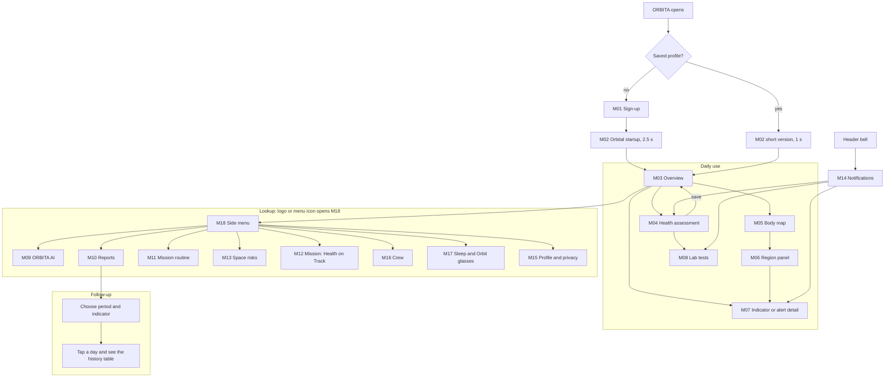

# 18. Responsive ORBITA design: screens, components and demo data

> Audience: whoever will run the code in Lovable (React, TypeScript, Tailwind, Lucide, Recharts) and whoever reviews the screens before delivery.
> Format: responsive web app that works well on phone, tablet and laptop; the Overview (Visão geral) also opens on a large screen (shared station monitor, laptop or presentation screen). Decision by the project owner on 2026-11-15, at 10:45.
> Basis: mandatory decisions from [`17-orbita-prompt-review.md`](17-orbita-prompt-review.md) (inventory M01 to M18 in section 5 and values in section 4); team prompt in [`../pesquisa/prompt-orbita-equipe.md`](../pesquisa/prompt-orbita-equipe.md) (identity, ORBITA name, palette and structure); principles U1 to U9 and rules for coexisting with the station alarm from [`07-interface-design.md`](07-interface-design.md); thresholds from [`03-indicators-and-thresholds.md`](03-indicators-and-thresholds.md) and [`../prototipo/config/indicadores.json`](../prototipo/config/indicadores.json); data model from [`06-data-model.md`](06-data-model.md); cross-referencing rules from [`04-data-cross-referencing.md`](04-data-cross-referencing.md).
> Drawings: [`wireframes/orbita-responsive.html`](wireframes/orbita-responsive.html) (open in the browser): one 390 x 844 px phone frame per screen, one 1920 x 1080 px large-screen frame for the Overview in display mode and one 1366 x 768 px laptop frame for the Reports with the fixed side menu. This document does not include application code.

---

## 1. Principles

| # | Principle | How it appears in ORBITA |
| --- | --- | --- |
| P1 | **Read in 3 seconds** | The top of the Overview states the overall status with color, icon and word before any number ("Health: attention · 3 indicators and 1 alert"). |
| P2 | **Progressive disclosure** | Status, then reason, then data, then source. Card → detail (M07) → chart → rule and reference. |
| P3 | **Always the next action** | Every yellow, orange and red carries "What to do" and "Escalates if". No alert ends without an action. |
| P4 | **Color never alone** | Every status has color, icon and word (section 2.2). Works with color blindness and in night mode. |
| P5 | **Minimal typing** | Touch scales, chips, +0.25 L buttons, hour picker. Keyboard only for name, notes, lab results and questions to the AI. Touch targets of at least 44 px. |
| P6 | **Night mode** | Automatic amber palette from pre-sleep (19:30 GMT on the default schedule), with little blue light. |
| P7 | **Mutual care with consent** | The Crew (M16) shows for each colleague only what they agreed to share. "Not shared" is neutral text, never an alert color. Filtering happens in the engine, before the screen. |
| P8 | **Do not imitate the station alarm** | Nothing blinks, nothing plays sound, nothing vibrates. Labels always carry the prefix "Health:". Never use the words Caution, Warning or Emergency. Neutral surfaces: the status appears only in the outline, the icon and the word. |
| P9 | **Support, not diagnosis** | "Possible", "suggests", "consistent with". Every terrestrial reference carries the label "terrestrial reference, not a flight limit". |
| P10 | **Simulated data is marked** | Every value shows the origin badge (section 2.7). Nothing pretends to be connected to equipment. |
| P11 | **One screen, several sizes** | The same content reorganizes from phone to laptop. On the large screen, the Overview becomes a mission panel, legible from a distance: large numbers, few elements and no scrolling. |

---

## 2. Design system

Use the token names below as CSS variables and in `tailwind.config` (for example `bg-surface`, `text-muted`, `border-estado-atencao`). They are the same names as in [`19-revised-lovable-prompt.md`](19-revised-lovable-prompt.md) and in the CSS of the wireframes file.

### 2.1 Brand colors and surfaces

| Token | Default theme (dark) | Night mode (amber) | Use | Text contrast on `--bg` |
| --- | --- | --- | --- | --- |
| `--bg` | `#07111F` (deep navy blue) | `#120A04` | Screen background | |
| `--surface` | `#0B1B2B` (secondary navy blue) | `#1C1108` | Cards, header, bottom bar, bottom sheet | |
| `--surface-2` | `#11243A` | `#26170B` | Elements inside cards, scales, fields | |
| `--border` | `#91A4B8` at 20% opacity (about `#232E3E` over `--bg`) | `#3A2414` | Subtle borders (decorative, carry no information) | |
| `--border-strong` | `#2A4A6B` | `#553620` | Outline of fields, secondary buttons, body silhouette | |
| `--text` | `#F4F8FC` (white) | `#F2C79B` | Main text | 17.75:1 (night 12.53:1) |
| `--muted` | `#91A4B8` (bluish gray) | `#BC9672` | Secondary text, labels | 7.40:1 (night 7.23:1) |
| `--primary` | `#21C5EF` (main cyan) | `#E8963F` | Primary action, active item, focus, chart series | 9.29:1 (night 8.28:1) |
| `--primary-2` | `#16A9C4` (turquoise blue) | `#C77B30` | Second chart series, baseline band | 6.77:1 |

Text on a cyan button: `#07111F` on `#21C5EF` gives 9.29:1.

### 2.2 Status colors and levels

Mandatory mapping from `docs/17` (correction 5): gray = level 0, green = 1, yellow = 2, orange = 3, red = 4. Levels are interface states, with no physical unit. Contrasts measured on `#07111F` (background) and on the indicated badge background.

| Level | Color | Token | Hex of text and outline | Badge background (14% of the color over `--surface`) | Contrast on `#07111F` | Contrast on the badge | Lucide icon | Fallback symbol | Label | Who acts |
| --- | --- | --- | --- | --- | --- | --- | --- | --- | --- | --- |
| 0 | Gray | `--estado-sem-dado` | `#A3ADBA` | `#202F3F` | 8.34:1 | 6.00:1 | `CircleHelp` | ? | No data | The crew member themself (measure, transfer, reconnect) |
| 1 | Green | `--estado-normal` | `#22C55E` | `#0E3332` | 8.31:1 | 5.99:1 | `CircleCheck` | ✓ | Health: normal | Nobody |
| 2 | Yellow | `--estado-atencao` | `#F5B800` | `#2C3125` | 10.58:1 | 7.46:1 | `CircleAlert` | ! | Health: attention | Crew member; CMO if it persists |
| 3 | Orange | `--estado-alerta` | `#F97316` | `#2C2728` | 6.76:1 | 5.25:1 | `CircleX` | ✕ | Health: alert, call CMO | CMO and flight surgeon |
| 4 | Red | `--estado-critico` | `#FF6B6B` | `#2D2634` | 6.82:1 | 5.26:1 | `OctagonX` | ✕ in octagon | Health: critical, contact CMO now | "Contact CMO now" and open the official procedure |

The five values are the same as in `docs/19`. Gray and red were chosen for contrast: the `#6B7280` of the first version gave only 3.92:1 on `#07111F` (below the 4.5:1 minimum for text) and `#EF4444` dropped to 4.10:1 inside the badge background; that is why both documents use `#A3ADBA` and `#FF6B6B` (aligned on 11/15). All pass 6:1 on `--bg` and `--surface`, as `docs/07`, section 5.1.1 requires. Badge background: each token has the `-bg` variant (for example `--estado-atencao-bg`).

Night mode: green `#A9C25A`, yellow `#F2B544`, orange `#EE8A45`, red `#F07A62`, gray `#AC9884`, all above 6:1 on `#120A04`. In night mode, yellow and orange are close: the difference is guaranteed by the icon and the word.

Usage rules:

- **Status badge** (`StatusBadge`): pill with a 1 px border in the level color, badge background, icon in a filled circle and label. Level 0 uses a dashed border.
- **Compact form**: in list rows, crew member blocks and matrix cells, the badge shrinks to icon plus short word ("attention", "normal", "no data") or only the icon; the full label with "Health:" stays in the block title, in the summary or in the accessible label. Environment values use the compact form without "Health:", because they are not a health status.
- **Card with status**: neutral surface (`--surface`) and only the outline in the color (1.5 px). Never paint the whole background yellow, orange or red. No halo, no colored shadow.
- **Red (level 4) only through a reported alarm symptom**, listed in `gatilhosSintoma` and `regraCor.sintomas` of `indicadores.json` (`docs/06`: it is the only path to level 4). No number produces red. An exceeded official requirement (CO2 above 3 mmHg in the 1 h average, career dose at 600 mSv or more) and a clinical cutoff with a source (SpO2 at or below 92%) produce level 3, orange, per the `regraCor`.
- **Baseline alone reaches at most yellow** (`linhaDeBase.nuncaVermelho: true`).
- **"No data" always with the exact word for the case**: "No reading", "Reading expired 26 h ago", "Sensor disconnected", "Weekly test pending". Validity comes from each indicator's `validadeHoras`.
- **Optional measurement never recorded** (pressure, glucose, temperature before the first record) does not use a gray badge: it shows the neutral text "No record" and the invitation "Record when you measure with the kit".
- **Routine reminders** use cyan or gray, never the status colors.

### 2.3 Typography

| Role | Family | Size at 360 to 430 px | Weight | Note |
| --- | --- | --- | --- | --- |
| Highlight number (card value) | Space Grotesk, fallback `system-ui` | 26 px (up to 30 px at 430 px) | 700 | `font-variant-numeric: tabular-nums`; unit beside it at 13 px, color `--muted` |
| Screen title | Space Grotesk | 20 px | 700 | Wraps to two lines if needed, never ellipsis in a title |
| Section title (AUTOMATIC MONITORING) | Inter, fallback `system-ui` | 12 px, uppercase, 0.08 em spacing | 700 | It is a label; minimum 12 px |
| Body text, buttons, list items | Inter | 14 px (button 14 to 15 px) | 400 to 600 | Minimum 14 px for text |
| Label, caption, badge, time | Inter | 12 px | 500 to 700 | Minimum 12 px |
| ORBITA brand in the header | Space Grotesk | 15 px, 0.14 em spacing | 700 | Beside the official icon |

The fonts are bundled with the app (`@fontsource/inter` and `@fontsource/space-grotesk`), with no network dependency. Optional fluid scale: `clamp(26px, 7vw, 30px)` for highlight numbers. Line height of 1.4 to 1.5 for text.

**Sizes by breakpoint** (section 2.11):

| Role | Phone | Tablet | Laptop | Large screen (display mode, 1920 x 1080) |
| --- | --- | --- | --- | --- |
| Highlight number | 26 px | 28 px | 32 px | 56 px (crew member block 28 to 40 px) |
| Screen or panel title | 20 px | 22 px | 24 px | 32 px |
| Label and section title | 12 px | 12 px | 13 px | 22 px (minimum 20 px) |
| Text | 14 px | 15 px | 15 px | 24 px |

Legibility at a distance: the NASA standard asks for labels of at least 12 points or 0.4 degree of visual angle at the viewing distance (NASA-STD-3001 Vol. 2, V2 10066, cited in `docs/07`, section 5.1.1). On a 55-inch TV at 1920 x 1080 seen from 3 m, 0.4 degree gives about 21 mm of character height, close to 33 px; that is why the large screen uses at least 20 px for labels and 40 to 56 px for values. Measure on the actual monitor or screen used in the presentation, because CSS pixels do not prove legibility.

### 2.4 Spacing, radii, shadows and glow

- **4 px grid**: allowed spacings 4, 8, 12, 16, 20, 24 and 32 px. Screen side margin 16 px. Space between cards of 10 to 12 px. Card padding 12 px (large card 16 px).
- **Radii**: card 16 px; inner element, field and button 12 px; badge, chip and pill 999 px; bottom sheet 24 px at the top; drawer with no radius.
- **Shadows**: almost none. Card without shadow; bottom sheet and drawer with `0 -10px 30px rgba(0,0,0,.5)`.
- **Cyan glow in moderation**: `0 0 0 1px rgba(33,197,239,.35), 0 0 16px rgba(33,197,239,.22)` in only three places: keyboard focus, the chosen option on a scale and the orbital dot of M02. Never on alerts, never on health states. In night mode the glow is turned off.
- **Width**: on the phone, full-width content with a 16 px margin. From the tablet up, the grid and navigation follow section 2.11; the ISS crew uses iPads and laptops (`docs/17`, section 2, item 1).

### 2.5 Suggested Lucide icons

| Item | Icon | Item | Icon |
| --- | --- | --- | --- |
| Menu | `Menu` | Notifications | `Bell` |
| Home | `House` | Map | `PersonStanding` |
| Assess | `ClipboardCheck` | AI | `Bot` |
| Heart rate | `HeartPulse` | Dosimetry | `Radiation` |
| Oximetry | `Activity` | Eye attention (EOG) | `Glasses` |
| CO2 and module air | `Wind` | Cabin pressure | `Gauge` |
| Space weather (protons) | `Sun` | Hydration | `GlassWater` |
| Fatigue | `BatteryLow` | Appetite | `Utensils` |
| Sleep | `BedDouble` | Mood | `Smile` |
| Blood pressure | `HeartPulse` | Glucose | `Droplet` |
| Temperature | `Thermometer` | Blood count | `TestTube` |
| Vision test | `Grid3x3` (Amsler) and `Eye` | PVT | `Timer` |
| Head and brain | `Brain` | Eyes | `Eye` |
| Ears | `Ear` | Vestibular | `Compass` |
| Heart | `Heart` | Lungs | `Wind` |
| Blood and immunity | `Droplet` | Digestion | `Utensils` |
| Kidneys | `Droplets` | Bones | `Bone` |
| Muscles | `Dumbbell` | Whole body | `Radiation` |
| Reports | `ChartLine` | Routine | `ListChecks` |
| Gamification | `Trophy` | Risks | `ShieldAlert` |
| Crew | `Users` | Sleep and glasses | `Moon` |
| Profile | `UserCog` | Private | `Lock` |
| Offline | `WifiOff` | Ground communication | `Satellite` |
| Offer support | `HandHeart` | Call CMO | `Stethoscope` |
| External link | `ExternalLink` | Send question | `Send` |

### 2.6 Amber night mode

- Turns on by itself at the start of pre-sleep (sleep time minus 2 h; 19:30 GMT on the default 21:30 to 06:00 schedule) and turns off 1.5 h after waking. It can also be turned on by hand in Profile (M15).
- Swaps all tokens for the "Night mode" column of sections 2.1 and 2.2. The body figure follows the tokens, with no blue.
- Cyan glow off. Charts use the amber `--primary`.
- The M17 wireframe is drawn in night mode.

### 2.7 Data origin badges

Field `origem` (origin) of the `Leitura` (`docs/06`, section 2.5). Small, neutral badge (`--surface-2`, border `--border`, text `--muted`, 12 px), never in a status color.

| `origem` | Badge text | Icon | When it appears |
| --- | --- | --- | --- |
| `simulada` | Simulated | `FlaskConical` | All data of the demo profile, including pre-loaded manual entries |
| `manual` | Recorded by you | `PencilLine` | Value typed or tapped by the astronaut after restoring the demo |
| `automatica` | Equipment (future integration) | `Cpu` | Future integration with a wearable or equipment; do not use in the prototype |
| `exame` | Lab test | `TestTube` | Lab result recorded in M08 |
| `historica` | Real, recorded (date) | `Database` | Real data recorded and replayed (ISS telemetry and NOAA from `prototipo/dados/amostras-reais/`), for example "Real, recorded 11/15" |
| `ao_vivo` | Live | `Radio` | Only if the optional integration is turned on; off by default |

Extra badge for the glasses: **"Orbit glasses (proposed) · simulated · experimental"** (`Glasses`). Values marked with `valorDeDemonstracao` carry the badge "demo value". In the Overview context line, the fixed badge "SIMULATED DATA" appears while the demo profile is active. Texts identical to those in `docs/19`, section 16.

### 2.8 Availability states

Field `disponibilidade` (availability, `docs/06`). Neutral badge with a dashed border; the engine only evaluates `disponivel` readings.

| State on screen | Field | Icon | Text |
| --- | --- | --- | --- |
| Collection scheduled | (routine task) | `CalendarClock` | "Collection scheduled for FD 53" |
| Awaiting transfer | `aguardando_transferencia` | `HardDriveUpload` | "Recorded, awaiting transfer" |
| Sample collected, analysis on Earth | `pendente_laboratorio` | `Earth` | "Sample collected on FD 38 · analysis on Earth" |
| Result available | `disponivel` | `FileCheck` | "Result available on 11/15, 06:00 GMT" |

### 2.9 Components

| Component | Main props | Where it appears |
| --- | --- | --- |
| `AppHeader` | `onMenu`, `naoLidas` (unread), `contexto` (astronaut, mission, FD, GMT), `modoExibicao` (display mode) | All inner screens |
| `BottomNav` | `ativo` (inicio, mapa, avaliar, ia) | Inner screens on the phone |
| `Drawer` | `itens[]`, `ativo`, `conectividade` | M18 on the phone |
| `SideNav` | `itens[]`, `ativo`, `recolhido` (collapsed), `conectividade` | Tablet and laptop |
| `MissionDisplay` | `ambiente[]`, `tripulantes[]` (already filtered by consent for the crew audience), `alertasAbertos[]`, `precisaApoio[]`, `metaTripulacao` | M03 on the large screen |
| `StatusBadge` | `nivel` (0 to 4), optional `texto` | Everywhere |
| `OriginBadge` | `origem`, `proposto` | Cards, data rows, M07 |
| `AvailabilityBadge` | `disponibilidade`, `instante` | M03, M08, M11 |
| `MetricCard` | `rotulo`, `valor`, `unidade`, `nivel`, `linhaDeBase`, `serie[]`, `origem`, `atualizadoEm` | M03, M17 |
| `EnvCard` | `modulo`, `leituras[]` (indicator, value, unit, level) | M03 |
| `SelfReportList` | `itens[]` (indicator, value, unit, usual, level), `registradoEm` | M03 |
| `AlertCard` | `alerta` (level, title, summary, regraId) | M03, M14 |
| `AlertDetail` | `alerta` (evidence, actions, escalation trigger, source, notifications) | M07 |
| `IndicatorDetail` | `indicador`, `leituras[]`, `linhaDeBase`, `regraAplicada` | M07 |
| `BodyMap` | `estadoPorRegiao`, `lado` (front, back), `sexo`, `onSelect` | M05, M06, preview in M03 |
| `RegionSheet` | `regiao`, `riscos[]`, `indicadores[]`, `orientacoes`, `linkHRP` | M06 |
| `ScaleSelector` | `min`, `max`, `valor`, `rotulos[]`, `habitual` | M04 |
| `ChipGroup` | `opcoes[]`, `valor`, `multiplo` | M04, M10, M14 |
| `Stepper` | `valor`, `passo`, `unidade` | M04 (hydration, sleep) |
| `TrendChart` (Recharts) | `serie[]`, `faixaLinhaDeBase`, `faixaReferencia`, `eventos[]`, `diaSelecionado` | M07, M10 |
| `LabStatusStepper` | `estado` (scheduled, collected, available) | M08 |
| `ChatMessage` | `autor`, `texto`, `fontes[]` | M09 |
| `TaskItem` | `nome`, `descricao`, `periodicidade`, `prazoGmt`, `estado` | M11 |
| `XpBar`, `AchievementCard` | `xp`, `nivel`, `proximo`; `conquista`, `progresso` | M12 |
| `HazardCard` | `perigo`, `descricao`, `impactos[]`, `regioes[]`, `indicadores[]`, `url` | M13 |
| `NotificationItem` | `tipo` (saude, rotina, info), `nivel`, `texto`, `destino`, `instante` | M14 |
| `ConsentRow` | `dado`, `audiencia`, `atualizadoEm`, `onRevogar` | M01, M15 |
| `CrewCard`, `CrewMatrix` | `tripulante`, `moduloAtual`, `estadoGeral`, `blocos[]`, `compartilhamento`, `fraseAjuda`, `tamanho` (list, card, display) | M16 and M03 on the large screen |
| `Hypnogram` | `epocas[]` (stage every 30 s) | M17 |
| `SoundscapeSchedule` | `perfil`, `faixas[]`, `audioNoSono` | M17 |

### 2.10 Motion and accessibility

- Allowed: transition between screens (200 to 250 ms), opening of the drawer and bottom sheet (250 ms), color change of a body region (300 ms), M02 animation.
- Forbidden: pulse, blinking, halo, glow on an alert, countdown, continuous animation on a screen that stays open, sound and vibration at any level.
- `prefers-reduced-motion`: replaces all transitions with a simple cut and shows M02 static.
- Static loading skeleton (gray blocks with no running shimmer).
- Every control has an accessible label; the body figure has an equivalent list of regions (M05) for screen readers and keyboard.
- Texts come from the `src/i18n/` dictionary (Brazilian Portuguese, with English), never hard-coded in the component.

### 2.11 Breakpoints and navigation

| Range | Widths | Navigation | Overview grid (M03) | Other screens |
| --- | --- | --- | --- | --- |
| Phone | 360 to 430 px (applies up to 767 px) | Bottom bar with 4 shortcuts (Home, Map, Assess, AI); side menu (M18) as a drawer, opened by the logo plus the menu icon; bell in the header | One column, personal panel (layout M03a) | One column; M06 as a bottom sheet |
| Tablet | 768 to 1024 px | Fixed, collapsible side menu: 240 px open, 72 px collapsed with icons only (default collapsed in portrait, open in landscape); no bottom bar; logo and bell at the top | Two columns: on the left summary, alert, automatic and environment; on the right personal assessment and map | M05 and M06 side by side (figure and panel); M16 in a grid of 2 cards |
| Laptop | from 1280 px (1024 to 1279 px follows the tablet) | Fixed 240 px side menu, collapsible to 72 px; no bottom bar | Three columns, content at most 1200 px | M10 with a wide chart and table beside it; M16 in a grid of 4 cards |
| Large screen | from 1920 px (or the "Display mode" button on any screen of 1280 px or more) | No menu and no bottom bar: display mode. A key or a discreet button in the corner ("Exit display mode") returns to the laptop layout | Mission panel (layout M03b), no scrolling | Only M03 has a display mode; the other screens use the laptop layout |

Rules:

- Same content and same reading order in all ranges; only the arrangement changes. Nothing appears only on the phone or only on the laptop, except the large-screen mission panel.
- The fixed side menu has the same 12 items as M18, the current item highlighted and the connectivity footer; collapsed, it shows only icons with a hover tooltip and an accessible label.
- 44 px touch targets apply in all ranges; on the laptop, visible keyboard focus on every control.
- Tailwind: `sm` 360 px, `md` 768 px, `lg` 1280 px, `xl` 1920 px (configure the breakpoints in `tailwind.config`, because Tailwind's defaults are different).
- Display mode requires deliberate activation ("Full screen" button in the laptop header, "Display mode" selector or opening the `/painel` route), does not react to touch to open details, and after a few minutes without use (configurable) hides the values and keeps only the states (`docs/07`, T1; `docs/19`, section 4).

---

## 3. Navigation

### 3.1 Flow map

The flow is the same in all ranges; on the tablet and laptop, "M18 Side menu" is the fixed menu. The large screen opens directly on the mission panel (M03b) and leaves it through "Exit display mode".

### 3.2 Fixed structure of the inner screens

| Element | Phone | Tablet and laptop | Large screen |
| --- | --- | --- | --- |
| **Header** | 48 px. On the left, a single button with the official ORBITA icon, the word ORBITA and the visible `Menu` icon (the prompt asks for an interactive logo; the menu icon makes it discoverable); a tap opens the drawer (M18). On the right, the bell with the number of unread notifications in cyan (not in a status color). | 56 px. Logo at the top of the fixed menu; in the header, screen title, context, "Display mode" button (only in M03) and bell. | 80 px: logo, "Mission panel", mission, day, large GMT, data and connectivity badges. No bell. |
| **Context line** | Only in the Overview: "ASTRONAUT 001 · ISS EXP-01 · DAY 045" and "GMT 319 / 06:40" (day of year and time, the official ISS time), with the badge "SIMULATED DATA". Disappears on scroll. | Inside the header, always visible | Inside the header |
| **Navigation** | 62 px bottom bar with Home (M03), Map (M05), Assess (M04) and AI (M09); active item in cyan, label always visible. 300 px drawer that slides in from the left in 250 ms and closes by the X, by tapping outside or by the back gesture. | Fixed 240 px side menu, collapsible to 72 px | None (display mode) |
| **Back** | Screens opened from a card (M06, M07, M08) show a back arrow to the left of the title; the header with the logo remains. | Same, with the breadcrumb "Overview › Detail" | Not applicable |

### 3.3 Rules

- The astronaut reaches any feature without going back to the Overview: drawer and bottom bar on all inner screens.
- Tapping a notification goes straight to the indicator, alert or task (M07, M04, M08).
- Inner routes: `/inicio`, `/mapa`, `/mapa/:regiao`, `/avaliar/:aba`, `/indicador/:indicadorId`, `/alerta/:alertaId`, `/exames`, `/ia`, `/relatorios`, `/rotina`, `/missao`, `/riscos`, `/notificacoes`, `/perfil`, `/tripulacao`, `/sono`.
- No reminders during sleep time (21:30 to 06:00 GMT on the default schedule) or during a critical activity marked in the routine.

---

## 4. Screens

Format of each screen: objective; layout from top to bottom; components; data (with `indicadorId` and unit); states; interactions; texts; done criteria. The values cited are those of the demo (section 5). Ids in backticks are exactly those of `indicadores.json`. The ids `apetite` (ordinal category from 1 to 3, region `digestao`) and `eog_piscadas` (region `cerebro`) are already in the JSON; `sintomas_checkin`, `hematocrito`, `leucocitos`, `audiometria` and `zumbido` exist in `docs/03`, but not yet in the JSON.

### M01. Sign-up

**Objective.** Create the local profile on first access. Required to start; does not reappear once completed, unless the astronaut chooses "Edit profile" in M15.

**Layout, from top to bottom.**
1. Official ORBITA icon (placeholder until the SVG arrives at `prototipo/marca/orbita-icone.svg`), title and description.
2. "You" block: Full name; Sex (two buttons: Male, Female); Body mass (kg) and Height (cm) side by side; Personal notes (optional, with a lock).
3. "Mission" block: Mission name; Start date (the app shows the computed mission day); Sleep time in GMT.
4. "What the crew can see" block: three switches.
5. "SAVE AND CONTINUE" button, full width.

**Components.** Text and number fields, two-option `ChipGroup`, date picker, time picker, three simplified `ConsentRow`, primary button.

**Data.**

| Field | Entity and field (`docs/06`) | Unit | Demo |
| --- | --- | --- | --- |
| Full name | `Tripulante.codinome` | | Astronaut 001 |
| Sex | `Tripulante.sexo` (exists in the simulation profile; add to `docs/06`) | | Male |
| Body mass | `Tripulante.massaPreVooKg` | kg | 78 kg |
| Height | `Tripulante.alturaCm` (new field; add to `docs/06`) | cm | 180 cm |
| Personal notes | stored only on the device, marked private | | empty |
| Mission name | `Missao.nome` | | ISS EXP-01 |
| Start date | `Missao.inicioUtc` | ISO date in UTC | 44 days before today, so the day is 45 |
| Sleep time | `Tripulante.horarioSono` | GMT | 21:30 to 06:00 |
| Sharing | `Tripulante.compartilhamento` | | demo: everything with the crew |

Mission day (FD) = days since start + 1 (`docs/06`, `Missao`). Sex also selects the body map figure and the hemoglobin reference range (13 to 18 g/dL in men and 12 to 16 g/dL in women, terrestrial reference).

**States.** Empty (first access; validation happens on tapping save); validation error (message below the field with the `CircleAlert` icon; the field border becomes `--text`, with no health status color); saving (the button shows "Saving" and is disabled, with no spinning spinner); editing (coming from M15: title "Edit profile", button "SAVE").

**Interactions.**

| Tap | Result |
| --- | --- |
| SAVE AND CONTINUE (valid, first access) | Saves to local storage and opens M02 |
| SAVE (editing) | Saves and goes back to M15 |
| Notes lock | Opens the explanation: "Stays only on this device. Never appears in the Crew screen or in reports." |
| "Adjust later in Profile and privacy" | Informational only; the full adjustment lives in M15 |

**Texts.** Title: "Astronaut Sign-up". Description: "Create your profile to personalize monitoring of your health during the mission." Sex help: "Defines the body map model and the blood count reference range." Label: "Body mass (kg)" (in space you measure mass, not weight). Notes: "Restrictions, preexisting conditions or other information. Private: stays only on this device." Computed day: "Today is mission day 45." Switches: "Status per system (color and icon, no numbers)", "Values (vital signs, sleep, hydration, radiation)", "Mood". Errors: "Enter your full name.", "Choose an option.", "Enter body mass in kg, numbers only.", "Enter height in cm, numbers only.", "The start date cannot be after today."

**Done criteria.**
- [ ] The four required fields block submission when empty or non-numeric, with the message above.
- [ ] After saving, closing and reopening the app leads to the short M02 and then to M03, without going through M01.
- [ ] The FD shown is days since start + 1.
- [ ] Changing the sex changes the figure in M05.
- [ ] Notes never appear in M16, M10 or M09.
- [ ] Default sharing of a new profile: status per system only for the CMO and flight surgeon; values and mood "Only me" (`docs/06`).

### M02. Orbital startup

**Objective.** Present the ORBITA identity between sign-up and the Overview, without looking like loading.

**Layout.** `--bg` background. Official icon centered (about 140 px). Below, "ORBITA" and the subtitle. Footer: "Tap to skip".

**Animation script.**

| Time | What happens |
| --- | --- |
| 0 to 0.3 s | Static icon |
| 0.3 to 1.7 s | The small cyan circle travels 360 degrees exactly over the icon's elliptical ring, with a short cyan light trail |
| 1.7 to 2.3 s | The whole icon dissolves (opacity and slight blur; particles are optional) |
| 2.3 to 2.5 s | Cross transition to M03 |

Total of at most 2.5 s. After the first access, a 1 s version (fast orbit and cut). With `prefers-reduced-motion`, static icon for 0.6 s and a cut. Recommended implementation: the ellipse path comes from the official SVG itself (`offset-path` in CSS or `animateMotion`), to respect the geometry. Do not redraw the icon.

**States.** First access (long version); later accesses (short version); reduced motion (static); official icon missing (placeholder with circle, ring and dot, with a warning in the code to replace it).

**Interactions.** Tapping anywhere skips to M03.

**Texts.** "ORBITA". "Health Monitoring System for Astronauts on Space Missions." "Tap to skip".

**Done criteria.**
- [ ] Total duration of at most 2.5 s on first access and 1 s afterwards.
- [ ] The dot follows the official SVG's ellipse, without deforming the symbol.
- [ ] A tap skips immediately.
- [ ] With reduced motion turned on in the system, nothing moves.

### M03. Overview (dashboard)

**Objective.** Answer in 3 seconds "am I well? do I need to do something now?" and gather the automatic data, the environment, the personal assessment and the map preview. It is the most used screen. It has two layouts: **M03a, personal panel** (phone, tablet and laptop) and **M03b, mission panel** (large screen, display mode).

**Layout M03a, phone, from top to bottom** (vertical scroll; the wireframe shows two frames: top and after scrolling). On the tablet, the same content in two columns (on the left summary, alert, automatic and environment; on the right personal assessment and map); on the laptop, in three columns, with the fixed side menu.
1. Header (section 3.2).
2. Context line: "ASTRONAUT 001 · ISS EXP-01 · DAY 045", "GMT 319 / 06:40", badge "SIMULATED DATA".
3. **Day summary**: `StatusBadge` of the overall status (highest level among indicators and alerts) and a sentence.
4. **Explainable alert** (one `AlertCard` per open alert, highest level first): "Possible effect of elevated CO2".
5. **AUTOMATIC MONITORING**: four `MetricCard` in a 2 x 2 grid.
6. **MODULE ENVIRONMENT**: `EnvCard` of the module where the astronaut is.
7. **PERSONAL ASSESSMENT**: Daily (five items, date and time of the record, button "Update assessment"); Manual vital signs (optional); Periodic (blood count); Weekly (vision tests and PVT).
8. **BODY MAP**: preview of the figure with the colored regions and the list of what needs attention.
9. Bottom bar, Home active.

**Data.**

| Block | Label on screen | `indicadorId` | Value and unit on screen | Canonical unit in the data | State in the demo | Origin |
| --- | --- | --- | --- | --- | --- | --- |
| Automatic | Heart rate | `fc_repouso` | 86 bpm; "Your usual: 64 bpm"; 7-day mini chart | bpm | ! Health: attention, by deviation from the baseline, even within the terrestrial reference of 60 to 100 bpm | Simulated |
| Automatic | Dosimetry | `dose_acumulada` (and the day's dose, derived from the accumulated value) | "Today 0.42 mSv"; "Mission 18.9 mSv"; bar "3.2% of the 600 mSv career limit" | mSv | ✓ Health: normal (official requirement: less than 600 mSv career, NASA-STD-3001 Vol. 1, V1 4030) | Simulated |
| Automatic | Oximetry | `spo2` | 97 %; "Terrestrial reference: 95 to 100%, not a flight limit"; last record | % | ✓ Health: normal | Simulated |
| Automatic | Eye attention (EOG) | `eog_piscadas` | 12.4 blinks/min; "Within your usual. Experimental, not a diagnosis." | blinks/min | ✓ Health: normal (baseline only, no threshold) | Orbit glasses (proposed) · simulated · experimental |
| Environment | CO2 · Node 3 | `ppco2_modulo` | 2.95 mmHg | mmHg | ! attention by rule R-CO2-01 (EWMA above the demonstrative marker of 2.8 mmHg, with a reported symptom; the official requirement is a 1 h average up to 3 mmHg) | Simulated (scenario C1; peak equal to the real recorded Node 3 value) |
| Environment | O2 (PIO2) · Node 3 | `pio2_cabine` | 18.84 kPa (141.3 mmHg); "O2 slightly below target in Node 3; check the sensor and follow the trend" | kPa | ! attention: outside the normoxia target of 19.33 to 20.67 kPa (145 to 155 mmHg), within the limits (127 mmHg in the 1 h average, 122 mmHg absolute) | Real, recorded 11/15 |
| Environment | Cabin pressure · US Lab | `pressao_cabine` | 101.0 kPa | kPa | ✓ (official envelope above 34.47 up to 103.42 kPa) | Real, recorded 11/15 |
| Environment | GOES protons | `fluxo_protons_goes` | 0.21 pfu | pfu | ✓ (below the NOAA S1 start, 10 pfu) | Real, recorded 11/15 |
| Environment | Kp index | `kp` | 1 | dimensionless | ✓ (baseline only, context) | Real, recorded 11/15 |
| Daily | Hydration | `agua_ingerida` | 1.8 L | mL (1,800 mL) | ✓ | Simulated |
| Daily | Fatigue | `fadiga` | 6 of 7; "usual: 2" | points, scale of 1 to 7 | ! attention (baseline) | Simulated |
| Daily | Appetite | `apetite` | Reduced; "usual: normal" | ordinal: normal, reduced, very reduced | ✓ (see section 7, item 4) | Simulated |
| Daily | Sleep | `sono_tst` | 5.4 h; "usual: 7.5 h" | min (324 min) | ! attention (baseline) | Simulated |
| Daily | Mood | `humor` | 3 of 5; "usual: 4" | points, scale of 1 to 5 | ✓ | Simulated |
| Vital signs | Blood pressure, glucose, temperature | `pa_sistolica`, `pa_diastolica`, `glicose`, `temperatura_corporal` | 120 over 80 mmHg; 90 mg/dL fasting; 36.8 °C | mmHg, mg/dL, °C | ✓ on all three (terrestrial reference; baseline forming) | Simulated |
| Periodic | Blood count | `hemoglobina` and others from the report | "Sample collected on FD 38 · analysis on Earth"; "Next collection: FD 53" | g/dL | availability badge, no color; the 22-day-old result appears with the age of the data | Lab test |
| Weekly | Vision tests and PVT | `acuidade_perto`, `amsler_distorcao`, `pvt_tempo_reacao`, `pvt_lapsos` | "Last 6 days ago · next on FD 46" | | ✓ (no new distortion; PVT of 268 ms, usual 270 ms) | Simulated |

The day's dose (0.42 mSv) is the daily difference of the accumulated value, in equivalent dose. It is not the `taxa_dose_radiacao` indicator (ambient dose rate in µGy/h, baseline), which only appears when there is a reading of that type.

PIO2 (`pio2_cabine`) is the **inspired** O2 pressure, computed from the module's ppO2 and the total pressure: PIO2 = (total pressure minus 47 mmHg) × ppO2 ÷ total pressure (OCHMO-TB-003; `docs/04`, A1). With the real recording (Node 3 ppO2 of 150.67 mmHg and total pressure of 757.64 mmHg), it gives 141.3 mmHg, or 18.84 kPa. Never show the raw ppO2 as if it were the PIO2.

**States.**

| State | How it appears |
| --- | --- |
| Normal with no alert | Summary "✓ Health: normal · no open alerts"; the alert block disappears |
| Loading | Static skeleton on the cards, no running shimmer |
| Empty (first days) | Card with value and the text "Baseline forming: 3 of 7 readings"; color only by a sourced reference |
| No data | Card with a dashed gray outline, ? and the exact word: "No reading", "Reading expired 26 h ago", "Sensor disconnected" |
| Pending | Blood count with availability badge |
| Daily assessment overdue (24 h) | Daily block with "Today's assessment pending" and a cyan "Do assessment" button |

**Interactions.**

| Tap | Destination |
| --- | --- |
| Day summary, "See what to do" | M07 of the highest-level alert |
| Alert card, "Why am I seeing this" | M07, alert mode |
| Each automatic card and each environment item | M07, indicator mode |
| Daily assessment item or "Update assessment" | M04, Daily tab |
| Vital signs | M04, Vital signs tab |
| Blood count | M08 |
| Weekly tests | M04, Tests tab |
| Map preview or "Open map" | M05 |
| Logo or menu icon | M18 |
| Bell | M14 |

**Texts.** "AUTOMATIC MONITORING", "MODULE ENVIRONMENT", "PERSONAL ASSESSMENT", "BODY MAP". Summary: "Health: attention · 3 indicators need attention and there is 1 alert. The other measured indicators are normal." Alert: "Possible effect of elevated CO2" / "Node 3 CO2 at 2.95 mmHg and difficulty concentrating reported 40 min ago." / context: "Also different from your usual today: heart rate and fatigue." / button "Why am I seeing this". O2: "O2 slightly below target in Node 3; check the sensor and follow the trend." EOG: "Experimental. Not a diagnosis of inattention." Daily: "Daily · last 24 hours · recorded at 06:00 GMT". Vital signs: "Optional: record when you measure with the kit." Map: "Attention: Head and brain, Heart, Lungs".

**Done criteria.**
- [ ] With the demo data, the screen shows exactly three yellows on the body (heart rate, fatigue, sleep), Node 3 O2 in yellow in the environment, one CO2 alert and everything else green.
- [ ] Every number has its unit beside it and every status has color, icon and word.
- [ ] Every card shows the origin badge.
- [ ] The oximetry card and the HR detail show "terrestrial reference, not a flight limit".
- [ ] Dosimetry shows the day's dose, accumulated and percentage of 600 mSv; no color for approaching the limit without an approved tier.
- [ ] The EOG card says "Orbit glasses (proposed)" and never uses a color by threshold.
- [ ] Saving the assessment in M04 updates the values, date and time of this block without reloading.
- [ ] No element blinks, pulses or emits sound.
- [ ] On the tablet and laptop the content is the same, in two or three columns, with the fixed side menu.

#### M03b. Large-screen Overview: mission panel (1920 x 1080)

**Objective.** On a shared station monitor, a laptop in display mode or the presentation screen, show in the same frame the station environment, the whole crew, who needs support and the open alerts, legible from a distance. It is the Overall Monitor (Monitor geral) of `docs/07`, T1, in the ORBITA format.

**Layout, no scrolling** (12-column grid, 48 px margins, 24 px gap):
1. **Mission bar** (80 px): icon and "ORBITA"; "Mission panel"; "ISS EXP-01 · DAY 045"; badges "SIMULATED DATA", "Offline: running locally" and "Ground: no contact"; "Display mode" indicator; "GMT 319 / 06:40" at 34 px.
2. **Priority row** (150 px), two blocks side by side:
   **Needs support** (5 columns): only crew members in orange or red, with who, for how long and the action ("Offer support", "Call CMO"); outline in the level color, neutral surface, no blinking. With nobody at that level, the neutral sentence "Nobody needs support right now."
   **Open alerts** (7 columns): one per row, highest level first, with `StatusBadge`, a title with "possible", the crew member (if they share status with the crew), module and how long ago, with no clinical evidence.
3. **Station environment** (about 226 px, 6 blocks): Node 3 CO2, Node 3 O2 (PIO2), cabin pressure, mission dose against 600 mSv, GOES protons against the NOAA S1 start and Kp index. Each block with module, large value, unit, symbol and word; the origin badges sit in the strip title.
4. **Crew** (about 464 px): one display `CrewCard` per crew member, side by side (up to 4 in a row; with 5 to 7 crew members, the panel switches to the matrix mode of M16). Each card: codename, role, current module (if shared), overall `StatusBadge`, mini body figure with the regions and seven blocks (Heart, Oxygenation, Temperature, Sleep, Hydration, Radiation, Mind), with a footer showing the age of the data and, if there is an alert, the phrase "How to help".
5. **Footer** (40 px): "Peer checks today: 2", "Crew goal: hydration 3 of 4", legend "✓ normal · ! attention · ✕ alert · ? no data" and "Only what each crew member shared with the crew".

Activation and use: display mode is turned on by the "Full screen" button in the laptop header ("Display mode" selector, `docs/19`), never on its own. After a few minutes without use (configurable), the panel hides the values and keeps only the states (color, icon and word). Tapping a card at most expands what is already visible; the alert detail (M07) only opens on the person's own device.

**Consent and privacy.** The panel is seen by everyone, so it uses only what each crew member shared with the **crew** audience (`Tripulante.compartilhamento`). Data shared only with the CMO, flight surgeon or a chosen colleague does not appear here. Filtering happens in the engine: the component receives the already filtered list. "Not shared" is neutral text, with no color and no inference. Clinical details, described symptoms, questionnaires, personal notes, blood count or conversations with the AI never appear. The CO2 alert appears as "Possible effect of elevated CO2 in Node 3" with the environmental action; the reported symptom stays only on the astronaut's device. No tap opens a medical record.

**Demo data.**

| Block | Content | `indicadorId` | State |
| --- | --- | --- | --- |
| Needs support | "Nobody needs support right now." (nobody in orange or red) | | neutral |
| Open alerts | "Possible effect of elevated CO2 in Node 3 · Astronaut 001 · 40 min ago · check ventilation; CMO informed" | R-CO2-01 | ! attention |
| CO2 · Node 3 | 2.95 mmHg | `ppco2_modulo` | ! attention (rule R-CO2-01) · Simulated, scenario C1 |
| O2 (PIO2) · Node 3 | 18.84 kPa (141.3 mmHg) | `pio2_cabine` | ! attention: below the normoxia target, within the limits · Real, recorded |
| Cabin pressure · US Lab | 101.0 kPa | `pressao_cabine` | ✓ · Real, recorded |
| Mission dose | 18.9 mSv (3.2% of 600 mSv; today 0.42 mSv) | `dose_acumulada` | ✓ · Simulated |
| GOES protons | 0.21 pfu (S1 starts at 10 pfu) | `fluxo_protons_goes` | ✓ · Real, recorded |
| Kp index | 1 | `kp` | ✓ · Real, recorded |
| Crew | Astronaut 001 in attention; Crew members A, B and C in "Health: normal" (M16 table) | several | see M16 |

**States.** Normal (nobody needs support, no alert: both strips show neutral sentences); someone at level 3 or 4 ("Needs support" strip with name and action, orange or static red outline, no blinking); no environment data (dashed gray block with "Reading expired 2 h ago"); crew member with no data (dashed card with "Sensor disconnected for 26 h"); many crew members (5 to 7: matrix mode); a few minutes without use (values disappear and only the states remain).

**Interactions.** None required: it is a screen to look at. The Esc key or the "Exit display mode" button returns to the laptop layout. No tap for clinical detail.

**Texts.** "Mission panel"; "Needs support"; "Nobody needs support right now."; "Open alerts"; "Station environment"; "Crew"; "Shows only what each crew member shared with the crew."; "Display mode".

**Done criteria.**
- [ ] At 1920 x 1080 everything fits without scrolling, with labels of at least 20 px and values of 40 to 56 px.
- [ ] Revoking a data item in M15 removes it from the panel immediately.
- [ ] No symptom, note, test or conversation appears on the panel.
- [ ] Nothing blinks, pulses or plays sound; the "Needs support" strip uses a neutral surface.
- [ ] With 5 to 7 crew members, the panel uses the matrix and still has no scrolling.
- [ ] Display mode only turns on by deliberate action.

### M04. Health assessment (daily, vital signs, tests)

**Objective.** Record in about 2 minutes what only the astronaut can say, with taps instead of typing, and give access to manual vital signs and quick tests.

**Layout.**
1. Header and title "Health assessment".
2. Tabs: Daily · Vital signs · Tests · Lab tests (Lab tests opens M08).
3. Status line: "Last 24 hours · last record at 06:00 GMT" and origin badge.
4. Tab content.
5. Primary button at the end of the tab ("SAVE ASSESSMENT", "SAVE VITAL SIGNS").

**Daily tab.**

| Question | `indicadorId` | Control | Unit | Demo value | Usual shown |
| --- | --- | --- | --- | --- | --- |
| Hydration in the last 24 h | `agua_ingerida` | `Stepper` with −0.25 L and +0.25 L | L on screen, mL in the data | 1.8 L | |
| Fatigue now | `fadiga` | `ScaleSelector` from 1 to 7 with the written anchor of the chosen value | points, 1 to 7 | 6 | 2 |
| Appetite | `apetite` | `ChipGroup`: Normal, Reduced, Very reduced | ordinal | Reduced | Normal |
| Sleep last night | `sono_tst` | `Stepper` of 0.1 h (or hours and minutes clock) | h on screen, min in the data | 5.4 h | 7.5 h; scheduled 8.5 h |
| Mood | `humor` | `ScaleSelector` from 1 to 5 | points, 1 to 5 | 3 | 4 |
| Symptoms today (optional) | `sintomas_checkin` (separate items, no sum) | Multiple `ChipGroup`: None, Headache, Difficulty concentrating, Dizziness, Nausea, Blurred vision, Other | | Difficulty concentrating | |

Fatigue anchors (Samn-Perelli scale, free translation not yet validated): 1 "Fully alert, wide awake"; 2 "Very lively, responsive, but not at peak"; 3 "Okay, somewhat fresh"; 4 "A little tired, less than fresh"; 5 "Moderately tired, let down"; 6 "Extremely tired, very difficult to concentrate"; 7 "Completely exhausted, unable to function effectively". Mood (project's own scale): 1 "Very bad", 2 "Bad", 3 "Neutral", 4 "Good", 5 "Very good". The usual value appears as a discreet mark under the corresponding option.

If "Headache" is checked, the question "Headache intensity (0 to 10)" appears, linked to `dor`; 7 or more is the demonstrative escalation trigger of rule R-CO2-01 (`valorDeDemonstracao: true`).

**Vital signs tab (optional, "when you measure with the kit").** Demo values: 120 over 80 mmHg, 90 mg/dL fasting and 36.8 °C, all green, with "baseline forming".

| Measurement | `indicadorId` | Unit | Reference text shown |
| --- | --- | --- | --- |
| Blood pressure | `pa_sistolica` and `pa_diastolica` | mmHg | "Terrestrial reference, not a flight limit: 90 to 120 mmHg (systolic) and 60 to 80 mmHg (diastolic)." |
| Glucose | `glicose` | mg/dL, with a "fasting" marking | "Terrestrial fasting reference: below 100 mg/dL. From 100 to 125 mg/dL calls for clinical interpretation." |
| Temperature | `temperatura_corporal` | °C (oral) | "Terrestrial oral reference: 36.5 to 37.3 °C." |

**Tests tab (weekly).**

| Test | `indicadorId` | Flow | Linked rule |
| --- | --- | --- | --- |
| Amsler grid | `amsler_distorcao` | Instruction (same distance, correction and light) → one eye at a time → "Did you see crooked, faded or missing lines?" → tap the area | R-SANS-01 (two worse tests within 14 days) |
| Near visual acuity | `acuidade_perto` | Chart on screen → smallest line read, per eye | R-SANS-01 |
| 3-minute PVT | `pvt_tempo_reacao`, `pvt_lapsos` | Instruction → 3 min tapping when the stimulus appears (interval of 1 to 4 s) → result with mean time in ms and lapses | Baseline; R-CO2-01 (worsening above 10%, only within the rule) |

Each test shows the date of the last and next: "Last: FD 39 (6 days ago)" and "Next: FD 46". In the demo, the last PVT gave 268 ms and 1 lapse (usual 270 ms) and the last vision test had no new distortion.

**States.** Assessment pending for the day (opens with empty fields and the usual values visible); already recorded today (opens with the values and the button becomes "UPDATE ASSESSMENT"); required question unanswered (the button says "2 answers missing" and scrolls to them); saved (notice "Assessment saved at 06:00 GMT · +20 XP" for 3 s, no sound); baseline forming ("Your usual will be ready after 7 records").

**Interactions.** SAVE writes one `Leitura` per answer (`origem: manual`), recomputes the states in the engine and returns to M03. Lab tests opens M08. Each test opens its instruction screen and returns to the Tests tab with the result.

**Texts.** "Health assessment"; "Last 24 hours"; "Hydration"; "Fatigue now (1 to 7)"; "Appetite"; "Sleep last night"; "Mood (1 to 5)"; "Symptoms today (optional)"; "SAVE ASSESSMENT"; "Optional: record when you measure with the kit."; "Weekly tests: about 6 minutes in total."

**Done criteria.**
- [ ] The complete daily assessment takes at most 6 taps besides save.
- [ ] Hydration appears in L and is stored in mL; sleep appears in h and is stored in min.
- [ ] Fatigue only accepts 1 to 7; mood only accepts 1 to 5.
- [ ] Each terrestrial reference appears with the label "terrestrial reference, not a flight limit".
- [ ] The assessment reopens at each new 24 h period, counted from the scheduled wake time.
- [ ] Previous records stay visible in M10, most recent first.

### M05. Body map

**Objective.** Show where the body needs attention and serve as an educational panel on spaceflight risks, region by region. It is not a list of texts: it is a clickable human figure.

**Layout.**
1. Header; title "Body map"; toggle "Front · Back".
2. Badge "Educational: not every risk is detected by the indicators."
3. SVG figure (male or female according to sign-up), centered, with the 12 regions colored by status and symbols (!, ✓, ?) on the larger regions. A tap highlights the region with a cyan outline and opens M06.
4. Short legend: "✓ normal · ! attention · ✕ alert · ? no data".
5. List of the 12 regions in two columns, each with symbol, color and name (equivalent to the figure for screen readers and keyboard).
6. Bottom bar, Map active.

On the front appear head, eyes, ears, vestibular, heart, lungs, abdomen, kidneys (on the flanks), blood (systemic marker on the arm), muscles (arms and thighs), bones (legs and knees) and the whole-body badge. On the back: spine (bones), kidneys (more visible from behind), back muscles and the back of the legs. A 3D model with Three.js only if time allows (`docs/17`, section 2, 3D body map).

**Region color rule.** The region takes the worst status among its indicators that have a valid reading and the cross-referencing alerts linked to it (R-CO2-01 links the Lungs region, because it crosses the module's CO2 with the crew member; `docs/04`, part C). If no indicator of the region has a valid reading, the region stays gray ("No data"). An environment reading alone (`regiaoCorpo: ambiente`, such as `pio2_cabine`) does not color the body: it appears in the environment card and as context in the panel.

**The 12 regions.**

| # | Region (SVG id) | Risks (team prompt) | One-sentence explanation | Related indicators | State in the demo | Risk link in the Human Research Program |
| --- | --- | --- | --- | --- | --- | --- |
| 1 | Head and brain (`cerebro`) | Neurological, behavioral, cognitive and sensorimotor changes | Short sleep, isolation, workload and CO2 can affect attention, mood and reaction time. | `fadiga`, `sono_tst`, `humor`, `pvt_tempo_reacao`, `pvt_lapsos`, `eog_piscadas` | ! attention (fatigue 6 of 7; sleep 5.4 h) | [Behavioral changes](https://www.nasa.gov/reference/risk-of-behavioral-conditions-and-psychiatric-disorders/); [Inadequate sleep](https://www.nasa.gov/reference/risk-from-inadequate-sleep-and-irregular-schedules/) |
| 2 | Eyes and vision (`olhos`) | SANS; changes in eye pressure and structure; visual changes linked to microgravity | In microgravity, fluids shift toward the head and can change the structure of the eye and vision. | `acuidade_perto`, `amsler_distorcao` | ✓ normal (FD 39 tests with no change; validity 2,160 h) | [SANS](https://www.nasa.gov/reference/risk-of-spaceflight-associated-neuro-ocular-syndrome-sans/) |
| 3 | Ears (`ouvidos`) | Continuous noise, tinnitus and hearing loss | Fans and pumps make noise all the time, and the daily noise dose is tracked to protect hearing. | `ruido_trabalho`, `ruido_dormitorio` (environment); `audiometria`, `zumbido` (docs/03) | ? no data (noise not measured in the prototype) | [Hostile and closed environments](https://www.nasa.gov/hrp/hazard-hostile-closed-environments/) |
| 4 | Vestibular system and balance (`vestibular`, new id) | Balance changes, dizziness, spatial orientation, adaptation to gravity fields | The inner ear loses the gravity reference, and dizziness and nausea are common during adaptation and on return. | `sintomas_checkin` (dizziness, nausea) | ? no data (there is no vestibular measurement in flight; dizziness and nausea enter as symptoms in the check-in) | [Motor and vestibular functions](https://www.nasa.gov/reference/risk-of-altered-sensorimotor-and-vestibular-function/); [Gravity fields](https://www.nasa.gov/hrp/hazard-gravity-fields/) |
| 5 | Heart (`coracao`) | Cardiovascular adaptations, circulatory changes, reduced conditioning | Without gravity, blood redistributes and the heart works differently; personal changes appear before they become a problem. | `fc_repouso`, `hrv_rmssd`, `pa_sistolica`, `pa_diastolica` | ! attention (86 bpm; your usual 64 bpm) | [Cardiovascular adaptations](https://www.nasa.gov/reference/risk-of-cardiovascular-adaptations/) |
| 6 | Lungs (`pulmoes`) | Hypoxia, oxygenation, environmental and respiratory problems, decompression sickness | The station air is closed; blood oxygen and module CO2 help to understand respiratory symptoms. | `spo2`, `frequencia_respiratoria`; context: `ppco2_modulo`, `pio2_cabine` | ! attention from the R-CO2-01 alert linked to the module's CO2 (the 97% SpO2 is normal) | [Hypoxia](https://www.nasa.gov/reference/risk-of-hypoxia/); [Decompression sickness](https://www.nasa.gov/reference/risk-of-decompression-sickness/) |
| 7 | Immune system and blood (`sangue`) | Altered immune responses, interaction with microorganisms, infections, spaceflight anemia | Flight can alter immunity and increase the destruction of red blood cells; the blood count tracks this with analysis on Earth. | `hemoglobina`, `hematocrito`, `leucocitos`, `glicose` | ✓ normal (glucose 90 mg/dL); blood count with the FD 38 sample under analysis on Earth | [Immune system](https://www.nasa.gov/reference/risk-of-altered-immune-system-responses/); [Host and microorganisms](https://www.nasa.gov/reference/risk-of-host-microorganism-interactions/) |
| 8 | Abdomen and digestion (`digestao`) | Inadequate food, insufficient nutrition, appetite changes | A limited menu and appetite changes can reduce the energy eaten. | `apetite`, `massa_corporal` | ✓ normal (reduced appetite, within the personal usual) | [Food and nutrition](https://www.nasa.gov/reference/risk-of-inadequate-food-and-nutrition/) |
| 9 | Kidneys and hydration (`rins`) | Kidney stones linked to bone loss; hydration | Bone releases calcium in space and this increases the risk of kidney stones; drinking water according to the individual plan helps. | `agua_ingerida`, `cor_urina` | ✓ normal (1.8 L) | [Bone changes](https://www.nasa.gov/reference/risk-of-spaceflight-induced-bone-changes/); [The human body in space](https://www.nasa.gov/humans-in-space/the-human-body-in-space/) |
| 10 | Bones (`ossos`) | Bone changes, reduced mineral density, loss of bone mass | Without load, bone loses mass, and resistive exercise is the main protection. | `densidade_ossea` (measured before and after flight) | ? no data in flight | [Bone changes](https://www.nasa.gov/reference/risk-of-spaceflight-induced-bone-changes/) |
| 11 | Muscles and limbs (`musculos`) | Reduced fitness, loss of strength, motor changes, injuries during extravehicular activity | Without load, muscle loses strength, and daily exercise maintains strength and capacity. | `tempo_exercicio`, `carga_ared` | ✓ normal (exercise of 120 min) | [Cardiorespiratory and musculoskeletal fitness](https://www.nasa.gov/reference/risk-of-reduced-cardiorespiratory-and-musculoskeletal-fitness/); [Extravehicular activity](https://www.nasa.gov/reference/risk-of-injury-and-compromised-performance-from-extravehicular-activity-eva/); [Dynamic loads](https://www.nasa.gov/reference/risk-of-injury-from-dynamic-loads/) |
| 12 | Whole body and radiation (`corpo`) | Space radiation, isolation and confinement, hostile environments, environmental factors | Outside Earth's protection, particles from space add dose over the career. | `dose_acumulada`, `temperatura_corporal`, `dor` | ✓ normal (18.9 mSv, 3.2% of the career limit; temperature 36.8 °C) | [Space radiation](https://www.nasa.gov/hrp/hazard-space-radiation/); [Radiation-induced cancer](https://www.nasa.gov/reference/risk-of-radiation-induced-cancers/); [Isolation and confinement](https://www.nasa.gov/hrp/hazard-isolation-and-confinement/) |

Result in the demo (same as `docs/19`, section 14): 3 regions in attention (head and brain, heart and lungs), 6 normal and 3 with no data (ears, vestibular and bones). The ids from `cerebro` to `corpo` are those of `docs/07`, T2; `vestibular` is new and `pele` (skin) is left out of this mobile version.

**States.** Normal; selected region (2 px cyan outline, no glow); no data (light gray fill and dashed outline); back (same colors, posterior regions); female figure.

**Interactions.** Tap a region or a list item → M06 with that region. Front/Back switches the view. Drag or pinch only if there is 3D.

**Texts.** "Body map"; "Front" and "Back"; "Educational: not every risk is detected by the indicators."; "Tap a region to see the risks and indicators."

**Done criteria.**
- [ ] The 12 regions are tappable with an area of at least 44 px (small regions, such as eyes and ears, get a larger invisible touch area and can also be chosen from the list).
- [ ] The color of each region follows the rule above and changes when a new record changes the status.
- [ ] Every colored region has a symbol on the figure or in the list, besides the color.
- [ ] The figure changes with the sex from sign-up.

### M06. Region panel (bottom sheet)

**Objective.** Explain the chosen region: risks, why it matters, indicators with current status, what to do and where to learn more.

**Layout.** M05 stays visible and dimmed behind, with the region highlighted. Bottom sheet with a handle, about 65% of the height, scrollable:
1. Region name and `StatusBadge` of the worst status.
2. One-sentence explanation (M05 table).
3. "Possible risks": chips.
4. "Related indicators": one row per indicator with name, value, unit, usual and status symbol; environmental context row when there is one.
5. "What to do": text from `orientacoes.amarelo` of the indicator in the worst status (or "Nothing to do now. Continue the routine." when everything is normal) and "Escalates if".
6. Buttons: the region's main action (for example "Take PVT test", "Take vision test", "Record hydration") and "Learn more" (link to the risk in the Human Research Program; opens outside the app when there is a network and shows the local summary when there is not).

**Data (wireframe example: Head and brain).**

| Row | `indicadorId` | Value | State |
| --- | --- | --- | --- |
| Fatigue | `fadiga` | 6 of 7 · usual 2 | ! |
| Sleep last night | `sono_tst` | 5.4 h · usual 7.5 h | ! |
| Mood | `humor` | 3 of 5 · usual 4 | ✓ |
| Reaction time (PVT) | `pvt_tempo_reacao` | 268 ms 6 days ago · usual 270 ms | ✓ |
| Blinks (EOG, experimental) | `eog_piscadas` | 12.4 per minute · within your usual | ✓ |
| Symptom today | `sintomas_checkin` | Difficulty concentrating | linked to the CO2 alert |

What to do (text from `indicadores.json` for `fadiga` and `sono_tst`): "Record sleep, shift and workload context; compare with your own series and inform the CMO if it persists." Escalates if: "Inability to perform a critical task safely or immediate risk reported."

**States.** Normal region (no action, only the explanation); region with no data ("There is no reading for this region in the prototype yet. The content below is educational."); indicator with no data (row with ? and the reason); indicator not monitored in the prototype (row in `--muted` "not monitored in the prototype").

**Interactions.** Indicator row → M07 indicator mode. Main action → M04 on the right tab. "Learn more" → HRP URL. Dragging down or tapping outside closes and returns to M05.

**Texts.** "Possible risks"; "Related indicators"; "What to do"; "Escalates if"; "Learn more at the Human Research Program"; "Educational: this panel does not claim that every risk is detected by the indicators."

**Done criteria.**
- [ ] The 12 regions have risks, explanation, indicators with status and HRP link filled in from the M05 table.
- [ ] The status of each row is the same as in M03 and M07.
- [ ] The link opens the official URL; offline, it shows the local summary.

### M07. Indicator and alert detail

**Objective.** Explain any color (P2): what was measured, why it has that color, what to do, what would raise the level and where the rule comes from. Two modes with the same structure.

**Alert mode (wireframe), four fixed blocks in this order** (`docs/07`, T4):
1. **Header**: `StatusBadge` "! Health: attention", who acts ("you, with notice to the CMO and environmental control"), title "Possible effect of elevated CO2 in Node 3", line "Astronaut 001 · Node 3 · 06:00 GMT (40 min ago) · rule R-CO2-01".
2. **Why am I seeing this**: the two conditions that triggered the rule, with value, unit, status and origin; then, separately, the possible factors (R-AMB-01) and the day's context.
3. **What to do now**: numbered steps, "Escalates to orange if" and "How a colleague can help".
4. **Rule source and who already knows**: references and notification status.

Below, a chart of the last 3 h of CO2 with the requirement line (3 mmHg) and the demonstrative marker line (2.8 mmHg).

| Role | Evidence | `indicadorId` | Value | State | Origin |
| --- | --- | --- | --- | --- | --- |
| Rule condition 1 | Module CO2, moving average (EWMA) | `ppco2_modulo` | Above 2.8 mmHg for more than 1 h; peak of 2.95 mmHg in Node 3; 1 h average below the 3 mmHg requirement | ! attention | Simulated, scenario C1 (peak equal to the real recorded value) |
| Rule condition 2 | Reported symptom | `sintomas_checkin` | Difficulty concentrating, reported 40 min ago | rule condition | Simulated |
| Possible factors (R-AMB-01) | Module CO2 and short sleep | `ppco2_modulo`, `sono_tst` | 2.95 mmHg; 5.4 h last night | context | Simulated |
| Day context (does not trigger the rule) | Heart rate and fatigue | `fc_repouso`, `fadiga` | 86 bpm (usual 64 bpm); 6 of 7 (usual 2) | ! attention each | Simulated |

What to do now (text from `docs/04` and from `regrasCruzamento` R-CO2-01, same as `docs/19`, section 14):
1. Check the module, the sensor and the ventilation.
2. If authorized, go to a module with a lower reading.
3. Hydrate according to the plan.
4. Repeat the reaction test in 2 hours.
5. Notify environmental control and the CMO.

Escalates to orange if: "headache of 7 or more out of 10, dizziness or 1-hour average above 3 mmHg" (V2 6004). Level 3 appears as "Health: alert, call CMO". How a colleague can help: "offer to accompany the person or notify environmental control".

Source: rule R-CO2-01 (prototype demo values, `docs/04`); NASA OCHMO-TB-004 and NASA-STD-3001 Vol. 2 Rev. F, V2 6004; "The 2.8 mmHg marker is demonstrative, not a NASA limit." Who already knows (`Alerta.notificacoes`): You, notified; CMO, queued; Ground (environmental control), queued for the next pass.

**Indicator mode** (for example, heart rate): `StatusBadge`; large value with unit; origin badge and "updated 8 min ago"; "Your usual: 64 bpm (7 readings)"; band with source and label ("Terrestrial reference of 60 to 100 bpm, not a flight limit"); 7-day `TrendChart` with the personal baseline band; "Why this color" ("Different from your usual: more than 2 standard deviations above your mean. Baseline alone never produces red."); "What to do" (`orientacoes.amarelo`); "Escalates if" (`orientacoes.gatilhoParaSubir`); "Source" (`fonte.referencia` with link).

**States.** Open alert; acknowledged (the "Got it" button changes the state to `reconhecido` and the M03 card gets a neutral outline and the text "Acknowledged at 06:45"); resolved (leaves M03 and stays in the M14 history); indicator with no data ("No valid reading" block with the reason and the action: measure, transfer or reconnect); baseline forming.

**Interactions.** "Got it" (acknowledges); "Repeat PVT in 2 h" (creates the task in M11); "See on map" (M05 with the region highlighted); "Ask ORBITA AI" (M09 with the question "What does this alert mean?"); source links.

**Texts.** "Why am I seeing this"; "What to do now"; "Escalates if"; "Rule source and who already knows"; "Got it"; "Demonstrative value, not a NASA limit."

**Done criteria.**
- [ ] The four blocks always appear, in this order.
- [ ] Each piece of evidence has value, unit, status and origin.
- [ ] Demo values show the "demonstrative" marking.
- [ ] The "What to do" text comes from `indicadores.json`, with no invented text on screen.
- [ ] No text asserts a diagnosis.

### M08. Lab tests (blood count)

**Objective.** Track the blood count with the real states of flight: blood is frozen in orbit and analyzed on Earth; the result arrives later.

**Layout.**
1. Header, back arrow and title "Lab tests".
2. Blood count card: `LabStatusStepper` with three steps (Collection scheduled → Sample collected → Result available); current step "Sample collected"; explanatory text; "Next collection: FD 53 (in 8 days) · every 15 days (configurable)".
3. "Last available result (FD 23)": table with parameter, value, unit, report range and comparison.
4. Evolution chart (appears from 2 results).
5. Buttons "Record result" and "Record collection".

**Data.**

| Parameter | `indicadorId` | Demo value | Range shown | State |
| --- | --- | --- | --- | --- |
| Hemoglobin | `hemoglobina` | 14.8 g/dL (previous collection, FD 23) | Report range: 13 to 18 g/dL (men, terrestrial reference) | Text "Within the report range"; availability badge of the current collection |
| Hematocrit | `hematocrito` | No data in the demo report | Report range | |
| Leukocytes | `leucocitos` | No data in the demo report | Report range | |
| Platelets | no id in `docs/03` | No data | Only the report range, with no app color | |

Rules: the reference range is that of the laboratory report (in the prototype, the one in `indicadores.json` by sex); outside the report range it shows "! Health: attention · review with the CMO"; **never automatic red** (orange and red only by symptom, such as syncope or shortness of breath at rest). The lab result carries `origem: exame`. The engine only evaluates `disponivel` readings.

**States.** Collection scheduled (step 1; notice in M11 on the day); sample collected, analysis on Earth (step 2; demo); result available (step 3; a notification appears); no tests yet ("No blood count recorded. The first collection is planned for FD 8."); overdue ("Collection planned for FD 53 not recorded").

**Interactions.** "Record collection" saves the date (step 2). "Record result" opens the form: collection date, parameter, value, unit (pre-filled) and report range (minimum and maximum). Parameter row → M07 indicator mode. "See evolution" → M10 with Blood count selected.

**Texts.** "Blood count"; "Sample collected on FD 38 (7 days ago)"; "In orbit, blood is frozen and analyzed on Earth. The result arrives later."; "Next collection: FD 53"; "Last available result"; "Within the report range"; "Interpretation belongs to the medical team; the app does not make a diagnosis."

**Done criteria.**
- [ ] The three states exist and the current one is marked with icon and text.
- [ ] The default periodicity is 15 days and can be changed.
- [ ] No result produces orange or red without a symptom.
- [ ] Previous results are kept, most recent first.

### M09. ORBITA AI

**Objective.** Answer questions about health, indicators and space risks without internet and without an API key, using the engine's current states and a local knowledge base with sources.

**Layout.**
1. Header; title "ORBITA AI"; subtitle "Intelligent space health assistant"; badge "Offline: local base".
2. Conversation: astronaut messages on the right (`--surface-2`), answers on the left (`--surface` with border), each answer with source chips.
3. Suggested questions in horizontally scrollable chips.
4. Field "Ask about your health" and send button (`Send`).
5. Small fixed notice: "Does not diagnose or recommend medication. If you have a symptom, talk to the CMO."

**Base and operation.** Local base in `prototipo/config/orbita-ia-base.json` (already created in the repository), fed by `docs/01`, `docs/03`, `docs/14` and by the guidance from workstream 10. Search by keywords and rules; answers through a text template that reads the engine's current states. The AI does not decide color: it only repeats the state the engine computed, with the rule and source.

**Demo answer for "How is my health today?".** "Today three indicators are different from your usual: heart rate of 86 bpm (your usual is 64 bpm), fatigue 6 of 7 (your usual is 2) and sleep of 5.4 h (your usual is 7.5 h). There is one open alert: possible effect of elevated CO2 in Node 3 (2.95 mmHg), along with the difficulty concentrating you reported. O2 in Node 3 is slightly below target, within the limits. What the mission recommends: check ventilation, go to a module with a lower reading if authorized, hydrate according to the plan, repeat the reaction test in 2 h and notify environmental control and the CMO." Sources: "Rule R-CO2-01 (docs/04)", "NASA-STD-3001 Vol. 2, V2 6004", "Personal baseline (docs/04, A3)".

**Suggested questions** (from the prompt): "How is my health today?", "Which indicators need attention?", "Why did my heart rate change?", "What is the SANS risk?", "What are the effects of microgravity on the body?", "How does space radiation affect the body?", "Why do I need to track my hydration?", "What are the risks of sleeping inadequately?", "When should I take my next assessment?", "What does the alert shown on my body map mean?".

**States.** Empty conversation (welcome message and suggestions); answering (three static dots, no continuous animation); no answer in the base ("I did not find that in the local base. I can talk about your indicators, flight risks and the mission routine."); request for diagnosis or medication (fixed refusal: "I cannot make a diagnosis or recommend medication. For symptoms, talk to the CMO. I can explain what the indicator measures and what the mission recommends.").

**Interactions.** A suggestion chip sends the question. A source chip opens the reference (M13 or link). An indicator name in the answer opens M07.

**Done criteria.**
- [ ] Works with the network off and without an API key.
- [ ] Every answer about the astronaut reads the engine state and cites a rule or source.
- [ ] Requests for diagnosis or medication get the fixed refusal.
- [ ] The 10 questions from the prompt have an answer.

### M10. Reports

**Objective.** See the evolution of the indicators and identify gradual changes, without interpreting isolated variation as a diagnosis.

**Layout.**
1. Header; title "Health reports".
2. Period: 7 days · 15 days · 30 days · Mission.
3. Indicator (scrollable chips): Heart rate, Accumulated dosimetry, Oximetry, EOG, Hydration, Fatigue, Appetite, Sleep, Mood, Blood count.
4. `TrendChart` (Recharts): indicator line; shaded band of the personal baseline (`--primary-2` with transparency); dashed lines of the sourced range when there is one (for example 60 to 100 bpm, labeled "terrestrial reference"); event markers (solar event, EVA); the tapped day shows the value, unit and status.
5. History table: Date · Indicator · Value · Status · Notes, most recent first.

On the laptop (1366 x 768 wireframe): fixed side menu on the left; period and indicators on one line; chart on the left (about 60% of the width) and history table on the right, both without page scrolling.

**Data.** Series of the chosen indicator from the simulator's `Leitura` (`perfis-simulacao.rascunho.json`); the FD 45 point uses the demo values. For heart rate, the previous 7 days are 60, 62, 64, 68, 66, 62 and 66 bpm (mean 64 bpm, standard deviation 2.8 bpm; `docs/19`, section 14), so the last 7 days show 62, 64, 68, 66, 62, 66 and 86 bpm, and the band of your usual (mean plus or minus 2 standard deviations) runs from about 58 to 70 bpm. Appetite uses a step chart (ordinal). Blood count uses points per collection. Dosimetry shows the accumulated value; the career limit appears as text ("3.2% of the 600 mSv limit"), because a line at 600 mSv would flatten the 18.9 mSv curve.

**States.** Few data ("Chart available from 2 records"); indicator with no reading in the period; baseline forming (no personal band, with a notice).

**Interactions.** Change period and indicator without leaving the page. Tapping a point highlights that day's table row. Table row → M07.

**Texts.** "Health reports"; "Your usual"; "Terrestrial reference, not a flight limit"; "An isolated variation is not a diagnosis."

**Done criteria.**
- [ ] The four periods and the ten indicators work.
- [ ] A new record in M04 appears in the chart and table without reloading.
- [ ] The personal band and the sourced band are visually distinct and labeled.

### M11. Mission routine

**Objective.** Remind what to do and when, in GMT, respecting sleep and critical activities.

**Layout.**
1. Header; title "Mission routine"; line "FD 045 · GMT 319".
2. Day progress bar: "3 of 6 completed".
3. "Today": list of `TaskItem` (name, short description, periodicity, deadline in GMT, state).
4. "Upcoming": weekly tests (FD 46) and blood count (FD 53).
5. Note: "No reminders from 21:30 to 06:00 GMT or during critical activities."

**Demo tasks.**

| Task | Periodicity | Deadline (GMT) | State | Destination |
| --- | --- | --- | --- | --- |
| Daily assessment (hydration, fatigue, appetite, sleep, mood, symptoms) | Daily | 06:30 | Completed at 06:00 | M04 |
| Check automatic indicators | Daily | 07:30 | Completed | M03 |
| Record vital signs with the kit (optional) | Daily | 09:00 | Completed at 06:05 | M04, Vital signs |
| Repeat the reaction test (PVT), requested by the CO2 alert | One-time | 08:00 | Pending | M04, Tests |
| Update hydration | Daily | 13:00 | Pending | M04 |
| Review the week's history | Weekly | 19:00 | Pending | M10 |
| Weekly vision tests and PVT | Weekly | FD 46 (tomorrow) | Last on FD 39 | M04, Tests |
| Blood count | Every 15 days | FD 53 | FD 38 sample under analysis on Earth | M08 |

The last two rows stay in the "Upcoming" block, outside the day's count.

Routine reminders use cyan or gray (P8). A completed task changes on its own when the corresponding record is saved.

**States.** All completed ("Today's routine completed."); overdue task (text "Overdue since 13:00" in `--text` with the `Clock` icon, no status color); sleep period (list visible, reminders off).

**Interactions.** Tapping a task → the corresponding screen. Mark as done only for tasks with no automatic record (for example "Review the history").

**Done criteria.**
- [ ] Times in GMT; no reminder between the start and end of the scheduled sleep.
- [ ] The progress bar counts the day's tasks and updates on save.
- [ ] Blood count shows the availability state.

### M12. Mission: Health on Track (gamification)

**Objective.** Encourage the care routine with a professional look. Points for actions, never for health results; crew goals with no ranking.

**Layout.**
1. Header; title "Mission: Health on Track".
2. Level card: "Level 4 · Navigator"; `XpBar` "1,240 XP · 260 XP to level 5"; streak "12 days in a row with a complete assessment".
3. Challenge of the day: "Do the weekly vision tests and PVT · +40 XP".
4. Crew goal: "Hydration recorded today: 3 of 4 crew members" (no names, no ranking).
5. Achievements (2 x 2 grid): Consistent hydration (5 days in a row, unlocked); Routine on track (5 of 7 days); Health explorer (9 of 12 regions consulted); Monitored sleep (unlocked).
6. Orbit glasses sounds: "Unlocked: Clear River (Atlantic Forest profile)".

**XP rules (project's own, adjustable).** Complete daily assessment +20; extra hydration record +5; vision test +20; PVT +20; first consultation of each map region +5; recording a blood count collection or result +30. Levels at 0, 250, 600, 1,000, 1,500 and 2,100 XP. Nothing gives or takes away points for the measured value.

**States.** Start (level 1, achievements locked in `--muted`); new achievement (notice "Achievement unlocked: Monitored sleep", no sound and no animated confetti); broken streak (neutral text "A new streak starts today", no punishment).

**Done criteria.**
- [ ] XP rises on completing tasks and never depends on the result.
- [ ] No ranking among colleagues.
- [ ] The four achievements from the prompt exist.

### M13. Space risks

**Objective.** Scientific library: the five Human Research Program hazards and the specific risks, linked to the map regions.

**Layout.**
1. Header; title "Spaceflight risks"; subtitle "The five hazards of NASA's Human Research Program".
2. Five `HazardCard` (the first open in the wireframe): icon, title, description, impacts, regions (chips that open M06), indicators, official link.
3. "Specific risks", grouped by category (accordions).
4. "Standards used in the thresholds": NASA-STD-3001 Vol. 1 and Vol. 2 and the OCHMO SANS brief.

**The five hazards.**

| Hazard | Short description | Regions | Indicators | Link |
| --- | --- | --- | --- | --- |
| Space radiation | Outside Earth's magnetic field, high-energy particles pass through the spacecraft and the body. | Whole body, Head and brain | `dose_acumulada`, `taxa_dose_radiacao`, `fluxo_protons_goes` | [nasa.gov/hrp/hazard-space-radiation](https://www.nasa.gov/hrp/hazard-space-radiation/) |
| Isolation and confinement | Months in a small space, far from family, affect sleep, mood and teamwork. | Head and brain | `humor`, `sono_tst`, `fadiga` | [nasa.gov/hrp/hazard-isolation-and-confinement](https://www.nasa.gov/hrp/hazard-isolation-and-confinement/) |
| Distance from Earth | The farther away, the greater the communication delay and the lower the chance of a quick return; the crew needs autonomy. | All | It is the reason ORBITA works offline | [nasa.gov/hrp/hazard-distance-from-earth](https://www.nasa.gov/hrp/hazard-distance-from-earth/) |
| Gravity fields | Changing gravity affects balance, bones, muscles, heart and eyes. | Vestibular, Bones, Muscles, Heart, Eyes | `fc_repouso`, `acuidade_perto`, `densidade_ossea`, `tempo_exercicio` | [nasa.gov/hrp/hazard-gravity-fields](https://www.nasa.gov/hrp/hazard-gravity-fields/) |
| Hostile and closed environments | The spacecraft's air, noise, temperature and microorganisms are controlled, but affect health when they leave the envelope. | Lungs, Ears, Blood | `ppco2_modulo`, `pio2_cabine`, `ruido_trabalho` | [nasa.gov/hrp/hazard-hostile-closed-environments](https://www.nasa.gov/hrp/hazard-hostile-closed-environments/) |

**Specific risks by category** (links from section 15 of the prompt; overview at [nasa.gov/hrp/risks](https://www.nasa.gov/hrp/risks/) and at [the human body in space](https://www.nasa.gov/humans-in-space/the-human-body-in-space/)):

| Category | Risks | Regions |
| --- | --- | --- |
| Body and movement | [Motor and vestibular functions](https://www.nasa.gov/reference/risk-of-altered-sensorimotor-and-vestibular-function/); [Cardiorespiratory and musculoskeletal fitness](https://www.nasa.gov/reference/risk-of-reduced-cardiorespiratory-and-musculoskeletal-fitness/); [Bone changes](https://www.nasa.gov/reference/risk-of-spaceflight-induced-bone-changes/); [Dynamic loads](https://www.nasa.gov/reference/risk-of-injury-from-dynamic-loads/); [Extravehicular activity](https://www.nasa.gov/reference/risk-of-injury-and-compromised-performance-from-extravehicular-activity-eva/) | Vestibular, Muscles, Bones, Kidneys |
| Heart, blood and defense | [Cardiovascular adaptations](https://www.nasa.gov/reference/risk-of-cardiovascular-adaptations/); [Immune system](https://www.nasa.gov/reference/risk-of-altered-immune-system-responses/); [Host and microorganisms](https://www.nasa.gov/reference/risk-of-host-microorganism-interactions/) | Heart, Blood |
| Air and pressure | [Hypoxia](https://www.nasa.gov/reference/risk-of-hypoxia/); [Decompression sickness](https://www.nasa.gov/reference/risk-of-decompression-sickness/) | Lungs |
| Eyes | [SANS](https://www.nasa.gov/reference/risk-of-spaceflight-associated-neuro-ocular-syndrome-sans/) | Eyes |
| Mind, sleep and team | [Behavioral changes](https://www.nasa.gov/reference/risk-of-behavioral-conditions-and-psychiatric-disorders/); [Teamwork](https://www.nasa.gov/reference/risk-of-inadequate-teamwork/); [Inadequate sleep](https://www.nasa.gov/reference/risk-from-inadequate-sleep-and-irregular-schedules/); [Systems operations support](https://www.nasa.gov/reference/risk-of-inadequate-systems-operations-support/) | Head and brain |
| Nutrition | [Food and nutrition](https://www.nasa.gov/reference/risk-of-inadequate-food-and-nutrition/) | Abdomen and digestion |
| Radiation | [Radiation-induced cancer](https://www.nasa.gov/reference/risk-of-radiation-induced-cancers/) | Whole body |

Standards: [NASA-STD-3001 Vol. 1 Rev. C](https://www.nasa.gov/wp-content/uploads/2023/11/nasa-std-3001-vol-1-rev-c-with-signature.pdf); [NASA-STD-3001 Vol. 2 Rev. F](https://www.nasa.gov/wp-content/uploads/2025/05/nasa-std-3001-vol-2.pdf); [OCHMO-MTB-001, SANS](https://www.nasa.gov/wp-content/uploads/2024/02/ochmo-mtb-001-sans.pdf).

**States.** Offline (the local summary appears; the link shows "Open when there is a connection"); card closed or open.

**Done criteria.**
- [ ] The five hazards and the 17 specific risks have an official link.
- [ ] The region chips open the right M06.
- [ ] No text presents a hypothesis as an official NASA result.

### M14. Notifications

**Objective.** Gather health, routine and news notices, each leading to the right place, with no sound and no vibration.

**Layout.** Header; title "Notifications"; filter (chips): All · Health · Routine; list, most recent first; button "Mark all as read".

**Demo items.**

| Type | Visual | Text | Time (GMT) | Destination |
| --- | --- | --- | --- | --- |
| Health | ! Health: attention | "Possible effect of elevated CO2 in Node 3." | 06:00 | M07 alert |
| Health | ! Health: attention | "Your heart rate is different from your usual: 86 bpm (usual 64 bpm)." | 05:50 | M07 indicator |
| Environment | ! attention (compact form) | "O2 slightly below target in Node 3; check the sensor and follow the trend." | 05:45 | M07 indicator |
| Routine | cyan, `ListChecks` | "Repeat the reaction test at 08:00 GMT (CO2 alert)." | 06:00 | M04 Tests |
| Routine | cyan, `CalendarClock` | "Next blood count collection in 8 days (FD 53)." | 06:00 | M08 |
| Information | gray, `Earth` | "FD 38 blood count: sample collected, analysis on Earth." | yesterday | M08 |
| Information | gray, `Trophy` | "Achievement unlocked: Monitored sleep." | yesterday | M12 |

**States.** Empty ("No notifications. All up to date."); unread (cyan dot on the left and bold text); read.

**Done criteria.**
- [ ] Health notifications use the level's color, icon and word; routine ones, cyan or gray.
- [ ] No sound, vibration or blinking.
- [ ] A tap goes to the indicated destination and marks as read.

### M15. Profile and privacy

**Objective.** Edit the profile, control what each audience sees and restore the demo.

**Layout.**
1. Header; title "Profile and privacy".
2. Profile card: Astronaut 001, Male, 78 kg, 180 cm; button "Edit profile" (opens M01 in edit mode).
3. Personal notes: lock, "Private: only on this device".
4. Mission: ISS EXP-01; start; FD 45; sleep 21:30 to 06:00 GMT.
5. Sharing (`ConsentRow`): Status per system → Crew; Values → Crew; Module where I am → Crew; Mind and mood → Crew (demo). Each row opens the audience choice (Only me, CMO, Flight surgeon, Chosen colleague, Crew) and shows purpose, effect, last update and "Revoke".
6. Preferences: Language (Brazilian Portuguese, English); Night mode (Automatic at pre-sleep, Always, Off).
7. Demo: button "RESTORE INITIAL DATA", with confirmation.

**States.** New profile (conservative defaults from `docs/06`); revoked consent (the row shows "Only me" and the Crew screen starts showing "not shared"); restore confirmation.

**Texts.** "Clinical details never appear in the Crew screen."; "There is no unrestricted emergency access."; confirmation: "Restore initial data? Your records from this session will be erased and the demo returns to day 45." Buttons "Restore" and "Cancel".

**Done criteria.**
- [ ] Changing an audience changes M16 immediately, through the engine.
- [ ] Restoring recreates exactly the data in section 5 and returns to M03.
- [ ] Notes never leave the device nor appear on another screen.

### M16. Crew (overall monitor)

**Objective.** Mutual care: each crew member sees whether a colleague needs help, using only what the colleague consented to share. Request from the project owner (`docs/07`, T1). M16 is the crew view: on the large screen it sits inside the mission panel (M03b, block 4); on the phone, it is this dedicated screen, as a list; on the tablet and laptop, a grid of 2 or 4 cards. The same `CrewCard` serves the three forms (prop `tamanho`).

**Phone layout (list).**
1. Header; title "Crew"; toggle "List · Matrix".
2. "Needs support" strip: only appears when someone is in orange or red. Shows who, for how long, the action ("Offer support", "Call CMO") and the symptom or value only if the person shared it. Without consent: "Crew member C: CMO attention requested". Neutral surface, outline in the level color, no red background and no blinking. With nobody at that level: neutral line "Nobody needs support right now."
3. One card per crew member (`CrewCard` with `tamanho: lista`), always with the same blocks in the same order (`docs/19`, section 7): header (codename, role, current module if shared, overall `StatusBadge`); blocks Heart (bpm), Oxygenation (%), Temperature (°C), Sleep (h), Hydration (L), Radiation (mission mSv), Mind (state only: the worst among fatigue, mood and stress, the same state as the Head and brain region on the map, so the monitor never contradicts the figure); footer with the age of the data and, if there is an alert, the phrase "How to help" (`orientacoes.colega`) and the buttons. On the phone, those in attention or above appear open, with values; those who are normal appear collapsed, with the strip of the seven blocks as symbols in the same order, and open with a tap. On tablet and laptop all cards stay open.
4. Compact environment strip (CO2, O2, pressure and protons) and mutual-care bar at the end of the list: "Peer checks today: 2 · Crew goal: hydration 3 of 4".

**Matrix mode.** Rows: Overall status, Heart, Oxygenation, Temperature, Sleep, Hydration, Radiation, Mind, Module, Updated. Columns: crew members. Each cell with symbol, color and value. "Not shared" in neutral text. Useful on a tablet or shared monitor.

**Demo data** (same as `docs/19`, sections 7 and 14: the colleagues' values are the baselines of `trip-a`, `trip-b` and `trip-c` in `perfis-simulacao.rascunho.json`, and all three are in "Health: normal").

| Crew member | What they share with the crew | Module | Overall status | Heart | Oxygenation | Temperature | Sleep | Hydration | Radiation | Mind |
| --- | --- | --- | --- | --- | --- | --- | --- | --- | --- | --- |
| Astronaut 001 (you), mission specialist | Everything | Node 3 | ! attention | 86 bpm ! | 97 % ✓ | 36.8 °C ✓ | 5.4 h ! | 1.8 L ✓ | 18.9 mSv ✓ | ! (fatigue 6 of 7) |
| Crew member A, commander | Everything | Lab (Destiny) | ✓ normal | 64 bpm ✓ | 98 % ✓ | 36.7 °C ✓ | 6.2 h ✓ | 2.5 L ✓ | 18.9 mSv ✓ | ✓ |
| Crew member B, flight engineer | Only status per system | not shared | ✓ normal | ✓ (value not shared) | ✓ | ✓ | ✓ | ✓ | ✓ | not shared |
| Crew member C, flight engineer (female) | Everything except mind | Node 1 (Unity) | ✓ normal | 68 bpm ✓ | 99 % ✓ | 36.6 °C ✓ | 6.5 h ✓ | 2.4 L ✓ | 18.9 mSv ✓ | not shared |

Colleagues' sleep: 370 and 390 min in the profiles draft, shown as 6.2 h and 6.5 h. Colleagues' roles and modules are screen examples. Help phrase for Astronaut 001 as seen by colleagues (`regrasCruzamento` R-CO2-01, `orientacoes.colega`): "Offer to accompany the person or notify environmental control."

**Escalation example (outside the initial data; `docs/19`, section 14).** If the demo records an SpO2 of 92% for Astronaut 001, their oximetry becomes orange ("Health: alert, call CMO") and, on the colleagues' devices, the "Needs support" strip appears: "Astronaut 001 · oximetry 92% · 2 min ago", with "Offer support" and "Call CMO". The wireframe has a frame with this state, seen by Crew member A.

**Consent and action rules.**
- The engine filters before the screen receives the data (`Tripulante.compartilhamento`); the screen never receives what was not shared.
- "Not shared" is neutral text, with no color, no click, no inference.
- "Offer support" sends the offer; the colleague accepts or declines on their own device; "on the way" only appears after acceptance (avoids unsolicited visits and duplicate responses).
- "Call CMO" asks for confirmation ("Notify the CMO about Astronaut 001?") and sends a local notification to the CMO.
- Clinical details, notes and questionnaires never appear.
- The readiness index (`docs/04`, A12) stays out of the mobile version; if it comes in, it appears neutral, with no color, with the label "project creation, not a NASA metric" (demo: 29 of 100, partial, without PVT and HRV).

**States.** All normal; someone in attention (open card with the help phrase and "Offer support"); someone in orange or red (strip at the top; static orange or red outline); no data (dashed gray outline with the exact word and the age of the data, for example "Sensor disconnected for 26 h"); not shared; you (your card first, with "Ask for support" in place of "Offer support").

**Interactions.** The astronaut's own card → M03. A colleague's block → summary of what they allowed (never a medical record). "Offer support", "Call CMO", "Ask for support". List and Matrix toggle. Tapping a collapsed item opens the values.

**Done criteria.**
- [ ] Revoking a data item in M15 swaps the block for "not shared" immediately.
- [ ] "Not shared" never has a status color.
- [ ] The "Needs support" strip only appears with orange or red.
- [ ] "On the way" only appears after acceptance.
- [ ] Matrix mode shows the same data as the cards.
- [ ] The same cards, with the same consent filters, appear in the mission panel (M03b).

### M17. Sleep and Orbit glasses

**Objective.** Show sleep, the signals from the Orbit glasses (proposed) and the soundscape, with silent audio during sleep.

**Layout** (the wireframe is in amber night mode, as it appears at pre-sleep).
1. Header; title "Sleep and Orbit glasses"; badge "Orbit glasses (proposed) · simulated · experimental".
2. Last night card: 5.4 h, `StatusBadge` "! Health: attention"; "Scheduled 8.5 h · Usual 7.5 h · Tonight's debt 3.1 h". Beside it, two gray blocks: "Sleep efficiency: no data" and "Noise in the sleeping cabin: no data".
3. Hypnogram (`Hypnogram`): bands Awake, REM, N1, N2, N3; legend "Demo estimate, not polysomnography (public Sleep-EDF dataset)."
4. Glasses signals: blinks 12.4 per minute, "✓ within your usual · experimental"; alpha power (EEG) no data in the demo; "EOG does not detect SANS and is not a diagnosis of attention."
5. Soundscape: profile "Atlantic Forest" (crew member's choice, never inferred from nationality); tracks Morning 06:00 to 07:30, Afternoon 17:00 to 19:30, Pre-sleep 19:30 to 21:30 and Sleep from 21:30, in silence; switch "Audio during sleep: off (default)" locked, with the note "Silence by default until acoustic testing, safety and protocol authorize it."
6. Fixed text (`docs/19`): "Sound pauses immediately upon any station alarm and never covers alarms. There is no study yet showing that the glasses improve sleep."
7. Unlocked sounds (link with M12): "Clear River".

**Data.**

| Element | Field or `indicadorId` | Value | Unit |
| --- | --- | --- | --- |
| Sleep last night | `sono_tst` and `SessaoSono.metricas.tstMin` | 324 min, shown as 5.4 h | min |
| Efficiency | `sono_eficiencia` | No data in the demo | % |
| Tonight's debt | `docs/04`, A8 (scheduled minus TST) | 3.1 h | h |
| Hypnogram | `SessaoSono.epocas` | Sleep-EDF (demo) | stage every 30 s |
| Blinks | `eog_piscadas` | 12.4 | blinks/min |
| Noise in the sleeping cabin | `ruido_dormitorio` | No data | dBA |
| Study condition | `SessaoSono.condicaoEstudo` | with Orbit | |
| Soundscape | `Tripulante.perfilSonoro` and `SessaoSono.paisagemSonora` | Atlantic Forest | |

**States.** No glasses ("You are not in the Orbit glasses study.", and only self-reported sleep); session recorded awaiting transfer (availability badge); no night recorded.

**Done criteria.**
- [ ] EOG and EEG never receive a color by threshold; only baseline, with "experimental".
- [ ] Audio during sleep comes off and cannot be turned on in the prototype.
- [ ] The hypnogram says it is a demo.
- [ ] The screen goes into night mode when pre-sleep starts.

### M18. Side menu

**Objective.** Navigate between all pages from any screen. On the phone it is a drawer; on the tablet and laptop it is the fixed side menu (`SideNav`, 240 px, collapsible to 72 px), with the same items and the same footer; on the large screen it does not exist (display mode).

**Phone layout.** 300 px drawer over the dimmed current screen.
1. Top: official icon, "ORBITA", close button (`X`).
2. Items with icon and label, current item highlighted (`--surface-2` background and 3 px cyan bar on the left): Overview; Body map; Health assessment; Lab tests; ORBITA AI; Reports; Mission routine; Crew; Sleep and Orbit glasses; Space risks; Mission: Health on Track; Profile and privacy. Notifications live in the bell.
3. Footer: "Astronaut 001 · ISS EXP-01 · Day 045"; "Offline: running locally" (`WifiOff`); "Ground communication: no contact" (in the prototype, always offline) (`Satellite`).

**States.** Current item; item with pending items (cyan dot, for example Routine with 4 pending; no status color).

**Interactions.** Item → page, and the drawer closes. X, tap outside or the back gesture close it.

**Done criteria.**
- [ ] On the phone, it opens by the logo and by the menu icon on all inner screens; on the tablet and laptop, it stays fixed and collapses to 72 px without losing accessible labels.
- [ ] The 12 items lead to the right page; no decorative items.
- [ ] The connectivity status does not pretend to be connected.

---

## 5. Demo data

### 5.1 Profile and mission

| Data | Value |
| --- | --- |
| Name | Astronaut 001 |
| Sex | Male |
| Body mass | 78 kg |
| Height | 180 cm |
| Mission | ISS EXP-01 (recommendation from `docs/17`; Mars stays on the "Designed for Mars" slide) |
| Mission day | 45 (the start is recorded 44 days before the moment of restoration) |
| Sleep time | 21:30 to 06:00 GMT |
| Current module | Node 3 (Tranquility) |
| Sharing | Everything with the crew |
| Time shown in the wireframes | GMT 319 / 06:40 (2026-11-15), after the 06:00 check-in |

### 5.2 Revised values (table from `docs/17`, section 4)

| Data | Revised value (`docs/17`) | `indicadorId` and canonical unit | State on screen | Why |
| --- | --- | --- | --- | --- |
| Mission | ISS EXP-01, day 45 (recommended) | `Missao` | | Consistency with real ISS data |
| Heart rate | 86 bpm, baseline 64 | `fc_repouso`, bpm | ! attention | Demonstrates personal deviation (yellow) within the terrestrial reference |
| Dosimetry | 0.42 mSv/day today; 18.9 mSv accumulated; 3.2% of the career limit | `dose_acumulada`, mSv | ✓ normal | 0.42 mSv is a typical ISS daily dose; 18.9 ÷ 600 × 100 = 3.15%, shown as 3.2% |
| Oximetry | 97% | `spo2`, % | ✓ normal | Green |
| EOG | 12.4 per minute, labeled "Orbit glasses, simulated" | `eog_piscadas`, blinks/min | ✓ normal (baseline) | Experimental, no threshold |
| Hydration | 1.8 L | `agua_ingerida`, 1,800 mL | ✓ normal | Green |
| Fatigue | 6 of 7, baseline 2 of 7 | `fadiga`, points from 1 to 7 | ! attention | Samn-Perelli scale |
| Appetite | Reduced | `apetite`, ordinal (1 normal, 2 reduced, 3 very reduced) | ✓ normal (within the personal usual) | Baseline 1, 1, 2, 1, 1, 2 and 1 (`docs/19`) |
| Sleep | Last night 5.4 h, baseline 7.5 h | `sono_tst`, 324 min | ! attention | Shows sleep debt |
| Mood | 3 of 5, baseline 4 of 5 | `humor`, points from 1 to 5 | ✓ normal | Scale from `indicadores.json` |
| Module CO2 | 2.95 mmHg in Node 3 | `ppco2_modulo`, mmHg | ! attention, within rule R-CO2-01 | Simulated scenario C1; the peak equals the real recorded Node 3 value on 2026-11-15 at 06:14 GMT |
| Blood count | Collection 7 days ago, "sample collected, analysis on Earth"; previous result of 14.8 g/dL hemoglobin | `hemoglobina`, g/dL | Pending (availability badge) | Real states |

With these values and those in section 5.3, M03 shows three yellows on the body (heart rate, fatigue, sleep), Node 3 O2 in yellow in the environment, one explainable CO2 alert and the rest green, plus the honest gray where there is no in-flight measurement.

### 5.3 Complementary values (not in `docs/17`; same as `docs/19`, section 14)

| Data | Value | Origin and source |
| --- | --- | --- |
| Node 3 CO2 (scenario C1) | Baseline of 1.9 mmHg; 2 h ago it rose to 2.95 mmHg; the EWMA passes 2.8 mmHg in about 60 min (readings every 10 min, λ = 0.3) | Simulated; the peak equals the real recorded Node 3 value (item `NODE3000003`) |
| Node 3 O2 (PIO2) | 18.84 kPa (141.3 mmHg): ppO2 of 150.67 mmHg and total pressure of 757.64 mmHg in the formula of section 4 (M03) | Real, recorded: items `NODE3000001` and `USLAB000058` from `prototipo/dados/amostras-reais/isslive-telemetria-20261115T061456Z.csv`. Yellow state: outside the 145 to 155 mmHg target, within the limits of 127 and 122 mmHg |
| Cabin pressure (US Lab) | 101.0 kPa (757.6 mmHg) | Real, recorded: item `USLAB000058` (torr scale to be confirmed, `docs/12`) |
| GOES protons, 10 MeV or more | 0.21 pfu; 7-day maximum of 0.48 pfu | Real, recorded: `noaa-integral-protons-7-day.json`, 2026-11-15 at 05:35 GMT |
| Kp index | 1 | Real, recorded (NOAA) |
| Check-in symptom | Difficulty concentrating, reported 40 min ago (06:00 GMT) | Simulated. It is the second condition of rule R-CO2-01 |
| Kit vital signs | 120 over 80 mmHg; glucose 90 mg/dL fasting; 36.8 °C | Simulated, typical values from the profiles draft |
| Exercise | 120 min | Simulated |
| Previous tests | FD 39 (6 days ago): vision with no new distortion and acuity equal to the usual; PVT of 268 ms and 1 lapse (usual 270 ms) | Simulated |
| Previous blood count collection | FD 23 (15-day cycle) | Simulated |
| Baselines of the previous 7 days | HR 60, 62, 64, 68, 66, 62 and 66 bpm; sleep 440, 455, 450, 465, 445, 450 and 445 min; fatigue 2, 2, 3, 2, 1, 2 and 2; mood 4, 4, 5, 4, 3, 4 and 4; hydration 2,000, 1,900, 2,100, 1,800, 2,000, 2,200 and 1,900 mL; appetite (1 normal, 2 reduced) 1, 1, 2, 1, 1, 2 and 1; SpO2 97, 98, 97, 96, 97, 98 and 97%; blinks 13.0; 12.1; 13.5; 12.8; 11.9; 12.6 and 13.2 per minute | Simulated (`docs/19`, section 14) |
| Crew colleagues | M16 table | Simulated, baselines of `trip-a`, `trip-b` and `trip-c` |
| Gamification | Level 4, 1,240 XP, 12-day streak, goal 3 of 4 | Simulated (screen example) |
| Soundscape | Atlantic Forest profile; sound "Clear River" | Examples from `docs/06` and `docs/07` |

Demo readings are recorded with times relative to the moment of restoration (for example "40 min ago"), so that the 1 h validity of the environment and the 24 h validity of personal data work with the real clock. The original time of the real sample is kept in `conjuntoDados` (for example `"isslive-2026-11-15T06:14Z"`).

### 5.4 What each screen shows with this data

| Screen | What appears |
| --- | --- |
| M01 | Form with Astronaut 001, Male, 78 kg, 180 cm, ISS EXP-01, sleep 21:30 to 06:00 (only when editing; in the demo the sign-up is already done) |
| M02 | Icon and transition |
| M03a (phone) | Summary "Health: attention"; CO2 alert; HR 86 bpm !, dose 0.42 mSv and 18.9 mSv ✓, SpO2 97% ✓, EOG 12.4/min ✓; environment with CO2 2.95 mmHg !, O2 (PIO2) 18.84 kPa !, pressure 101.0 kPa ✓, protons 0.21 pfu ✓, Kp 1 ✓; daily 1.8 L ✓, fatigue 6 !, appetite reduced ✓, sleep 5.4 h !, mood 3 ✓; vital signs ✓; blood count pending; tests on FD 46; map with head, heart and lungs in attention |
| M03b (large screen) | "Nobody needs support right now."; one open alert (CO2 in Node 3, 40 min ago); environment with CO2 2.95 mmHg !, O2 (PIO2) 18.84 kPa !, pressure 101.0 kPa ✓, dose 18.9 mSv ✓, protons 0.21 pfu ✓, Kp 1 ✓; four cards: Astronaut 001 in attention, A, B and C in "Health: normal", with "not shared" in neutral text (B's values; C's mind) |
| M04 | Values from the 06:00 check-in, with "Difficulty concentrating" checked |
| M05 | 3 regions in attention, 6 normal, 3 with no data |
| M06 | Head and brain with fatigue and sleep in attention |
| M07 | Alert R-CO2-01 with the two conditions, the possible factors, the day's context and the five steps |
| M08 | FD 38 sample under analysis on Earth; hemoglobin of 14.8 g/dL from FD 23; next collection FD 53 |
| M09 | Answer to "How is my health today?" |
| M10 | 7-day HR (62, 64, 68, 66, 62, 66 and 86 bpm) with the band of your usual (in the laptop wireframe, with the fixed side menu) |
| M11 | 3 of 6 tasks completed; repeat the PVT at 08:00 GMT; weekly tests on FD 46 |
| M12 | Level 4, 1,240 XP, 12-day streak |
| M13 | The five hazards and the specific risks |
| M14 | Seven notifications: two health, one environment, two routine and two information |
| M15 | Profile and sharing with the crew |
| M16 | Four cards: you in attention, A, B and C normal (B with states only; C without the mind); extra frame with the escalation example (SpO2 of 92%) |
| M17 | Sleep of 5.4 h, efficiency and noise with no data, blinks 12.4/min, soundscape with sleep in silence |
| M18 | Menu with Overview active and offline status |

### 5.5 Restore initial data

The button in M15 erases the session's records, rewrites the profile and the readings of sections 5.1 to 5.3 with times relative to the current moment, recomputes states and alerts in the engine and opens M03. After that, any new record in M04 must change colors and texts immediately (for example, fatigue 2 removes the yellow from fatigue).

---

## 6. Build order in Lovable (about 13 hours)

Priorities from `docs/17`, section 5. Run the demo scenario (section 5) at the end of each block.

| Order | Block | Screens | Priority | Hours | Done when |
| --- | --- | --- | --- | --- | --- |
| 1 | Responsive foundation: tokens (sections 2.1 and 2.2), fonts, breakpoints (section 2.11), `StatusBadge`, `OriginBadge`, `AppHeader`, `BottomNav`, `Drawer`, `SideNav`, i18n dictionary, local storage | M18 | P0 | 1.0 | Navigating between empty screens through the bar on the phone and the fixed menu on the laptop |
| 2 | Minimal engine: load `indicadores.json`, evaluate `regraCor` and baseline (z-score), validity, rule R-CO2-01, consent filter by audience; demo data and "Restore" | | P0 | 1.0 | The states in section 5.2 come out of the engine, not the screen |
| 3 | Sign-up and startup | M01, M02 | P0 | 1.0 | Complete and persistent first access |
| 4 | Overview, personal panel (phone, tablet and laptop) | M03a | P0 | 1.25 | M03 criteria |
| 5 | Large-screen Overview, with display `CrewCard` (reused in M16) | M03b | P0 | 1.0 | M03b criteria at 1920 x 1080 |
| 6 | Health assessment (Daily and Vital signs; Tests with simple screens) | M04 | P0 | 1.0 | Saving changes M03 |
| 7 | SVG body map and panel | M05, M06 | P0 | 1.5 | 12 tappable regions with data |
| 8 | Indicator and alert detail | M07 | P0 | 0.5 | Four blocks of the CO2 alert |
| | **P0 subtotal** | | | **8.25** | **Minimal end-to-end demo, on the phone and on the big screen** |
| 9 | Lab tests | M08 | P1 | 0.5 | Three states and recording |
| 10 | ORBITA AI with local base | M09 | P1 | 0.75 | The 10 questions answer offline |
| 11 | Reports (Recharts) | M10 | P1 | 0.5 | Period, indicator and table |
| 12 | Routine | M11 | P1 | 0.5 | Progress and deadlines in GMT |
| 13 | Space risks | M13 | P1 | 0.5 | Five hazards with links |
| 14 | Notifications | M14 | P1 | 0.25 | Correct destinations |
| 15 | Profile and privacy | M15 | P1 | 0.5 | Consent changes M16 and M03b |
| 16 | Crew as a list on the phone and a grid on the laptop (reuses the cards from block 5) | M16 | P1 | 0.25 | Consent and actions |
| | **P1 subtotal** | | | **3.75** | |
| 17 | Gamification | M12 | P2 | 0.5 | XP per action |
| 18 | Sleep and Orbit glasses, night mode | M17 | P2 | 0.5 | Hypnogram and soundscape |
| | **P2 subtotal** | | | **1.0** | |
| | **Total** | | | **13.0** | |

If behind schedule, cut in this order: M16 matrix mode, M12, M17, the Tests tab of M04 (keep only the recording of the result), the long M02 animation (keep the 1 s one), the two-column tablet layout (the centered phone layout with at most 560 px will do). Never cut: the large-screen mission panel (it is what the big screen shows), origin badges, the "Health:" labels, "terrestrial reference, not a flight limit" and the "What to do" of alerts.

---

## 7. Open items and conflicts found

Status on 11/15, 12:00, after the coordinator's review.

| # | Item | Status |
| --- | --- | --- |
| 1 | **R-CO2-01 needs a symptom or PVT.** The CO2 alert does not trigger on heart rate and fatigue alone; the rule requires CO2 above 2.8 mmHg **and** headache, PVT worsening above 10% or difficulty concentrating | ✅ Resolved: the demo has "difficulty concentrating, reported 40 min ago"; HR and fatigue appear only as context. `docs/17`, section 4, corrected |
| 2 | **Level 3 orange and level 4 red** | ✅ Resolved: `docs/03` (section 1) and `docs/07` (signaling rules) aligned. Red only through an alarm symptom |
| 3 | **Appetite unit** | ✅ Resolved: `docs/03` and `indicadores.json` use an ordinal from 1 to 3 (normal, reduced, very reduced) |
| 4 | **Ordinal appetite and baseline** | ✅ No new rule: with the baseline 1, 1, 2, 1, 1, 2 and 1 (mean 1.29, deviation 0.49), "reduced" (2) gives a z of about 1.5 and stays green; "very reduced" (3) gives a z of about 3.5 and becomes yellow by the general rule of `docs/04` |
| 5 | **Validity of lab test and weekly test** | ✅ Resolved: `pvt_tempo_reacao` and `pvt_lapsos` with 168 h (7 days), `hemoglobina` with 360 h (15 days, the demo's collection cycle). The 22-day-old result keeps appearing with the age of the data |
| 6 | **Day's dose** | ✅ Resolved: `docs/19` says the day's dose is the daily difference of `dose_acumulada`, never `taxa_dose_radiacao` (µGy/h) converted directly |
| 7 | **Region of `sintomas_checkin`** | ✅ This design adopted: the indicator stays in "corpo" in the JSON, and the screen links each symptom to its region (concentration and headache to the brain, dizziness and nausea to the vestibular) |
| 8 | **New fields** | ✅ `Tripulante.sexo` and `Tripulante.alturaCm` in `docs/06`; region `vestibular` in `docs/07`, T2. ⏳ Open: platelets still have no `indicadorId` in `docs/03` |
| 9 | **Official icon** | ⏳ Open: `prototipo/marca/orbita-icone.svg` is missing; M02 and the header use a placeholder until it arrives |
| 10 | **Regions with no data** | Informational: ears, vestibular and bones stay gray because there is no in-flight measurement in the demo. It is the "honest gray" of `docs/19` |
| 11 | **PIO2, not ppO2** | ✅ Resolved: `pio2_cabine` is computed as PIO2 = (total pressure minus 47 mmHg) × ppO2 ÷ total pressure (OCHMO-TB-003; `docs/04`, A1). With the 11/15 recording, Node 3 sits at 141.3 mmHg (18.84 kPa), yellow. Outside the 145 to 155 mmHg target is yellow; orange only beyond the exposure limits |
| 12 | **File names** | ✅ `18-orbita-responsive-design.md` and `wireframes/orbita-responsive.html`, cited in `docs/00`, `docs/17`, `docs/19` and in `README.md` |
| 13 | **Gray and red** | ✅ Resolved: `docs/19` aligned to `#A3ADBA` and `#FF6B6B` (section 2.2) |
| 14 | **Mind block in the crew** | ✅ Resolved in the review: the block shows the worst status among fatigue, mood and stress, the same as the Head and brain region, so the monitor never contradicts the figure. Astronaut 001 appears with Mind in attention (fatigue 6 of 7); those who share only the state appear with "state only" in place of the value |
| 15 | **Simulation profiles** | ✅ Resolved: `apetite` and `eog_piscadas` entered `perfis-simulacao.rascunho.json` (37 indicators), with baseline in the 7 fictional crew members; simulator values marked [INFERENCE] |
